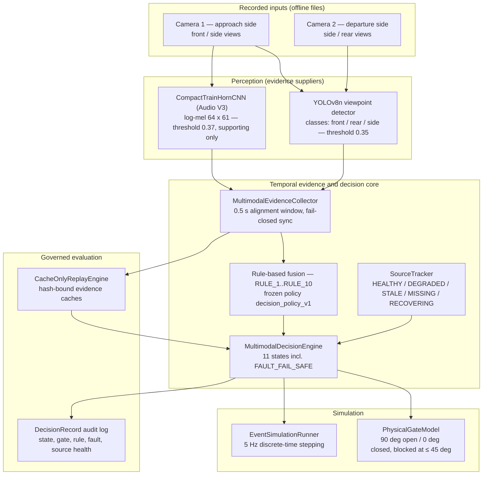

# Train Gate Automation: A Multimodal, Temporal, Safety-Oriented Railway-Crossing Decision Architecture

[](https://www.python.org/downloads/)
[]()
[]()
[]()

> [!CAUTION]
> **Academic research prototype — not a safety system.**
> This repository contains research software for studying a multimodal, state-aware
> *simulated* decision architecture for railway level crossings. It is **not** certified
> railway signalling, interlocking, or vital safety software, and it must **never** be
> connected to live railway infrastructure, relays, or physical barrier actuators.
> All gate behaviour in this project is simulated. Nothing in this repository establishes
> physical fail-safe operation, safety improvement, or deployment readiness.

---

## 1. Research Overview

Level crossings in Bangladesh depend on human operators who must recognise an approaching
train, close the gate in time, confirm the train has fully passed, and reopen the gate.
Documented vulnerabilities include human error and delayed reaction, poor visibility
(rain, fog, night, occlusion), camera detection failure, long trains, and false or missed
detections.

This project investigates whether a **predefined, two-camera, audio-assisted, temporal
state policy** produces different event-level crossing outcomes than simpler perception
pipelines. The research object is the **decision architecture** — how evidence from
multiple sensors is collected over time and converted into conservative simulated gate
decisions — not the individual detectors, which are evidence suppliers.

The architecture is organised around the three operationally distinct phases of a train
passage:

1. **Approach** — evidence supporting simulated gate closure.
2. **Occupancy / passing** — evidence supporting retaining the simulated closed state.
3. **Departure** — positive departure and clearance evidence required before simulated
   reopening. The simulated gate must never reopen merely because detections stop:
   *loss of detection is not proof of departure.*

## 2. Research Questions

**Primary question** (authoritative version, `docs/archive/RESEARCH_PROTOCOL_V2.md`, 2026-08-13):

> On synchronized, event-labeled recordings from held-out crossings, does a predefined
> two-camera, audio-assisted, temporal state policy **change** event-level missed-train
> and premature-opening outcomes relative to fair single-camera and vision-only baselines?

The word **"change"** is intentional. Improvement may not occur; the direction and
uncertainty of any effect must be determined experimentally and reported from data.

**Secondary questions:** the benefit of the second camera; the effect of horn evidence on
recall and warning lead time; temporal filtering versus independent per-frame decisions;
whether the state-aware policy prevents simulated premature opening relative to
non-state-aware fusion; variation across crossings and conditions; and viewpoint-label
ambiguity.

The founding design documents are `docs/archive/RESEARCH_CONCEPT.md` (2026-08-10) and
`docs/archive/RESEARCH_PROTOCOL_V2.md` (2026-08-13). A full reconstruction of the original
research target, methodology, and blockers is in
[`docs/generated/research_recovery/`](docs/generated/research_recovery/ORIGINAL_RESEARCH_TARGET_AND_BLOCKER_REPORT.md).

## 3. System Architecture

Two perception models produce evidence independently and in parallel. A temporal
collector time-aligns their outputs into multimodal frames. A deterministic, rule-based
decision engine evaluates each frame against a frozen policy and an 11-state machine,
tracking per-source sensor health, and emits an auditable decision record for every tick.
A simulated gate model converts decisions into gate motion. There is **no learned fusion,
no weighted evidence formula, and no conditional cascade** in this architecture — fusion
is transparent, predeclared rules over normalised evidence records.



### Components

| Component | Location | Role |
|---|---|---|
| YOLOv8n viewpoint detector | `src/railway_detection/vision/yolo_adapter.py` | Detects trains by viewpoint class (`front`, `rear`, `side`). Viewpoint is functional: front = approach evidence, side = occupancy evidence, rear = departure confirmation. |
| CompactTrainHornCNN | `src/railway_detection/audio/model.py` | Binary train-horn classifier over 64-band log-mel features (16 kHz mono, 1.0 s window, 0.5 s hop). The loader refuses any caller threshold other than the frozen checkpoint threshold (0.37). |
| Audio evidence pipeline | `src/railway_detection/audio/pipeline.py` | Converts audio windows to evidence records tagged `supporting_only`; a missing file yields an explicit unavailable record, never silent evidence. |
| Temporal evidence processing | `src/railway_detection/vision/temporal.py` | Multi-frame confirmation and evidence persistence for the vision stream (emits evidence only; never decides). |
| MultimodalEvidenceCollector | `src/railway_detection/fusion/collector.py` | Time-aligns vision and audio evidence into `MultimodalFrame`s (0.5 s tolerance). Fail-closed: an unregistered source raises rather than silently defaulting; duplicate and out-of-order observations are rejected and logged. |
| Rule-based fusion | `src/railway_detection/fusion/rules.py` | Per-tick boolean evidence qualification (approach / departure / audio presence) under frozen thresholds. |
| SourceTracker | `src/railway_detection/fusion/source_tracker.py` | Per-source health: HEALTHY, DEGRADED, STALE (> 2.0 s), MISSING, RECOVERING (2 confirmation frames). An available source with zero detections is healthy negative evidence, not a failure. |
| MultimodalDecisionEngine | `src/railway_detection/fusion/decision_engine.py` | The 11-state decision machine (below). Emits a `DecisionRecord` per tick. |
| PhysicalGateModel | `src/railway_detection/simulation/gate_model.py` | Simulated barrier: 90° open, 0° closed, passage blocked at ≤ 45°. |
| EventSimulationRunner | `src/railway_detection/simulation/runner.py` | Steps the decision engine and gate model over recorded evidence at 5 Hz. |
| FailureInjector | `src/railway_detection/simulation/failure_injector.py` | Fault injection for robustness experiments: camera/audio dropout, stale timestamps, out-of-order frames, false detections, dropped frames. |
| CacheOnlyReplayEngine | `src/railway_detection/evaluation/cache_only_engine.py` | Governed decision replay over hash-bound JSONL evidence caches (no raw-media access). Its execution is gated — see §7. |
| Evaluation and audit records | `src/railway_detection/evaluation/`, `docs/generated/` | Metric computation, experiment manifests, and the mission evidence packages that record what was actually executed. |

## 4. Decision Policy

**States (11):** `IDLE, TRAIN_APPROACHING, WARNING, GATE_CLOSING, TRAIN_PRESENT,
CROSSING_OCCUPIED, TRAIN_DEPARTING, REAR_CONFIRMED, CROSSING_CLEAR, GATE_OPENING,
FAULT_FAIL_SAFE`. Gate state is tracked separately: `OPEN, CLOSING, CLOSED, OPENING`.

**Asymmetric authority** (founding Decision D-004, `docs/RESEARCH_DECISIONS.md`):

- **Closing is aggressive toward safety.** Qualified approach evidence (2 consecutive
  frames at ≥ 0.35) moves the system toward closure (RULE_1).
- **Opening is conservative and positive-evidence-based.** Reopening requires a confirmed
  rear/departure observation (`REAR_CONFIRMED`, RULE_3) plus a 3.0 s clearance dwell with
  no approach or audio evidence. Absence of detections never authorises opening.
- **Audio is supporting evidence only** (RULE_2; Protocol V2 §13). Horn evidence may
  support closure and resets the clearance clock, but audio can never independently
  authorise simulated opening, and — until a validation-based policy decision justifies
  otherwise — does not independently trigger closure either.
- **Fault handling is conservative.** Loss of all vision sources, or staleness of the
  departure source during clearance, clamps the system to `FAULT_FAIL_SAFE` with the gate
  closed (RULE_4 / RULE_5). Degraded departure evidence holds the gate closed (RULE_6).
  A new train interrupts reopening (RULE_7). Recovery from a fault requires 2 clean
  confirmation frames and never recovers directly to open if a train was present or
  approaching before the fault (RULE_9).

**Decision policy evolution (`V1` -> `V2 Candidate` -> `V3 Four-Layer Causal FSM`):**

- `configs/decision_policy_v1.yaml` + `configs/frozen_experiment_v1.yaml` remain the
  byte-identical **frozen baseline** policy (`vision 0.35`, `audio 0.37`, `confirm 2 frames`,
  `clearance dwell 3.0 s`, `staleness 2.0 s`), preserved alongside `V1` (`fusion/rules.py`).
- `configs/decision_policy_v2_candidate.yaml` (`fusion/rules_v2_candidate.py`) resolved V1's
  `side`/`train` departure label overlap but still allowed disappearance-based reopening.
- **`V3 Four-Layer Causal Multimodal FSM` ([`decision_engine_v3_four_layer.py`](src/railway_detection/fusion/decision_engine_v3_four_layer.py), [`rules_v3_four_layer.py`](src/railway_detection/fusion/rules_v3_four_layer.py), [`occupancy.py`](src/railway_detection/fusion/occupancy.py)):**
  Active exploratory research architecture adding causal snapshot alignment without stale
  backfill (`allow_stale_detection_backfill=False`), orthogonal container display-rotation
  normalization (`vision/video.py`), Layer 2 lateral `SideMovementTracker`, strictly
  non-gating Layer 3 acoustic reinforcement, and `V3_CONSERVATIVE_POSITIVE` departure +
  `OccupancyState.CLEAR` AND-gate reopening. Official promotion remains fail-closed
  (`ready: false`) pending human Stage-2.1 ground-truth records.

**Model weights register** (frozen checkpoints live under `experiments/`; `*.pt` files are
not tracked in Git — see §8):

| Asset | Path | SHA-256 | Policy |
|---|---|---|---|
| YOLOv8n viewpoint detector | `experiments/vision/39f402dfe460/checkpoints/weights/best.pt` | `3f5bb5b23f82f5d963d23dc8f3f1896a83532424d8e4ef70a406b6abfba18ebd` | Frozen (threshold 0.35) |
| Audio V3 CNN | `experiments/audio/RUN_20261008_AUDIO_V3_ESC50/checkpoints/best.pt` | `ea1bb81d74230af71ba22b6d534a2ac550bca05833d1532e223376926c512782` | Frozen (threshold 0.3700) |
| Legacy Audio V2 | `models/audio/best_checkpoint.pt` | `59b0785f73b201dfd2fb335b98f6ddb764c8544d1ca5fc9e8aa326d74ffcf7d5` | **Prohibited from inference** (listed in the frozen config) |

## 5. Dataset

- **27 active physical events** (`23 train`, `3 no_train`, `1 engine`) from a **single site**
  (`crossing_A`, Bangladesh) across **two physical recording sessions**: Session 1
  (`2026-09-14`, daytime, `train_events/001..020`, `iPhone 15 Pro Max` back camera) and
  Session 2 (`2026-10-04`, dusk/night, `train_events/021..023` [`night_video_lowlight`] +
  `3/3 no_train_events` + `1/1 engine_events`, `iPad 10th gen` back camera) + `1` excluded
  duplicate; `54` active `.mov` camera references.
- **Session/hardware confounding & AI proposal bug (`7/27` mismatches):** `batch_multimodal_annotator`
  hardcoded `session_id = "session_20260914_morning"` on all `27/27` proposals and `lighting = "day"`
  on night clips `021..023`. Because `100%` of controls are dusk/night Session 2 and only `1` crossing /
  `2` sessions exist, **no 3-way `train/val/test` partition of these `27` events is `leakage_safe = true`**
  ([`layer_b_split_audit_and_collection_plan.json`](results/dataset_audit/layer_b_split_audit_and_collection_plan.json)).
  Cross-site and cross-weather generalization is **not** supported (`"104 rainy images"` is `NOT FOUND`).
- **Vision V1 (`baler.v1i.yolov8`) & Audio V3 Leakage Remediation ([`vision_audio_leakage_audit.json`](results/dataset_audit/vision_audio_leakage_audit.json)):**
  - Verified corpus: `3,157` vision manifests (`1,315` unique source images, `3,267` boxes, `0` negative background images);
    `172` audio split clips (`86` horn segments from `57` stems + `86` ESC-50 negatives).
  - Active split [`705d388743ea`](data/splits/705d388743ea/split_summary.json) leaked `87.1%` (`411/472`) of `test`
    from Roboflow `train/` augmentations and split `27/29` (`93.1%`) 10-min timestamp sessions (`447/447` test imgs overlapping `train`);
    original [`audio/v3/dataset_split.json`](data/splits/audio/v3/dataset_split.json) leaked `5/57` positive YouTube stems (`28/86 = 32.56%`).
  - Non-destructive clean candidate splits under [`data/splits/vision_v1_session_grouped/`](data/splits/vision_v1_session_grouped/split_summary.json)
    (`0/29` crossing sessions `<=600 s`, `804` eval aug duplicates excluded) and [`data/splits/audio_v3_stem_grouped/`](data/splits/audio_v3_stem_grouped/split_summary.json)
    (`0/57` cross-split stems, `60/13/13` balanced) are ready for post-authorization retraining.
- **Annotations are researcher-adopted AI-assisted references (`7.0.0`) — `0` Stage-2.1 human records exist.**
  No frame-level bounding boxes or audio window onset timestamps exist in the field video corpus.
- Historical caution: the legacy Phase-11 event inventory is flagged `INVALID_FABRICATED_APPROVAL`.

## 6. Exploratory Experimental Status (`Exp A` – `Exp R`, `2026-11-14`)

*(All real-video metrics remain **exploratory** on frozen `pre-db40305` caches evaluated against adopted references; official Phase 12 replay remains fail-closed pending human governance gates in [`PI_HUMAN_APPROVAL_PACKAGE.md`](docs/generated/PI_HUMAN_APPROVAL_PACKAGE.md).)*

| Suite / Experiment | Key Verified Finding & Location |
|---|---|
| **Perception Cache Extraction (Mission 43)** | `B0_front` (`6,613` records), `B0_back` (`6,479`), `B1_audio` (`2,600` total windows across `27` events: `2,470` `audio23` + `116` `no_train` + `14` `engine`), `audio23` max-window `@0.37`: Recall `92.31%`, Precision `54.55%`, Specificity `0.00%`, F1 `0.6857`, ROC-AUC `0.6846`, AP `0.7739`. |
| **`Exp A–N` V3 Four-Layer Suite** ([`final_research_v2/`](docs/generated/final_research_v2/EXPERIMENTAL_RESULTS.md)) | `23` SHA-256 bit-identical artifacts under [`results/exploratory_v2/`](results/exploratory_v2/MASTER_V2_SUMMARY.json). V3 eliminates `no_train` false closures (`0/3` vs `3/3` stateless union, McNemar `p=0.25`) and `sync11` premature openings (`0/11` vs `4/11` V2, McNemar `p=0.125`); `18/18` fault scenarios pass with `0` unsafe openings and `100%` legal transitions. `pre-db40305` approach trigger rate is `10/23` (`43.48%`, 95% CI `[0.2563, 0.6319]`) due to `-90°` `.mov` rotation and causal filtering. |
| **`Exp O` Audio Hysteresis & Calibration** ([`exp_o`](results/exploratory_v2/optimization_and_stress/exp_o_audio_calibration_hysteresis.json)) | `no_train` road horns persist `3–9` windows `>=0.37` (`max 0.826`) but `1` window `>=0.75`. `(tau=0.75, k=2)` suppresses `3/3` `no_train` FPs and lifts specificity `0.00 -> 0.90`, `Prec 0.8889`, `F1 0.7273` (`Rec 0.6154`); `T=3.0` temperature scaling lowers ECE `0.2955 -> 0.0709`. |
| **`Exp P` CPU Edge & Duty Cycle** ([`exp_p`](results/exploratory_v2/optimization_and_stress/exp_p_cpu_edge_benchmark.json)) | Apple M1 CPU (`SYNTHETIC_ONLY`; `physical_raspberry_pi_tested = false`): optimizer stripping shrinks Vision `best.pt` `-74.91%` (`24.49 -> 6.15 MB` FP16); `416px` E2E `YOLO.predict` speeds up `2.06×` (`44.56 -> 21.60 ms`, `46.30 FPS`); Audio `log_mel + CNN TS` takes `0.878 ms`; `V3 FSM` takes `0.0381 ms/tick`; event-triggered wakeup reduces daily vision frames `-96.56% to -98.64%`. |
| **`Exp Q` Weather × Dropout Stress** ([`exp_q`](results/exploratory_v2/optimization_and_stress/exp_q_weather_and_interlocking_stress.json)) | Across `100` synthetic attenuation × burst-drop runs: `0` unsafe openings, `100%` legal transitions, safe obstacle hold (`reopen @ 22.6 s`), and multi-train reopen interrupt (`14.8 s`). Identifies a healthy-empty-frame optical cliff at `alpha=0.35` (`conf=0.308 < 0.35` -> `0%` closure without staleness). |
| **`Exp R` LOEO CV & Optical Wakeup** ([`exp_r`](results/exploratory_v2/optimization_and_stress/exp_r_crossval_and_failsafe.json), [`independent_val`](results/exploratory_v2/optimization_and_stress/exp_r_independent_validation.json), [`fig15`](docs/generated/figures/fig15_exp_r_loeo_and_optical_wakeup.png)) | 23-fold nested LOEO CV on Batch-4 audio reaches OOF `Spec = 0.6000` (`[0.3000, 0.9000]` vs `0.0000` baseline) at lower `F1 = 0.6400` (`[0.4167, 0.8148]` vs `0.6857`) and `Recall = 0.6154` (vs `0.9231`), `Brier 0.2724 -> 0.2366` (Δ `95% CI [-0.0839, +0.0104]` crosses `0`), `ECE 0.2955 -> 0.0999` (`tau=0.75, k=2` in `20/23` folds; independent audit `exact_match_within_published_4dp=true`, `no_train` tiebreak removal invariant on OOF metrics). `SYNTHETIC_ONLY` opt-in `RULE_L3_OPTICAL_DEGRADED_AUDIO_WAKEUP` (`enable_optical_degradation_audio_wakeup=False` default) closes the `alpha=0.35` cliff (`0% -> 100%` @ `4.0 s`) with `0` unsafe opens and `0/2` false-alarm controls. |
| **Standalone Edge Scaling Benchmark** ([`host_edge_scaling_benchmark.json`](results/exploratory_v2/optimization_and_stress/host_edge_scaling_benchmark.json), [`runbook`](docs/generated/RASPBERRY_PI_DEPLOYMENT_RUNBOOK.md)) | `scripts/rpi_edge_benchmark.py` (`v1.1` + `pi_telemetry.py`): TorchScript (`max_abs_diff=0.0`) + FP16 stripped bundle (`6.15 MB`) across `1/2/4` CPU threads (`416px: 28.025/20.921/16.839 ms`; `320px: 17.150/13.537/11.523 ms`; `4T Audio TS: 0.384 ms`; `log_mel: 0.405 ms`; OpenCV `1080p->Rotate90->416px: 16.980 ms`; `RSS: 452.45 MB`; `physical_raspberry_pi_tested = false`). |

See [`results/publication_tables/PUBLICATION_TABLES.md`](results/publication_tables/PUBLICATION_TABLES.md), [`docs/generated/EXPERIMENT_RESULTS.md`](docs/generated/EXPERIMENT_RESULTS.md), and [`docs/generated/IEEE_MANUSCRIPT_TRAIN_GATE_AUTOMATION.md`](docs/generated/IEEE_MANUSCRIPT_TRAIN_GATE_AUTOMATION.md).

## 7. Governance Status, Limitations and Blockers

- **Technical Blockers Eliminated (`dependency_lock: PASS`, `FAIL: 0`):** Synchronized `requirements.lock` (all `50` pinned packages match), synchronized `MISSION_26_CATALOG_BINDING.json`, extracted `config/constants.py`, replaced brittle process-order isolation tests via [`_isolation_audit.py`](src/railway_detection/synthetic/_isolation_audit.py), isolated `scripts/run_synthetic_tests.py` `--confcutdir` batching (`3,286` passed, `0` failed), fixed the `_Guard._safe_is_dir` `ENAMETOOLONG` subprocess crash in [`access_guard_plugin.py`](src/railway_detection/safety/access_guard_plugin.py) with [`UNKNOWN_TESTS_FORENSIC_AUDIT.md`](docs/generated/UNKNOWN_TESTS_FORENSIC_AUDIT.md) (`9/9` `UNKNOWN` passing `133/133`), guarded non-media metadata utilities ([`check_zero_blocker_readiness.py`](scripts/check_zero_blocker_readiness.py)), and validated all `3,889 / 3,889` full-suite pytest cases (`0` failed).
- **Academic Professor Research Handover & Research Owner Governance ([`FINAL_PROFESSOR_RESEARCH_HANDOVER.md`](docs/generated/FINAL_PROFESSOR_RESEARCH_HANDOVER.md), [`professor_research_handover/`](docs/generated/professor_research_handover/README_HANDOVER_INDEX.md), [`RESEARCH_OWNER_FINAL_ACTION_DASHBOARD.md`](docs/generated/RESEARCH_OWNER_FINAL_ACTION_DASHBOARD.md), [`PI_APPROVAL_EXECUTION_GUIDE.md`](docs/generated/approval_packages/PI_APPROVAL_EXECUTION_GUIDE.md), `evaluation status` -> `ready: false`, `5` logical blockers / `7` instances):** Primary governance belongs to **Research Owner (`raihankabirrahu@gmail.com`)** (`6` recorded decisions/adoptions on disk; `professor_technical_signoff_required = false`), while [`elaf85777@gmail.com`](data/ground_truth/authorized_reviewers.json) serves as separate **Independent Second Reviewer (`RD-043`)**; the Professor receives the verified academic package under [`FINAL_PROFESSOR_RESEARCH_HANDOVER.md`](docs/generated/FINAL_PROFESSOR_RESEARCH_HANDOVER.md) + `51`-artifact [`HANDOVER_EVIDENCE_MANIFEST.json`](docs/generated/professor_research_handover/HANDOVER_EVIDENCE_MANIFEST.json). `12` schema-validated unsigned templates under `docs/generated/approval_packages/` + fail-closed CLI [`prepare_and_execute_official_evaluation.py`](scripts/prepare_and_execute_official_evaluation.py) are ready. Per [`layer_b_split_audit_and_collection_plan.json`](results/dataset_audit/layer_b_split_audit_and_collection_plan.json) (`v1.3`), `12/12` Option A descriptive cross-checks pass (`0` discrepancies), `0/11` `sync11` clips have rear detections (`4` L1 closures, `5` EOF `RULE_4_FAIL_SAFE_CLAMP`, `2` `IDLE`; `43.203 s` max back gap; `median 1.402 s` post-`T4` tail; `0/22` premature `M3` vs `4/22` `M2`; `23.84%` 95% upper bound), and no 3-way split of the `27` single-crossing events can be `leakage_safe = true` — keep **Option A** (`SPLIT-DECISION-OPTION-A-2026-11-09` + owner `Stage-2.1` + `AUTH-DESCRIPTIVE-EVAL-EXEC`) for existing data or collect **Option C** (`98 + 43 + 94 = 235` primary cluster-adjusted events across `>= 5` crossings / `13` sessions; `207` unclustered; `271` across `14` sessions for `81.59%` McNemar power at `p_10=0.20`). Remaining pending gates: `AUTH-MEDIA-ACCESS.json` absent (owner sign-off), `STAGE21_RECORDS_MISSING` + `COHORT_APPROVAL_MISSING` (human review + `RD-043` second review), `EVENT_SPLIT_DECISION_MISSING` (held by Option A), `MANIFEST_MISSING`, and `EVAL_AUTH_NOT_GRANTED`.
- **Reproducibility CLI (`audit reproducibility`):** `PASS: 8, FAIL: 0, UNRESOLVED: 3 [human ground-truth/split/decisions], NOT_AVAILABLE: 2 [official Phase 12]`.
- **Prototype Hardware & Timing Gaps:** `0/27` physical side cameras, `0/27` physical occupancy sensors, `0/27` `last_carriage` boxes, `pre-db40305` unrotated caches on `-90°` `.mov` streams, close-range camera placement (`T2` median `~3.6 s` vs `7.6 s` baseline closure budget needing `84–211 m` upstream siting), and unmeasured physical Raspberry Pi hardware (`physical_raspberry_pi_tested = false`).
- **Discrete Simulation Stepping Note:** `EventSimulationRunner` steps `PhysicalGateModel` at the issuing tick `t` (Convention A, `-0.20 s` vs strict post-tick Convention B).
- **Simulated Hardware Boundary:** Research simulation software only — never connect to live railway signaling or physical relays.

## 8. Repository Structure

```text
Train_automation/
├── README.md                  # This document
├── PROJECT_STRUCTURE.md       # Repository map and research documentation index
├── pyproject.toml             # Package build, dependencies, tool configuration
├── requirements.lock          # Pinned dependency lockfile
├── configs/                   # Frozen experiment + policy configs (see §4); two legacy
│                              #   Phase-0 placeholder schemas are marked SUPERSEDED in-file
├── src/railway_detection/     # Core Python package (see PROJECT_STRUCTURE.md)
├── tests/                     # Guarded test programme (unit, integration, synthetic)
├── scripts/                   # Project utility and audit scripts
├── data/                      # Manifests, governance records, ground-truth proposals,
│                              #   splits and metadata. Raw Layer B media is local-only
│                              #   (git-ignored); derived caches are versioned.
├── experiments/               # Training runs, checkpoints (weights git-ignored),
│                              #   descriptors and evaluation outputs
├── models/                    # Local model assets (weights git-ignored; the Audio V2
│                              #   checkpoint here is prohibited from inference)
├── results/                   # Experiment outputs, figures, benchmark summaries
├── research/                  # Manuscript figures, templates and figure registry
├── reports/                   # Progress reports
├── schemas/                   # Data schemas
├── docs/                      # Protocols, hazard model, decisions, audits
│   ├── archive/               # Founding documents (concept, Protocol V2, plans)
│   └── generated/             # Complete audits, V3 reports (`final_research_v2/`),
│                              #   IEEE manuscript, PI approval package, safety reports,
│                              #   figures (`fig11`–`fig15`), `master_reaudit/`
├── outputs/                   # Local runtime outputs (git-ignored)
└── scratch/                   # Researcher local workspace (git-ignored, not published)
```

Local-only by design (see `.gitignore`): original recordings (`data/raw/layer_b/`,
`Unseen_Video/`), the ESC-50 corpus (`ESC-50-master/`), model weights (`*.pt`),
`scratch/`, virtual environments, and tool caches. Everything needed to audit the
research — protocols, manifests, hashes, evidence packages, decision records — is
versioned.

## 9. Installation and Environment

Verified from `pyproject.toml`: **Python ≥ 3.11** (local validation environment:
Python 3.11.15 on macOS `arm64`), setuptools src-layout package `railway-detection`.

```bash
git clone https://github.com/mohammad-sayem-uddin/ai-railway-crossing-safety.git
cd ai-railway-crossing-safety
python3.11 -m venv venv
source venv/bin/activate
python -m pip install --upgrade pip setuptools wheel
python -m pip install -e ".[dev]"
# Optional, for identical dependency pinning:
python -m pip install -r requirements.lock
```

Declared dependencies — core: `numpy`, `PyYAML`, `Pillow`, `torch`, `torchvision`,
`ultralytics`, `opencv-python`; optional `pts`: `av` (PyAV, for source-PTS video
handling); `dev`: `pytest`, `ruff`, `mypy`, `types-PyYAML`; `eval`: `matplotlib`,
`scipy`. Console entry points: `railway-detection`, `railway-readiness`.

Local configuration: copy `.env.example` to `.env` (never commit `.env`). Variables:
`GEMINI_API_KEY` / `GEMINI_MODEL` (optional, offline annotation-drafting assistance only),
`LOG_LEVEL`, `PYTHONUNBUFFERED`.

## 10. Reproducibility

- **Frozen configuration:** `configs/frozen_experiment_v1.yaml` pins checkpoint paths and
  SHA-256 digests, thresholds, and timing parameters; `configs/decision_policy_v1.yaml`
  is the frozen V1 policy. The package version is `0.1.0`.
- **Reproducible Experiment Runners (`exp/four-layer-completion`):**
  - Exploratory V3 suite (`Exp A–N`, `23` SHA-256 bit-identical artifacts): `PYTHONPATH=src:scripts .venv/bin/python scripts/run_v2_experiments.py`
  - Leakage audit & session/stem-grouped candidate splits: `PYTHONPATH=src .venv/bin/python scripts/run_leakage_and_split_audit.py`
  - Acoustic hysteresis, cross-validation, CPU edge profiling & stress (`Exp O–R`): `PYTHONPATH=src:. .venv/bin/python scripts/run_optimization_and_robustness_suite.py`
  - Standalone TorchScript/FP16 & CPU thread-scaling benchmark (`host_edge_scaling_benchmark.json`): `PYTHONPATH=src:. .venv/bin/python scripts/rpi_edge_benchmark.py`
  - Zero-blocker technical vs human-gate check: `PYTHONPATH=src:. .venv/bin/python scripts/check_zero_blocker_readiness.py`
  - Master CSV/Markdown tables (`results/publication_tables/`): `PYTHONPATH=src:. .venv/bin/python scripts/generate_master_publication_tables.py`
  - Event-split leakage audit & `>= 3`-crossing collection plan (`layer_b_split_audit_and_collection_plan.json`): `PYTHONPATH=src:. .venv/bin/python scripts/audit_event_splits.py`
  - Post-approval official handoff preflight (`preflight-check` / `--mode execute-option-a-descriptive` / fail-closed `execute-after-approval`): `PYTHONPATH=src:. .venv/bin/python scripts/prepare_and_execute_official_evaluation.py --mode preflight-check`
  - Governance & audit CLIs: `.venv/bin/python -m railway_detection.cli.main evaluation status` and `audit reproducibility`
- **Tests:** The guarded test programme (`181` files classified via `scripts/classify_test_access.py`) validates software contracts, leak-free split invariants, reproducibility fail-closed governance, and V3/Exp R/Pi-telemetry/PI-approval/handoff invariants (`scripts/run_synthetic_tests.py`: `145` safe files, `3,286 passed, 0 failed, 0 skipped, 0 violations`; [`UNKNOWN_TESTS_FORENSIC_AUDIT.md`](docs/generated/UNKNOWN_TESTS_FORENSIC_AUDIT.md) audits all `9` OS/CLI/native spawner files passing `133/133` with `0` blocked reads). Full suite discovery uses `--import-mode=importlib` (`PYTHONPATH=src:. .venv/bin/python -m pytest tests/ --import-mode=importlib`: `3,889 passed, 0 failed`, while [`test_exploratory_subset_authorization_gate.py`](tests/unit/test_exploratory_subset_authorization_gate.py#L69) verifies fail-closed `[AUTH_MEDIA_ACCESS_NOT_GRANTED]` enforcement until `AUTH-MEDIA-ACCESS.json` is recorded); full details appear in [`docs/generated/FINAL_INDEPENDENT_REVIEW.md`](docs/generated/FINAL_INDEPENDENT_REVIEW.md), [`docs/generated/MISSION_3_FINAL_GOVERNANCE_REPORT.md`](docs/generated/MISSION_3_FINAL_GOVERNANCE_REPORT.md), and [`docs/generated/FINAL_PI_ACTION_REQUIRED.md`](docs/generated/FINAL_PI_ACTION_REQUIRED.md).
  **Tests are not experiments:** synthetic-fixture results carry no weight about
  real-data performance.
- **Permitted experiments:** Only executions authorised by a recorded researcher
  decision and admitted by the repository's governance gates. Do not bypass the gates;
  a refused execution is a research record, not an obstacle to route around.

## 11. Research Integrity

- Original media and annotations are preserved unmodified; historical reports remain
  auditable even where their claims were later corrected (corrections are appended,
  never silently rewritten).
- **Model predictions are not ground truth.** Inference is not decision-level validation.
  Synthetic tests are not original-data experiments.
- The simulated safety policy is a research instrument: conservative simulated closure
  is a policy response, **not** physical safety certification.
- Claims discipline: results are reported as **change** relative to named baselines,
  with nulls kept distinct from zeros, per Protocol V2.

## 12. Citation and Contact

```bibtex
@misc{uddin2026multimodalrailway,
  author       = {Mohammad Sayem Uddin and Raihan Kabir Rahu},
  title        = {Multimodal Railway Level-Crossing Safety Research Framework: Perception, Feasibility, and Kinematic Simulation in Rural Bangladesh},
  year         = {2026},
  publisher    = {GitHub},
  howpublished = {\url{https://github.com/mohammad-sayem-uddin/ai-railway-crossing-safety}}
}
```

- **Authorship:** restricted to the named human researchers (COPE guidance; project
  direction RD-054). AI systems are not credited with academic authorship.
- **AI assistance disclosure:** generative AI assistants (including Google Gemini and
  Anthropic Claude) were used as offline tools for code auditing, documentation,
  test-fixture generation, and protocol errata identification. Scientific conclusions
  and governance determinations were verified and approved by the human researchers.
- **Third-party components:** YOLOv8 by Ultralytics (AGPL-3.0). Acoustic background
  samples from the ESC-50 dataset by Karol J. Piczak (CC BY-NC 3.0).
- **Licence:** proprietary research prototype (see `pyproject.toml`).

---

*README updated 2026-11-19 (`exp/four-layer-completion`) to reflect Mission 7 completion: Research Owner governance alignment (`raihankabirrahu@gmail.com` primary owner, `elaf85777@gmail.com` independent `RD-043` second reviewer, `professor_technical_signoff_required = false`), [`layer_b_split_audit_and_collection_plan.json`](results/dataset_audit/layer_b_split_audit_and_collection_plan.json) (`v1.3`) with `6` recorded owner authorizations & `12/12` Option A cross-artifact verification checks (`0` discrepancies), [`FINAL_PROFESSOR_RESEARCH_HANDOVER.md`](docs/generated/FINAL_PROFESSOR_RESEARCH_HANDOVER.md) + indexed package [`docs/generated/professor_research_handover/`](docs/generated/professor_research_handover/README_HANDOVER_INDEX.md) (`51` SHA-256-verified artifacts), repaired Option A `verify_promotion_receipt` handoff check in `official_handoff.py`, synchronized `MISSION_26_CATALOG_BINDING.json`, and updated `D-10` decision logs.*
