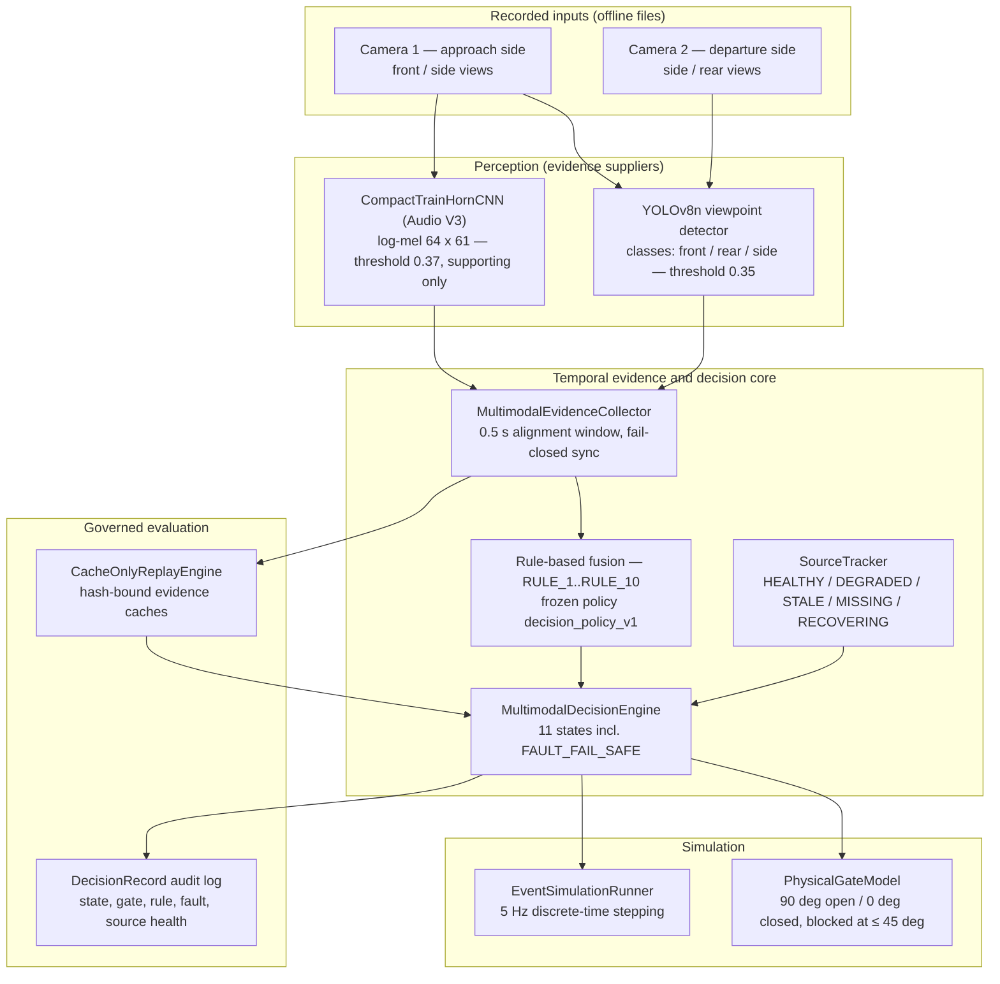

# Train Gate Automation: A Multimodal, Temporal, Safety-Oriented Railway-Crossing Decision Architecture

[](https://www.python.org/downloads/)
[]()
[]()

> [!CAUTION]
> **Academic research prototype — not a safety system.**
> This repository contains research software for studying a multimodal, state-aware
> *simulated* decision architecture for railway level crossings. It is **not** certified
> railway signalling, interlocking, or vital safety software, and it must **never** be
> connected to live railway infrastructure, relays, or physical barrier actuators.
> All gate behaviour in this project is simulated. Nothing in this repository establishes
> physical fail-safe operation, safety improvement, or deployment readiness.

---

## 1. Research Overview

Level crossings in Bangladesh depend on human operators who must recognise an approaching
train, close the gate in time, confirm the train has fully passed, and reopen the gate.
Documented vulnerabilities include human error and delayed reaction, poor visibility
(rain, fog, night, occlusion), camera detection failure, long trains, and false or missed
detections.

This project investigates whether a **predefined, two-camera, audio-assisted, temporal
state policy** produces different event-level crossing outcomes than simpler perception
pipelines. The research object is the **decision architecture** — how evidence from
multiple sensors is collected over time and converted into conservative simulated gate
decisions — not the individual detectors, which are evidence suppliers.

The architecture is organised around the three operationally distinct phases of a train
passage:

1. **Approach** — evidence supporting simulated gate closure.
2. **Occupancy / passing** — evidence supporting retaining the simulated closed state.
3. **Departure** — positive departure and clearance evidence required before simulated
   reopening. The simulated gate must never reopen merely because detections stop:
   *loss of detection is not proof of departure.*

## 2. Research Questions

**Primary question** (authoritative version, `docs/archive/RESEARCH_PROTOCOL_V2.md`, 2026-08-13):

> On synchronized, event-labeled recordings from held-out crossings, does a predefined
> two-camera, audio-assisted, temporal state policy **change** event-level missed-train
> and premature-opening outcomes relative to fair single-camera and vision-only baselines?

The word **"change"** is intentional. Improvement may not occur; the direction and
uncertainty of any effect must be determined experimentally and reported from data.

**Secondary questions:** the benefit of the second camera; the effect of horn evidence on
recall and warning lead time; temporal filtering versus independent per-frame decisions;
whether the state-aware policy prevents simulated premature opening relative to
non-state-aware fusion; variation across crossings and conditions; and viewpoint-label
ambiguity.

The founding design documents are `docs/archive/RESEARCH_CONCEPT.md` (2026-08-10) and
`docs/archive/RESEARCH_PROTOCOL_V2.md` (2026-08-13). A full reconstruction of the original
research target, methodology, and blockers is in
[`docs/generated/research_recovery/`](docs/generated/research_recovery/ORIGINAL_RESEARCH_TARGET_AND_BLOCKER_REPORT.md).

## 3. System Architecture

Two perception models produce evidence independently and in parallel. A temporal
collector time-aligns their outputs into multimodal frames. A deterministic, rule-based
decision engine evaluates each frame against a frozen policy and an 11-state machine,
tracking per-source sensor health, and emits an auditable decision record for every tick.
A simulated gate model converts decisions into gate motion. There is **no learned fusion,
no weighted evidence formula, and no conditional cascade** in this architecture — fusion
is transparent, predeclared rules over normalised evidence records.



### Components

| Component | Location | Role |
|---|---|---|
| YOLOv8n viewpoint detector | `src/railway_detection/vision/yolo_adapter.py` | Detects trains by viewpoint class (`front`, `rear`, `side`). Viewpoint is functional: front = approach evidence, side = occupancy evidence, rear = departure confirmation. |
| CompactTrainHornCNN | `src/railway_detection/audio/model.py` | Binary train-horn classifier over 64-band log-mel features (16 kHz mono, 1.0 s window, 0.5 s hop). The loader refuses any caller threshold other than the frozen checkpoint threshold (0.37). |
| Audio evidence pipeline | `src/railway_detection/audio/pipeline.py` | Converts audio windows to evidence records tagged `supporting_only`; a missing file yields an explicit unavailable record, never silent evidence. |
| Temporal evidence processing | `src/railway_detection/vision/temporal.py` | Multi-frame confirmation and evidence persistence for the vision stream (emits evidence only; never decides). |
| MultimodalEvidenceCollector | `src/railway_detection/fusion/collector.py` | Time-aligns vision and audio evidence into `MultimodalFrame`s (0.5 s tolerance). Fail-closed: an unregistered source raises rather than silently defaulting; duplicate and out-of-order observations are rejected and logged. |
| Rule-based fusion | `src/railway_detection/fusion/rules.py` | Per-tick boolean evidence qualification (approach / departure / audio presence) under frozen thresholds. |
| SourceTracker | `src/railway_detection/fusion/source_tracker.py` | Per-source health: HEALTHY, DEGRADED, STALE (> 2.0 s), MISSING, RECOVERING (2 confirmation frames). An available source with zero detections is healthy negative evidence, not a failure. |
| MultimodalDecisionEngine | `src/railway_detection/fusion/decision_engine.py` | The 11-state decision machine (below). Emits a `DecisionRecord` per tick. |
| PhysicalGateModel | `src/railway_detection/simulation/gate_model.py` | Simulated barrier: 90° open, 0° closed, passage blocked at ≤ 45°. |
| EventSimulationRunner | `src/railway_detection/simulation/runner.py` | Steps the decision engine and gate model over recorded evidence at 5 Hz. |
| FailureInjector | `src/railway_detection/simulation/failure_injector.py` | Fault injection for robustness experiments: camera/audio dropout, stale timestamps, out-of-order frames, false detections, dropped frames. |
| CacheOnlyReplayEngine | `src/railway_detection/evaluation/cache_only_engine.py` | Governed decision replay over hash-bound JSONL evidence caches (no raw-media access). Its execution is gated — see §7. |
| Evaluation and audit records | `src/railway_detection/evaluation/`, `docs/generated/` | Metric computation, experiment manifests, and the mission evidence packages that record what was actually executed. |

## 4. Decision Policy

**States (11):** `IDLE, TRAIN_APPROACHING, WARNING, GATE_CLOSING, TRAIN_PRESENT,
CROSSING_OCCUPIED, TRAIN_DEPARTING, REAR_CONFIRMED, CROSSING_CLEAR, GATE_OPENING,
FAULT_FAIL_SAFE`. Gate state is tracked separately: `OPEN, CLOSING, CLOSED, OPENING`.

**Asymmetric authority** (founding Decision D-004, `docs/RESEARCH_DECISIONS.md`):

- **Closing is aggressive toward safety.** Qualified approach evidence (2 consecutive
  frames at ≥ 0.35) moves the system toward closure (RULE_1).
- **Opening is conservative and positive-evidence-based.** Reopening requires a confirmed
  rear/departure observation (`REAR_CONFIRMED`, RULE_3) plus a 3.0 s clearance dwell with
  no approach or audio evidence. Absence of detections never authorises opening.
- **Audio is supporting evidence only** (RULE_2; Protocol V2 §13). Horn evidence may
  support closure and resets the clearance clock, but audio can never independently
  authorise simulated opening, and — until a validation-based policy decision justifies
  otherwise — does not independently trigger closure either.
- **Fault handling is conservative.** Loss of all vision sources, or staleness of the
  departure source during clearance, clamps the system to `FAULT_FAIL_SAFE` with the gate
  closed (RULE_4 / RULE_5). Degraded departure evidence holds the gate closed (RULE_6).
  A new train interrupts reopening (RULE_7). Recovery from a fault requires 2 clean
  confirmation frames and never recovers directly to open if a train was present or
  approaching before the fault (RULE_9).

**Frozen v1 vs v2 candidate — read this before citing the policy:**

- `configs/decision_policy_v1.yaml` + `configs/frozen_experiment_v1.yaml` are the
  **frozen, executed** policy and configuration (thresholds: vision 0.35, audio 0.37;
  confirm 2 frames; clearance dwell 3.0 s; staleness 2.0 s).
- `configs/decision_policy_v2_candidate.yaml` (+ `fusion/rules_v2_candidate.py`,
  `fusion/decision_engine_v2_candidate.py`) is a **research candidate only**:
  `CANDIDATE_UNDER_RESEARCH_REVIEW_NOT_AUTHORIZED_FOR_DEPLOYMENT`. It is not the default
  execution path and has **not** been adopted as canonical.
- **Known v1 defect:** in frozen v1, the approach and departure label sets overlap
  (`side` and `train` appear in both), so departure confirmation can in principle be
  satisfied without a genuine `rear` detection. This was documented in the project's own
  Phase 9 clearance-divergence analysis; the v2 candidate fixes it with unambiguous-label
  logic. Which policy is canonical is an open researcher decision (see §7).

**Model weights register** (frozen checkpoints live under `experiments/`; `*.pt` files are
not tracked in Git — see §8):

| Asset | Path | SHA-256 | Policy |
|---|---|---|---|
| YOLOv8n viewpoint detector | `experiments/vision/39f402dfe460/checkpoints/weights/best.pt` | `3f5bb5b23f82f5d963d23dc8f3f1896a83532424d8e4ef70a406b6abfba18ebd` | Frozen (threshold 0.35) |
| Audio V3 CNN | `experiments/audio/RUN_20261008_AUDIO_V3_ESC50/checkpoints/best.pt` | `ea1bb81d74230af71ba22b6d534a2ac550bca05833d1532e223376926c512782` | Frozen (threshold 0.3700) |
| Legacy Audio V2 | `models/audio/best_checkpoint.pt` | `59b0785f73b201dfd2fb335b98f6ddb764c8544d1ca5fc9e8aa326d74ffcf7d5` | **Prohibited from inference** (listed in the frozen config) |

## 5. Dataset

- **27 physical events** from a **single site** (`crossing_A`, rural Bangladesh):
  **23 train, 3 no-train, 1 engine-only**.
- **54 camera source references** (27 front + 27 back); all digests verified against the
  event inventory. **Two historical duplicate camera references are excluded.**
- Recordings are **daytime-only**. There is one site, so **no cross-site generalisation**
  claim is supported, and later protocols prohibit describing these recordings as
  "held-out crossings."
- Original recordings are **not published in this repository** (kept local; see §8) —
  manifests, hashes, and derived evidence are versioned instead.
- **Annotations are researcher-adopted AI-assisted references.** The researcher confirmed
  manual verification and adopted the AI-assisted annotations as the working reference
  (Mission 43 adoption record). They are **not** independently stored human observations,
  and **canonical ground-truth promotion (Stage 2.1) has not occurred**. The adopted
  content contains event-level labels and horn status, but **no frame-level bounding
  boxes, no audio window labels, and no horn offsets** — so detection-level metrics
  (image AP/mAP, window accuracy) are not computable from it.
- Historical caution: the legacy Phase-11 event inventory is flagged
  `INVALID_FABRICATED_APPROVAL` and must never be cited as ground truth.

## 6. Experimental Status (Mission 43, 2026-11-08)

Mission 43 executed **perception inference and input assembly** over the full cohort.
It did **not** execute decision replay.

| Experiment | Result |
|---|---|
| B0_front (vision, front sources) | 27 sources · 6,613 records · 329 predicted objects |
| B0_back (vision, back sources) | 27 sources · 6,479 records · 1,020 predicted objects |
| B1_audio (front embedded audio) | 27 sources · 2,600 windows · 445 positive (frozen threshold 0.37) |
| B2 input assembly | 27 events · 6,614 frames · 3,897 with paired audio evidence |
| **B2 decision replay** | **Not executed — 0 decision events, 0 decision frames** |

**Exploratory audio event-label comparison** (Mission 43; frozen max-window rule at 0.37
against the researcher-adopted horn labels, 23 train events: 13 horn-present,
10 horn-absent): TP 12, FP 10, FN 1, TN 0 — **precision 54.55%, recall 92.31%,
F1 0.6857, specificity 0%, accuracy 52.17%, ROC-AUC 0.6846, average precision 0.7739**.
This is exploratory agreement with adopted event labels — **not** independent-human-GT
performance and **not** window-level accuracy. Its plain reading is that the frozen audio
operating point fires on every horn-absent train event in this cohort.

**What Mission 43 does not establish:** any vision accuracy (no box reference exists),
any fusion or state-policy behaviour, premature-opening or missed-train decision
outcomes, fail-safe behaviour on real data, safety improvement, or generalisation.

Earlier development metrics exist for the perception models on a still-image (Layer A)
split (e.g., YOLO mAP@0.5 = 0.9946 on 487 test objects). Project audits have confirmed
that split carried frame-level leakage (`leakage_risk: true`), so those figures are
**development diagnostics only** and must not be cited as event-level performance.

## 7. Current Limitations and Blockers

- **Decision replay has never executed on original data.** The descriptive replay gate
  (`src/railway_detection/evaluation/descriptive_exec_gate.py`) refuses execution
  (`AUTH_DESCRIPTIVE_EVAL_EXEC_NOT_GRANTED`) because three governance records do not
  exist: `data/governance/AUTH-DESCRIPTIVE-EVAL-EXEC.json`, a genuine Stage 2.1 promotion
  receipt (`data/governance/stage21_promotion_receipt.json`), and the canonical
  protocol-choice record (`data/manifests/phase12_protocol_decision.json`). Three of the
  five required hash bindings are already computed and verified; the remaining records
  must be genuine researcher decisions — they cannot be manufactured by tooling.
- **`premature_opening_window` is undecided**, so the headline premature-opening metric
  (M4) currently has no operative definition for replay scoring. Historical M4/M5 values
  were **non-computable** (rear-camera clearance landmark unavailable), **not zero**.
- **Back/departure camera evidence is absent from the current B2 assembly** (front +
  audio only), so the rear-confirmation path cannot yet be exercised end-to-end.
- **Full-cohort dual-camera synchronisation is unresolved** (frozen config:
  `independent_or_unverified / R04_UNRESOLVED`). Dual-camera exploratory work is
  authorised only for an 11-event `CALIBRATION_SUPPORTED` subset.
- **v1 label-overlap defect** (see §4); the v2 fix is an unauthorised candidate.
- **Left-censoring:** 20 of 23 train recordings began after the train was already
  approaching, so physical warning lead time / minimum time reserve cannot be estimated
  from recording starts. The historical 3.6 s figure is an implementation-derived
  engineering parameter, not a railway standard.
- **Single site, daytime only** — no cross-site, night, or weather generalisation.
- **Physical gate actuation and deployment are outside the established research scope.**
  This is offline, simulation-based research software (package `__init__`: "research
  software only… must not be connected to live railway infrastructure").

## 8. Repository Structure

```text
Train_automation/
├── README.md                  # This document
├── PROJECT_STRUCTURE.md       # Repository map and research documentation index
├── pyproject.toml             # Package build, dependencies, tool configuration
├── requirements.lock          # Pinned dependency lockfile
├── configs/                   # Frozen experiment + policy configs (see §4); two legacy
│                              #   Phase-0 placeholder schemas are marked SUPERSEDED in-file
├── src/railway_detection/     # Core Python package (see PROJECT_STRUCTURE.md)
├── tests/                     # Guarded test programme (unit, integration, synthetic)
├── scripts/                   # Project utility and audit scripts
├── data/                      # Manifests, governance records, ground-truth proposals,
│                              #   splits and metadata. Raw Layer B media is local-only
│                              #   (git-ignored); derived caches are versioned.
├── experiments/               # Training runs, checkpoints (weights git-ignored),
│                              #   descriptors and evaluation outputs
├── models/                    # Local model assets (weights git-ignored; the Audio V2
│                              #   checkpoint here is prohibited from inference)
├── results/                   # Experiment outputs, figures, benchmark summaries
├── research/                  # Manuscript figures, templates and figure registry
├── reports/                   # Progress reports
├── schemas/                   # Data schemas
├── docs/                      # Protocols, hazard model, decisions, audits
│   ├── archive/               # Founding documents (concept, Protocol V2, plans)
│   └── generated/             # Mission evidence: master_reaudit/, research_results/,
│                              #   professor_evidence/ (Missions 42-44),
│                              #   research_recovery/, repository_maintenance/
├── outputs/                   # Local runtime outputs (git-ignored)
└── scratch/                   # Researcher local workspace (git-ignored, not published)
```

Local-only by design (see `.gitignore`): original recordings (`data/raw/layer_b/`,
`Unseen_Video/`), the ESC-50 corpus (`ESC-50-master/`), model weights (`*.pt`),
`scratch/`, virtual environments, and tool caches. Everything needed to audit the
research — protocols, manifests, hashes, evidence packages, decision records — is
versioned.

## 9. Installation and Environment

Verified from `pyproject.toml`: **Python ≥ 3.11** (local validation environment:
Python 3.11/3.12, macOS/Linux), setuptools src-layout package `railway-detection`.

```bash
git clone https://github.com/mohammad-sayem-uddin/ai-railway-crossing-safety.git
cd ai-railway-crossing-safety
python3.11 -m venv venv
source venv/bin/activate
python -m pip install --upgrade pip setuptools wheel
python -m pip install -e ".[dev]"
# Optional, for identical dependency pinning:
python -m pip install -r requirements.lock
```

Declared dependencies — core: `numpy`, `PyYAML`, `Pillow`, `torch`, `torchvision`,
`ultralytics`, `opencv-python`; optional `pts`: `av` (PyAV, for source-PTS video
handling); `dev`: `pytest`, `ruff`, `mypy`, `types-PyYAML`; `eval`: `matplotlib`,
`scipy`. Console entry points: `railway-detection`, `railway-readiness`.

Local configuration: copy `.env.example` to `.env` (never commit `.env`). Variables:
`GEMINI_API_KEY` / `GEMINI_MODEL` (optional, offline annotation-drafting assistance only),
`LOG_LEVEL`, `PYTHONUNBUFFERED`.

## 10. Reproducibility

- **Frozen configuration:** `configs/frozen_experiment_v1.yaml` pins checkpoint paths and
  SHA-256 digests, thresholds, and timing parameters; `configs/decision_policy_v1.yaml`
  is the frozen policy. The package version is 0.1.0.
- **Evidence integrity:** mission evidence packages carry manifests and SHA-256 file
  lists (e.g. `docs/generated/professor_evidence/mission42/PACKAGE_FILES.sha256`) that can
  be re-verified against the files on disk.
- **Experiment outputs:** Mission 39–43 manifests, prediction caches (`data/cache/`,
  `results/experiments/cache/`), and per-mission reports under `docs/generated/` record
  exactly what was executed, on which inputs, with which frozen configuration.
- **Tests:** the guarded test programme validates software contracts on synthetic
  fixtures. Latest full run (Mission 43): **3,815 cases — 3,700 passed, 84 failed,
  31 errors**. All 115 non-passing cases are triaged as protected-dependency policy
  exceptions (110 explicit, 5 indirect); the suite must not be described as passing.
  Run locally with `PYTHONPATH=src pytest` (see `pyproject.toml` for test config).
  **Tests are not experiments:** synthetic-fixture results carry no weight about
  real-data performance.
- **Permitted experiments:** only executions authorised by a recorded researcher
  decision and admitted by the repository's governance gates. Do not bypass the gates;
  a refused execution is a research record, not an obstacle to route around.

## 11. Research Integrity

- Original media and annotations are preserved unmodified; historical reports remain
  auditable even where their claims were later corrected (corrections are appended,
  never silently rewritten).
- **Model predictions are not ground truth.** Inference is not decision-level validation.
  Synthetic tests are not original-data experiments.
- The simulated safety policy is a research instrument: conservative simulated closure
  is a policy response, **not** physical safety certification.
- Claims discipline: results are reported as **change** relative to named baselines,
  with nulls kept distinct from zeros, per Protocol V2.

## 12. Citation and Contact

```bibtex
@misc{uddin2026multimodalrailway,
  author       = {Mohammad Sayem Uddin and Raihan Kabir Rahu},
  title        = {Multimodal Railway Level-Crossing Safety Research Framework: Perception, Feasibility, and Kinematic Simulation in Rural Bangladesh},
  year         = {2026},
  publisher    = {GitHub},
  howpublished = {\url{https://github.com/mohammad-sayem-uddin/ai-railway-crossing-safety}}
}
```

- **Authorship:** restricted to the named human researchers (COPE guidance; project
  direction RD-054). AI systems are not credited with academic authorship.
- **AI assistance disclosure:** generative AI assistants (including Google Gemini and
  Anthropic Claude) were used as offline tools for code auditing, documentation,
  test-fixture generation, and protocol errata identification. Scientific conclusions
  and governance determinations were verified and approved by the human researchers.
- **Third-party components:** YOLOv8 by Ultralytics (AGPL-3.0). Acoustic background
  samples from the ESC-50 dataset by Karol J. Piczak (CC BY-NC 3.0).
- **Licence:** proprietary research prototype (see `pyproject.toml`).

---

*README rebuilt 2026-11-08 during repository maintenance to describe the project as it
actually is: architecture and numbers verified against the frozen configurations, the
source code, and Mission 42/43 evidence. Historical detail removed from this README
remains available in `docs/` and in git history.*
