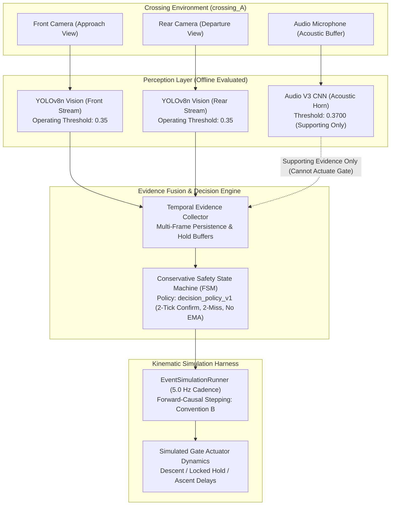

# Multimodal Railway Level-Crossing Safety Research Framework

[](https://www.python.org/downloads/)
[]()
[]()
[](docs/generated/master_reaudit/)

> [!CAUTION]
> **Academic Research Prototype & Safety Disclaimer:**
> This software repository contains an academic research prototype and offline discrete-time simulation framework developed to study multimodal computer vision and audio evidence fusion at a single rural railway level-crossing in Bangladesh (`crossing_A`).
> **It is NOT certified railway signaling, interlocking, or vital safety software.** It must **NEVER** be connected to live railway infrastructure, electrical relays, or physical barrier actuators. All empirical claims, numerical tables, and benchmark figures represent offline software simulation and retrospective diagnostic analyses under controlled protocol constraints. **Execution of real-data evaluation remains strictly unauthorized.**

---

## 1. Project Overview

Level-crossings in Bangladesh and developing railway networks present severe public safety hazards due to manual gate operations, unstaffed informal crossings, dense non-lane roadway congestion, and constrained sightlines. This research investigates an edge-oriented, multimodal perception and conservative decision architecture designed to detect approaching rail vehicles and crossing clearance while mitigating dangerous premature gate reopenings and excessive road closure delays.

The framework investigates:
* **Complementary Dual-Camera Computer Vision:** Evaluating front approach and rear departure camera perspectives to overcome severe occlusions caused by trucks, buses, and pedestrians.
* **Acoustic Horn Detection:** An independent sensory modality using log-mel spectrogram convolutional representations to provide supplemental approach evidence during optical obstruction.
* **Temporal Evidence Persistence:** Multi-frame confirmation windows and hysteresis filters that eliminate transient detector dropouts without introducing unverified smoothing.
* **Conservative State Machine Decision Engine:** A deterministic finite state machine (FSM) enforcing rapid gate closure upon verified approach evidence, strict multi-sensor hold intervals, and clearance confirmation before gate ascent.
* **Kinematic Simulation Runner:** A discrete-time kinematic simulation harness evaluating gate warning times, descent speeds, locked states ($\theta \le 45.0^\circ$), and ascent delays under discrete time cadences.

---

## 2. Research Problem and Objectives

Manual crossing gate operation in developing regions suffers from high human-error fatality rates, delayed closures, and hazardous premature reopenings while trains occupy crossings. The primary scientific objectives of this research are:
1. **Multimodal Perception Reliability:** Determine whether fusing visual object detection with acoustic train horn classification improves rail vehicle presence detection over unimodal optical sensing under rural ambient conditions.
2. **Lead-In Feasibility & Warning Times:** Quantify the physical lead-in time available between earliest sensor detection and physical track entry, establishing whether autonomous closure can safely complete before train arrival under field recording constraints.
3. **Prevention of Premature Reopening:** Develop deterministic state machine rules that eliminate premature gate ascent while railcars traverse the roadway conflict area.
4. **Minimization of Traffic Disruption:** Minimize unnecessary road blockage duration by transitioning the simulated gate to ascent immediately after confirmed train tail departure.

---

## 3. Research Scope and Study Site

All empirical video and acoustic data in this repository originate from a single, fixed rural level-crossing site in Bangladesh:
* **Study Site:** `crossing_A`, a single-track, non-electrified rural corridor characterized by non-standardized crossing geometry, ballast tracks, unpaved pedestrian approaches, and tropical vegetation.
* **Descriptive Single-Site Benchmark:** This investigation is an **empirical, descriptive single-crossing benchmark**. No claim of cross-site generalization, all-weather robustness (e.g., monsoon floods, dense fog), or multi-track applicability is made.
* **Fixed Event Corpus:** The real-world evaluation dataset is strictly frozen at **27 recording episodes** (23 full-train passages, 3 baseline no-train negative exposures, and 1 engine-only pass). **No new field recordings are authorized for this study.**
* **Manuscript Direction:** The authoritative manuscript scope is an empirical, descriptive, and observational benchmark paper documenting multi-modal perception performance and field lead-in feasibility constraints.

---

## 4. System Architecture

The software architecture processes video frames and audio buffers through independent perception backends into a temporal fusion collector, a finite state machine controller, and a discrete-time actuator model:



### Camera Stream Roles & Research Direction Governance:
* **Front Camera (`camera_front.mov`):** Primary sensor for train approach detection, warning lead time ($T_1 - T_{\text{detect}}$), and baseline ingress metrics (Researcher Directions `RD-015`, `RD-028`).
* **Rear Camera (`camera_back.mov`):** Established by `RD-015` as the primary perspective for train tail clearance ($T_4$) and exit safety metrics M4 (Premature Opening Rate) and M5 (Never Protected Before $T_4$).
* **Camera Scope Status:** Uncalibrated hardware clock drift between independent recording rigs prevented cross-camera timecode synchronization, leaving rear-camera landmark $T_4$ unannotated (`null`) across all 23 historical train passes. While a proposal exists to decouple Version 1.0 into a front-camera-only descriptive benchmark (evaluating conditions B0, B1, B2), **this proposal conflicts with RD-015 and RD-028 and remains pending explicit Principal Investigator governance amendment.** Front-only V1.0 is NOT an approved replacement for the project scope.

---

## 5. Computer-Vision Component (YOLOv8n)

* **Architecture:** Ultralytics YOLOv8n single-class (`train`) object detector.
* **Input Resolution:** 640×640 pixels; Frozen Operating Confidence Threshold: `0.35` ([`configs/vision.yaml`](configs/vision.yaml)).
* **Historical Development Metrics:**
  * $\text{mAP@0.5} = 0.9946$
  * $\text{mAP@0.5:0.95} = 0.8550$
  * Evaluated on 487 annotated train instances across 3,165 cropped images.
* **Essential Diagnostic Qualification:**
  * These development metrics originate from partition `705d388743ea` (`development_fallback`).
  * Audit inspection of `data/splits/705d388743ea/split_summary.json` confirms `leakage_risk: true` and `allow_ungrouped_fallback: true`. Because all images shared a single crossing identifier, image-level random splitting allowed frames from the same video recording to appear in both training and validation sets.
  * **These metrics represent development diagnostics only.** They do NOT establish event-independent generalization, production reliability, or all-weather performance.
* **View Annotations:** Bounding box appearance tags (`front`, `side`, `rear`) in training manifests are descriptive view angles, NOT validated train-direction classifiers.

---

## 6. Audio Component (Audio V3 CNN)

* **Architecture:** 4-layer 2D Convolutional Neural Network with a log-mel spectrogram front-end (128 mel frequency bands, 16 kHz mono sampling, 1.0 s analysis window, 0.5 s hop).
* **Training Corpus:** Curated locomotive horn events mixed with the ESC-50 Environmental Sound Classification dataset (50 non-target acoustic noise categories).
* **Historical Development Metrics:** Validation $\text{F1} = 0.869$, $\text{ROC-AUC} = 0.961$ at calibrated operating threshold `0.3700` ([`configs/audio.yaml`](configs/audio.yaml)).
* **Safety Role Constraints (RD-027, RD-030):**
  * **Supporting Evidence Only:** Acoustic horn evidence can confirm visual approach or sustain temporal hold; **it cannot independently initiate gate lowering and cannot grant clearance.**
  * **Clock Invariance:** Acoustic cross-correlation offsets derived from horn onsets must **never** shift or alter official human ground truth video timestamps.
  * The historical F1 score does not establish certified field safety under rain, wind, or heavy engine noise.
* **Quarantined Artifact:** Legacy Audio V2 checkpoint (`59b0785f73b2...`) was identified during protocol reaudits as exhibiting non-target acoustic leakage and is cryptographically barred from execution.

---

## 7. Decision Policy & Safety Constraints

The gate controller logic is governed by the frozen specification `decision_policy_v1` ([`configs/decision_policy_v1.yaml`](configs/decision_policy_v1.yaml)):
* **Two-Tick Confirmation:** Requires 2 consecutive positive perception frames ($\ge 0.40\,\text{s}$ at 5.0 Hz) to initiate gate closure from `NO_TRAIN` to `APPROACHING`.
* **Two-Miss Tolerance:** Requires 2 consecutive frames lacking evidence before dropping occupancy hold.
* **Zero Smoothing (RD-031):** No Exponential Moving Average (EMA) or probability smoothing is applied; all state transitions depend strictly on integer confirmation counts.
* **Fail-Closed Bias:** Any sensor dropout or syntax error maintains the current barrier state or drives gates closed.
* **Heuristic Nature:** `decision_policy_v1` represents an empirical research heuristic, not an internationally certified railway safety interlocking standard (e.g., CENELEC EN 50126 / 50128).

---

## 8. Simulation Framework & Historical Table 11 Realities

Offline system evaluation is performed by `EventSimulationRunner` stepping pre-computed perception logs at a nominal 5.0 Hz cadence ($\Delta t = 0.20\,\text{s}$):
* **Simulated Gate Dynamics:** Nominal traverse time of 60.0 seconds between fully open ($90.0^\circ$) and fully lowered ($0.0^\circ$). Passage is defined as blocked whenever $\theta(t) \le 45.0^\circ$.
* **Definition of Table 11 Closed Duration:** Historical Table 11 durations represent **simulated passage-blocked duration** ($T_{\text{blocked}} = \sum_{k=1}^N \Delta t_k \cdot \mathbf{1}_{\{\theta_k \le 45.0^\circ\}}$). They are **NOT** physical train occupancy duration ($T_4 - T_1$) and **NOT** full horizontal gate-closure duration ($\theta = 0.0^\circ$).
* **Simulation Stepping Conventions & Timing Offset:**
  * *Convention A (Historical Retroactive Stepping):* Evaluated the decision engine at $t_k$ and applied the resulting velocity command backward over the preceding elapsed interval $[t_{k-1}, t_k]$, moving the simulated gate one time-step ($0.20\,\text{s}$) earlier than causally possible.
  * *Convention B (Forward-Causal Stepping):* Evaluates the decision engine at $t_k$ and applies the velocity command forward across the succeeding interval $[t_k, t_{k+1}]$.
  * *Analytical Offset Theorem:* Missions 16D, 16G, and 16H established that the duration difference collapses to:
    $$\Delta T = T_{\text{causal}} - T_{\text{retro}} = -\Delta t \cdot b_N$$
    where $b_N = \mathbf{1}_{\{\theta_N \le 45.0^\circ\}}$ is the blockage status of the final simulation frame.
  * *Conditional Fact:* High-precision audit of all 27 B4 timelines proved that all recordings terminated in a fully lowered gate state ($b_N = 1, \theta_N = 0.0^\circ$) under strictly uniform 5.0 Hz cadence ($\Delta t = 0.200000\,\text{s}$). Consequently, forward-causal duration is **identically $T_{\text{Table 11}} - 0.2000\,\text{s}$ for all 27 B4 events**.
  * *Explicit Boundary:* This $-0.20\,\text{s}$ correction is conditional on uniform 0.20s cadence and terminal blockage; it is **NOT** a universal law for arbitrary sampling rates or complete opening/closing cycles.

---

## 9. Research Metrics & Evaluation Methodology

### 9.1 Primary Safety Metrics (M4 & M5)
* **Metric M4 — Premature Opening Rate (POR):** The primary safety clearance metric, evaluating whether the simulated gate begins opening before the train completely clears the roadway conflict area:
  $$\text{POR} = \mathbf{1}_{\{\exists t \in [T_1, T_4] : \theta(t) > 45.0^\circ\}}$$
* **Metric M5 — Never Protected Before $T_4$:** A companion failure indicator, evaluating whether the gate failed to achieve full horizontal blockage before train exit. Reported strictly as an integer count, never as a percentage rate (RD-017).
* **Historical Reality:** Both M4 and M5 strictly require an observable train tail clearance landmark $T_4$. Because rear-camera timecode synchronization was unresolved, $T_4$ was set to `null` across all 23 historical train events. Historical M4 and M5 values were **`NON-COMPUTABLE`**, not zero violations. **No measured 0% premature-opening rate can be claimed on historical data.**

### 9.2 Lead-In Feasibility Screen & Minimum Time Reserve (MTR)
* **Left-Censoring Reality:** Audit inspection reveals that **20 of the 23 historical train events (86.9%) are left-censored ($T_0 \le 0.0\,\text{s}$)**. Recording operators started cameras after the train was already approaching or in sight.
* **Physical MTR is Not Estimable:** Physical Minimum Time Reserve cannot be mathematically estimated from left-censored recordings because the true physical approach onset is unobserved. Calculating lead time from recording onset ($t = 0.0\,\text{s}$) measures camera pre-roll, not train approach speed.
* **Threshold Origin:** The historical 3.6-second threshold is an **implementation-derived feasibility parameter** ($0.2\text{s} \text{ engine} + 2.0\text{s} \text{ confirmation} + 1.5\text{s} \text{ margin} - 0.1\text{s} \text{ tolerance}$), **NOT an approved international or Bangladesh Railway safety standard.** It serves strictly as an engineering filter to identify truncated video clips.

---

## 10. Master Reaudit Findings & Scientific Disclosures

The completed 36-deliverable Master Reaudit Series ([`docs/generated/master_reaudit/`](docs/generated/master_reaudit/)) established 12 verified technical facts:

| ID | Domain | Verified Technical Fact | Primary Evidentiary Source | Status |
| :---: | :--- | :--- | :--- | :---: |
| **TF-01** | Simulation | Runner stepped engine before gate; retroactively actuated over $[t_{k-1}, t_k]$. | `runner.py:187-229` | **CERTAIN** |
| **TF-02** | Kinematics | All 27 B4 timelines possess strictly uniform 5.0 Hz cadence ($\Delta t = 0.200000\,\text{s}$). | 27 CSV timelines in `B4/` | **CERTAIN** |
| **TF-03** | Simulation | All 27 B4 events terminated while gate was fully lowered ($\theta_N = 0.0^\circ$, $b_N=1$). | 27 CSV timelines in `B4/` | **CERTAIN** |
| **TF-04** | Mathematics | Forward-causal duration is identically $T_{\text{Table 11}} - 0.2000\,\text{s}$ for all 27 B4 events. | Missions 16D, 16G, 16H | **PROVEN** |
| **TF-05** | Metrics | Historical M4 (POR) and M5 were non-computable on real data ($T_4 = \text{null}$). | 17 summary JSONs | **CERTAIN** |
| **TF-06** | Data | 20 of 23 train events are left-censored ($T_0 \le 0.0\,\text{s}$); physical MTR unestimable. | Manifest metadata | **CERTAIN** |
| **TF-07** | Metrics | 3.6s MTR threshold is an engineering sum, not a certified railway safety standard. | `lead_in.py`, Mission 16A | **CERTAIN** |
| **TF-08** | Vision | YOLO mAP@0.5=99.46% carries confirmed scene leakage (`leakage_risk: true`). | `split_summary.json` | **HIGH** |
| **TF-09** | Audio | Audio V3 historical F1=0.869; checkpoint hash was config-declared only. | Model configs | **MEDIUM** |
| **TF-10** | Tooling | `adjudication_session.py` contains synthetic assertions (`_require_synthetic_id`). | `adjudication_session.py:126` | **CERTAIN** |
| **TF-11** | Security | `promotion_gate.py` requires raw media access but lacks scoped token permit. | `promotion_gate.py:219` | **CERTAIN** |
| **TF-12** | Replay | `cache_only_engine.py` supports front B0–B2 only; back caches do not exist. | `cache_only_engine.py:77` | **CERTAIN** |

---

## 11. Repository Structure

```text
Train_automation/
├── configs/                     # Versioned YAML configurations (vision, audio, fusion, sim)
│   ├── vision.yaml              # YOLOv8n inference threshold (0.35)
│   ├── audio.yaml               # Audio V3 CNN operating threshold (0.3700)
│   └── decision_policy_v1.yaml  # Frozen controller constants (2-tick, 2-miss, no EMA)
├── data/                        # Research metadata, manifests, splits, and governance records
│   ├── governance/              # Historical execution authorizations and signer allowlists
│   ├── ground_truth/            # AI proposals, review sheets, and annotation schemas
│   │   └── proposals/           # Stage 1 candidate proposals (v1-v6)
│   ├── manifests/               # Dataset manifests and sensor inventory lists
│   └── splits/                  # Split definitions (705d388743ea, audio v1-v3)
├── docs/                        # Research protocols, hazard models, and reaudit reports
│   ├── FINAL_REAL_WORLD_EXPERIMENT_PROTOCOL.md # Master Evaluation Protocol (v8.0.0)
│   ├── FINAL_GROUND_TRUTH_PROTOCOL.md          # Ground-Truth Annotation Protocol (v7.0.0)
│   ├── FINAL_EXPERIMENT_DATA_FLOW.md           # Evaluation Data Flow Architecture (v5.1.0)
│   ├── FINAL_ABLATION_MATRIX.md                # Fair Single-Factor Ablation Plan (v5.1.0)
│   ├── HAZARD_MODEL.md                         # Formal hazard taxonomy and safety invariants
│   └── generated/
│       ├── master_reaudit/      # Authoritative 36-deliverable Master Reaudit Series (M16A–M17A)
│       └── phase2/              # Proposed protocol drafts (FINAL_GROUND_TRUTH_PROTOCOL_v7.1.1_PROPOSED.md)
├── experiments/                 # Reproducibility descriptors, training histories, and logs
│   ├── audio/                   # Audio V1, V2, and V3 training runs and metric JSONs
│   └── vision/                  # YOLOv8n training runs and evaluation descriptors
├── results/                     # Benchmark summaries, ROC/PR curves, figures, and research report
│   ├── figures/                 # Publication architecture diagrams and qualitative plots
│   ├── experiments/             # Historical benchmark evaluation JSONs and Table 11 CSVs
│   └── Railway_Crossing_Automation_Research_Report.docx # Comprehensive research report
├── src/railway_detection/       # Core Python package source code
│   ├── annotation/              # AI proposal parser, schema validator, and review runner
│   ├── audio/                   # Mel-spectrogram generator and Audio V3 CNN inference adapter
│   ├── cli/                     # Unified command-line interface entry points
│   ├── config/                  # Strict YAML configuration parsers and validators
│   ├── data/                    # Dataset loaders, sync aligners, and media boundary guard
│   ├── evaluation/              # Metric calculators, lead-in screen, and governance gates
│   ├── fusion/                  # Multi-sensor temporal evidence collectors
│   ├── safety/                  # Runtime media access guard (media_guard.py)
│   ├── simulation/              # FSM decision engine and gate dynamics model
│   └── vision/                  # YOLOv8n detector adapter and video frame processors
├── tests/                       # Unit, integration, and governance test suites (104 test modules)
├── pyproject.toml               # Package build specifications and dependency definitions
├── requirements.lock            # Pinned dependency lockfile for reproducible environment setup
└── README.md                    # Authoritative repository overview (this document)
```

---

## 12. Installation & Environment Setup

Supported Environment: **Python 3.11 or newer** on macOS / Linux. Verified local validation environment: Python 3.11.15.

```bash
# 1. Clone the repository
git clone https://github.com/mohammad-sayem-uddin/ai-railway-crossing-safety.git
cd ai-railway-crossing-safety

# 2. Create and activate a clean virtual environment
python3.11 -m venv venv
source venv/bin/activate

# 3. Upgrade core packaging tools
python -m pip install --upgrade pip setuptools wheel

# 4. Install the package in editable mode with development dependencies
python -m pip install -e ".[dev]"

# 5. (Recommended) For identical dependency pinning, install from requirements.lock
python -m pip install -r requirements.lock
```

### Declared Dependencies:
* **Core Runtime:** `numpy`, `PyYAML`, `Pillow`, `torch`, `torchvision`, `ultralytics`, `opencv-python`.
* **Testing & Quality:** `pytest`, `ruff`, `mypy`, `types-PyYAML`.
* **Evaluation & Plotting:** `matplotlib`, `scipy`.
* *Note:* Historical mentions of `pydantic`, `torchaudio`, and `google-genai` are non-normative; they are not imported by the current package and are not required for verified local test execution.

---

## 13. Running Permitted Synthetic Tests

All test commands in this repository run exclusively against mock fixtures and synthetic data. **They never decode raw video or run unvetted models:**

```bash
# Run annotation workflow unit tests (synthetic fixtures)
PYTHONPATH=src pytest -c /dev/null -p no:cacheprovider tests/test_annotation_workflow.py

# Run evaluation runner contract tests
PYTHONPATH=src pytest -c /dev/null -p no:cacheprovider tests/unit/test_phase12_evaluation_runner.py

# Run security governance and media boundary regression tests
PYTHONPATH=src pytest -c /dev/null -p no:cacheprovider tests/unit/test_security_governance_regressions.py

# Run static code formatting and linting checks
ruff check src tests

# Run strict type consistency checks
mypy src
```

> [!NOTE]
> **Testing vs. Evaluation Distinction:**
> Running `pytest` validates software contracts, schema parsing, and FSM transition logic on synthetic fixtures. It does **NOT** execute the real-world Layer B evaluation on actual video recordings. Real-world evaluation replay is restricted until ground truth is signed off by the researcher.

---

## 14. Configuration & Cryptographic Reproducibility

Copy the provided template to configure local environment variables:
```bash
cp .env.example .env
```

| Variable | Required | Default | Role |
|---|---|---|---|
| `GEMINI_API_KEY` | Optional | *None* | Used exclusively for offline Stage 1 proposal drafting. Never committed to Git. |
| `GEMINI_MODEL` | Optional | `gemini-2.5-pro` | Multimodal model endpoint for visual/acoustic boundary drafting. |
| `LOG_LEVEL` | Optional | `INFO` | Console logging verbosity (`DEBUG`, `INFO`, `WARNING`, `ERROR`). |

### Cryptographic Weights Register:
Every model weight file in this repository is cryptographically tracked to guarantee scientific reproducibility:

| Asset Name | Canonical Relative Path | Verified SHA-256 Hex Digest | Execution Policy |
|---|---|---|---|
| **YOLOv8n Train Detector** | `experiments/vision/39f402dfe460/checkpoints/weights/best.pt` | `3f5bb5b23f82f5d963d23dc8f3f1896a83532424d8e4ef70a406b6abfba18ebd` | **Frozen (Threshold 0.35)** |
| **Audio V3 CNN Classifier** | `experiments/audio/RUN_20261008_AUDIO_V3_ESC50/checkpoints/best.pt` | `ea1bb81d74230af71ba22b6d534a2ac550bca05833d1532e223376926c512782` | **Frozen (Threshold 0.3700)** |
| **Legacy Audio V2 (Prohibited)** | `models/audio/best_checkpoint.pt` | `59b0785f73b201dfd2fb335b98f6ddb764c8544d1ca5fc9e8aa326d74ffcf7d5` | **Prohibited from Inference** |

---

## 15. Research Governance & Authorization Status

Execution of code that reads, decodes, hashes, or runs inference on raw video (`.mov`, `.mp4`) or audio (`.wav`) is strictly governed by a software security firewall implemented in [`src/railway_detection/safety/media_guard.py`](src/railway_detection/safety/media_guard.py):

* **Fail-Closed Operation:** Any attempt to access raw media without an active, signed, unexpired cryptographic authorization token (`data/governance/AUTH-MEDIA-ACCESS.json`) immediately raises a fatal `MediaAccessAuthorizationError`.
* **Prerequisites for Real-Data Authorization:**
  1. **Gate 1 (Protocol Authority Promotion):** Formal PI adoption of Ground Truth Protocol v7.1.1-PROPOSED and implementation of dedicated human review CLI (`human_review_session.py`).
  2. **Gate 2 (Ground Truth Promotion):** Frame-by-frame dual human review and adjudication across all 27 events, verified through `promotion_gate.py`.
  3. **Gate 3 (Evaluation Authorization):** Issuance of an official execution authorization record (`EVAL-AUTH.json`) binding the promotion receipt, clean repository tree (`porcelain == 0`), and frozen decision policy.
* **Current Operational Status:** **REAL-DATA EVALUATION IS STRICTLY NOT AUTHORIZED.**

---

## 16. Current Research Status

| Component | Status | Detailed Technical Description |
|---|---|---|
| **Perception Foundation** | **Completed** | YOLOv8n fine-tuned on train visual classes; Audio V3 CNN trained on train horns & ESC-50. |
| **Ground Truth Protocol** | **v7.1.1-PROPOSED** | Ground Truth Protocol v7.1.1-PROPOSED prepared in [`docs/generated/phase2/`](docs/generated/phase2/) to resolve legacy $T_1$ premature opening definitions; pending PI hash binding. |
| **Master Reaudit Series** | **Completed (M16A–M17A)** | Comprehensive 36-report forensic audit completed in [`docs/generated/master_reaudit/`](docs/generated/master_reaudit/), establishing mathematical closure on simulation timing and resolving researcher directions (RD-001 through RD-055). |
| **Kinematic Stepping Proof** | **Proven ($\Delta T = -0.20\,\text{s}$)** | Analytical proof that forward-causal Convention B stepping reduces historical B4 closed durations by exactly $-0.2000\,\text{s}$ across all 27 events ($\Delta T = -\Delta t \cdot b_N$). |
| **Lead-In Feasibility & Censoring** | **Disclosed (20/23 Left-Censored)**| 86.9% of train events are left-censored ($T_0 \le 0.0\,\text{s}$); physical MTR is not estimable. Historical 3.6s threshold is an engineering parameter ($0.2 + 2.0 + 1.5 - 0.1\,\text{s}$), not a railway regulatory standard. |
| **Historical Safety Metrics** | **Non-Computable ($T_4 = \text{null}$)** | Rear-camera departure landmark $T_4$ was null across all 23 historical train passes; M4 (POR) and M5 (Never Protected) were non-computable, not zero violations. |
| **Camera Scope Status** | **Pending PI Amendment** | Front-camera-only V1.0 benchmark proposal conflicts with RD-015/RD-028; pending explicit PI scope amendment. |
| **Real-World Layer B Evaluation** | **STRICTLY NOT AUTHORIZED** | Final batch replay across the Layer B evaluation cohort (27 events) remains fail-closed and locked out until Gate 1–3 governance authorizations are formally issued. |

---

## 17. Known Limitations

1. **Single Fixed Crossing:** All recordings originate from `crossing_A`. Performance under differing track geometries, multi-track junctions, electrified catenary, or varied road layouts is unstudied.
2. **Left-Censored Footage:** 20 of 23 train recordings began after the train was already in motion toward the crossing; true physical warning lead times cannot be measured from recording starts.
3. **Hardware Desynchronization:** Front and rear camera streams suffer from unmeasured inter-camera clock drift, preventing reliable dual-camera cross-correlation.
4. **Ungrouped CV Split Leakage:** The historical YOLO split partition (`705d388743ea`) suffered frame-level leakage across train and validation sets, inflating development metrics.
5. **Acoustic Environmental Vulnerability:** Locomotive horn audio classification is subject to degradation from heavy monsoon rain, high wind speeds, and dense highway traffic noise.
6. **Software Simulation Only:** No physical PLC controllers, relay interlocks, or hardware actuator circuits were deployed in live railway corridors.

---

## 18. Future Work

* **Event-Grouped CV Re-Partitioning:** Re-partition the visual dataset using 5-fold stratified cross-validation grouped strictly by physical event IDs to measure true out-of-sample object detection generalization.
* **Human Review Tooling & Calibration Pilot:** Implement dedicated review CLI (`src/railway_detection/review/human_review_session.py`) and conduct a 5-event human calibration pilot to establish empirical landmark tolerances.
* **Hardware-Synchronized Dual-Camera Rig (Version 2.0):** Deploy a hardware-genlocked camera and acoustic logging apparatus to eliminate clock skew and resolve tail clearance ($T_4$).
* **Closed-Loop Cyber-Physical Control:** Validate the forward-causal FSM decision engine against real-time SIL-2 simulation hardware and multi-site field deployments.

---

## 19. Citation & Acknowledgment Guidance

If citing or referencing this research framework in academic literature:

```bibtex
@misc{uddin2026multimodalrailway,
  author       = {Mohammad Sayem Uddin and Raihan Kabir Rahu},
  title        = {Multimodal Railway Level-Crossing Safety Research Framework: Perception, Feasibility, and Kinematic Simulation in Rural Bangladesh},
  year         = {2026},
  publisher    = {GitHub},
  howpublished = {\url{https://github.com/mohammad-sayem-uddin/ai-railway-crossing-safety}}
}
```

### Authorship & AI Usage Disclosure (COPE Guidelines):
* **Authorship:** In accordance with Committee on Publication Ethics (COPE) standards and Researcher Direction `RD-054`, authorship is strictly restricted to named human researchers. Artificial intelligence systems are not credited with academic authorship.
* **AI Assistance Disclosure:** Generative AI assistants (including Google Gemini and Anthropic Claude) were utilized as offline tools for code structure auditing, documentation formatting, test fixture generation, and protocol errata identification. All scientific conclusions, mathematical theorems, and governance determinations were verified and approved by the human research team.
* **Third-Party Backbones:** YOLOv8 vision backbones provided by Ultralytics under AGPL-3.0 licensing. Acoustic background samples sourced from the ESC-50 Environmental Sound Classification dataset by Karol J. Piczak (CC BY-NC 3.0).
