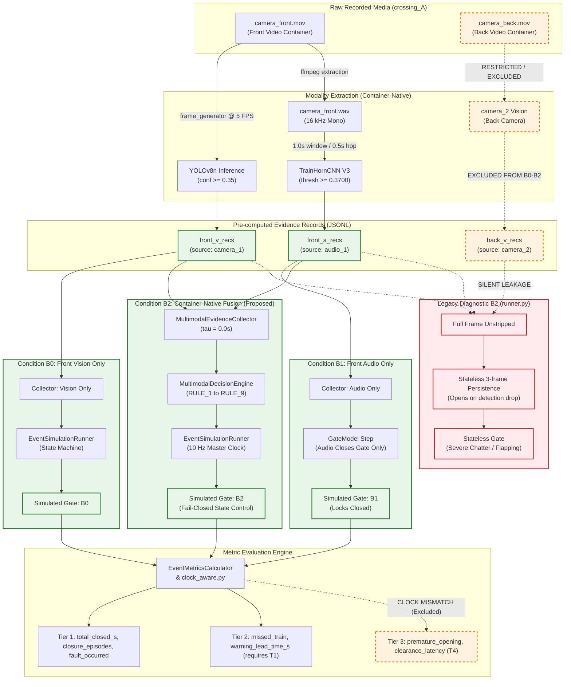

# B0 / B1 / B2 Architectural Separation Audit

**Document Version:** 1.0.0  
**Audit Type:** Static Code & Dataflow Audit  
**Target Architecture:** Front-Camera Container Conditions (B0: Vision, B1: Audio, B2: Fusion)  
**Governing Modules:**  
- `src/railway_detection/experiments/runner.py`
- `scripts/run_phase5_full_inference.py`
- `src/railway_detection/experiments/layer_b_processor.py`
- `src/railway_detection/evaluation/replay_producer.py`
- `src/railway_detection/fusion/decision_engine.py`
- `src/railway_detection/fusion/rules.py`
- `src/railway_detection/simulation/runner.py`

---

## 1. Executive Summary & Purpose

This audit statically traces the architectural separation, sensory ingestion, temporal alignment, and decision-logic data flows for conditions **B0** (front vision), **B1** (front audio), and **B2** (container-native multimodal fusion). 

The goal is to determine whether B0, B1, and B2 can serve as a scientifically fair and defensible comparative benchmark on the 27-event dataset, identify any silent leakage of back-camera data, and map out the exact state-machine invariants that govern each condition.

---

## 2. Modality Pipeline Tracing

### 2.1 Front-Camera Visual Pipeline (B0)
- **Source Artifact:** `data/raw/layer_b/v2/{cohort}/{event_id}/camera_front.mov`
- **Native Sampling:** ~29.97 FPS, 1080p, QuickTime container.
- **Sampling & Preprocessing:** Sampled at 5.0 FPS ($\Delta t = 0.20\,\text{s}$) by `frame_generator()` (`src/railway_detection/vision/video.py`).
- **Model Checkpoint:** YOLOv8n (`experiments/vision/39f402dfe460/checkpoints/weights/best.pt`; SHA-256: `3f5bb5b2...`).
- **Operating Threshold:** Visual confidence threshold $T_{\text{conf}} = 0.35$ (`configs/frozen_experiment_v1.yaml`).
- **Output Record:** `EvidenceRecord(modality=VISION, source_id="camera_1", available=True, detections=[...])` stored in JSONL cache.
- **Clock Alignment:** Master timeline is native to front video container ($t = 0.0\,\text{s}$ at Frame 0).

### 2.2 Front-Camera Audio Pipeline (B1)
- **Source Artifact:** Embedded audio track of `camera_front.mov`.
- **Extraction:** Demuxed to 16 kHz mono WAV via `ffmpeg` (`data/processed/layer_b/audio/{cohort}/{event_id}/camera_front.wav`).
- **Windowing:** 1.0s window, 0.5s hop stride ($2.0\,\text{Hz}$ evaluation rate) by `AudioEvidencePipeline` (`src/railway_detection/audio/pipeline.py`).
- **Model Checkpoint:** CompactTrainHornCNN V3 (`experiments/audio/RUN_20261008_AUDIO_V3_ESC50/checkpoints/best.pt`; SHA-256: `ea1bb81d...`).
- **Operating Threshold:** Acoustic threshold $T^* = 0.3700$.
- **Output Record:** `EvidenceRecord(modality=AUDIO, source_id="audio_1", available=True, metadata={"audio_safety_role": "supporting_only"})`.
- **Clock Alignment:** Native audio timestamps match the QuickTime master timeline ($\tau = 0.0\,\text{s}$).

### 2.3 Container-Native Fusion Pipeline (B2)
- **Ingestion:** Merges `front_v_recs` and `front_a_recs` into `MultimodalEvidenceCollector` (`src/railway_detection/fusion/collector.py`).
- **Offset Calibration:** Hardware-defined zero offset ($\tau = 0.0\,\text{s}$). No cross-camera sync aligner is required.
- **Resampling:** Generates synchronized `MultimodalFrame` sequence at 0.1s master clock ticks ($\Delta t = 0.10\,\text{s}$; 10 Hz) using a window tolerance of $0.25\,\text{s}$.
- **Back-Camera Isolation:** `camera_2` records are strictly omitted from the collector.

---

## 3. Discrepancy Analysis: Legacy Runner vs. Production Replay

Static code inspection reveals two conflicting definitions of condition B2 in the repository:

```
┌──────────────────────────────────────────────────────────────────────────────────────────────────┐
│ BRANCH 1: Legacy Diagnostic Script (src/railway_detection/experiments/runner.py: lines 250, 420) │
│ • Labeled: "Dual Vision + Audio" / "Stateless 3-frame persistence"                               │
│ • Input: Unstripped MultimodalFrame (SILENTLY RETAINS camera_2 if present!)                      │
│ • Simulation: Direct thresholding with confirm_needed = 3; opens gate immediately on drop!      │
│ • State Machine: Bypassed. EventSimulationRunner is NOT used.                                    │
│ • Status: Exploratory failure demonstration only. NOT the proposed benchmark condition.          │
├──────────────────────────────────────────────────────────────────────────────────────────────────┤
│ BRANCH 2: Production Replay Architecture (scripts/run_phase5_full_inference.py: lines 401–415 & │
│            src/railway_detection/evaluation/replay_producer.py: lines 275–276)                   │
│ • Labeled: "Condition B2: Front Vision + Front Audio Native Container Sync"                      │
│ • Input: Strictly front_v_recs + front_a_recs (camera_2 strictly excluded).                      │
│ • Simulation: EventSimulationRunner(config=config) executing MultimodalDecisionEngine.           │
│ • State Machine: Full state-machine policy with dwell timers and fail-closed clamps.              │
│ • Status: Authoritative technical target for front-camera offline benchmark.                    │
└──────────────────────────────────────────────────────────────────────────────────────────────────┘
```

**Authoritative Finding:** The benchmark must exclusively target Branch 2 (as formalized in `replay_producer.py` and `run_phase5_full_inference.py`). Branch 1 in `runner.py` is an unstripped baseline artifact.

---

## 4. State Machine Rules & Safety Invariants

The interaction between modalities and the gate barrier is governed by `MultimodalDecisionEngine` (`src/railway_detection/fusion/decision_engine.py`) and `RuleId` (`src/railway_detection/fusion/rules.py`):

### 4.1 Invariant: Audio Never Authorizes Gate Opening
- **Enforcement in Rules:**
  - `RuleId.RULE_2_AUDIO_SUPPORT_ONLY`: Audio evidence can actuate `CrossingState.WARNING` or extend gate closure, but cannot command `CrossingState.CROSSING_CLEAR` or `GateState.OPENING`.
  - In `decision_engine.py` (lines 489–493), if `audio_train_detected == True` during `REAR_CONFIRMED`, the clearance dwell timer is reset (`self.clearance_started_at_s = t`), actively delaying opening.
- **Enforcement in Simulation Runner:**
  - In `runner.py` (lines 385–386), under condition B1:
    `command = GateState.CLOSING if has_train_audio else gate.current_state`
    Audio commands closure, but never commands opening. Once closed on audio, the gate remains closed until manual reset or simulation termination.

### 4.2 Positive Clearance Requirement (`RULE_3_POSITIVE_CLEARANCE`)
- Advancing from `CROSSING_OCCUPIED` to `TRAIN_DEPARTING` and `REAR_CONFIRMED` requires positive visual evidence satisfying `has_qualified_departure()` (`rules.py` line 74).
- Once in `REAR_CONFIRMED`, the system must observe an uninterrupted dwell period of `clearance_dwell_s = 3.0\,\text{s}` with zero approach detections and zero audio energy before commanding `CROSSING_CLEAR` and `GateState.OPENING`.

### 4.3 Front-Camera Label Overlap & Clearance Dynamics
- In `rules.py` (lines 58–59):
  - `APPROACH_LABELS = frozenset({"front", "side", "train"})`
  - `DEPARTURE_LABELS = frozenset({"rear", "side", "train"})`
- **Architectural Nuance on Front Camera:**
  - Because `"train"` and `"side"` appear in both label sets, detections on a single front camera simultaneously trigger approach and departure eligibility.
  - When a train passes the front camera, the engine advances to `REAR_CONFIRMED`. However, once the train departs the front camera's field of view, all detections cease.
  - In `decision_engine.py` (lines 452–466), if detection ceases without a specific rear confirmation label, the engine logs:
    `"Train disappearance without positive rear confirmation; gate remains closed"`
  - Consequently, on front-only replays, if rear confirmation was not latched prior to frame exit, the gate will remain closed indefinitely until timeout or failure clamp (`RULE_4_FAIL_SAFE_CLAMP` / `RULE_6_DEGRADED_SOURCE_HOLD`).

---

## 5. Experimental Comparability & Confounders

Before claiming that B0, B1, and B2 provide a fair experimental comparison, the following systemic differences must be accounted for:

| Factor | Condition B0 (Vision) | Condition B1 (Audio) | Condition B2 (Fusion) | Experimental Impact & Confounding Risk |
| :--- | :--- | :--- | :--- | :--- |
| **Input Sampling Rate** | 5.0 FPS ($\Delta t = 0.20\,\text{s}$) | 2.0 Hz ($\text{win}=1.0\,\text{s}, \text{hop}=0.5\,\text{s}$) | Resampled to 10 Hz ($\Delta t = 0.10\,\text{s}$) | Vision updates 2.5x faster than audio. Warning latency comparisons must account for audio hop delay (up to 0.5s). |
| **Opening Mechanism** | Can clear after departure dwell | **CANNOT OPEN GATE** (by design) | Can clear after departure dwell | **Major Confounder:** Comparing total closed duration between B1 and B0/B2 is invalid because B1 lacks clearance capability and stays closed indefinitely. |
| **Silent Approaches** | Detects silently approaching trains | Fails completely if no horn is blown | Detects via vision even if horn silent | Expected finding: B1 will have non-zero missed train rate ($N_{\text{miss}} \approx 3$) on events lacking audible horn. |
| **Environmental Noise** | Unaffected by wind/road noise; sensitive to glare/night | Sensitive to wind, truck horns, and road traffic | Audio chatter suppressed by visual confirmation rules | Nuisance activations on negative controls will reflect modality-specific noise sources. |

---

## 6. Complete Dataflow Architecture Diagram



---

## 7. Governance and Split Isolation

1. **Split Contract Isolation:**
   - The official replay runner (`Phase12EvaluationRunner.run_official()`) is hardcoded to execute only `partitions["test"]` under a 3-way split (`research_contracts.py` lines 38–51).
   - Executing all 27 events as a descriptive full cohort cannot be run via the official runner without a contract amendment; it must be executed using the research diagnostic runner or an approved descriptive runner interface.
2. **Back-Camera Firewall:**
   - In `run_phase5_full_inference.py` (lines 378, 392, 405) and `replay_producer.py` (lines 275–276), `back_v_recs` are strictly excluded from B0, B1, and B2. No back-camera records leak into the front-camera evaluation.
