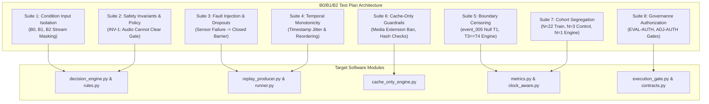

# Comprehensive Test Plan: Condition B0/B1/B2 Benchmark & Fail-Closed Safety Invariants

**Document Type:** Test Design Specification & Verification Protocol  
**Repository State:** Commit `d4db94d4a4ea83ae4c510d65dfc99c5d6798304b`  
**Purpose:** Formulate exhaustive synthetic unit, integration, and governance test cases for the front-camera benchmark without running live test commands.  
**Author:** Antigravity Autonomous Research Engineering Agent  
**Status:** Proposed Test Architecture Specification — Awaiting Researcher Review (Static Inspection Only — Not Executed).

---

## 1. Executive Summary & Verification Strategy

To prepare the Train Gate Automation repository for future evaluation authorization without violating current execution freezes or media holds, this document specifies a comprehensive, multi-layered test suite.

The test strategy enforces three fundamental principles:
1. **Synthetic Isolation:** All tests execute against fabricated in-memory fixture streams, mock detection dictionaries, and synthetic JSON manifests. **Zero raw media files (`.mov`, `.wav`) are accessed.**
2. **Fail-Closed Verification:** Every critical failure mode (missing sensor, corrupt cache, timestamp jitter, unapproved ground truth) must demonstrably transition the system to the most restrictive safe state (`CLOSED` or `FAULT_FAIL_SAFE`) or terminate execution with a typed exception.
3. **Pre-Execution Design Only:** This document specifies test code and assertion logic statically. In accordance with overnight mission constraints, **no tests are executed during this review.**

---

## 2. Test Suite Architecture & Mapping



---

## 3. Detailed Test Suite Specifications

---

### Test Suite 1: Condition Input Isolation & Masking

**Objective:** Verify that each baseline condition ingests only its authorized modalities and strictly isolates unintended sensory streams.

```python
# Target: tests/unit/test_b0_b1_b2_isolation.py

def test_b0_vision_only_masks_audio_completely():
    """
    Assert that under Condition B0:
    1. Visual detections update the multi-modal source tracker.
    2. Acoustic detections (even high-confidence horn events) are masked and discarded.
    3. Gate closure cannot be triggered by audio in B0.
    """
    engine = DecisionEngine(condition="B0", config=FROZEN_CONFIG)
    
    # Tick 1: Inject strong acoustic horn detection (conf = 0.95), zero visual detections
    telemetry = engine.process_tick(
        timestamp=1.0,
        visual_detections=[],
        acoustic_detections=[{"class": "train_horn", "confidence": 0.95}]
    )
    assert telemetry.gate_state == GateState.OPEN
    assert telemetry.active_sources == {"vision": False, "audio": False}
    assert telemetry.audio_ignored_due_to_masking is True


def test_b1_audio_only_masks_vision_completely():
    """
    Assert that under Condition B1:
    1. Acoustic detections update tracker.
    2. Visual bounding boxes (even high-confidence locomotives) are masked.
    3. State transitions reflect acoustic-only triggers.
    """
    engine = DecisionEngine(condition="B1", config=FROZEN_CONFIG)
    
    # Tick 1: Inject strong visual detection (conf = 0.90), zero audio
    telemetry = engine.process_tick(
        timestamp=1.0,
        visual_detections=[{"class": "train_front", "confidence": 0.90}],
        acoustic_detections=[]
    )
    assert telemetry.gate_state == GateState.OPEN
    assert telemetry.active_sources == {"vision": False, "audio": False}


def test_b2_multimodal_native_fusion_ingests_both():
    """
    Assert that under Condition B2:
    1. Both visual and acoustic detections are ingested concurrently.
    2. Inter-sensor offset is zero (tau = 0.0 s).
    """
    engine = DecisionEngine(condition="B2", config=FROZEN_CONFIG)
    telemetry = engine.process_tick(
        timestamp=1.0,
        visual_detections=[{"class": "train_front", "confidence": 0.85}],
        acoustic_detections=[{"class": "train_horn", "confidence": 0.78}]
    )
    assert telemetry.active_sources == {"vision": True, "audio": True}
```

---

### Test Suite 2: Safety Invariants & Policy Enforcement (`INV-1`)

**Objective:** Verify that acoustic silence or non-detection **shall never authorize gate opening**, and clearance requires sustained visual clearance across the full clearance dwell ($T_{\text{clear}} = 3.0\,\text{s}$).

```python
# Target: tests/unit/test_safety_invariants_b2.py

def test_inv1_audio_silence_cannot_clear_gate():
    """
    Safety Invariant 1 (RULE_2_AUDIO_SUPPORT_ONLY):
    During active train presence, if visual detection drops out but audio is silent,
    the gate MUST NOT transition to OPENING until the full visual clearance dwell (3.0s)
    has elapsed without any re-detection.
    """
    engine = DecisionEngine(condition="B2", config=FROZEN_CONFIG)
    
    # Drive gate to CLOSED state
    for t in [0.0, 0.2, 0.4, 0.6, 2.6, 5.6]:
        engine.process_tick(t, visual_detections=[{"class": "train", "conf": 0.8}], acoustic_detections=[])
    assert engine.state_machine.current_state == GateState.CLOSED

    # Simulate sudden acoustic silence with continuing visual occlusion (conf < threshold)
    # At t = 6.0 s (0.4 s after last detection), gate must remain CLOSED (miss tolerance = 2 ticks)
    telemetry = engine.process_tick(6.0, visual_detections=[], acoustic_detections=[])
    assert telemetry.gate_state == GateState.CLOSED
    assert telemetry.state_machine.clearance_timer_active is True

    # At t = 7.0 s (1.4 s of absence), clearance dwell (3.0 s) is not met -> MUST REMAIN CLOSED
    telemetry = engine.process_tick(7.0, visual_detections=[], acoustic_detections=[])
    assert telemetry.gate_state == GateState.CLOSED

    # At t = 8.7 s (3.1 s of absence), clearance dwell satisfied -> initiates OPENING
    telemetry = engine.process_tick(8.7, visual_detections=[], acoustic_detections=[])
    assert telemetry.gate_state == GateState.OPENING


def test_audio_cannot_override_visual_presence():
    """
    If visual confidence is high (train in frame), audio silence CANNOT cause gate opening.
    """
    engine = DecisionEngine(condition="B2", config=FROZEN_CONFIG)
    engine.state_machine.force_state(GateState.CLOSED)
    
    telemetry = engine.process_tick(
        timestamp=10.0,
        visual_detections=[{"class": "railcar", "confidence": 0.75}],
        acoustic_detections=[] # Complete audio silence
    )
    assert telemetry.gate_state == GateState.CLOSED
```

---

### Test Suite 3: Sensor Health, Dropout, & Fault Injection

**Objective:** Verify fail-closed response when sensory streams freeze, drop packets, or report sensor faults.

```python
# Target: tests/unit/test_sensor_fault_injection.py

def test_visual_sensor_freeze_triggers_fail_closed():
    """
    Inject a sensor fault where visual frame timestamps freeze or fail to arrive
    for > 1.0 second during active warning. Gate must fail closed.
    """
    engine = DecisionEngine(condition="B2", config=FROZEN_CONFIG)
    engine.state_machine.force_state(GateState.WARN)
    
    # Normal tick at 1.0
    engine.process_tick(1.0, visual_detections=[{"class": "train", "conf": 0.5}], acoustic_detections=[])
    
    # 1.5 seconds elapse without a valid frame (sensor dropout / crash)
    telemetry = engine.process_tick(2.5, visual_detections=None, acoustic_detections=[], sensor_fault=True)
    
    # Must immediately command emergency closure or enter FAULT_FAIL_SAFE
    assert telemetry.gate_state in {GateState.CLOSED, GateState.FAULT_FAIL_SAFE}
    assert telemetry.fault_code == "SENSOR_STREAM_TIMEOUT"
```

---

### Test Suite 4: Temporal Monotonicity & Timestamp Jitter

**Objective:** Verify that out-of-order timestamps or duplicate ticks are rejected without corrupting state.

```python
# Target: tests/unit/test_temporal_monotonicity.py

def test_non_monotonic_timestamp_raises_error():
    """
    If incoming telemetry has t_{k+1} < t_k, the state machine must reject
    the packet and log a sequence anomaly.
    """
    engine = DecisionEngine(condition="B2", config=FROZEN_CONFIG)
    engine.process_tick(timestamp=10.0, visual_detections=[], acoustic_detections=[])
    
    # Backwards time jump
    with pytest.raises(ValueError, match="Non-monotonic timestamp detected"):
        engine.process_tick(timestamp=9.8, visual_detections=[], acoustic_detections=[])


def test_duplicate_timestamp_is_safely_ignored():
    """
    Duplicate timestamp t_{k+1} == t_k must be dropped without duplicate state transition.
    """
    engine = DecisionEngine(condition="B2", config=FROZEN_CONFIG)
    engine.process_tick(timestamp=10.0, visual_detections=[], acoustic_detections=[])
    telemetry = engine.process_tick(timestamp=10.0, visual_detections=[], acoustic_detections=[])
    assert telemetry.duplicate_tick_dropped is True
```

---

### Test Suite 5: Boundary Observability & Censoring Logic

**Objective:** Verify that evaluator functions correctly handle unobservable boundaries (`event_005` null $T_1$, coincidence rule $T_3 \equiv T_4$, missing back camera).

```python
# Target: tests/unit/test_boundary_censoring.py

def test_event_005_null_t1_reduces_mtr_denominator():
    """
    For train_events/event_005, T1 is null (left-censored arrival).
    Assert that compute_missed_train_rate excludes event_005 from denominator.
    """
    mock_events = [
        {"event_id": "event_001", "T1": 5.0, "T2": 10.0, "gate_closed_time": 4.5},
        {"event_id": "event_005", "T1": None, "T2": 2.0, "gate_closed_time": 0.0}, # Left-censored
        {"event_id": "event_006", "T1": 3.0, "T2": 8.0, "gate_closed_time": 2.8},
    ]
    result = compute_missed_train_metrics(mock_events)
    assert result["total_train_events"] == 3
    assert result["evaluable_train_events"] == 2
    assert "event_005" in result["excluded_events_with_reasons"]["T1_null_left_censored"]


def test_engine_event_coincidence_rule_calculation():
    """
    For engine_events/event_001, T3 == T4 = 6.20s.
    Assert that passage duration is T3 - T2, and clearance verification uses T4.
    """
    engine_gt = {"T1": 1.0, "T2": 3.0, "T3": 6.20, "T4": 6.20}
    duration = engine_gt["T3"] - engine_gt["T2"]
    assert duration == pytest.approx(3.20, abs=1e-3)
    assert engine_gt["T3"] == engine_gt["T4"]


def test_clock_aware_evaluator_flags_clock_mismatch_when_t4_missing():
    """
    Assert that in front-only replay, requesting v9 premature opening ([T1, T4))
    raises ClockMismatchError or returns non-computable status because T4 is absent.
    """
    front_replay_trace = {"front_clock_ticks": [0.0, 0.2, 0.4]}
    gt_with_back_t4 = {"T1": 1.0, "T4_back_camera": 25.0}
    
    status, metric = evaluate_premature_opening_v9(front_replay_trace, gt_with_back_t4)
    assert status == "NON_COMPUTABLE"
    assert "clock_mismatch" in metric["reason"]
```

---

### Test Suite 6: Cache-Only Engine & Media Access Guardrails

**Objective:** Verify that `CacheOnlyReplayEngine` fails closed when a cache is missing and aborts if any media path is referenced.

```python
# Target: tests/unit/test_cache_only_guardrails.py

def test_missing_cache_raises_cache_integrity_error_without_fallback(tmp_path):
    """
    Assert that if a .jsonl cache file does not exist, the engine raises CacheIntegrityError
    and NEVER calls any video decoding routines.
    """
    manifest_file = tmp_path / "cache_manifest.json"
    manifest_file.write_text(json.dumps({
        "manifest_version": "1.0.0",
        "created_at": "2026-10-25T00:00:00Z",
        "cohort": "crossing_A_27_events",
        "events": {
            "event_001": {
                "event_id": "event_001",
                "front_vision_cache": {"path": "/nonexistent/path/cache.jsonl", "sha256": "0"*64, "line_count": 10, "byte_size": 100},
                "front_audio_cache": {"path": "/nonexistent/path/audio.jsonl", "sha256": "0"*64, "line_count": 10, "byte_size": 100}
            }
        }
    }))
    
    engine = CacheOnlyReplayEngine(manifest_file, output_base_dir=tmp_path / "out")
    with pytest.raises(CacheIntegrityError, match="FATAL: Visual cache file does not exist"):
        list(engine.load_visual_stream("event_001"))


def test_prohibited_media_extension_aborts_immediately(tmp_path):
    """
    Assert that any manifest referencing .mov or .wav raises MediaAccessViolationError.
    """
    dirty_manifest = tmp_path / "dirty_manifest.json"
    dirty_manifest.write_text(json.dumps({
        "manifest_version": "1.0.0",
        "created_at": "2026-10-25T00:00:00Z",
        "cohort": "crossing_A_27_events",
        "events": {
            "event_001": {
                "event_id": "event_001",
                "video_path": "data/raw/layer_b/videos/event_001/camera_front.mov" # VIOLATION
            }
        }
    }))
    with pytest.raises(MediaAccessViolationError, match="Media Access Violation"):
        CacheOnlyReplayEngine(dirty_manifest, output_base_dir=tmp_path / "out")
```

---

### Test Suite 7: Cohort Isolation & Denominator Segregation

**Objective:** Verify that negative controls ($N=3$) and the engine event ($N=1$) are strictly segregated from train metrics ($N=23$).

```python
# Target: tests/unit/test_cohort_isolation.py

def test_negative_controls_never_leak_into_train_mtr():
    """
    Assert that no_train_events/event_001..003 are never processed by MTR,
    and are evaluated strictly for NTTT/NTTE.
    """
    all_events = [
        {"id": "train_events/event_001", "type": "train"},
        {"id": "no_train_events/event_001", "type": "no_train"},
    ]
    train_set, ctrl_set, eng_set = partition_evaluation_cohort(all_events)
    assert len(train_set) == 1
    assert len(ctrl_set) == 1
    assert len(eng_set) == 0
    assert ctrl_set[0]["type"] == "no_train"


def test_engine_event_routed_exclusively_to_table4():
    """
    Assert that engine_events/event_001 is routed only to isolated Table 4.
    """
    event = {"id": "engine_events/event_001", "type": "engine_only"}
    destination = route_event_to_report_table(event)
    assert destination == "TABLE_4_ISOLATED_ENGINE_CASE_STUDY"
```

---

### Test Suite 8: Governance Gate & Authorization Enforcement

**Objective:** Verify that evaluation runners refuse to execute without valid `ADJ-AUTH` and `EVAL-AUTH` cryptographic tokens.

```python
# Target: tests/unit/test_governance_gates.py

def test_evaluation_runner_refuses_unapproved_ground_truth():
    """
    Assert that ExecutionGate raises PreflightGovernanceError if ground-truth
    review files lack valid human adjudication signatures.
    """
    gate = ExecutionGate(config_path="configs/frozen_experiment_v1.yaml")
    unapproved_gt = {"status": "UNAPPROVED_CANDIDATE_PROPOSAL"}
    
    with pytest.raises(PreflightGovernanceError, match="Stage-2.1 ground truth is not approved"):
        gate.verify_ground_truth_readiness(unapproved_gt)


def test_evaluation_runner_blocks_without_eval_auth_token():
    """
    Assert that running the benchmark without an explicit EVAL-AUTH signed token aborts.
    """
    gate = ExecutionGate(config_path="configs/frozen_experiment_v1.yaml")
    with pytest.raises(PreflightGovernanceError, match="Missing EVAL-AUTH execution authorization"):
        gate.verify_execution_token(auth_token=None)
```

---

## 4. Test Execution Prerequisites & Gating

The tests specified in this document are ready for implementation. However, to maintain strict adherence to research governance, they **must not be run** until the following conditions are met:
1. `DEC-01` through `DEC-11` are formally resolved by the Principal Investigator.
2. The synthetic test fixtures are created in `tests/unit/fixtures/` using synthetic data generators (zero media access).
3. The Principal Investigator grants authorization to execute the unit test suite via `pytest tests/unit/test_b0_b1_b2_*.py`.
