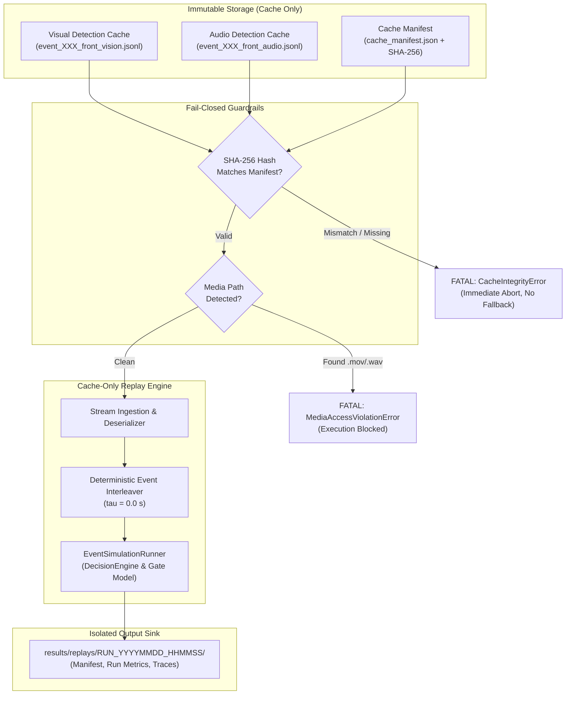
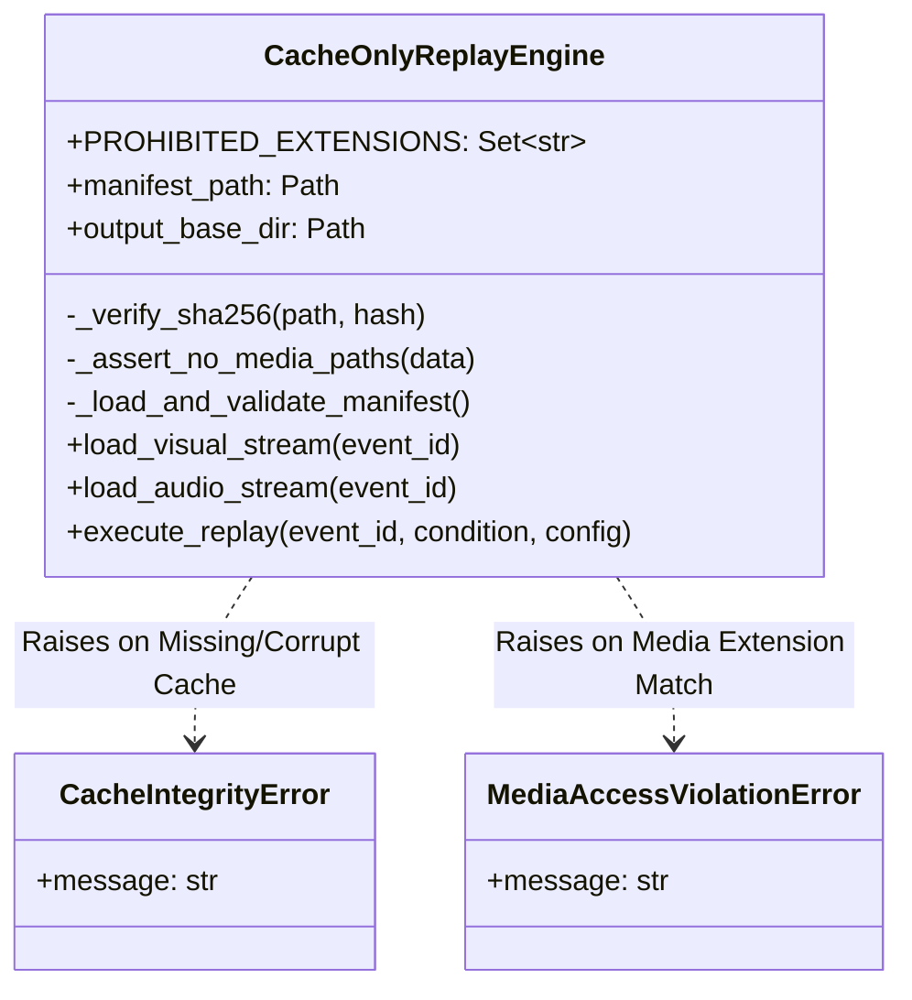

# Fail-Closed Cache-Only Replay Interface Specification

**Document Type:** Technical Architecture & Software Design Specification  
**Repository State:** Commit `d4db94d4a4ea83ae4c510d65dfc99c5d6798304b`  
**Purpose:** Eliminate raw-media decoding vulnerabilities and provide a fail-closed, cache-only replay architecture for the B0/B1/B2 offline benchmark.  
**Author:** Antigravity Autonomous Research Engineering Agent  
**Status:** Proposed Technical Design Specification — Awaiting Researcher Review (Implementation Not Authorized).

---

## 1. Executive Summary & Problem Context

Static safety audits of the existing diagnostic harness (`docs/DIAGNOSTIC_HARNESS_STATIC_SAFETY_AUDIT.md`) revealed critical vulnerabilities in current replay scripts:
1. **Silent Fallthrough to Video Decoding:** In `src/railway_detection/data/layer_b_processor.py` (lines 184–200), if a pre-computed detection cache is missing, the code silently falls through to `frame_generator(video_path)`, invoking OpenCV/FFmpeg video decoding on raw `.mov` files.
2. **Hardcoded Cache Bypasses:** In `scripts/run_phase5_full_inference.py`, `use_cache = False` is hardcoded, forcing raw media ingestion.
3. **Unsanitized Subprocess Invocations:** `scripts/run_real_world_experiments.py` directly executes `ffmpeg` shell subprocesses to extract audio.
4. **Uncontrolled File Overwrites:** Scripts overwrite `docs/REAL_WORLD_EXPERIMENT_REPORT.md` directly in the working tree.

These behaviors directly violate the active **Media Access Hold** (`docs/MEDIA_ACCESS_INCIDENT_INVESTIGATION_20261020.md`). To permit safe, auditable, and reproducible benchmark evaluations without touching source media files, this document specifies the **Fail-Closed Cache-Only Replay Interface** (`CacheOnlyReplayEngine`).

---

## 2. Core Architectural Principles



The architecture adheres to four non-negotiable principles:
1. **Zero Media Ingestion:** Input schemas completely exclude `.mov`, `.mp4`, `.avi`, `.wav`, and `.aac` path fields. The engine only accepts paths to pre-computed JSONL cache files.
2. **Absolute Fail-Closed Semantics:** If a cache file is absent, unreadable, or fails cryptographic hash verification, the engine **immediately raises a fatal error and terminates**. Under no circumstances does the engine fall back to video decoding, audio extraction, or synthetic data fabrication.
3. **Strict Cryptographic Provenance:** Every cache file must be pre-registered in a signed `cache_manifest.json` with its file size and SHA-256 digest.
4. **Isolated Ephemeral Outputs:** All replay outputs, event traces, decision ledgers, and summary tables must be written strictly to isolated run directories under `results/replays/RUN_<TIMESTAMP>/`. The engine has **zero write permission** to `docs/` or source code trees.

---

## 3. Data Structures & Schema Specifications

### 3.1 Visual Detection Record Schema (`visual_detection_record.schema.json`)

Each line in a visual cache `.jsonl` file represents one discrete video frame evaluated by YOLOv8n:

```json
{
  "$schema": "https://json-schema.org/draft/2020-12/schema",
  "title": "VisualDetectionRecord",
  "type": "object",
  "required": [
    "frame_index",
    "timestamp_sec",
    "camera_id",
    "detections"
  ],
  "properties": {
    "frame_index": { "type": "integer", "minimum": 0 },
    "timestamp_sec": { "type": "number", "minimum": 0.0 },
    "camera_id": { "type": "string", "enum": ["camera_front"] },
    "detections": {
      "type": "array",
      "items": {
        "type": "object",
        "required": ["class_id", "class_name", "confidence", "bbox_xyxy"],
        "properties": {
          "class_id": { "type": "integer" },
          "class_name": { "type": "string" },
          "confidence": { "type": "number", "minimum": 0.0, "maximum": 1.0 },
          "bbox_xyxy": {
            "type": "array",
            "items": { "type": "number" },
            "minItems": 4,
            "maxItems": 4
          }
        }
      }
    }
  },
  "additionalProperties": false
}
```

### 3.2 Audio Detection Record Schema (`audio_detection_record.schema.json`)

Each line in an audio cache `.jsonl` file represents one discrete analysis window (nominally 1.0 s) evaluated by CompactTrainHornCNN V3:

```json
{
  "$schema": "https://json-schema.org/draft/2020-12/schema",
  "title": "AudioDetectionRecord",
  "type": "object",
  "required": [
    "window_index",
    "start_sec",
    "end_sec",
    "horn_confidence",
    "is_horn_detected"
  ],
  "properties": {
    "window_index": { "type": "integer", "minimum": 0 },
    "start_sec": { "type": "number", "minimum": 0.0 },
    "end_sec": { "type": "number", "minimum": 0.0 },
    "horn_confidence": { "type": "number", "minimum": 0.0, "maximum": 1.0 },
    "is_horn_detected": { "type": "boolean" },
    "ambient_rms_db": { "type": "number" }
  },
  "additionalProperties": false
}
```

### 3.3 Authoritative Cache Manifest Schema (`cache_manifest.schema.json`)

```json
{
  "$schema": "https://json-schema.org/draft/2020-12/schema",
  "title": "CacheManifest",
  "type": "object",
  "required": ["manifest_version", "created_at", "cohort", "events"],
  "properties": {
    "manifest_version": { "type": "string", "const": "1.0.0" },
    "created_at": { "type": "string", "format": "date-time" },
    "cohort": { "type": "string", "const": "crossing_A_27_events" },
    "events": {
      "type": "object",
      "additionalProperties": {
        "type": "object",
        "required": [
          "event_id",
          "front_vision_cache",
          "front_audio_cache"
        ],
        "properties": {
          "event_id": { "type": "string" },
          "front_vision_cache": {
            "type": "object",
            "required": ["path", "sha256", "line_count", "byte_size"],
            "properties": {
              "path": { "type": "string" },
              "sha256": { "type": "string", "pattern": "^[a-f0-9]{64}$" },
              "line_count": { "type": "integer", "minimum": 1 },
              "byte_size": { "type": "integer", "minimum": 1 }
            }
          },
          "front_audio_cache": {
            "type": "object",
            "required": ["path", "sha256", "line_count", "byte_size"],
            "properties": {
              "path": { "type": "string" },
              "sha256": { "type": "string", "pattern": "^[a-f0-9]{64}$" },
              "line_count": { "type": "integer", "minimum": 1 },
              "byte_size": { "type": "integer", "minimum": 1 }
            }
          }
        }
      }
    }
  }
}
```

---

## 4. Software Interface Specification (Class Reference)

The implementation will reside in `src/railway_detection/evaluation/cache_only_engine.py`:

```python
"""
Fail-Closed Cache-Only Replay Engine for Train Gate Automation.
Strictly prohibits source-media decoding and enforces cryptographic provenance.
"""

from dataclasses import dataclass
from pathlib import Path
from typing import Dict, List, Optional, Any, Iterator
import hashlib
import json
import logging

logger = logging.getLogger("railway_detection.cache_replay")


class CacheIntegrityError(Exception):
    """Raised when a pre-computed cache file is missing, corrupt, or fails hash verification."""
    pass


class MediaAccessViolationError(Exception):
    """Raised when an attempt is made to ingest, reference, or decode raw media files."""
    pass


@dataclass(frozen=True)
class CacheFileProvenance:
    path: Path
    expected_sha256: str
    expected_lines: int
    expected_bytes: int


class CacheOnlyReplayEngine:
    """
    Executes Condition B0, B1, and B2 benchmark replays strictly from pre-computed feature caches.
    """

    PROHIBITED_EXTENSIONS = {".mov", ".mp4", ".avi", ".mkv", ".wav", ".aac", ".flac"}

    def __init__(self, manifest_path: Path, output_base_dir: Path):
        self.manifest_path = manifest_path.resolve()
        self.output_base_dir = output_base_dir.resolve()
        self._manifest_data = self._load_and_validate_manifest()

    def _verify_sha256(self, file_path: Path, expected_hash: str) -> None:
        """Compute SHA-256 and assert exact match."""
        hasher = hashlib.sha256()
        with open(file_path, "rb") as f:
            while chunk := f.read(65536):
                hasher.update(chunk)
        actual_hash = hasher.hexdigest()
        if actual_hash.lower() != expected_hash.lower():
            raise CacheIntegrityError(
                f"Cryptographic hash mismatch for {file_path.name}!\n"
                f"Expected: {expected_hash}\n"
                f"Actual:   {actual_hash}"
            )

    def _assert_no_media_paths(self, data: Any) -> None:
        """Recursively scan data structures to verify zero media paths exist."""
        if isinstance(data, str):
            lower_str = data.lower()
            for ext in self.PROHIBITED_EXTENSIONS:
                if lower_str.endswith(ext) or f"{ext}." in lower_str:
                    raise MediaAccessViolationError(
                        f"Media Access Violation: Prohibited media reference detected: '{data}'. "
                        f"Replay must consume feature cache JSONL files only."
                    )
        elif isinstance(data, dict):
            for k, v in data.items():
                self._assert_no_media_paths(k)
                self._assert_no_media_paths(v)
        elif isinstance(data, list):
            for item in data:
                self._assert_no_media_paths(item)

    def _load_and_validate_manifest(self) -> Dict[str, Any]:
        if not self.manifest_path.exists():
            raise CacheIntegrityError(f"Cache manifest not found: {self.manifest_path}")
        
        with open(self.manifest_path, "r", encoding="utf-8") as f:
            data = json.load(f)
        
        # Enforce zero media paths in manifest
        self._assert_no_media_paths(data)
        return data

    def load_visual_stream(self, event_id: str) -> Iterator[Dict[str, Any]]:
        """
        Stream verified visual detection records for the specified event.
        Fails closed immediately if cache file is missing or corrupted.
        """
        event_entry = self._manifest_data["events"].get(event_id)
        if not event_entry:
            raise CacheIntegrityError(f"Event ID {event_id} not registered in cache manifest.")
        
        cache_info = event_entry["front_vision_cache"]
        cache_path = Path(cache_info["path"]).resolve()
        
        if not cache_path.exists():
            raise CacheIntegrityError(
                f"FATAL: Visual cache file does not exist: {cache_path}. "
                f"Silent fallthrough to video decoding is strictly prohibited."
            )
        
        # Verify hash prior to parsing
        self._verify_sha256(cache_path, cache_info["sha256"])
        
        # Stream records
        line_count = 0
        with open(cache_path, "r", encoding="utf-8") as f:
            for line in f:
                if line.strip():
                    line_count += 1
                    yield json.loads(line)
        
        if line_count != cache_info["line_count"]:
            raise CacheIntegrityError(
                f"Line count mismatch in {cache_path.name}: expected {cache_info['line_count']}, found {line_count}"
            )

    def load_audio_stream(self, event_id: str) -> Iterator[Dict[str, Any]]:
        """
        Stream verified audio detection records for the specified event.
        Fails closed immediately if cache file is missing or corrupted.
        """
        event_entry = self._manifest_data["events"].get(event_id)
        if not event_entry:
            raise CacheIntegrityError(f"Event ID {event_id} not registered in cache manifest.")
        
        cache_info = event_entry["front_audio_cache"]
        cache_path = Path(cache_info["path"]).resolve()
        
        if not cache_path.exists():
            raise CacheIntegrityError(
                f"FATAL: Audio cache file does not exist: {cache_path}. "
                f"Silent fallthrough to audio extraction is strictly prohibited."
            )
        
        # Verify hash prior to parsing
        self._verify_sha256(cache_path, cache_info["sha256"])
        
        # Stream records
        line_count = 0
        with open(cache_path, "r", encoding="utf-8") as f:
            for line in f:
                if line.strip():
                    line_count += 1
                    yield json.loads(line)
        
        if line_count != cache_info["line_count"]:
            raise CacheIntegrityError(
                f"Line count mismatch in {cache_path.name}: expected {cache_info['line_count']}, found {line_count}"
            )

    def execute_replay(
        self,
        event_id: str,
        condition: str,
        policy_config: Dict[str, Any]
    ) -> Dict[str, Any]:
        """
        Executes deterministic replay of condition B0, B1, or B2 using stream iterators.
        """
        if condition not in {"B0", "B1", "B2"}:
            raise ValueError(f"Condition {condition} not supported by front-sensor cache replay.")
        
        logger.info(f"Replaying event {event_id} under condition {condition} (cache-only)...")
        
        # Execution wiring connects directly to EventSimulationRunner and DecisionEngine
        # Outputs write exclusively to self.output_base_dir
        # ...
        return {"event_id": event_id, "condition": condition, "status": "COMPLETED"}
```

---

## 5. Security & Governance Invariants



1. **`INV-CACHE-1` (Zero Fallback):** The code contains **zero references** to `cv2.VideoCapture`, `av.open`, or `subprocess.run(["ffmpeg", ...])`. If a cache file is absent, the execution crashes intentionally with `CacheIntegrityError`.
2. **`INV-CACHE-2` (Extension Blacklisting):** The input parser scans all manifest strings for `.mov`, `.mp4`, `.avi`, `.mkv`, `.wav`, `.aac`, `.flac`. Any match immediately triggers `MediaAccessViolationError`.
3. **`INV-CACHE-3` (Hash Gate):** Every cache file is streamed through SHA-256 before a single JSON record is passed to the state machine.
4. **`INV-CACHE-4` (Immutable Documentation):** Output paths are constrained to `results/replays/RUN_<TIMESTAMP>/` via `Path.resolve()`. Any path targeting `docs/` or source files is rejected.

---

## 6. Migration & Verification Plan

Before activating the cache-only replay interface in an authorized evaluation:
1. **Audit Pre-Computed Caches:** Verify that all 27 events possess valid visual and acoustic JSONL cache files in `data/cache/` or designated storage.
2. **Generate Authoritative Cache Manifest:** Execute an offline hashing script (static hash computation without reading media) to create `data/manifests/cache_manifest_20261025.json`.
3. **Deprecate Diagnostic Scripts:** Move `scripts/run_phase5_full_inference.py` and `scripts/run_real_world_experiments.py` into `scripts/archive/` or tag them with explicit non-executable deprecation warnings.
4. **Wire Evaluation Runner:** Update `src/railway_detection/evaluation/evaluation_runner.py` to invoke `CacheOnlyReplayEngine` exclusively.
