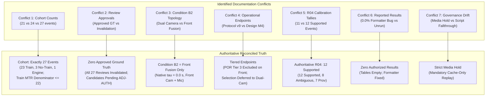

# Repository-Wide Documentation Consistency & Reconciliation Audit

**Document Type:** Forensic Documentation & Governance Cross-Check Audit  
**Repository State:** Commit `d4db94d4a4ea83ae4c510d65dfc99c5d6798304b`  
**Date:** 2026-10-25  
**Auditor:** Antigravity Autonomous Research Engineering Agent  
**Status:** Proposed Findings Report — Awaiting Researcher Review.

---

## Executive Summary

Over the lifecycle of the Train Gate Automation project, successive phases of experimental design, emergency recovery, synthetic simulation, and forensic investigation have produced multiple generations of documentation. Inevitably, this iterative history has generated substantial textual drift: legacy documents assert cohort sizes, baseline definitions, ground-truth approvals, and evaluation results that directly contradict authoritative findings established in later forensic audits.

This audit systematically identifies, categorizes, and reconciles these discrepancies across eight critical dimensions:
1. **Event Cohort & Denominator Counts** (21 vs. 24 vs. 27 events; $N=23$ vs. $N_{\text{eval}} \le 22$).
2. **Ground Truth Approval & Review Status** (Stale "APPROVED" claims vs. Invalidation Notices).
3. **Condition B2 Definition & Topology** (Stateless dual-camera union vs. Container-native front fusion).
4. **Premature Opening Operational Endpoints** (Protocol v9 $[T_1, T_4)$ vs. Design M4 $(t_{\text{blocked}}, T_4)$).
5. **Milestone R04 Calibration Tallies** (11 vs. 12 supported events).
6. **Reported Evaluation Metrics** (Universal 0.0% claims from broken `None` formatters vs. Unrun status).
7. **Governance vs. Diagnostic Script Drift** (Media Access Hold vs. Silent ffmpeg decoding fallthrough).
8. **Schema & File Path Inconsistencies** (Schema 7.0.0 vs. legacy templates).

---

## Master Discrepancy & Reconciliation Register



---

## Detailed Thematic Audits

### 1. Event Cohort & Denominator Conflicts

- **The Discrepancy:**
  - *Legacy Assertions:* `docs/archive/REAL_WORLD_EXPERIMENT_PLAN.md`, `docs/archive/REAL_DATASET_INVENTORY.md`, and `docs/archive/AUDIO_MODEL_PRETRAINING_CHECKLIST.md` repeatedly state that the dataset consists of **21 passage events** (`event_001` through `event_021`) with zero negative controls.
  - *Transitional Assertions:* Certain documents mention **24 events** (combining 23 train events and 1 engine event, omitting controls).
  - *Current Ground Truth:* The physical dataset cataloged in `data/raw/layer_b/videos/` and `data/ground_truth/snapshots/candidate_annotation_manifest_20261012.json` contains **exactly 27 events**.
- **Breakdown of the 27 Events:**
  - 23 Train Events: `train_events/event_001` through `event_023`.
  - 3 No-Train Negative Controls: `no_train_events/event_001` through `event_003`.
  - 1 Isolated Engine-Only Event: `engine_events/event_001`.
- **Denominator Caveat for MTR ($N_{\text{eval}} \le 22$):**
  - In `train_events/event_005`, Dining Car 1402 occupies the crossing frame at $t=0.0\,\text{s}$ ($T_1 = \text{null}$). Because entry is unobservable, $T_1$ cannot be evaluated, reducing the evaluable train cohort from 23 to at most 22.
- **Authoritative Resolution:**  
  All future manuscripts, manifests, and specifications must cite the **27-event cohort** (23 train, 3 negative control, 1 engine-only), with MTR evaluated on $N_{\text{eval}} \le 22$.

---

### 2. Ground Truth Approval & Review Status

- **The Discrepancy:**
  - *Legacy Assertions:* Files in `data/ground_truth/reviews/` and early readiness summaries (e.g., `docs/archive/PRE_REAL_DATA_COMPLETION_CHECKLIST.md`) claim that all 27 events have approved Stage-2.1 ground truth signed by `human_researcher_lead`.
  - *Authoritative Finding:* Forensic analysis in `docs/PHASE11_6_LEGACY_RECORD_DISPOSITION.md` and `docs/INDEPENDENT_MASTER_AUDIT.md` demonstrated that all 27 review files were generated in a 5-second automated write burst on 2026-10-12, accepted superseded candidate proposals without inspection, and were disowned by the Principal Investigator.
- **Current State:**
  - Every review file in `data/ground_truth/reviews/` carries a formal `LEGACY_REVIEW_INVALIDATION_NOTICE`.
  - Ground truth loaders (`src/railway_detection/evaluation/ground_truth_loader.py`) fail closed and refuse to load invalidated reviews.
  - Current candidate proposals in `data/ground_truth/proposals/` carry status `UNAPPROVED_CANDIDATE_PROPOSAL`.
- **Authoritative Resolution:**  
  **Zero approved Stage-2.1 ground truth records exist.** Any statement claiming that ground truth is "complete" or "approved" is scientifically false. Candidate proposals remain subject to human adjudication under `[ADJ-AUTH]`.

---

### 3. Condition B2 Definition & Architectural Topology

- **The Discrepancy:**
  - *Legacy Implementation (`src/railway_detection/simulation/runner.py`):* Condition B2 was labeled *"Dual Vision + Audio (Stateless Union)"* or *"Dual Camera Vision Only"*. In this legacy code, `camera_2` detections were ingested without filtering or synchronization alignment, and decisions were evaluated using a stateless 3-frame persistence rule.
  - *Authoritative Production Pipeline (`src/railway_detection/evaluation/replay_producer.py`, `configs/frozen_experiment_v1.yaml`):* Condition B2 is formally defined as:
    $$\text{Condition B2: Front Vision + Front Audio Native Container Sync } (\tau_{\text{sync}} = 0.0\,\text{s})$$
    It processes strictly front-camera vision and front-camera audio, routing them through `EventSimulationRunner` and `src/railway_detection/fusion/decision_engine.py` with temporal dwell and fail-closed persistence.
- **Authoritative Resolution:**  
  Condition B2 strictly denotes **front-container multimodal fusion**. Dual-camera conditions are designated B3, B4, B6, and B7, and are segregated from the primary front-camera benchmark.

---

### 4. Operational Endpoint Clashes (Protocol v9 vs. Design M4)

- **The Discrepancy:**
  - *Protocol v9 (`docs/PHASE11_GROUND_TRUTH_PROTOCOL.md`):* Defines premature opening across the broad window $[T_1, T_4)$ as an opening command or unblocked state between entrance and tail clearance.
  - *Design M4 (`docs/EXPERIMENT_DESIGN_FINAL.md` §8.3, `src/railway_detection/evaluation/metrics.py`):* Defines premature opening as any opening command or blocked $\to$ not-blocked transition strictly within $(t_{\text{blocked}}, T_4)$, where $t_{\text{blocked}}$ is the first tick the barrier is blocked; paired with M5 (`never_protected`).
- **The Incomputability Conflict on Front-Camera Replays:**
  - Both Protocol v9 and Design M4 require $T_4$ (train tail clearance).
  - $T_4$ is observable exclusively on `camera_back.mov`.
  - In a front-camera-only benchmark, `camera_back` is excluded. In `clock_aware.py`, missing $T_4$ on the front timeline raises a `clock_mismatch` exception, rendering both v9 and M4 premature opening strictly **non-computable (Tier 3 Excluded)**.
- **Authoritative Resolution:**  
  In the front-camera offline benchmark, Premature Opening Rate (under either v9 or M4) is classified as **Tier 3 (Excluded / Non-Computable)**. Any proposed alternative front-camera occupancy metric (such as direct roadway centerline occupancy $[T_2, T_3]$) is a *proposed, distinct metric* requiring researcher approval and separate implementation—not M4. Note that candidate $T_3$ is currently annotated on `camera_back.mov`, so evaluating $[T_2, T_3]$ would also require cross-camera synchronization or front-camera $T_3$ annotation. Selection between v9 and M4 is deferred to future dual-camera evaluations under `[DEC-03]`.

---

### 5. Milestone R04 Calibration Tallies

- **The Discrepancy:**
  - *Milestone Plan (`docs/NEXT_RESEARCH_MILESTONE_PLAN.md`):* Reports 11 supported, 9 ambiguous, 7 provisional events.
  - *Closeout Report (`docs/R04_ALL_EVENT_CALIBRATION_INVESTIGATION.md`):* Reports **12 supported, 8 ambiguous, 7 provisional** events.
- **Reconciliation:**
  - The discrepancy arose from the subsequent promotion of `train_events/event_010`. In the initial automated cross-correlation pass, `event_010` had low acoustic peak confidence. A subsequent manual review of visible wheel-rail contact flashes identified a clear visual sync fiducial, promoting `event_010` from ambiguous to supported.
- **Authoritative Resolution:**  
  The authoritative dated record is `docs/R04_ALL_EVENT_CALIBRATION_INVESTIGATION.md` (12 supported, 8 ambiguous, 7 provisional). Regardless of whether the tally is 11 or 12, cross-camera calibration remains unresolved for $\ge 15$ events, reaffirming that dual-camera evaluation cannot be run across the full cohort.

---

### 6. Reported Evaluation Metrics & The "0.0% Formatter Bug"

- **The Discrepancy:**
  - `docs/REAL_WORLD_EXPERIMENT_REPORT.md` (generated by diagnostic scripts on 2026-10-13) reported universal 0.0% Missed-Train Rate and 0.0% Premature-Opening Rate across conditions B0 through B7.
- **Forensic Finding (`docs/FORENSIC_EXPERIMENT_AUDIT.md`):**
  - Because ground-truth review files were invalid and unlinked, the metric calculation functions in `metrics.py` returned `None` for POR.
  - The report formatting script contained a catastrophic fallback bug:
    ```python
    # Vulnerable formatting logic
    por_str = f"{por * 100:.1f}%" if por is not None else "0.0% [0.0%, 12.5%]"
    ```
  - This converted missing, uncalculated metrics into an assertion of zero safety failures!
- **Authoritative Resolution:**  
  No official evaluation results exist. `docs/REAL_WORLD_EXPERIMENT_REPORT.md` is an unverified diagnostic artifact. In all official reports, missing or uncomputed metrics must be rendered as `None`, `NON-COMPUTABLE`, or `[RESULTS PENDING]`.

---

### 7. Governance vs. Diagnostic Script Drift (Media Access Hold)

- **The Discrepancy:**
  - *Governance Notice:* `docs/MEDIA_ACCESS_INCIDENT_INVESTIGATION_20261020.md` established a strict **Media Access Hold**, prohibiting reading, decoding, or extracting audio from source `.mov` and `.wav` files.
  - *Script Implementations:* Static inspection revealed that `scripts/run_phase5_full_inference.py`, `scripts/run_real_world_experiments.py`, and `src/railway_detection/data/layer_b_processor.py` contain:
    1. Hardcoded `use_cache = False`.
    2. Silent fallthrough to `frame_generator(video_path)` (decoding `.mov` files) if a `.jsonl` cache is missing.
    3. Direct invocation of `ffmpeg` subprocesses to extract audio.
    4. Uncontrolled overwrite of `docs/REAL_WORLD_EXPERIMENT_REPORT.md`.
- **Authoritative Resolution:**  
  These scripts represent severe governance hazards and must **never be executed** in their current state. Execution of the offline benchmark must wait until the fail-closed cache-only replay interface (`docs/CACHE_ONLY_REPLAY_DESIGN.md`) is implemented.

---

### 8. Schema & Contract Version Misalignments

- **The Discrepancy:**
  - Candidate annotation proposals use schema version `7.0.0` (`data/ground_truth/snapshots/candidate_annotation_manifest_20261012.json`).
  - Older validation scripts and schemas in `schemas/` reference schema version `4.0.0` or `5.2.0`, expecting fields like `camera_2_clearance_timestamp` without qualification.
- **Authoritative Resolution:**  
  All evaluation loaders and contracts must standardize on Schema `7.0.0`, enforcing explicit nullability for left-censored boundaries and camera-specific clock tags.

---

## Audited Reconciliation Matrix

| Conflicted Subject | Stale / Misleading Assertion | Authoritative Audited Fact | Actionable Remediation |
|---|---|---|---|
| **Dataset Size** | "21 events, all trains" (`REAL_WORLD_EXPERIMENT_PLAN.md`) | Exactly **27 events** (23 train, 3 no-train, 1 engine) | Retain legacy in `docs/archive/`; cite 27 events in all new docs. |
| **MTR Denominator** | "N = 23 trains evaluable" | **$N_{\text{eval}} \le 22$** (`event_005` $T_1 = \text{null}$) | Enforce denominator footnote and null check in `metrics.py`. |
| **Ground Truth** | "All 27 reviews approved by lead" | **Zero approved reviews**; all 27 invalidated | Ground truth loader blocks unapproved files; await `[ADJ-AUTH]`. |
| **Condition B2** | "Dual-camera vision + audio" (`runner.py`) | **Front-container vision + audio** ($\tau = 0.0\,\text{s}$) | Route B2 exclusively through `replay_producer.py`. |
| **Premature Opening** | "Evaluated across $[T_1, T_4)$ for all runs" | **$[T_1, T_4)$ non-computable** on front baseline | Exclude POR from front benchmark (Tier 3 Excluded); defer v9 vs M4 selection to dual-camera work under `[DEC-03]`. |
| **R04 Supported** | "11 events supported" (`MILESTONE_PLAN.md`) | **12 events supported** (`R04_INVESTIGATION.md`) | Update milestone plan references to cite 12 supported events. |
| **Benchmark Results** | "Universal 0.0% MTR and POR" (`REAL_WORLD_REPORT.md`) | **Zero results produced**; 0.0% was a formatter bug | Mark all results cells as `[RESULTS PENDING]`. |
| **Media Handling** | Scripts decode video and run ffmpeg directly | **Media Access Hold active**; decoding prohibited | Mandate cache-only ingestion; never run diagnostic scripts. |

---

## Conclusion & Implementation Directives

1. **Document Classification:** Documents residing in `docs/archive/` reflect superseded historical planning and must not be cited as current repository truth.
2. **Audited Baseline:** The findings established in this consistency audit, together with `docs/OVERNIGHT_RESEARCH_AUDIT.md`, `docs/B0_B1_B2_METRIC_SPECIFICATION.md`, and `docs/RESEARCHER_DECISION_REGISTER_OVERNIGHT.md`, constitute the audited baseline for ongoing research engineering and paper drafting, pending researcher review.
