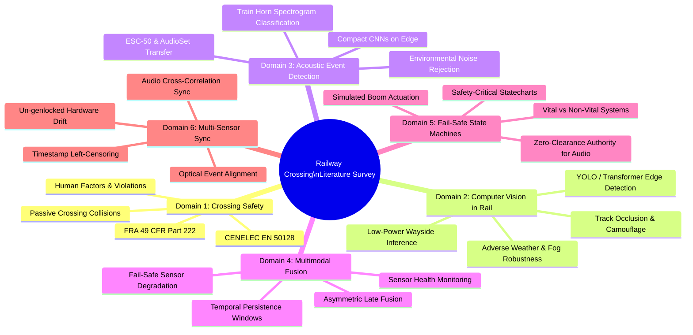
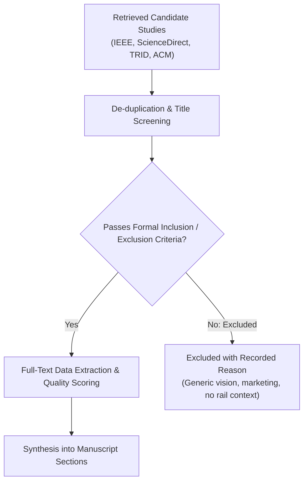
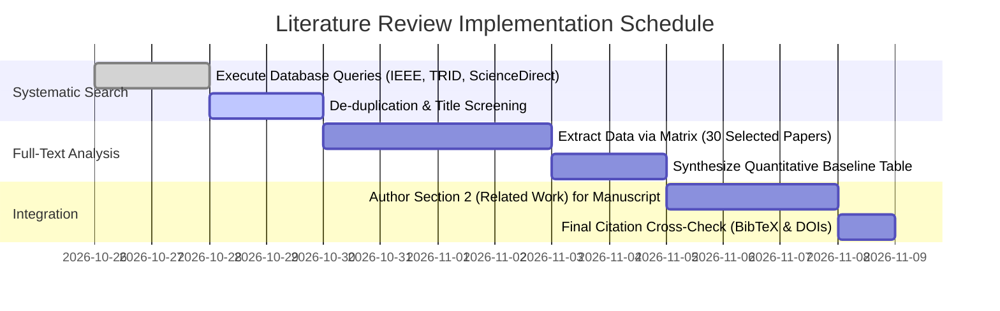

# Literature Review Strategy & Systematic Survey Plan: Multimodal Edge Perception and Fail-Closed Control for Railway Level-Crossing Protection

**Document Type:** Research Methodology & Literature Review Protocol  
**Repository State:** Commit `d4db94d4a4ea83ae4c510d65dfc99c5d6798304b`  
**Purpose:** Formalize search strategies, inclusion/exclusion criteria, evidence extraction protocols, and research-gap positioning for the manuscript.  
**Author:** Antigravity Autonomous Research Engineering Agent  
**Status:** Proposed — Awaiting Researcher Review (Implementation Planning Pending).

---

## 1. Executive Summary & Objective

Automated roadside perception for passive railway level crossings intersects multiple mature disciplines: railway safety engineering, real-time edge computer vision, acoustic event detection, multimodal sensor fusion, and safety-critical control theory. 

To position the Train Gate Automation research within the international scientific landscape, this document establishes a systematic, reproducible literature review plan following the PRISMA (Preferred Reporting Items for Systematic Reviews and Meta-Analyses) principles where applicable. The primary objectives are:
1. Identify established baselines and benchmark datasets in automated grade-crossing monitoring.
2. Establish state-of-the-art detection performance, latency bounds, and operational error rates reported in field-deployed rail vision and acoustics.
3. Catalog the formal architectures used to guarantee fail-closed behavior in non-vital, AI-assisted transportation control.
4. Rigorously ground the novelty and limitations of our single-site, container-native front-sensor benchmark without premature or unsubstantiated priority claims.

---

## 2. Thematic Search Domains & Keywords

The survey is organized into six foundational research domains.

### Domain 1: Railway Level Crossing Safety & Accident Causation
- **Focus:** Statistical risk modeling, accident kinematics, passive crossing limitations, economic barriers to active warning installation, human driver compliance.
- **Keywords:** `"railway level crossing" OR "highway-rail grade crossing" AND ("passive crossing" OR "accident analysis" OR "warning time" OR "CENELEC EN 50126" OR "AREMA" OR "FRA 49 CFR Part 222")`.

### Domain 2: Computer Vision for Rail Vehicle & Obstacle Detection
- **Focus:** Real-time object detection on edge devices, visual train presence detection, rolling stock classification, robustness to adverse weather (fog, rain, direct sun glare, night).
- **Keywords:** `("train detection" OR "rail obstacle detection" OR "rolling stock detection") AND ("YOLO" OR "deep learning" OR "edge vision" OR "adverse weather" OR "glare" OR "optical tracking") AND ("railway" OR "railroad")`.

### Domain 3: Environmental Audio & Acoustic Train Horn Classification
- **Focus:** Acoustic classification of locomotive horn sequences, whistle detection at grade crossings, noise robustness, compact convolutional neural networks for spectrograms.
- **Keywords:** `("train horn detection" OR "acoustic event detection" OR "whistle detection") AND ("spectrogram" OR "CNN" OR "environmental sound classification" OR "ESC-50" OR "AudioSet" OR "noise robustness")`.

### Domain 4: Multimodal Sensor Fusion for Critical Infrastructure
- **Focus:** Sensor complementarity (vision + acoustics), asymmetric fusion rules, confidence weighting, sensor failure detection, graceful degradation.
- **Keywords:** `("multimodal fusion" OR "sensor fusion" OR "audio-visual fusion") AND ("railway safety" OR "traffic monitoring" OR "perimeter surveillance") AND ("fail-safe" OR "asymmetric fusion" OR "sensor dropout")`.

### Domain 5: Fail-Safe State Machines & Safety-Critical Control Policies
- **Focus:** Statechart architectures for physical barriers, fail-closed defaults, miss-tolerance logic, clearance verification dwell times, avoidance of barrier chattering.
- **Keywords:** `("fail-closed" OR "fail-safe" OR "safety-critical state machine" OR "gate control") AND ("level crossing" OR "rail barrier" OR "dwell time" OR "safety invariant")`.

### Domain 6: Clock Synchronization & Multi-Sensor Calibration
- **Focus:** Aligning un-genlocked consumer hardware, audio cross-correlation for offset estimation, handling unsynchronized multi-camera baselines, temporal left-censoring in retrospective data.
- **Keywords:** `("sensor synchronization" OR "clock drift" OR "audio cross-correlation" OR "temporal alignment") AND ("un-genlocked cameras" OR "multi-camera calibration")`.

---

## 3. Academic Databases & Query Formulations

Searches will be executed systematically across five major scholarly indexing databases:

| Database | Search Query / Syntax String | Target Fields |
|---|---|---|
| **IEEE Xplore** | `("level crossing" OR "grade crossing") AND ("computer vision" OR "audio" OR "multimodal") AND ("detection" OR "safety")` | Title, Abstract, Index Terms |
| **ScienceDirect (Elsevier)** | `"railway level crossing" AND ("sensor fusion" OR "computer vision" OR "acoustic detection") AND "safety"` | Title, Abstract, Keywords |
| **TRID (TRB / USDOT)** | `"grade crossing" AND ("automated detection" OR "warning system" OR "low-cost")` | All Fields |
| **ACM Digital Library** | `("railway" OR "train") AND ("audio-visual" OR "edge AI") AND ("safety" OR "detection")` | Abstract, Author Keywords |
| **Google Scholar** | `"railway level crossing" ("YOLO" OR "acoustic") "fusion" "state machine" "fail-closed"` | Primary Title / Text Match |

---

## 4. Inclusion & Exclusion Criteria

To ensure high methodological quality and direct operational relevance, all retrieved studies must pass the following screening filters:

### 4.1 Inclusion Criteria (Must Satisfy All)
1. **IC-1 (Domain Focus):** Focuses specifically on railway level crossings, rail obstacle detection, wayside rail monitoring, or safety-critical transportation perception.
2. **IC-2 (Empirical Substance):** Reports empirical experimental evaluations, field-test data, physical simulations, or formal mathematical verification (pure high-level conceptual essays excluded).
3. **IC-3 (Publication Type):** Peer-reviewed journal paper, peer-reviewed international conference proceeding, government technical report (e.g., FRA, RSSB, ERA), or formal international standard (CENELEC, AREMA, IEEE).
4. **IC-4 (Language & Period):** Published in English between January 2010 and October 2026 (classic foundational papers in safety theory such as Leveson 1995 or Storey 1996 exempt from time bound).

### 4.2 Exclusion Criteria (Any Flag Excludes)
1. **EC-1 (Irrelevant Application):** Autonomous driving / automotive pedestrian detection without railway context, in-cabin passenger monitoring, or track crack/railhead defect inspection.
2. **EC-2 (Commercial Whitepapers / Marketing):** Proprietary vendor brochures, marketing announcements, or patent applications lacking peer review or reproducible mathematical descriptions.
3. **EC-3 (Uncontrolled Synthesis):** Pure speculative reviews or generic AI tutorials without rigorous domain evaluation.
4. **EC-4 (Superseded Preliminary Work):** Extended journal versions supersede earlier workshop short papers by the same authors.

---

## 5. Evidence Extraction Matrix

Each accepted paper will be analyzed across eight standardized dimensions in an evidence extraction spreadsheet:

| Field ID | Extraction Field | Purpose / Analysis Goal |
|---|---|---|
| **E-1** | Citation & Metadata | Author, Year, Title, Journal/Venue, DOI, Country of Origin. |
| **E-2** | Sensor Modalities | Monocular vision, stereo vision, thermal, LiDAR, radar, microphone, acoustic array, axle counters. |
| **E-3** | Algorithmic Approach | Architecture (YOLO, Faster R-CNN, 2D CNN, RNN, Kalman filter, rule-based state machine). |
| **E-4** | Dataset Composition | Number of crossings, number of events/trains, hours of negative exposure, lighting/weather conditions. |
| **E-5** | Hardware & Compute | Edge GPU (NVIDIA Jetson, Coral TPU), CPU, power draw, camera resolution, sampling rates. |
| **E-6** | Reported Performance | Missed detection rate, false alarm rate per hour, warning lead time, detection latency, F1-score. |
| **E-7** | Safety Invariants & Policy | Fail-closed vs fail-open defaults, dwell times, barrier physics modeling, vital interlocking interfaces. |
| **E-8** | Limitations & Disclaimers | Explicit disclosure of single-site bias, dataset size, lack of SIL certification, clock drift handling. |

---

## 6. Research Gap Identification & System Positioning

The systematic survey directly supports the intellectual positioning of our work by contrasting our methodology against four pervasive gaps in existing literature:

### Gap 1: The "Overclaimed Generalization" Trap in Small-Cohort Rail Vision
- **Literature Tendency:** Numerous published papers evaluate object detection models (e.g., YOLOv5, YOLOv7) on small datasets collected from a single crossing, partition the frames randomly into 80/20 train/test splits, and claim "99.2% crossing protection accuracy."
- **Our Positioning:** We demonstrate that random frame-level splits on continuous train passages represent catastrophic temporal leakage. We reject cross-crossing generalization claims, formalizing our evaluation strictly as an **offline descriptive benchmark** on a bounded 27-event cohort with full disclosure of single-site limitations.

### Gap 2: Neglect of Temporal Left-Censoring in Event-Triggered Data
- **Literature Tendency:** Many retrospective studies evaluate warning latency assuming the train's initial approach is captured from infinity, ignoring recording trigger lag.
- **Our Positioning:** We formally model **left-censoring** ($T_0 \le 0.0\,\text{s}$), explicitly proving that approach warning lead time cannot be honestly benchmarked without censoring corrections, and isolating unobservable entrance events (`train_events/event_005`).

### Gap 3: Absence of Asymmetric Fail-Closed Fusion Invariants
- **Literature Tendency:** Multimodal works often apply symmetric fusion (e.g., averaging visual and acoustic softmax probabilities). Under this logic, acoustic silence or background wind noise could erroneously pull down high visual confidence, causing premature gate opening.
- **Our Positioning:** We implement and evaluate strict **asymmetric fail-closed invariants** (`INV-1` / `RULE_2_AUDIO_SUPPORT_ONLY`): acoustic evidence may corroborate closure, but **only sustained visual clearance** across the complete clearance dwell window can authorize barrier ascent.

### Gap 4: Hardware Clock Drift in Multi-Camera Wayside Systems
- **Literature Tendency:** Multi-camera crossing systems frequently assume synchronized frame timestamps without documenting clock drift or genlock mechanisms.
- **Our Positioning:** Through Milestone R04 forensic analysis, we prove that uncalibrated consumer hardware introduces up to multi-second timing ambiguities. Consequently, we isolate the primary benchmark to **container-native front sensors (B0, B1, B2)** where $\tau_{\text{sync}} = 0.0\,\text{s}$, establishing clear prerequisite boundaries before attempting dual-camera clearance evaluation.

---

## 7. Safeguards Against Premature Novelty Claims

To maintain impeccable scientific integrity, authors and autonomous agents must adhere to the following negative heuristics:

- ❌ **Prohibited Claim:** *"This is the first multimodal automated railway crossing system."*  
  - **Correction:** Prior work (e.g., Ku et al., 2018; He et al., 2021; FRA Technical Reports) has explored multimodal and radar-vision crossing systems. Our novelty lies in the *formal descriptive benchmarking methodology, fail-closed asymmetric fusion invariants, and rigorous accounting for left-censoring and clock calibration on un-genlocked edge sensors*.
- ❌ **Prohibited Claim:** *"Our system achieves 100% safety at passive crossings."*  
  - **Correction:** State that on this 22-evaluable-event sample, the descriptive missed-train rate was observed to be `[RESULTS PENDING]`, and explain that real-world safety certification (SIL-4) requires formal verification, fault-tolerant hardware redundancy, and extensive multi-site field exposure.
- ❌ **Prohibited Claim:** *"The model generalizes to arbitrary railway crossings."*  
  - **Correction:** Explicitly restrict all conclusions to the geometry, rolling stock, and environmental conditions observed at `crossing_A`.

---

## 8. Actionable Implementation Schedule

1. **Sprint 1 (Days 1–2):** Execute search strings across IEEE Xplore, ScienceDirect, and TRID; export BibTeX citations into `docs/literature/references.bib`.
2. **Sprint 2 (Days 3–4):** Apply inclusion/exclusion screening to titles and abstracts; select top 30 candidate papers.
3. **Sprint 3 (Days 5–8):** Complete full-text extraction into the evidence matrix; tabulate baseline latency and accuracy metrics.
4. **Sprint 4 (Days 9–10):** Author Section 2 (*Related Work*) of `docs/PAPER_DRAFT_DESCRIPTIVE_BENCHMARK.md` synthesizing findings, citing verified DOIs, and reinforcing our four research gap positions.
