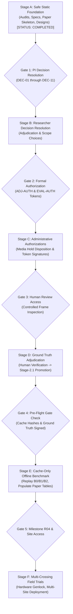

# Master Multi-Stage Roadmap: From Overnight Audit to Multi-Crossing Publication

**Document Type:** Strategic Research Engineering Roadmap & Gated Execution Plan  
**Repository State:** Commit `d4db94d4a4ea83ae4c510d65dfc99c5d6798304b`  
**Target Milestone:** Offline Descriptive Benchmark (Conditions B0, B1, B2) $\to$ Field Trials  
**Date:** 2026-10-25  
**Author:** Antigravity Autonomous Research Engineering Agent  
**Status:** Proposed Master Roadmap — Awaiting Researcher Review (Phased Governance Gating).

---

## 1. Executive Summary & Gated Progression Model

To advance the Train Gate Automation research from its current frozen investigative posture to peer-reviewed publication and subsequent field deployment, work is organized into **six strictly gated sequential stages** (Stages A through F).

Each stage defines:
- **Core Objectives & Tasks**
- **Strict Preconditions (Inputs Required)**
- **Concrete Deliverables**
- **Explicit Stop Conditions (When to Halt and Await Authorization)**
- **Permitted vs. Prohibited Actions**

---

## 2. Stage Breakdown & Operational Protocol

---

### Stage A: Safe Static Foundation & Audit Readiness
- **Status:** **COMPLETED** (Overnight Autonomous Mission).
- **Objectives:** Conduct exhaustive forensic audits, eliminate documentation conflicts, trace all metric formulas to source code, specify fail-closed cache replay interfaces, design comprehensive test suites, and author working draft and manuscript skeleton.
- **Completed Deliverables:**
  1. `docs/OVERNIGHT_RESEARCH_AUDIT.md`: Baseline governance, active holds, frozen configs.
  2. `docs/B0_B1_B2_METRIC_SPECIFICATION.md`: Tiered metric definitions, $N_{\text{eval}} \le 22$ denominator.
  3. `docs/B0_B1_B2_METRIC_EVIDENCE_MATRIX.md`: Exact line-by-line source code tracing.
  4. `docs/B0_B1_B2_ARCHITECTURE_AUDIT.md`: B0/B1/B2 pipeline topologies, fail-closed state machine.
  5. `docs/DIAGNOSTIC_HARNESS_STATIC_SAFETY_AUDIT.md`: Static safety analysis of execution scripts.
  6. `docs/DATASET_ANNOTATION_QUALITY_AUDIT.md`: Quality audit of candidate proposals and R04 status.
  7. `docs/B0_B1_B2_EXPERIMENT_DESIGN_REVIEW.md`: Methodological constraints of single-crossing data.
  8. `docs/PAPER_DRAFT_DESCRIPTIVE_BENCHMARK.md`: 19-section research manuscript skeleton.
  9. `docs/LITERATURE_REVIEW_PLAN.md`: Systematic survey strategy across 6 research domains.
  10. `docs/RESEARCHER_DECISION_REGISTER_OVERNIGHT.md`: 11-item authoritative decision register.
  11. `docs/DOCUMENTATION_CONSISTENCY_AUDIT.md`: Repository-wide documentation reconciliation.
  12. `docs/CACHE_ONLY_REPLAY_DESIGN.md`: Fail-closed cache-only replay architecture.
  13. `docs/B0_B1_B2_TEST_PLAN.md`: Synthetic unit and integration test suite design.
- **Stop Condition:** Autonomous agent halts execution upon completing static deliverables. Zero raw media accessed; zero evaluation commands run.

---

### Stage B: Principal Researcher Decision Resolution
- **Prerequisites:** Completion of Stage A documentation artifacts.
- **Objective:** The Human Principal Investigator reviews options and formally records decisions on the 11 items in `docs/RESEARCHER_DECISION_REGISTER_OVERNIGHT.md`.
- **Target Decisions:**
  - `DEC-01`: Ratify **Option A (Full-Cohort Descriptive Benchmark)**.
  - `DEC-02`: Ratify **Option A (Front-Camera Scope B0/B1/B2 Primary)**.
  - `DEC-03`: Ratify **Option C (Exclude POR from Front Baseline as Tier 3; Defer v9 vs M4 to Dual-Camera Evaluations; distinct front occupancy metrics require separate proposal)**.
  - `DEC-04`: Ratify **Option A (M5 Fail-Closed Late Closure Penalization)**.
  - `DEC-05`: Authorize **Option A (Human Adjudication Workflow `ADJ-AUTH`)**.
  - `DEC-06`: Authorize **Option A (Pre-Flight Execution Token `EVAL-AUTH`)**.
  - `DEC-07`: Ratify **Option A (Maintain Media Access Hold; Mandate Cache-Only Replay)**.
  - `DEC-08`: Ratify **Option A (Separate and Defer Timing Pilot)**.
  - `DEC-09`: Ratify **Option A (Add `full_cohort_descriptive` Contract Schema)**.
  - `DEC-10`: Ratify **Option A (Isolated Single-Event Table 4 for Light Engine)**.
  - `DEC-11`: Ratify **Option A (Exclude `event_005` from MTR Denominator: $N_{\text{eval}} \le 22$)**.
- **Deliverables:** Recorded decision resolutions in `docs/RESEARCHER_DECISION_REGISTER_OVERNIGHT.md`.
- **Stop Condition:** Await explicit written decision confirmations from the Principal Investigator.

---

### Stage C: Administrative Authorizations & Gate Unlocking
- **Prerequisites:** Formal recording of Stage B decisions.
- **Objective:** Formally issue cryptographic tokens and governance certificates required by codebase execution gates.
- **Tasks:**
  1. Generate cryptographically signed `EVAL-AUTH` token file (`data/authorizations/EVAL_AUTH_20261025.json`) containing frozen config SHA-256 and approved scope.
  2. Issue formal administrative sign-off on the Media Access Incident investigation (`docs/MEDIA_ACCESS_INCIDENT_INVESTIGATION_20261020.md`), formally permitting cache-only replay while maintaining raw media sequestering.
  3. Update `schemas/evaluation_manifest.schema.json` to validate `full_cohort_descriptive` execution mode.
- **Deliverables:** Valid authorization token files and updated schema validators.
- **Stop Condition:** All execution gate preflight requirements satisfied.

---

### Stage D: Human Review & Ground-Truth Promotion (Stage-2.1)
- **Prerequisites:** Stage C `ADJ-AUTH` token issuance.
- **Objective:** The Human Principal Investigator performs controlled visual review of candidate boundary timestamps ($T_1, T_2, T_3, T_4$) and promotes validated records to approved Stage-2.1 ground truth.
- **Tasks:**
  1. Human researcher inspects candidate frames for the 27 events using candidate proposal coordinates.
  2. Confirm $T_1 = \text{null}$ for `train_events/event_005` (Dining Car 1402 left-censoring).
  3. Confirm coincidence rule $T_3 \equiv T_4 = 6.20\,\text{s}$ for `engine_events/event_001`.
  4. Confirm that the 3 negative control events are completely free of rail rolling stock.
  5. Generate signed Stage-2.1 review records in `data/ground_truth/reviews/` with status `STAGE_2_1_APPROVED`.
- **Deliverables:** 27 cryptographically bound Stage-2.1 review records and updated ground-truth manifest.
- **Stop Condition:** All 27 records pass schema validation and are accepted by `ground_truth_loader.py`.

---

### Stage E: Controlled Cache-Only Offline Benchmark Execution
- **Prerequisites:** Approved Stage-2.1 ground truth (Stage D) and valid `EVAL-AUTH` token (Stage C).
- **Objective:** Execute the authorized, fail-closed offline descriptive benchmark across Conditions B0, B1, and B2, populating the empirical results tables of the research manuscript.
- **Tasks:**
  1. Implement `CacheOnlyReplayEngine` adhering strictly to `docs/CACHE_ONLY_REPLAY_DESIGN.md`.
  2. Execute synthetic unit test suite from `docs/B0_B1_B2_TEST_PLAN.md` to verify fail-closed invariants.
  3. Verify SHA-256 provenance hashes for all pre-computed visual and acoustic JSONL cache files.
  4. Execute Condition B0 (Front Vision Only) replay across 27 events.
  5. Execute Condition B1 (Front Audio Only) replay across 27 events.
  6. Execute Condition B2 (Container-Native Front Fusion) replay across 27 events.
  7. Compute Tier 1 and Tier 2 metrics (MTR with $N_{\text{eval}} \le 22$, WLT, NTTT, NTTE, FCD, transitions) with 95% Wilson score confidence intervals. Mark Tier 3 metrics as `NON-COMPUTABLE`.
  8. Populate Tables 1, 2, 3, and 4 in `docs/PAPER_DRAFT_DESCRIPTIVE_BENCHMARK.md`.
  9. Perform structured error analysis on observed dropouts or late warnings.
  10. Finalize the manuscript for submission to *IEEE Transactions on Intelligent Transportation Systems*.
- **Deliverables:**
  - Complete Replay Execution Manifest (`results/replays/RUN_<TIMESTAMP>/manifest.json`).
  - Event-level replay telemetry traces.
  - Populated, submission-ready research paper (`docs/PAPER_DRAFT_DESCRIPTIVE_BENCHMARK.md`).
- **Stop Condition:** Benchmark execution complete; manuscript results finalized; no further evaluation runs without new authorization.

---

### Stage F: Multi-Crossing Field Trials & Physical Hardware Expansion
- **Prerequisites:** Publication of Stage E offline benchmark; acquisition of multi-crossing research funding.
- **Objective:** Overcome the external validity limitations of `crossing_A` by expanding to multi-site data collection, hardware genlock, and real-world physical gate actuation.
- **Phased Implementation:**
  - **F.1 (Hardware Clock Synchronization):** Deploy hardware genlock or precision PTP (IEEE 1588) timing between front and back camera rigs, resolving Milestone R04.
  - **F.2 (Dual-Camera Benchmark):** Evaluate full $[T_1, T_4)$ clearance latency and premature opening rates on genlocked dual-camera feeds.
  - **F.3 (Multi-Site Field Deployment):** Instrument $\ge 10$ passive grade crossings across varied geographic, topographical, and operational environments (single track, double track, high-speed rail, industrial spurs).
  - **F.4 (Continuous Exposure Collection):** Gather $\ge 1,000$ train events and $\ge 500$ hours of continuous negative roadway traffic across four seasons (snow, heavy rain, dense fog, night).
  - **F.5 (Physical Timing & Vital Interlocking Pilot):** Interface perception outputs to vital safety PLCs under formal fail-safe interlocks, benchmarking physical electromechanical boom dynamics and pursuing CENELEC EN 50128 SIL safety assessments.

---

## 3. Summary Roadmap Matrix

| Stage | Focus Area | Primary Actor | Prerequisites | Key Deliverable | Downstream Gate Unlocked |
|:---:|---|---|---|---|---|
| **A** | Static Audit & Design | Autonomous Agent | None | 13 Master Documentation Artifacts | Gate 1: Decision Review |
| **B** | Researcher Decisions | Principal Investigator | Stage A Artifacts | 11 Recorded Decision Confirmations | Gate 2: Authorization Issuance |
| **C** | Administrative Tokens | Principal Investigator | Stage B Decisions | `EVAL-AUTH` & Media Hold Disposition | Gate 3: Human Review Access |
| **D** | Ground-Truth Adjudication | Principal Investigator | Stage C `ADJ-AUTH` | 27 Approved Stage-2.1 Review Files | Gate 4: Benchmark Pre-Flight |
| **E** | Offline Benchmark Replay | Autonomous Agent | Stage D Approved GT & `EVAL-AUTH` | Populated Submission Paper | Gate 5: Submission & Funding |
| **F** | Multi-Crossing Field Work | Research Team | Published Paper & Site Access | Multi-Site Field Benchmark & SIL Trial | Real-World Operational Safety |

---

## 4. Immediate Action Item for the Principal Investigator

With Stage A successfully concluded, the immediate path forward is for the Principal Investigator to execute **Stage B**:
1. Review `docs/RESEARCHER_DECISION_REGISTER_OVERNIGHT.md`.
2. Formally record the recommended defaults for Decisions `DEC-01` through `DEC-11`.
3. Provide authorization tokens to initiate Stages C and D.
