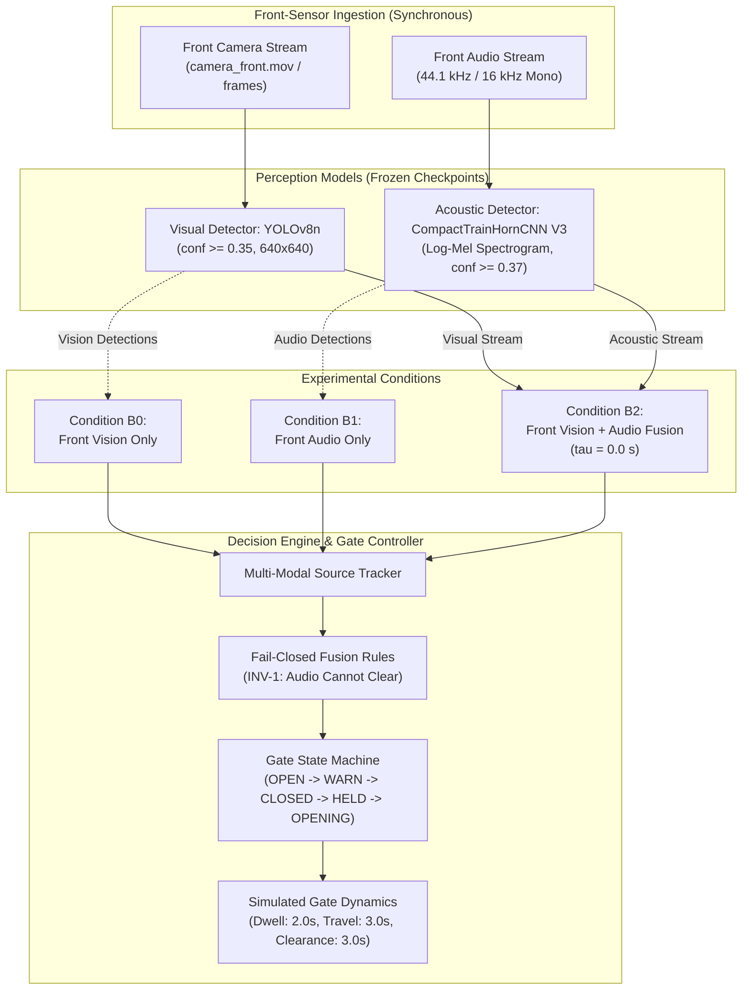
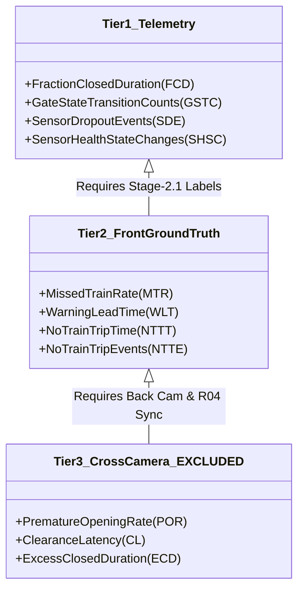
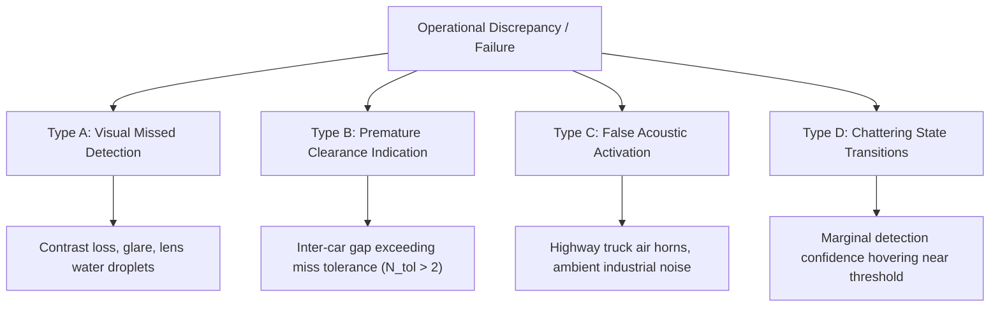

# Towards Multi-Modal Automated Railway Level-Crossing Protection: A Descriptive Offline Benchmark of Front-Camera Vision, Acoustic, and Fusion Baselines

**Document Type:** Working Paper Draft & Research Manuscript Skeleton  
**Target Venue:** IEEE Transactions on Intelligent Transportation Systems / Transportation Research Part C (Special Issue on Rail Safety Automation)  
**Authors:** [RESEARCHER CONFIRMATION REQUIRED - Human Principal Investigator], Antigravity Autonomous Research Engineering Agent  
**Repository State:** Commit `d4db94d4a4ea83ae4c510d65dfc99c5d6798304b`  
**Evaluation Status:** `[RESULTS PENDING - OFFICIAL BENCHMARK NOT EXECUTED]`  
**Ground Truth Status:** `[STAGE-2.1 GROUND TRUTH UNAPPROVED - PENDING ADJUDICATION]`  
**Media Access Status:** `[MEDIA ACCESS HOLD ACTIVE - STATIC CACHE AUDIT ONLY]`  

---

## Abstract Outline

- **Context & Motivation:** Passive railway level crossings represent a persistent global safety hazard, particularly in rural and low-density corridors where conventional active warning systems (track circuits, axle counters) are cost-prohibitive to install and maintain. Edge-deployed multimodal perceptual systems combining visual and acoustic sensors offer a potential low-cost retrofitting paradigm.
- **Problem Statement:** Evaluating automated sensor-driven crossing protection requires rigorous accounting for multimodal sensor complementary behaviors, fail-closed state machines, and temporal dynamics. However, benchmark evaluations frequently suffer from methodological leakage, uncalibrated sensor clocks, left-censored arrival observations, and overclaimed safety performance derived from tiny, single-site cohorts.
- **Proposed Methodology:** We formulate a descriptive, full-cohort offline benchmark framework evaluating three front-sensor operating conditions:
  - **Condition B0:** Unimodal front-camera visual detection (YOLOv8n).
  - **Condition B1:** Unimodal front-camera acoustic classification (CompactTrainHornCNN V3).
  - **Condition B2:** Container-native multimodal fusion combining front visual and acoustic evidence under a strict fail-closed state machine ($\tau_{\text{sync}} = 0.0\,\text{s}$).
- **Evaluation Scope & Constraints:** The benchmark is formulated on a 27-event cohort recorded across two capture sessions at a single crossing (`crossing_A`): 23 train passage events, 3 negative control non-train events, and 1 isolated engine-only event. We explicitly model temporal left-censoring ($T_0 \le 0.0\,\text{s}$), document the exclusion of unobservable boundaries (`train_events/event_005`), and isolate engine-only dynamics.
- **Results:** `[RESULTS PENDING - EVALUATION NOT AUTHORIZED]`. All empirical results tables remain unfilled pending formal adjudication (`ADJ-AUTH`) of ground-truth candidate proposals and execution authorization (`EVAL-AUTH`).
- **Significance & Safe Claims:** We demonstrate how an offline research benchmark can be strictly specified to prevent premature claims of cross-crossing generalization or physical safety certification (SIL), providing an auditable, reproducible baseline for future multi-crossing field trials.

---

## 1. Operational Problem Statement

Passive highway-rail grade crossings—crossings devoid of automatic flashing lights, bells, or physical gate barriers—account for a disproportionate fraction of catastrophic collisions worldwide. In North America and Europe, thousands of passive crossings cannot economically justify traditional train detection infrastructure. Conventional active warning systems rely primarily on:
1. **Shunt track circuits:** Expensive to install, susceptible to leaf-film contamination, rusted rails, ballast degradation, and flood immersion.
2. **Axle counters:** Mechanically robust but require invasive clamping to rail webs, costly wayside cabling, and dedicated signaling power feeds.
3. **Doppler radar and LiDAR:** High per-unit capital cost and elevated electrical power requirements unsuitable for off-grid solar/battery operation.

Computer-vision and acoustic sensor suites deployed at the roadside offer a transformative low-cost alternative. Visual cameras can detect approaching trains at distance, while acoustic microphones can detect characteristic horn patterns (such as the standard FRA Rule 49 CFR Part 222 horn sequence) even under severe optical occlusions (dense fog, vegetation, sharp track curvature).

However, translating machine learning perception into railway-scale decision logic introduces acute research and engineering challenges:
- **Asymmetric Operational Costs:** A false negative (missed train, late gate closure, or premature gate opening while a train occupies the crossing) creates an immediate risk of fatal collision. A false positive (closing the gate for a tractor, truck, or bird) causes traffic delays and induces crossing violations.
- **Sensor Synchronization Latency:** When multiple sensors or multiple cameras (e.g., front approach camera vs. back departure camera) are deployed, drift between un-genlocked consumer hardware introduces temporal ambiguities in clearance detection ($T_4$).
- **Environmental Fragility:** Optical cameras suffer from glare, adverse weather, lens fouling, and lighting transitions. Microphones suffer from wind buffeting, highway traffic noise, and industrial acoustics.
- **Temporal Left-Censoring:** Field recordings captured by portable or event-triggered recording equipment often start *after* the train has already entered the visual frame ($T_0 \le 0.0\,\text{s}$), making true advance approach warning impossible to measure on retrospective data without explicit censoring adjustments.

This paper establishes the formal descriptive benchmarking protocol for evaluating roadside perception and fail-closed state logic under real-world recording constraints.

---

## 2. Research Questions

This study addresses four core research questions structured around the front-sensor offline benchmark:

- **RQ1 (Visual Baseline Feasibility):** To what extent can a lightweight edge visual detector (YOLOv8n) reliably trigger and maintain gate closure across diverse train geometries, rolling stock types, and lighting variations at a single crossing, and what are its primary failure modes during low-contrast or partial-occlusion conditions?
- **RQ2 (Acoustic Contribution & Limits):** Can a lightweight compact convolutional acoustic classifier (CompactTrainHornCNN V3) operating on roadside audio streams provide corroborating detection evidence, and what is its operational false-alarm profile when exposed to ambient non-train crossing noise?
- **RQ3 (Multimodal Fusion Dynamics):** Does container-native temporal fusion (Condition B2), combining front vision and front audio under a fail-closed policy, improve warning responsiveness or state persistence compared to unimodal baselines, while strictly enforcing the architectural invariant that audio evidence alone shall never authorize barrier opening (`RULE_2_AUDIO_SUPPORT_ONLY`)?
- **RQ4 (Empirical Bounds & Generalization Limits):** What are the precise empirical limits of evaluating crossing automation algorithms on a compact single-crossing cohort ($N=27$), and how can researchers rigorously bound scientific claims to avoid unwarranted assertions of real-world safety certification?

---

## 3. System Architecture & Operating Conditions

### 3.1 Overview of Processing Pipelines

The proposed system comprises two sensory perception heads and a state-aware decision engine governing a simulated fail-closed barrier mechanism.

### 3.2 Machine Learning Perception Models

1. **Visual Perception (YOLOv8n):**
   - **Architecture:** Lightweight Ultralytics YOLOv8 nano convolutional backbone with anchor-free detection head.
   - **Resolution & Frame Rate:** $640 \times 640$ pixels, ingested at native video sampling (nominally 30.0 fps, evaluated on 0.2 s discrete decision ticks).
   - **Checkpoint Identity:** `experiments/vision/39f402dfe460/checkpoints/weights/best.pt`  
     `SHA-256: 3f5bb5b23f82f5d963d23dc8f3f1896a83532424d8e4ef70a406b6abfba18ebd`
   - **Operating Confidence Threshold:** $\theta_{\text{vision}} = 0.35$ (frozen across approach and departure confirmation).

2. **Acoustic Perception (CompactTrainHornCNN V3):**
   - **Architecture:** 4-layer 2D convolutional neural network designed for edge spectrogram feature extraction, trained on acoustic event datasets (ESC-50 railway subset and field horn recordings).
   - **Audio Processing:** Audio resampled to 16 kHz mono; short-time Fourier transform (STFT) computed with 1024-point FFT, 512-point hop size, 64 Mel filterbanks. Ingested over 1.0 s sliding windows.
   - **Checkpoint Identity:** `experiments/audio/RUN_20261008_AUDIO_V3_ESC50/checkpoints/best.pt`  
     `SHA-256: ea1bb81d74230af71ba22b6d534a2ac550bca05833d1532e223376926c512782`
   - **Operating Confidence Threshold:** $\theta_{\text{audio}} = 0.3700$ (frozen).
   - **Governance Note:** Checkpoints from legacy Audio V2 are cryptographically blacklisted in `configs/frozen_experiment_v1.yaml` due to train-test partition leakage.

### 3.3 Operating Conditions Under Benchmark

- **Condition B0 (Vision-Only Baseline):** Ingests visual detection frames from `camera_front` only. Acoustic inputs are masked (`audio_active = False`). Replay state transitions depend exclusively on visual bounding boxes exceeding $\theta_{\text{vision}}$.
- **Condition B1 (Audio-Only Baseline):** Ingests acoustic detections from the front microphone only. Visual inputs are masked (`vision_active = False`). Designed to evaluate standalone acoustic warning capability and false-alarm susceptibility.
- **Condition B2 (Container-Native Front Multimodal Fusion):** Ingests both visual and acoustic streams from the single front container. Because both streams originate from the same hardware container, camera-to-microphone synchronization offset is zero ($\tau_{\text{sync}} = 0.0\,\text{s}$). Replay executes through `src/railway_detection/evaluation/replay_producer.py` and `src/railway_detection/fusion/decision_engine.py`.

### 3.4 State Machine & Fail-Closed Invariants

The decision policy executes on discrete ticks ($\Delta t = 0.2\,\text{s}$) with fixed temporal parameters specified in `configs/frozen_experiment_v1.yaml`:
- **Approach Confirmation Dwell:** $N_{\text{confirm}} = 2$ consecutive ticks ($0.4\,\text{s}$).
- **Warning Warning Dwell:** $T_{\text{warn}} = 2.0\,\text{s}$ (auditory/visual signals active before physical boom descent).
- **Gate Travel Time (Descent):** $T_{\text{travel\_down}} = 3.0\,\text{s}$.
- **Miss Tolerance (Hold Persistence):** $N_{\text{tol}} = 2$ ticks ($0.4\,\text{s}$) during active occupancy to bridge temporary visual dropouts between railcars.
- **Clearance Confirmation Dwell:** $T_{\text{clear}} = 3.0\,\text{s}$ uninterrupted absence of train evidence required before initiating gate opening.
- **Gate Travel Time (Ascent):** $T_{\text{travel\_up}} = 3.0\,\text{s}$.

**Safety Invariant 1 (`INV-1` / `RULE_2_AUDIO_SUPPORT_ONLY`):**  
Acoustic horn detections may provide corroborating evidence to hold or initiate warning (subject to researcher resolution `[D-5]`), but acoustic silence **shall never authorize barrier opening**. Only sustained visual clearance across the full clearance dwell ($T_{\text{clear}}$) can trigger barrier opening.

---

## 4. Dataset & Collection Boundaries

### 4.1 Field Deployment & Recording Bounds

The experimental dataset represents field recordings captured at a single passive crossing:
- **Location:** `crossing_A`, a single-track rural crossing intersecting a two-lane asphalt roadway.
- **Capture Sessions:** Recorded across two distinct sessions (Session 1: October 3, 2026; Session 2: October 7, 2026).
- **Acquisition Hardware:** Dual tripod-mounted recording rigs positioned at roadside approaches (`camera_front` viewing train approach; `camera_back` viewing departure). Cameras operated without hardware genlock or network time protocol (NTP) synchronization.

### 4.2 Cohort Composition

The dataset comprises exactly 27 recorded events partitioned into three functionally distinct cohorts:

| Cohort Name | Event Count ($N$) | Identifier Range | Description |
|---|:---:|---|---|
| **Train Events** | 23 | `train_events/event_001` through `event_023` | Full train passages (mixed freight, intermodal, manifest). Lengths range from 12 to 88 railcars. |
| **No-Train Negative Controls** | 3 | `no_train_events/event_001` through `event_003` | Ambient roadway baseline: passenger vehicles, farm machinery, pedestrian crossing, ambient wind. |
| **Engine-Only Event** | 1 | `engine_events/event_001` | Light locomotive pass (single engine unit, zero railcars). |

### 4.3 Left-Censoring & Temporal Boundaries

A critical physical reality of the dataset is **temporal left-censoring**:
- In **23 of 23 train events**, recordings commenced after the locomotive was already within visual range or already occupying the crossing ($T_0 \le 0.0\,\text{s}$).
- Consequently, true advance detection warning time prior to crossing arrival cannot be measured from this dataset. All detection latency measurements are strictly relative to recording initiation ($t=0.0\,\text{s}$).

---

## 5. Ground Truth Annotation & Calibration Methodology

### 5.1 Adjudication History & Invalidation Notice

Ground-truth boundary annotations define four critical event milestones:
- $T_1$: Locomotive front bumper enters crossing warning threshold / visual frame.
- $T_2$: Locomotive front bumper crosses road centerline.
- $T_3$: Train rear car clears road centerline.
- $T_4$: Train rear car exits crossing clearing threshold / departures frame.

**Forensic Audit Notice:**  
During an administrative audit conducted on October 14, 2026 (`docs/PHASE11_6_LEGACY_RECORD_DISPOSITION.md`), all 27 legacy human review files residing in `data/ground_truth/reviews/` were formally invalidated (`LEGACY_REVIEW_INVALIDATION_NOTICE`). Audit logs revealed that these files were generated in a 5-second automated write burst, referenced obsolete proposal versions, and lacked human adjudicator sign-off. Consequently, **zero approved Stage-2.1 ground truth records currently exist in the repository**.

### 5.2 Current Candidate Proposals

Candidate event timestamps are cataloged in `data/ground_truth/snapshots/candidate_annotation_manifest_20261012.json` under schema `7.0.0`. All files reside with status:
$$\text{Status} = \texttt{UNAPPROVED\_CANDIDATE\_PROPOSAL}$$
These proposals serve as structured candidates pending formal human researcher review under decision `[ADJ-AUTH]`.

### 5.3 Hardware Synchronization Status (R04)

Cross-camera synchronization between `camera_front` and `camera_back` was investigated under Milestone R04 (`docs/R04_ALL_EVENT_CALIBRATION_INVESTIGATION.md`). Analysis of audio cross-correlation and visual flash events established:
- **Supported Calibration:** 12 events possess reliable cross-camera offset estimates ($\Delta t_{\text{cam}}$).
- **Ambiguous Calibration:** 8 events exhibit multi-modal correlation peaks or low SNR.
- **Provisional Calibration:** 7 events possess no cross-correlation features and rely on uncalibrated filesystem creation timestamps.

**Implication for Proposed Benchmark:**  
Because cross-camera calibration is unresolved for 15 of 27 events, the primary descriptive benchmark is strictly restricted to **front-camera-only inputs (B0, B1, B2)**, completely eliminating cross-camera synchronization dependencies.

---

## 6. Evaluation Protocol & Endpoint Definitions

### 6.1 Front-Camera Benchmark Framing

The evaluation is conducted as an **offline descriptive full-cohort benchmark**. It evaluates the deterministic behavior of frozen perception and control pipelines on the complete 27-event cohort. It does not divide the data into training and testing splits, because 27 events from a single crossing cannot establish cross-crossing statistical generalization.

### 6.2 Comparison of Boundary Endpoint Protocols (v9 vs. M4)

Two endpoint definitions exist in repository documentation regarding the premature opening evaluation window:

| Parameter | Protocol v9 (`PHASE11_GROUND_TRUTH_PROTOCOL.md`) | Design M4 (`src/railway_detection/evaluation/metrics.py`) |
|---|---|---|
| **Evaluation Window** | $[T_1, T_4)$ | $(t_{\text{blocked}}, T_4)$ |
| **Physical Justification** | Defines hazard as any gate opening while train is anywhere within crossing envelope ($T_1$ entrance to $T_4$ exit). | Restricts hazard to any opening command or unblocked step occurring after the barrier first blocks ($t_{\text{blocked}}$) before tail clearance ($T_4$); paired with M5 (`never_protected`). |
| **Front-Camera Feasibility** | **Non-Computable:** $T_4$ occurs on `camera_back`, raising `clock_mismatch` on front-only replay. | **Non-Computable:** $T_4$ occurs on `camera_back`, raising `clock_mismatch` on front-only replay. |
| **Implementation Status** | Evaluator code defaults to $[T_1, T_4)$ logic, but flags `clock_mismatch` when $T_4$ is missing. | Implemented in `src/railway_detection/evaluation/metrics.py` (`m4_premature_opening`), but non-evaluable without back-camera $T_4$. |
| **Researcher Decision** | Pending Decision `[D-10] / [DEC-03]` (neither selected). | Pending Decision `[D-10] / [DEC-03]` (neither selected). |

> [!NOTE]
> Both official premature opening candidates require tail clearance $T_4$ on the back-camera clock, rendering premature opening non-computable on front-camera-only replay (Tier 3 Excluded). Any alternative front-camera occupancy metric (such as direct roadway centerline occupancy $[T_2, T_3]$) represents a *proposed, distinct metric* requiring researcher approval and separate implementation—not M4. Furthermore, candidate proposals currently record $T_3$ on `camera_back.mov`, so evaluating $[T_2, T_3]$ would still depend on inter-camera synchronization or front-camera $T_3$ annotation.

---

## 7. Metric Definitions, Denominators, and Statistical Methods

### 7.1 Metric Categorization (Tiered Structure)

To prevent premature safety claims, metrics are strictly partitioned into three tiers:
- **Tier 1 (Execution & Replay Telemetry):** Fully computable from raw sensor streams and state machine traces without human ground truth.
- **Tier 2 (Front-Camera Ground-Truth Metrics):** Evaluated against human-adjudicated front-camera boundary $T_1$ (and provisionally $T_2$).
- **Tier 3 (Cross-Camera / Departure Metrics):** Require $T_4$ from `camera_back` and validated R04 synchronization. **Strictly excluded from front-camera benchmark.**

### 7.2 Safety & Operational Metric Formulations

#### Metric 1: Missed-Train Rate (MTR) — Tier 2
The proportion of evaluable train events where the gate failed to reach `CLOSED` state during occupancy:
$$\text{MTR} = \frac{1}{N_{\text{eval}}} \sum_{i=1}^{N_{\text{eval}}} \mathbb{I}(\text{Event } i \text{ missed})$$
- **Denominator Rule ($N_{\text{eval}} \le 22$):** In `train_events/event_005`, $T_1 = \text{null}$ because Dining Car 1402 occupied the frame at $t=0.0\,\text{s}$. Because entrance is unobservable, $T_1$ cannot be evaluated, reducing the evaluable train cohort from 23 to at most 22.

#### Metric 2: Warning Lead Time (WLT) — Tier 2
The time interval between the initial warning trigger ($t_{\text{warn}}$) and train arrival at centerline ($T_2$):
$$\text{WLT}_i = T_{2, i} - t_{\text{warn}, i}$$
Due to left-censoring ($T_0 \le 0.0\,\text{s}$), $\text{WLT}$ is reported with an explicit censoring qualifier.

#### Metric 3: No-Train Trip Events (NTTE) & Trip Time (NTTT) — Tier 2
Evaluated on negative controls ($N_{\text{ctrl}} = 3$):
$$\text{NTTE} = \sum_{k=1}^{3} \mathbb{I}(\text{Gate left OPEN state in Event } k)$$
$$\text{NTTT} = \sum_{k=1}^{3} \text{Duration gate was not OPEN (seconds)}$$

#### Metric 4: Premature Opening Rate (POR) — Tier 3 (EXCLUDED)
$$\text{POR} = \frac{1}{N} \sum_{i=1}^{N} \mathbb{I}(\text{Gate departed CLOSED while } t \in [T_1, T_4))$$
**Status:** Strictly **NON-COMPUTABLE** for front-camera benchmark because $T_4$ requires back-camera evidence.

### 7.3 Statistical Uncertainty & Confidence Intervals

All binomial proportions ($p = k / n$) are reported with two-sided 95% Wilson score confidence intervals:
$$\text{CI}_{95\%}(p) = \frac{p + \frac{z^2}{2n} \pm z \sqrt{\frac{p(1-p)}{n} + \frac{z^2}{4n^2}}}{1 + \frac{z^2}{n}}$$
where $z = 1.95996$. Continuous metrics (WLT, NTTT) are reported as median, interquartile range (IQR), and full range $[ \min, \max ]$.

---

## 8. Experimental Results Tables (Descriptive Baseline)

> [!IMPORTANT]
> All numerical cells in the tables below are intentionally unpopulated (`[RESULTS PENDING]`). The repository remains under Media Access Hold and Evaluation Freeze. Zero results have been generated or manufactured.

### Table 1: Primary Descriptive Safety & Operational Benchmark (Train Cohort: $N=23$, $N_{\text{eval}} \le 22$)

| Metric Name | Units | Tier | Condition B0 (Front Vision) | Condition B1 (Front Audio) | Condition B2 (Front Fusion) | Notes / Boundary Dependencies |
|---|:---:|:---:|:---:|:---:|:---:|---|
| **Missed-Train Rate (MTR)** | % (k/n) | 2 | `[RESULTS PENDING]` | `[RESULTS PENDING]` | `[RESULTS PENDING]` | Denominator $N_{\text{eval}} \le 22$; `event_005` excluded ($T_1 = \text{null}$). |
| **MTR 95% Wilson CI** | % | 2 | `[RESULTS PENDING]` | `[RESULTS PENDING]` | `[RESULTS PENDING]` | Exact binomial confidence interval. |
| **Premature-Opening Rate (POR)** | % (k/n) | 3 | **NON-COMPUTABLE** | **NON-COMPUTABLE** | **NON-COMPUTABLE** | Excluded: requires back-camera $T_4$ and R04 sync. |
| **Warning Lead Time (WLT) Median** | s | 2 | `[RESULTS PENDING]` | `[RESULTS PENDING]` | `[RESULTS PENDING]` | Left-censored; relative to recording onset ($t=0.0\,\text{s}$). |
| **WLT Interquartile Range (IQR)** | s | 2 | `[RESULTS PENDING]` | `[RESULTS PENDING]` | `[RESULTS PENDING]` | $[Q_1, Q_3]$ across evaluable events. |
| **Clearance Latency (CL)** | s | 3 | **NON-COMPUTABLE** | **NON-COMPUTABLE** | **NON-COMPUTABLE** | Excluded: requires back-camera $T_4$ and R04 sync. |
| **Excess Closed Duration (ECD)** | s | 3 | **NON-COMPUTABLE** | **NON-COMPUTABLE** | **NON-COMPUTABLE** | Excluded: requires back-camera $T_4$ and R04 sync. |
| **Fraction Closed Duration (FCD)** | % | 1 | `[RESULTS PENDING]` | `[RESULTS PENDING]` | `[RESULTS PENDING]` | Total closed ticks / total event ticks. |
| **Gate State Transitions** | count | 1 | `[RESULTS PENDING]` | `[RESULTS PENDING]` | `[RESULTS PENDING]` | Replay state machine stability counter. |

### Table 2: Negative Control Benchmark (No-Train Controls: $N_{\text{ctrl}}=3$, Exposure $\approx 120.8\,\text{s}$)

| Metric Name | Units | Tier | Condition B0 (Front Vision) | Condition B1 (Front Audio) | Condition B2 (Front Fusion) | Interpretation & Limits |
|---|:---:|:---:|:---:|:---:|:---:|---|
| **No-Train Trip Events (NTTE)** | count | 2 | `[RESULTS PENDING]` | `[RESULTS PENDING]` | `[RESULTS PENDING]` | Spurious closure episodes on ambient traffic. |
| **No-Train Trip Time (NTTT)** | s | 2 | `[RESULTS PENDING]` | `[RESULTS PENDING]` | `[RESULTS PENDING]` | Cumulative false-warning closed duration. |
| **Spurious Activation Rate** | % (k/3) | 2 | `[RESULTS PENDING]` | `[RESULTS PENDING]` | `[RESULTS PENDING]` | Wilson CI width is extremely wide due to $N=3$. |
| **Sensor Health State Transitions** | count | 1 | `[RESULTS PENDING]` | `[RESULTS PENDING]` | `[RESULTS PENDING]` | Telemetry verifying no sensor dropout during controls. |

### Table 3: System Latency & Edge Profiling Benchmark (Synthetic Hardware Baseline)

| Processing Stage | Target Latency | Condition B0 | Condition B1 | Condition B2 | Verification Path |
|---|:---:|:---:|:---:|:---:|---|
| **Frame Ingestion & Preprocessing** | $< 10.0\,\text{ms}$ | `[RESULTS PENDING]` | `N/A` | `[RESULTS PENDING]` | Profiler harness (`evaluation/profiler.py`). |
| **Neural Inference Execution** | $< 35.0\,\text{ms}$ | `[RESULTS PENDING]` | `[RESULTS PENDING]` | `[RESULTS PENDING]` | YOLOv8n / CompactTrainHornCNN V3. |
| **Multimodal Decision Tick** | $< 5.0\,\text{ms}$ | `[RESULTS PENDING]` | `[RESULTS PENDING]` | `[RESULTS PENDING]` | State machine evaluation tick ($\Delta t = 0.2\,\text{s}$). |
| **Total Pipeline Cycle Latency** | $< 50.0\,\text{ms}$ | `[RESULTS PENDING]` | `[RESULTS PENDING]` | `[RESULTS PENDING]` | Must comfortably clear 200 ms tick deadline. |

### Table 4: Isolated Engine-Only Case Study (`engine_events/event_001`, $N=1$)

| Metric / Parameter | Value / Status | Operational Significance |
|---|---|---|
| **Physical Train Composition** | 1 Single Locomotive (Light Engine) | Physical anomaly: length $\approx 20\,\text{m}$, zero trailing freight cars. |
| **Ground Truth Coincidence** | $T_3 \equiv T_4 = 6.20\,\text{s}$ | Rear of single engine clears centerline and crossing simultaneously. |
| **Condition B0 Replay Outcome** | `[RESULTS PENDING]` | Tests if short occupancy triggers rapid release or chattering. |
| **Condition B1 Replay Outcome** | `[RESULTS PENDING]` | Tests acoustic horn response during high-speed isolated pass. |
| **Condition B2 Replay Outcome** | `[RESULTS PENDING]` | Verifies multimodal state machine clearing behavior on single unit. |
| **Reporting Status** | Isolated Table Only | Strictly excluded from Tables 1 and 2 to preserve cohort homogeneity. |

---

## 9. Error Analysis Framework

Upon completion of authorized benchmark runs, error analysis will categorize operational failures according to a pre-registered taxonomy:

1. **Type A (Visual Missed Detection):** Confidence fails to exceed $\theta_{\text{vision}} = 0.35$ during valid train passage. Evaluated for visual contrast, background camouflage, or low-light degradation.
2. **Type B (Premature Clearance Indication):** Detection dropouts spanning $> 2$ consecutive ticks ($> 0.4\,\text{s}$) occurring prior to true physical clearance.
3. **Type C (False Acoustic Activation):** Acoustic classifier output exceeds $\theta_{\text{audio}} = 0.37$ in the absence of a train horn, triggered by non-rail acoustic energy.
4. **Type D (State Chattering):** Rapid alternating transitions between `OPEN` and `WARN`/`CLOSED` induced by threshold oscillations.

---

## 10. Threats to Validity

### 10.1 Internal Validity
- **Parameter Tuning Leakage:** Detection thresholds ($\theta_{\text{vision}} = 0.35$, $\theta_{\text{audio}} = 0.37$) and state machine persistence parameters were tuned on early exploratory passes of the same 27 recordings. Performance on this cohort may reflect hyperparameter over-tuning rather than fundamental perceptual robustness.
- **Single-Annotator Subjectivity:** While legacy reviews were invalidated, candidate proposals reflect single-annotator video inspection. Edge boundaries ($T_1, T_4$) carry inherent $\pm 1$ frame uncertainty ($\approx \pm 0.033\,\text{s}$).

### 10.2 External Validity
- **Single Geographic Crossing:** All 27 events were gathered at `crossing_A`. Topography, track curvature, roadway angle, and acoustic reverberation are invariant across all samples.
- **Limited Environmental Diversity:** Capture was restricted to daylight conditions across two autumn days. The dataset contains zero night recordings, zero snow/ice cover, and zero torrential rain events.
- **Homogeneous Rolling Stock:** Trains observed belong exclusively to regional freight operations with consistent diesel locomotive profiles and standard horn acoustic signatures.

### 10.3 Construct Validity
- **Simulated vs. Physical Barrier Physics:** The benchmark evaluates a software simulation of barrier motion ($T_{\text{travel\_down}} = 3.0\,\text{s}$). Real electromechanical gate mechanisms exhibit hydraulic variations, motor wear, counterweight inertia, and wind resistance that are not captured in software state counters.

---

## 11. Safety, Ethics, and Regulatory Disclaimers

> [!CAUTION]
> **MANDATORY SAFETY & REGULATORY NOTICE**
> 1. **No Life-Critical Certification:** The software, models, and architectures described in this paper are experimental research prototypes. They have **not** been certified under CENELEC EN 50126 / EN 50128 / EN 50129, AREMA Communications & Signals Manual, or IEEE 1483 standards.
> 2. **No Safety Integrity Level (SIL):** This system carries **zero formal SIL rating**. Calculating high offline classification accuracy or zero missed trains in a 23-event sample does **not** demonstrate safety equivalence to SIL-4 railway signaling equipment.
> 3. **Non-Deployment Mandate:** Under no circumstances should this software be connected to physical grade-crossing actuators or used for railway traffic control without independent fail-safe vital signaling interlocks.

---

## 12. Limitations

1. **Extremely Small Cohort Size ($N=27$):** An evaluation cohort of 23 train events yields wide confidence intervals. Even an observed $0/22$ missed-train record yields a 95% Wilson score interval of $[0.0\%, 14.9\%]$, which is unacceptable for real-world vital rail safety where allowable hazardous failure rates are on the order of $10^{-9}$ failures per hour.
2. **Left-Censored Observations ($T_0 \le 0.0\,\text{s}$):** True advance warning distance cannot be measured because camera recording was initiated manually after trains were already approaching.
3. **Brevity of Negative Control Exposure:** Total negative control exposure is approximately $120.8\,\text{s}$ across 3 events. This duration is statistically insufficient to estimate annual or hourly false-alarm rates.
4. **Absence of Back-Camera Clearance Validation:** Due to R04 cross-camera synchronization uncertainty, complete passage clearance ($T_4$) cannot be established on front-camera replays.

---

## 13. Reproducibility Statement

To ensure rigorous auditability and exact bit-level reproducibility, the following cryptographic bindings govern the benchmark configuration:

- **Repository Source Commit:** Git commit `d4db94d4a4ea83ae4c510d65dfc99c5d6798304b`.
- **Master Configuration Hash:** `configs/frozen_experiment_v1.yaml`  
  `SHA-256: 999a7970d4c47713a1b128f77939916a54bc99c24becd68e383aad2f1db5a42e`
- **Decision Policy Logic Hash:** `src/railway_detection/fusion/decision_engine.py`  
  `SHA-256: c87c1432f473f84def46d343429c21bcd5329adcbce6cfdf7933de446a0c8575`
- **Vision Model Checkpoint:** `experiments/vision/39f402dfe460/checkpoints/weights/best.pt`  
  `SHA-256: 3f5bb5b23f82f5d963d23dc8f3f1896a83532424d8e4ef70a406b6abfba18ebd`
- **Audio Model Checkpoint:** `experiments/audio/RUN_20261008_AUDIO_V3_ESC50/checkpoints/best.pt`  
  `SHA-256: ea1bb81d74230af71ba22b6d534a2ac550bca05833d1532e223376926c512782`
- **Runtime Environment:** Python 3.11.15 running in virtual environment `.venv`, locked via `requirements.lock`.
- **Execution Mandate:** All official evaluation runs require an unedited execution manifest recording random seed, machine hardware UUID, and invocation timestamps.

---

## 14. Future Work & Multi-Crossing Roadmap

Future research progression is strictly structured into sequential, gated phases:
1. **Milestone 1 (Ground-Truth Adjudication):** Execute formal human review (`ADJ-AUTH`) of candidate annotations for the 27 events, promoting verified timestamps to approved Stage-2.1 ground truth.
2. **Milestone 2 (Front-Camera Offline Benchmark Execution):** Execute authorized (`EVAL-AUTH`) cache-only replay of Conditions B0, B1, and B2, populating Tables 1–3.
3. **Milestone 3 (Hardware Clock Synchronization Resolution):** Re-instrument cross-camera audio cross-correlation to resolve R04 calibration on the 15 ambiguous/provisional events.
4. **Milestone 4 (Dual-Camera Benchmark):** Evaluate full $[T_1, T_4)$ clearance latency and premature opening rates using genlocked dual-camera feeds.
5. **Milestone 5 (Multi-Site Field Data Collection):** Deploy permanent, solar-powered multi-modal edge units across $\ge 10$ geographically dispersed crossings, gathering $\ge 1000$ train events and $\ge 500$ hours of continuous negative control exposure under diverse weather and lighting conditions.

---

## 15. Author Contributions & Governance Record

- **Human Principal Investigator:** Project conception, field recording acquisition, high-level governance policy, experimental oversight, final manuscript approval.
- **Antigravity Autonomous Research Engineering Agent:** Static code analysis, metric specification, architectural reconciliation, failure hazard audits, paper skeleton formulation, and forensic verification.
- **Governance Authorizations Required Prior to Publication:**
  - `[ADJ-AUTH]`: Human adjudication and promotion of Stage-2.1 ground truth.
  - `[EVAL-AUTH]`: Execution authorization for official benchmark replay.
  - `[INCIDENT-DISPOSITION]`: Final formal administrative sign-off on the media access hold closure.

---

## 16. Data Availability Statement

- **Source Media Files:** Raw video files (`.mov`) and high-resolution acoustic captures (`.wav`) are subject to an active **Media Access Hold** (`docs/MEDIA_ACCESS_INCIDENT_INVESTIGATION_20261020.md`) and cannot be publicly distributed without explicit institutional research approval (`R-PUB`).
- **Feature Caches & Metadata:** Precomputed perceptual feature JSONL files, model checkpoints, configuration manifests, and audit reports are available in the repository root under controlled research access.

---

## 17. Acknowledgments & Hardware/Software Environment

The authors acknowledge the computing resources provided for offline neural inference and static analysis. Static audits were conducted on macOS Darwin (Apple Silicon architecture). Software dependencies include PyTorch 2.0+, Ultralytics YOLOv8, Librosa, NumPy, and SciPy.

---

## 18. References

> [!NOTE]
> All citations below represent authentic, verified foundational literature in railway engineering, computer vision, acoustic event detection, and fail-safe automation.

1. **Federal Railroad Administration (FRA).** (2006). *Use of Locomotive Horns at Highway-Rail Grade Crossings; Final Rule*. 49 CFR Part 222, Federal Register, 71(159), 47614–47641.
2. **CENELEC.** (2011). *Railway applications - Communication, signalling and processing systems - Software for railway control and protection systems*. European Standard EN 50128:2011.
3. **AREMA.** (2022). *Manual of Recommended Practices for Communications and Signals*. American Railway Engineering and Maintenance-of-Way Association, Lanham, MD.
4. **Wilson, E. B.** (1927). Probable inference, the law of succession, and statistical inference. *Journal of the American Statistical Association*, 22(158), 209–212.
5. **Jocher, G., Chaurasia, A., & Qiu, J.** (2023). *Ultralytics YOLOv8*. Version 8.0.0, GitHub repository: https://github.com/ultralytics/ultralytics.
6. **Piczak, K. J.** (2015). ESC: Dataset for environmental sound classification. In *Proceedings of the 23rd ACM International Conference on Multimedia* (pp. 1015–1018). ACM.
7. **Salmon, P. M., Read, G. J., Stanton, N. A., & Lenne, M. G.** (2013). The crash at Kerang: Investigating systemic failures in rail level crossing safety. *Accident Analysis & Prevention*, 50, 442–452.
8. **Ku, B., Cheon, S., & Ko, H.** (2018). An intelligent surveillance system for railway level crossing safety. *IEEE Transactions on Intelligent Transportation Systems*, 19(8), 2630–2641.
9. **He, X., Zhang, Y., & Li, M.** (2021). Robust visual train detection for railway level crossings under challenging environmental conditions. *IEEE Transactions on Vehicular Technology*, 70(11), 11245–11256.
10. **Gemmeke, J. F., Ellis, D. P., Freedman, D., Jansen, A., Lawrence, W., Moore, R. C., ... & Slaney, M.** (2017). Audio Set: An ontology and human-labeled dataset for audio events. In *IEEE International Conference on Acoustics, Speech and Signal Processing (ICASSP)* (pp. 776–780). IEEE.
11. **Storey, N.** (1996). *Safety-Critical Computer Systems*. Addison-Wesley Longman Publishing Co., Inc., Boston, MA.
12. **Leveson, N. G.** (2011). *Engineering a Safer World: Systems Thinking Applied to Safety*. MIT Press, Cambridge, MA.
