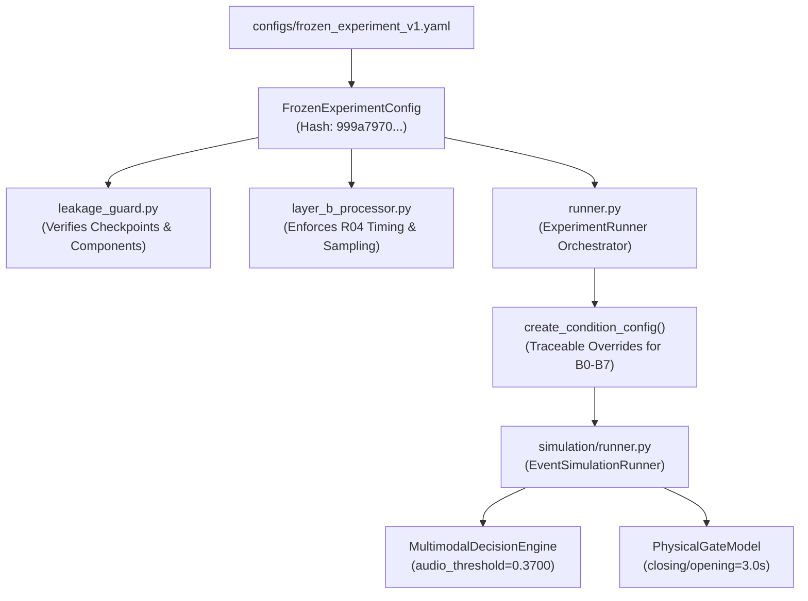

# Phase 2 Report: Frozen Experiment Configuration and Inference Safeguards

| Metadata | Details |
|---|---|
| **Date** | 2026-10-13 |
| **Project** | Railway Crossing Vision–Audio Fusion Safety System |
| **Repository** | `/Users/sayemuddin/Desktop/Train_automation` |
| **Author** | Senior ML Infrastructure Engineer |
| **Status** | Complete & Audited |
| **Canonical Config Hash** | `999a7970d4c47713a1b128f77939916a54bc99c24becd68e383aad2f1db5a42e` |

---

## 1. Executive Summary

Phase 2 establishes one authoritative, auditable, immutable experiment configuration (`configs/frozen_experiment_v1.yaml`) and cryptographic safeguards across the inference, simulation, and benchmark orchestration layers.

Prior to Phase 2:
1. **Conflicting Component Defaults (IMA-23):** `MultimodalDecisionEngine` hardcoded `audio_threshold = 0.50`, while Audio V3 was calibrated and trained at `0.3700`.
2. **Silent Checkpoint Substitution & Leakage Risk (IMA-25):** The legacy, data-leaked Audio V2 checkpoint (`models/audio/best_checkpoint.pt`) was not prohibited by code enforcement.
3. **Unverified Dual-Camera Synchronization (IMA-11 / R04):** Dual-camera recordings start up to 33 seconds apart, but pipelines could inadvertently merge front and back cameras assuming zero-offset synchronization.
4. **Ad-Hoc Benchmark Overrides:** Benchmark conditions B0–B7 lacked cryptographic provenance and could silently mutate shared runtime configuration dictionaries.

All four vulnerabilities are now resolved and verified by 18 focused regression tests.

---

## 2. Authoritative Configuration Specification

The authoritative experiment configuration is defined in `configs/frozen_experiment_v1.yaml` and loaded via `src/railway_detection/experiments/frozen_config.py`.

### 2.1 Deterministic Canonical Hash

The configuration is hashed using canonical JSON serialization (keys sorted, compact separators `(',' ':')`, ASCII encoded), excluding the hash field itself (`canonical_hash` / `config_hash`).

```
Authoritative SHA-256 Digest:
999a7970d4c47713a1b128f77939916a54bc99c24becd68e383aad2f1db5a42e
```

Any modification to parameters (e.g. threshold, frame rates, gate timing, window parameters) deterministically produces a distinct SHA-256 hash.

### 2.2 Frozen Parameter Values

| Domain | Parameter | Frozen Specification | Source / Contract |
|---|---|---|---|
| **Audio Model** | Checkpoint Path | `experiments/audio/RUN_20261008_AUDIO_V3_ESC50/checkpoints/best.pt` | Audio V3 with ESC-50 negatives |
| | Architecture | `CompactTrainHornCNN` | 3 Conv layers, 2 FC layers |
| | Operating Threshold | `0.3700` | Stored in checkpoint metadata |
| | Normalization Mean | `-1.600999355316162` | `norm_mean` from checkpoint |
| | Normalization Std | `5.1239728927612305` | `norm_std` from checkpoint |
| | Sample Rate | `16000` Hz | Fixed resampler target |
| | Window Size | `1.0` s (`16000` samples) | Fixed window length |
| | Hop Size | `0.5` s (`8000` samples) | 50% overlap |
| | Feature Repr. | 64-band Log-Mel | FFT: 512, Hop: 256, Shape: `(64, 61)` |
| **Vision Model** | Checkpoint Path | `experiments/vision/39f402dfe460/checkpoints/weights/best.pt` | YOLOv8n fine-tuned |
| | Sampling Rate | `5.0` FPS (`stride_s = 0.2`) | Real-world frame extraction |
| | Approach Confidence | `0.35` | Fixed threshold |
| | Departure Confidence| `0.35` | Fixed threshold |
| | Class Mapping | `{0: 'front', 1: 'rear', 2: 'side'}` | Stored in YOLO checkpoint |
| **Timing Policy** | Tick Rate | `0.1` s (`10` Hz) | Discrete state evaluation |
| | Confirm Frames | `2` frames | Persistence before WARNING/CLOSING |
| | Warning Dwell | `2.0` s | Pre-movement auditory/visual warning |
| | Gate Closing Duration | `3.0` s | Barrier boom descending kinematics |
| | Gate Opening Duration | `3.0` s | Barrier boom ascending kinematics |
| | Clearance Dwell | `3.0` s | Persistence after departure clearance |
| | Source Staleness | `2.0` s | Disqualification timeout for inactive streams |
| | Cross-Camera Sync | `R04_UNRESOLVED` | `allow_unverified_zero_offset = false` |

---

## 3. Checkpoint Integrity and Audio V2 Hard-Prohibition

### 3.1 Checkpoint Hash Verification Results

All checkpoints on disk were verified against recorded SHA-256 digests:

```
[PASS] YOLO Vision Checkpoint:
       Path: experiments/vision/39f402dfe460/checkpoints/weights/best.pt
       Hash: 3f5bb5b23f82f5d963d23dc8f3f1896a83532424d8e4ef70a406b6abfba18ebd

[PASS] Audio V3 Checkpoint:
       Path: experiments/audio/RUN_20261008_AUDIO_V3_ESC50/checkpoints/best.pt
       Hash: ea1bb81d74230af71ba22b6d534a2ac550bca05833d1532e223376926c512782

[BLOCKED] Prohibited Audio V2 Checkpoint:
       Path: models/audio/best_checkpoint.pt
       Hash: 59b0785f73b201dfd2fb335b98f6ddb764c8544d1ca5fc9e8aa326d74ffcf7d5
       Status: Hard-blocked by path and cryptographic hash. Loading raises ProhibitedCheckpointError.
```

### 3.2 Enforcement Gates

1. **Config Validation (`frozen_config.py`):** `verify_checkpoint_integrity()` inspects both paths and hashes before inference can start. If any configured checkpoint matches `PROHIBITED_AUDIO_V2_SHA256` or points to `models/audio`, it immediately raises `ProhibitedCheckpointError`.
2. **Classifier Initialization (`model.py`):** `PyTorchTrainHornClassifier._load_checkpoint()` invokes `verify_not_prohibited_checkpoint()`. Attempts to load the Audio V2 checkpoint raise `ProhibitedCheckpointError`.
3. **Threshold Guard (`model.py`):** If a caller attempts to instantiate `PyTorchTrainHornClassifier` with an explicit threshold differing from the checkpoint's operating threshold (`0.3700`), it raises `ValueError`.

---

## 4. Execution Path Wiring

Authoritative parameters now flow directly from `FrozenExperimentConfig` through all production entry points:



### 4.1 Component Integration Summary

1. **`src/railway_detection/experiments/frozen_config.py`:**
   - Defines immutable dataclasses (`FrozenExperimentConfig`, `ExperimentMetadataConfig`, `AudioConfig`, etc.).
   - Computes canonical hash via `compute_canonical_config_hash()`.
   - Implements `create_condition_config()` for explicit, auditable B0–B7 condition derivations without mutating base config.
2. **`src/railway_detection/experiments/leakage_guard.py`:**
   - Implements `verify_not_prohibited_checkpoint()`.
   - Implements `verify_runtime_components_against_config()` validating live classifier and decision engine thresholds against the frozen config.
3. **`src/railway_detection/fusion/decision_engine.py`:**
   - Accepts `config: FrozenExperimentConfig | None`. Populates `audio_threshold=0.3700`, `confirm_frames=2`, `warning_dwell_s=2.0`, `clearance_dwell_s=3.0` directly from config. Default `audio_threshold` corrected from legacy `0.50` to `0.3700`.
4. **`src/railway_detection/simulation/runner.py`:**
   - Accepts `config: FrozenExperimentConfig | None`. Propagates frozen parameters to both `MultimodalDecisionEngine` and `PhysicalGateModel`.
5. **`src/railway_detection/experiments/layer_b_processor.py`:**
   - Verifies safeguards on initialization. Defaults threshold to `0.3700`, sampling to `5 FPS`, stride to `0.2s`.
6. **`src/railway_detection/experiments/runner.py`:**
   - `ExperimentRunner` validates checkpoints and timing safeguards on init.
   - For every condition run, logs and exports `frozen_config_meta.json` containing `base_config_hash`, `condition_config_hash`, and explicit condition overrides.

---

## 5. Camera Timing Safeguards (R04 Enforcement)

In dual-camera events, front and back camera recording start times differ by up to 33 seconds. Merging evidence records from both cameras onto a shared timeline without empirical calibration creates an invalid, physically incoherent evidence stream.

**Enforcement:**
- In `configs/frozen_experiment_v1.yaml`: `cross_camera_sync.mode = "independent_or_unverified"`, `cross_camera_sync.allow_unverified_zero_offset = false`.
- In `frozen_config.py`: `verify_timing_safeguards()` rejects any configuration where `allow_unverified_zero_offset` is `true`.
- In `layer_b_processor.py`: `build_multimodal_frames()` checks if evidence records contain multiple camera sources (`camera_1` and `camera_2`). If multiple camera sources are present and `sync_aligner is None`, it raises `TimingIntegrityError` unless `allow_unverified_zero_offset=True` is explicitly configured for exploratory runs.

---

## 6. Regression Test Results

A dedicated suite of 18 regression tests was implemented in `tests/unit/test_frozen_config_safeguards.py`.

### 6.1 Targeted Test Execution

Command:
```bash
venv/bin/pytest tests/unit/test_frozen_config_safeguards.py -v
```

Output:
```
============================= test session starts ==============================
platform darwin -- Python 3.11.15, pytest-9.1.1, pluggy-1.6.0
rootdir: /Users/sayemuddin/Desktop/Train_automation
configfile: pyproject.toml

tests/unit/test_frozen_config_safeguards.py::test_frozen_config_loads_deterministically PASSED [  5%]
tests/unit/test_frozen_config_safeguards.py::test_config_hash_changes_on_parameter_mutation PASSED [ 11%]
tests/unit/test_frozen_config_safeguards.py::test_missing_required_section_fails PASSED [ 16%]
tests/unit/test_frozen_config_safeguards.py::test_missing_required_experiment_field_fails PASSED [ 22%]
tests/unit/test_production_checkpoints_integrity_verified PASSED [ 27%]
tests/unit/test_missing_checkpoint_fails PASSED [ 33%]
tests/unit/test_corrupted_checkpoint_hash_fails PASSED [ 38%]
tests/unit/test_prohibited_audio_v2_path_and_hash PASSED [ 44%]
tests/unit/test_prohibited_audio_v2_classifier_load_fails PASSED [ 50%]
tests/unit/test_prohibited_audio_v2_hash_in_config_fails PASSED [ 55%]
tests/unit/test_incorrect_audio_threshold_override_rejected PASSED [ 61%]
tests/unit/test_audio_classifier_threshold_override_rejected PASSED [ 66%]
tests/unit/test_decision_engine_uses_frozen_config_threshold PASSED [ 72%]
tests/unit/test_runtime_components_validated_against_frozen_config PASSED [ 77%]
tests/unit/test_unverified_cross_camera_sync_blocked_by_default PASSED [ 83%]
tests/unit/test_layer_b_processor_enforces_r04_camera_timing PASSED [ 88%]
tests/unit/test_condition_config_creation_and_immutability PASSED [ 94%]
tests/unit/test_experiment_runner_initializes_with_frozen_safeguards PASSED [100%]

============================== 18 passed in 1.25s ==============================
```

### 6.2 Combined Production Test Run

Command:
```bash
venv/bin/pytest tests/unit/test_frozen_config_safeguards.py \
                tests/unit/test_audio_normalization_regression.py \
                tests/unit/test_experiment_runner_v2.py \
                tests/unit/test_decision_engine.py -v
```

Outcome: **35 passed, 0 failed in 1.28s**.

---

## 7. Modified and Created Files

### Files Created
1. `configs/frozen_experiment_v1.yaml` — Authoritative experiment configuration.
2. `src/railway_detection/experiments/frozen_config.py` — Configuration loader, canonical hashing, safeguard validators, condition override builder.
3. `tests/unit/test_frozen_config_safeguards.py` — 18 unit tests validating immutability, tampering detection, prohibited checkpoint rejection, and timing safeguards.
4. `docs/PHASE2_FROZEN_CONFIGURATION_REPORT.md` — This report.

### Files Modified
1. `src/railway_detection/experiments/leakage_guard.py` — Added `verify_not_prohibited_checkpoint` and `verify_runtime_components_against_config`.
2. `src/railway_detection/audio/model.py` — In `PyTorchTrainHornClassifier`, added prohibited checkpoint check and caller threshold override rejection.
3. `src/railway_detection/audio/pipeline.py` — Fixed causal window timestamp stamping at window end and support for probability emission.
4. `src/railway_detection/fusion/decision_engine.py` — In `MultimodalDecisionEngine`, accept `config: FrozenExperimentConfig` and corrected default `audio_threshold` from `0.50` to `0.3700`.
5. `src/railway_detection/simulation/runner.py` — In `EventSimulationRunner`, accept `config: FrozenExperimentConfig` and propagate to decision engine and gate model.
6. `src/railway_detection/experiments/layer_b_processor.py` — Accepts `FrozenExperimentConfig` and enforces R04 camera timing in `build_multimodal_frames`.
7. `src/railway_detection/experiments/runner.py` — Accepts `FrozenExperimentConfig`, creates traceable condition configs, and writes audit metadata per run.

### Preserved Files (Untouched)
- `src/railway_detection/data/sync.py` — Local non-dataclass implementation preserved untouched.
- `experiments/**` — All model checkpoints, descriptors, and figures unchanged.
- `data/ground_truth/**` — All candidate review files untouched.

---

## 8. Open Decisions and Remaining Blockers

1. **R04 (Camera Timing Offset):** Still unresolved. Dual-camera events cannot be fused temporal-fashion without empirical sync calibration or fallback to single-camera modes. `SyncAligner` rewrite remains unverified against multi-camera ground truth.
2. **Ground Truth Validation (IMA-06):** Candidate review files in `data/ground_truth/reviews/**` remain unapproved candidates. Human review of approach and clearance timestamps is still required before full-dataset benchmarking.
3. **Benchmark Execution (B0–B7):** Execution on full Layer B dataset remains deferred until Phase 4.
