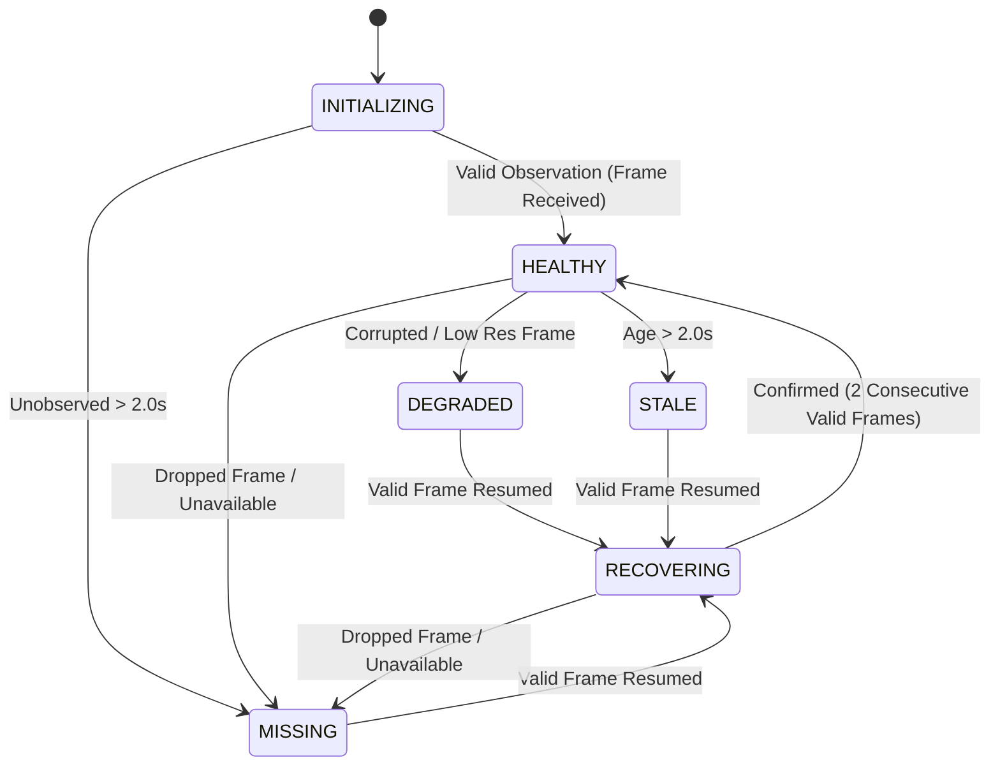

# Phase 3: Sensor Health, Staleness, and Decision Policy Specification

## 1. Overview and Objective

This specification establishes the authoritative Phase 3 sensor health monitoring, timing-aware staleness management, deterministic multimodal decision policy, and actuator kinematics for the Railway Crossing Vision–Audio Safety System.

The core objective is to ensure that multimodal simulation and benchmark runs produce auditable, temporally defensible decisions instead of silently trusting missing, stale, invalid, or incorrectly synchronized observations.

> [!IMPORTANT]
> **Safety Scope Clarification:**
> This document specifies an offline and simulation safety policy designed to prevent silent sensor failure, stale clearance, or unverified temporal fusion during experimental benchmarking. It does **not** certify or authorize physical level-crossing railway deployment.

---

## 2. Sensor Health State Model

Each sensor source (`camera_1`, `camera_2`, `audio_1`, etc.) is tracked through an explicit, deterministic health state machine implemented in [`src/railway_detection/fusion/source_tracker.py`](file:///Users/sayemuddin/Desktop/Train_automation/src/railway_detection/fusion/source_tracker.py).

### 2.1 Health States (`SensorHealth`)



1. **`HEALTHY`**: The source is transmitting valid observations within the configured staleness timeout ($t_{\text{age}} \le 2.0\text{s}$).
2. **`DEGRADED`**: Observations are received, but frame quality, resolution, or inference integrity is compromised.
3. **`STALE`**: The elapsed time since the last valid observation exceeds the configured staleness timeout ($t_{\text{age}} > 2.0\text{s}$).
4. **`MISSING`**: The sensor stream dropped, disconnected, or reported `available = False`.
5. **`RECOVERING`**: The sensor resumed transmitting valid observations after a fault, but is undergoing confirmation before full operational eligibility.

### 2.2 Health Reason Codes (`HealthReason`)

Every state assignment retains an auditable reason code:
- `OBSERVATION_HEALTHY`: Valid observation with active detections.
- `OBSERVATION_NO_DETECTIONS`: Valid observation with zero train detections (healthy negative evidence).
- `OBSERVATION_DEGRADED`: Degraded observation received.
- `TIMEOUT_STALE`: Observation age strictly exceeded $2.0\text{s}$ timeout.
- `INPUT_MISSING`: Stream disconnected or dropped.
- `OUT_OF_ORDER`: Timestamp $t < t_{\text{last}}$, observation rejected.
- `RECOVERY_PENDING`: Source emitting valid observations, awaiting $2$ confirmation frames.
- `FLAPPING_INSTABILITY`: Repeated oscillation between healthy and failed states tracked.
- `INITIALIZING`: Stream registered but unobserved.

### 2.3 The Negative Evidence Invariant (IMA-15 Resolution)

> [!CRITICAL]
> **No detection is NOT sensor failure.**
> A valid video frame with zero bounding boxes is a fully functioning observation establishing that no train is visually visible in the camera frame. Similarly, an audio inference window yielding train probability $0.05 < 0.3700$ is a functioning acoustic observation.
> 
> Input-data health is monitored strictly independently of semantic model detections:
> - `available=True` and `detections=()` $\implies$ `HEALTHY` (Reason: `OBSERVATION_NO_DETECTIONS`).
> - Treating negative evidence as sensor dropout is strictly prohibited.

---

## 3. Timing-Aware Staleness and Clock Isolation

### 3.1 Timing Parameters and Boundary Behavior

Respecting [`configs/frozen_experiment_v1.yaml`](file:///Users/sayemuddin/Desktop/Train_automation/configs/frozen_experiment_v1.yaml):
- **Vision Nominal Interval:** $0.2\text{s}$ ($5.0\text{ FPS}$).
- **Audio Window Hop:** $0.5\text{s}$ ($1.0\text{s}$ window, $0.5\text{s}$ hop).
- **Decision Engine Tick:** $0.1\text{s}$ ($10\text{ Hz}$).
- **Source Staleness Timeout:** $2.0\text{s}$ ($10\times$ vision nominal interval, $4\times$ audio nominal hop).

**Boundary Behavior:**
- Age calculation: $t_{\text{age}} = t_{\text{current}} - t_{\text{last\_valid}}$.
- $t_{\text{age}} \le 2.0\text{s}$: Observation is **fresh** and eligible for decision making.
- $t_{\text{age}} > 2.0\text{s}$: Observation is **stale**; sensor health transitions to `STALE`.

### 3.2 Processing Latency vs Media Timelines

Freshness is computed against media-local playback progress, not wall-clock inference delay. Processing latency (e.g., $0.8\text{s}$ model inference delay) is tracked in observation metadata (`metadata["processing_latency_s"]`) and does not falsely trigger source staleness.

### 3.3 Camera-Clock Isolation (R04 Enforcement)

Front and back cameras in real recordings have independent start timestamps with uncalibrated offsets up to $33\text{s}$.
- Every observation preserves `event_id`, `source_id`, `camera_id`, `media_timestamp_s`, and `sequence_num`.
- Directly subtracting timestamps or fusing cross-camera observations without an empirical `SyncAligner` raises `TimingIntegrityError`.
- Unverified zero-offset cross-camera temporal fusion is strictly blocked by default.

---

## 4. Multimodal Safety Decision Policy

The level crossing safety controller is governed by deterministic safety rules and a formal finite state machine.

### 4.1 Safety Rule Definitions

| Rule ID | Name | Trigger Condition | Safety Action |
|---|---|---|---|
| `RULE_1` | `APPROACH_TRIGGER` | Qualified approach detection ($\text{conf} \ge 0.35$) on 2 consecutive frames | Transition `IDLE` $\to$ `WARNING` (Gate begins warning cycle) |
| `RULE_2` | `AUDIO_SUPPORT_ONLY` | Audio energy $\ge 0.3700$ with no vision detection | Supportive only. Never closes gate in `IDLE`; delays clearance dwell in `REAR_CONFIRMED` |
| `RULE_3` | `POSITIVE_CLEARANCE` | Confirmed rear departure detection followed by $3.0\text{s}$ clearance dwell without conflicting detections | Permits transition to `CROSSING_CLEAR` and gate opening |
| `RULE_4` | `FAIL_SAFE_CLAMP` | All vision sources lost/failing while crossing active, or for 2 frames in `IDLE` | Immediately transitions to `FAULT_FAIL_SAFE`, clamps gate `CLOSED` |
| `RULE_5` | `STALE_SOURCE_ABORT` | Vision source becomes `STALE` or `MISSING` during `REAR_CONFIRMED`, `CROSSING_CLEAR`, or `GATE_OPENING` | Aborts clearance/opening immediately; clamps gate `CLOSED` in `FAULT_FAIL_SAFE` |
| `RULE_6` | `DEGRADED_SOURCE_HOLD` | Departure camera (`camera_2`) degraded, stale, or missing while in `TRAIN_DEPARTING` | Holds gate `CLOSED` in `TRAIN_DEPARTING`; prohibits premature rear confirmation |
| `RULE_7` | `NEW_TRAIN_INTERRUPT` | New approach detection observed during rear clearance or gate opening | Immediately aborts opening; re-closes gate to `TRAIN_PRESENT` / `GATE_CLOSING` |
| `RULE_8` | `OUT_OF_ORDER_REJECTION` | Timestamp $t < t_{\text{last}} - 10^{-9}\text{s}$ | Rejects out-of-order frame; preserves current state without mutation |
| `RULE_9` | `SENSOR_RECOVERY` | Sensors recover after fault and provide 2 consecutive frames of clean negative evidence | Restores crossing from `FAULT_FAIL_SAFE` to `IDLE` |

### 4.2 State Transition Matrix

```mermaid
flowchart TD
    IDLE["IDLE (Gate OPEN)"] -->|Rule 1: 2x Front Det| WARNING["WARNING (2.0s Dwell)"]
    IDLE -->|Rule 4: Dual Vision Loss (2 frames)| FAULT["FAULT_FAIL_SAFE (Gate CLOSED)"]
    
    WARNING -->|Warning Dwell 2.0s Elapsed| CLOSING["GATE_CLOSING (3.0s Descent)"]
    WARNING -->|Rule 4: Vision Loss| FAULT
    
    CLOSING -->|Closing Duration 3.0s Elapsed| PRESENT["TRAIN_PRESENT (Gate CLOSED)"]
    CLOSING -->|Rule 4: Vision Loss| FAULT
    
    PRESENT -->|Approach or Side Detected| OCCUPIED["CROSSING_OCCUPIED (Gate CLOSED)"]
    PRESENT -->|Rule 4: Vision Loss| FAULT
    
    OCCUPIED -->|Rear / Departure Detected| DEPARTING["TRAIN_DEPARTING (Gate CLOSED)"]
    OCCUPIED -->|Rule 4: Vision Loss| FAULT
    
    DEPARTING -->|Rule 3: Rear Confirmed| REAR_CONF["REAR_CONFIRMED (3.0s Dwell)"]
    DEPARTING -->|Rule 6: Rear Camera Stale/Lost| DEPARTING
    DEPARTING -->|Rule 4: Vision Loss| FAULT
    
    REAR_CONF -->|Rule 7: New Train Approach| PRESENT
    REAR_CONF -->|Rule 2: Audio Horn Detected| REAR_CONF
    REAR_CONF -->|Rule 5: Stale Vision Data| FAULT
    REAR_CONF -->|Rule 3: Clearance Dwell 3.0s Clean| CLEAR["CROSSING_CLEAR"]
    
    CLEAR -->|Rule 7: New Train Approach| CLOSING
    CLEAR -->|Rule 5: Stale Vision Data| FAULT
    CLEAR -->|Clearance Verified| OPENING["GATE_OPENING (3.0s Ascent)"]
    
    OPENING -->|Rule 7: New Train Approach| CLOSING
    OPENING -->|Rule 5: Stale Vision Data| FAULT
    OPENING -->|Opening Duration 3.0s Elapsed| IDLE
    
    FAULT -->|Rule 9: Sensors Healthy 2 frames & Clean| IDLE
    FAULT -->|Train Detected while in Fault| PRESENT
```

---

## 5. Actuator Boom Kinematics and Timing Progression

Level crossing barrier arm movement is modeled in [`src/railway_detection/simulation/gate_model.py`](file:///Users/sayemuddin/Desktop/Train_automation/src/railway_detection/simulation/gate_model.py).

### 5.1 Physical Kinematics Parameters

- **Vertical Raised Angle (OPEN):** $90.0^\circ$ (road traffic permitted).
- **Horizontal Lowered Angle (CLOSED):** $0.0^\circ$ (road traffic blocked).
- **Closing Rate:** $\frac{90.0^\circ}{3.0\text{s}} = 30.0^\circ/\text{s}$.
- **Opening Rate:** $\frac{90.0^\circ}{3.0\text{s}} = 30.0^\circ/\text{s}$.
- **Vehicular Obstruction Boundary:** $\theta \le 45.0^\circ$ (`is_passage_blocked = True`).
- **Fully Lowered Boundary:** $\theta \le 0.05^\circ$ (`is_fully_closed = True`).

### 5.2 Closing Timeline from Approach Confirmation

```
t = 0.0s ────────────────────────────── t = 2.0s ────────────── t = 3.5s ────────────── t = 5.0s
Approach Confirmed                   Warning Dwell Ends       Arm at 45°              Arm at 0°
Crossing: WARNING                    Crossing: GATE_CLOSING   Road Obstruction        Crossing: TRAIN_PRESENT
Gate: Commanded OPEN                 Gate: Commanded CLOSING  is_passage_blocked      Gate: Fully CLOSED
Flasher / Bells Active               Boom Starts Lowering     Road Vehicles Blocked   Arm Completely Horizontal
```

- Total time from approach confirmation to road vehicular blockage: **$3.5\text{s}$**.
- Total time from approach confirmation to barrier fully closed: **$5.0\text{s}$**.
- Warning dwell and barrier boom physical descent occur sequentially; they do not overlap.

---

## 6. Authoritative Configurations and Cryptographic Digests

Phase 3 maintains two immutable configurations:

1. **Frozen Experiment Base Configuration:**
   - File: [`configs/frozen_experiment_v1.yaml`](file:///Users/sayemuddin/Desktop/Train_automation/configs/frozen_experiment_v1.yaml)
   - Canonical SHA-256 Digest: `999a7970d4c47713a1b128f77939916a54bc99c24becd68e383aad2f1db5a42e`
   - Preserves Audio V3 operating threshold ($0.3700$), YOLO Vision confidence threshold ($0.35$), and R04 cross-camera synchronization blocking.

2. **Phase 3 Decision Policy Configuration:**
   - File: [`configs/decision_policy_v1.yaml`](file:///Users/sayemuddin/Desktop/Train_automation/configs/decision_policy_v1.yaml)
   - Canonical SHA-256 Digest: `051c908d4db23687db33cbc8349945b241a0735b362413be876d7017a5eacc9d`
   - Formalizes Rules 1–9, staleness timeout ($2.0\text{s}$), recovery confirmation frames ($2$), and actuator kinematics.
