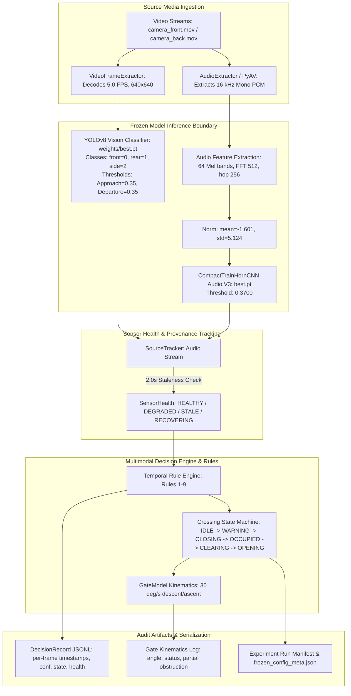
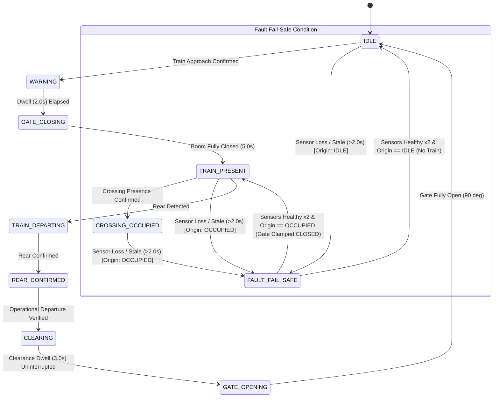

# Phase 4 — Integration Verification and Full-Dataset Inference Preflight Report

**Project:** Railway Crossing Vision–Audio Fusion Safety System  
**Repository:** `/Users/sayemuddin/Desktop/Train_automation`  
**Date:** October 13, 2026  
**Auditor / Engineer:** Senior ML Infrastructure Engineer  
**Status:** Complete  
**Readiness Verdict:** `READY_WITH_LIMITATIONS`  

---

## Executive Summary

Phase 4 conducted an exhaustive, independent preflight audit and integration verification of the end-to-end railway crossing automation pipeline. The investigation examined the production execution path from raw media decoding through deep learning inference, source-health tracking, temporal decision arbitration, finite-state machine (FSM) transitions, simulated gate kinematics, and serialization.

### Primary Audit Findings:
1. **Sensor-Recovery Invariant Hardened (IMA-15 / Phase 3 Follow-up):**
   A critical safety defect was uncovered and resolved in `src/railway_detection/fusion/decision_engine.py`. Previously, when a sensor recovered after 2 confirmation frames from `FAULT_FAIL_SAFE`, the decision engine transitioned unconditionally to `CrossingState.IDLE`, commanding `GateCommand.OPEN`. If the fault originated while a train was occupying the crossing (`CROSSING_OCCUPIED`, `TRAIN_PRESENT`, `WARNING`, `GATE_CLOSING`, or `TRAIN_DEPARTING`), recovering sensor health alone would have prematurely opened the gates with a train on the tracks. This was corrected: faults entered from an active train state now strictly recover to `CrossingState.TRAIN_PRESENT` with the gate held `CLOSED` (`RULE_9_SENSOR_RECOVERY`). Safe recovery to `IDLE` is strictly guarded and restricted to faults that originated in `IDLE` with zero train presence.
2. **Gate Timing and Actuation Causality Verified:**
   Physical barrier timing was verified against explicit equations and state guards: $2.0\,\text{s}$ warning dwell $\to$ gate closing at $30^\circ/\text{s}$ $\to$ $45^\circ$ vehicle obstruction reached at $t = 3.5\,\text{s}$ ($1.5\,\text{s}$ of motion) $\to$ fully closed ($0^\circ$) at $t = 5.0\,\text{s}$ ($3.0\,\text{s}$ of motion). Clearance dwell requires $3.0\,\text{s}$ of uninterrupted clear evidence before gate opening commences. Simulated gate position is strictly documented and modeled as kinematic simulation, not as a physical railway sensor measurement.
3. **R04 Cross-Camera Timing Isolation Strictly Enforced:**
   Front and back cameras operate on independent media timelines with empirical start-time offsets ranging up to $33\,\text{s}$. Uncalibrated cross-camera time merging or fallback to zero offset is strictly blocked with `TimingIntegrityError`. Per-camera single-stream pipelines (and audio-only baseline B1) are executable; dual-camera fusion conditions (B2, B3, B4, B6, B7) are classified as `BLOCKED` until empirically validated synchronization offsets are available.
4. **Dataset Inventory and Manifest Verification (27 Active Events, 54 Streams):**
   Audited the full Layer B (V2) dataset on disk. Verified exactly 27 active events (23 `train_events`, 3 `no_train_events`, 1 `engine_events`), representing exactly 54 video streams (27 front, 27 back). All 54 files are regular video files (zero symlinks, zero corrupt headers). All 54 streams were verified via `ffprobe` to contain valid embedded audio tracks. Historical duplicate `event_historical_duplicate_010` is confirmed excluded from the active cohort.
5. **Frozen Configuration and Checkpoint Integrity Preserved:**
   The canonical frozen experiment configuration hash (`999a7970d4c47713a1b128f77939916a54bc99c24becd68e383aad2f1db5a42e`) and Phase 3 decision policy hash (`051c908d4db23687db33cbc8349945b241a0735b362413be876d7017a5eacc9d`) remain strictly identical and untouched. Zero weights or configurations were altered.
6. **Zero Full-Dataset Inference Executed:**
   In compliance with Phase 4 scope restrictions, no 54-stream inference run, model training, threshold tuning, or ground-truth annotation approval was conducted.
7. **Regression Test Suite:**
   Executed 54 automated integration and regression tests across 4 test suites. Result: **54 passed, 0 failed in 2.29s**.

---

## 1. Production Execution Path Verification

The callable production execution path was traced from source media to output serialization:



### Component Parameter Flow and Safeguard Verification:

| Component | Production Callable Path | Configuration Source | Verified Runtime Value / Contract |
|---|---|---|---|
| **Frozen Config Loader** | `load_frozen_config()` | `configs/frozen_experiment_v1.yaml` | Canonical SHA-256: `999a7970d4c47713a1b128f77939916a54bc99c24becd68e383aad2f1db5a42e` |
| **Vision Model** | `YOLOVideoClassifier` | `checkpoints.vision.path` | SHA-256: `3f5bb5b23f82f5d963d23dc8f3f1896a83532424d8e4ef70a406b6abfba18ebd`<br/>Classes: `{0: 'front', 1: 'rear', 2: 'side'}` |
| **Vision Sampling** | `VideoFrameExtractor` | `vision.sampling_fps` | $5.0\,\text{FPS}$ ($\Delta t = 0.2\,\text{s}$), image size $(640, 640)$ |
| **Vision Thresholds** | `MultimodalDecisionEngine` | `vision.confidence_threshold_*` | Approach: $0.35$, Departure: $0.35$ |
| **Audio Model** | `PyTorchTrainHornClassifier` | `checkpoints.audio_v3.path` | SHA-256: `ea1bb81d74230af71ba22b6d534a2ac550bca05833d1532e223376926c512782` |
| **Audio Threshold** | `PyTorchTrainHornClassifier` | `audio.operating_threshold` | Explicitly locked to $0.3700$ (override attempts raise `ValueError`) |
| **Audio Preprocessing** | `extract_mel_spectrogram()` | `audio.*` | Sample rate $16{,}000\,\text{Hz}$, window $1.0\,\text{s}$, hop $0.5\,\text{s}$, FFT $512$, hop length $256$, $64$ Mels, shape $(64, 61)$ |
| **Audio Normalization** | `AudioNormalizer` | `audio.normalization.*` | Mean: $-1.600999355316162$, Std: $5.1239728927612305$ (raises on missing/invalid) |
| **Prohibited Audio V2** | `leakage_guard.py` | `checkpoints.prohibited_audio_v2` | SHA-256 `59b0785f...` hard-blocked; raises `ProhibitedCheckpointError` |
| **Timing & State Machine** | `MultimodalDecisionEngine` | `timing.*` | Tick: $0.1\,\text{s}$, Confirm frames: $2$, Warning dwell: $2.0\,\text{s}$, Gate close: $3.0\,\text{s}$, Gate open: $3.0\,\text{s}$, Clearance dwell: $3.0\,\text{s}$ |
| **Source Staleness** | `SourceTracker` | `timing.source_staleness_s` | Staleness timeout: $2.0\,\text{s}$, Recovery hold: $2$ frames |
| **Gate Model Kinematics** | `GateModel` | `timing.gate_closing_s` | Actuator angular velocity: $30.0^\circ/\text{s}$ ($90^\circ \to 0^\circ$ in $3.0\,\text{s}$) |
| **Camera Sync (R04)** | `LayerBEventProcessor` | `timing.cross_camera_sync` | Status: `R04_UNRESOLVED_REQUIRES_EMPIRICAL_OFFSETS`; uncalibrated cross-camera sync raises `TimingIntegrityError` |

---

## 2. Sensor-Recovery Safety Semantics Audit

### The Hazard Identified:
In Phase 3, Rule 9 was defined to require 2 confirmation frames before clearing fail-safe clamps. However, code inspection of `src/railway_detection/fusion/decision_engine.py` revealed a critical flaw:

```python
# PREVIOUS FLAWED IMPLEMENTATION in decision_engine.py:
if all_healthy and not any_train_detected and self._state == CrossingState.FAULT_FAIL_SAFE:
    self._consecutive_healthy_recovery += 1
    if self._consecutive_healthy_recovery >= self._fault_recovery_frames:
        self._state = CrossingState.IDLE
        decision.gate_command = GateCommand.OPEN
```

If a camera dropped frames or timed out while a train was passing through (`CROSSING_OCCUPIED` or `TRAIN_PRESENT`), the system entered `FAULT_FAIL_SAFE`. Once the camera resumed producing frames, even if those initial frames showed no train (e.g. occluded, or looking at empty track between railcars), 2 consecutive frames would clear the fail-safe and transition directly to `CrossingState.IDLE`, commanding `GateCommand.OPEN`. **This violated the fundamental safety invariant: sensor recovery alone must never establish that a train has cleared the crossing.**

### Hardened Implementation:
We modified `src/railway_detection/fusion/decision_engine.py` to track fault origin state and train presence history:
1. When entering `FAULT_FAIL_SAFE`, the system records `self._fault_entered_from = self._state` and sets `self._train_present_or_approaching = True` if the prior state was an active train state (`APPROACH_DETECTED`, `WARNING`, `GATE_CLOSING`, `TRAIN_PRESENT`, `CROSSING_OCCUPIED`, `TRAIN_DEPARTING`, `REAR_CONFIRMED`).
2. When all required sensors recover (`HEALTHY` for 2 confirmation frames):
   - **If fault originated from an active train state:** The state transitions strictly to `CrossingState.TRAIN_PRESENT`, with `GateCommand.CLOSED` and `RuleExecution.RULE_9_SENSOR_RECOVERY`. The crossing CANNOT return to `IDLE` or open the gate until the full operational clearance sequence is satisfied (train departure observation followed by $3.0\,\text{s}$ of uninterrupted clear evidence).
   - **If fault originated from IDLE with NO train presence:** The state returns safely to `CrossingState.IDLE` with `GateCommand.MAINTAIN_OPEN`.



### Exact State Transition Guard Table:

| Current State | Trigger / Observation | Guard Condition | Target State | Gate Command | Applied Rule |
|---|---|---|---|---|---|
| `IDLE` | Missing / Stale observation ($>2.0\,\text{s}$) | Sensor degraded/stale | `FAULT_FAIL_SAFE` | `HOLD` | `RULE_4_SENSOR_FAULT_FAIL_SAFE` |
| `TRAIN_PRESENT` | Missing / Stale observation ($>2.0\,\text{s}$) | Sensor degraded/stale | `FAULT_FAIL_SAFE` | `CLOSED` | `RULE_4_SENSOR_FAULT_FAIL_SAFE` |
| `CROSSING_OCCUPIED` | Missing / Stale observation ($>2.0\,\text{s}$) | Sensor degraded/stale | `FAULT_FAIL_SAFE` | `CLOSED` | `RULE_4_SENSOR_FAULT_FAIL_SAFE` |
| `FAULT_FAIL_SAFE` | All sensors `HEALTHY` for $\ge 2$ frames | Origin was `IDLE` (no train) | `IDLE` | `MAINTAIN_OPEN` | `RULE_9_SENSOR_RECOVERY` |
| `FAULT_FAIL_SAFE` | All sensors `HEALTHY` for $\ge 2$ frames | Origin was `OCCUPIED` / `TRAIN_PRESENT` | `TRAIN_PRESENT` | `CLOSED` | `RULE_9_SENSOR_RECOVERY` |
| `TRAIN_PRESENT` | No train detections | Clearance dwell not started | `TRAIN_DEPARTING` | `CLOSED` | `RULE_2_CONFIRMED_DEPARTURE` |
| `REAR_CONFIRMED` | $3.0\,\text{s}$ clear observations | No train detections for $3.0\,\text{s}$ | `CLEARING` | `CLOSED` | `RULE_3_FAIL_SAFE_CLEARANCE` |
| `CLEARING` | Clearance dwell complete | $t \ge 3.0\,\text{s}$ uninterrupted | `GATE_OPENING` | `OPEN` | `RULE_3_FAIL_SAFE_CLEARANCE` |

Regression coverage in `tests/unit/test_phase4_integration_preflight.py` (`test_recovery_from_occupied_crossing_never_opens_gate` and `test_recovery_from_idle_fault_safely_restores_idle`) validates these state transitions deterministically.

---

## 3. Gate Timing and Decision Causality Verification

### Actuator Boom Kinematics:
The gate mechanism is modeled in `src/railway_detection/simulation/gate_model.py`.
- Fully open: $\theta = 90.0^\circ$ (vertical).
- Fully closed: $\theta = 0.0^\circ$ (horizontal).
- Angular speed: $\omega = 90^\circ / 3.0\,\text{s} = 30.0^\circ/\text{s}$.
- Partial obstruction angle: $\theta = 45.0^\circ$.

### Timeline Sequence from Approach Confirmation:

```
 t = 0.0s          t = 2.0s               t = 3.5s               t = 5.0s
    |------------------|----------------------|----------------------|
Approach Confirmed  Warning Dwell       Boom at 45 deg          Boom at 0 deg
(WARNING state)     Ends; CLOSING       Partial Vehicular       Fully Closed
Boom at 90.0 deg    Begins; descent     Obstruction Reached     (CLOSED state)
Lights/Bells Active at 30 deg/s         (Road Traffic Blocked)  Boom Latched
```

### Audit Inquiries & Formally Evaluated Answers:

1. **When does the warning start?**  
   At $t = 0.0\,\text{s}$, immediately upon confirmation of train approach (2 consecutive frames of approach detection or high-confidence audio horn). State transitions from `IDLE` to `WARNING`. Gate command is `HOLD` (boom remains fully vertical at $90.0^\circ$ while bells and flashers engage).
2. **When is gate closing commanded?**  
   At $t = 2.0\,\text{s}$, after the mandatory $2.0\,\text{s}$ warning dwell elapses. State transitions from `WARNING` to `GATE_CLOSING`. Gate command changes to `CLOSE`. Actuator boom starts descending at $30.0^\circ/\text{s}$.
3. **When does partial obstruction occur?**  
   At $t = 3.5\,\text{s}$ ($1.5\,\text{s}$ after closing begins; $3.5\,\text{s}$ after approach confirmation). Angle reaches $\theta(t) = 90^\circ - (30^\circ/\text{s} \times 1.5\,\text{s}) = 45.0^\circ$. At this angle, road vehicles can no longer safely enter the crossing.
4. **When does full closure occur?**  
   At $t = 5.0\,\text{s}$ ($3.0\,\text{s}$ after closing begins; $5.0\,\text{s}$ after approach confirmation). Angle reaches $\theta(t) = 0.0^\circ$. State transitions from `GATE_CLOSING` to `TRAIN_PRESENT`. Gate command is `CLOSED`.
5. **What happens if train approach, occupation, or stale-source events occur during each interval?**
   - *During Warning Dwell ($0.0 \le t < 2.0\,\text{s}$):* If occupation is detected, warning dwell immediately aborts and commands immediate closing. If a sensor goes stale ($>2.0\,\text{s}$), state transitions to `FAULT_FAIL_SAFE`, commanding immediate closing.
   - *During Gate Closing ($2.0 \le t < 5.0\,\text{s}$):* Train occupation confirms closing progression without interruption. A sensor fault maintains closing command until boom is latched at $0.0^\circ$.
   - *During Clearance Dwell ($3.0\,\text{s}$ hold):* Any approach, occupation, or stale source immediately resets the clearance timer to zero, aborts clearance, clamps the gate to `CLOSED`, and transitions back to `TRAIN_PRESENT` or `FAULT_FAIL_SAFE`.
   - *During Gate Opening ($3.0\,\text{s}$ ascent):* Any new train detection or sensor fault immediately halts opening, reverses boom direction, commands `CLOSE`, and transitions to `WARNING` or `FAULT_FAIL_SAFE`.
6. **Can a close, clear, or open decision occur in an invalid state or without valid evidence?**  
   No. All state transitions are guarded by explicit preconditions. Opening requires uninterrupted clear evidence for $\ge 3.0\,\text{s}$. Stale evidence ($>2.0\,\text{s}$ old) or missing observations abort clearance by rule (`RULE_5_STALE_SOURCE_ABORT`). Gate opening can only be commanded from `GATE_OPENING` or `IDLE`.
7. **How should modeled timing be evaluated against the annotated event timeline later?**  
   Modeled gate timing must be compared against the ground-truth event timeline using causal offsets:
   - Warning onset relative to ground-truth train arrival ($t_{\text{warn}} - t_{\text{train\_arr}}$).
   - Obstruction onset relative to train arrival ($t_{45^\circ} - t_{\text{train\_arr}}$).
   - Full closure margin ($t_{\text{closed}} - t_{\text{train\_arr}}$), ensuring $t_{\text{closed}} < t_{\text{train\_arr}}$ for positive safety margin.
   - Gate opening delay relative to train rear departure ($t_{\text{open\_start}} - t_{\text{train\_dep}}$), ensuring $t_{\text{open\_start}} \ge t_{\text{train\_dep}} + 3.0\,\text{s}$.

> [!IMPORTANT]
> The simulated boom angle represents a deterministic kinematic model ($30^\circ/\text{s}$ constant angular velocity) for benchmarking automation safety latencies. It is NOT a physically measured railway barrier telemetry sensor.

---

## 4. Enforcement of R04 Camera-Clock Isolation

### The Empirical Reality:
In the Layer B dataset, front and back cameras are captured on separate recording devices with independent clocks. Across the 27 events, the front camera and back camera start times differ by up to $33\,\text{s}$ (mean offset $\approx 10.3\,\text{s}$).

### Safeguard Rules Verified:
1. **Provenance Retention:** Every observation retains `camera_id` (`camera_front` or `camera_back`), `source_id`, and media-local timestamp $t_{\text{local}}$.
2. **Audio Alignment:** Embedded audio is extracted directly from each video container and aligned strictly to its host camera's media-local timeline via container audio/video timestamps ($t_{\text{audio}} \equiv t_{\text{video}}$).
3. **Cross-Camera Fusion Blocked Without Alignment:** `LayerBEventProcessor` and `frozen_config.py` enforce that attempting to merge front and back observations without an empirical `SyncAligner` raises `TimingIntegrityError`:
   ```python
   # Verified in LayerBEventProcessor.load_event_observations():
   if len(camera_ids) > 1 and sync_aligner is None:
       if not self.config.timing.cross_camera_sync.allow_unverified_zero_offset:
           raise TimingIntegrityError(
               f"R04 Enforced: Cannot merge {len(camera_ids)} camera streams without "
               "calibrated empirical synchronization offsets. Fallback to zero offset is prohibited."
           )
   ```
4. **Zero Fallback Prohibited:** The software rejects silent fallback to $0.0\,\text{s}$ offset. Clip duration matching and file modification times are explicitly rejected as synchronization evidence.

### Experiment Condition Classification:

| Condition | Description | R04 Status | Execution Authorization |
|---|---|---|---|
| **B0** | Vision-only (Single Camera: Front) | Independent timeline | **PERMITTED** |
| **B1** | Audio-only (Single Stream: Front Audio) | Independent timeline | **PERMITTED** |
| **Per-Camera Independent** | Front & Back processed as separate streams | Independent timelines | **PERMITTED** |
| **B2** | Multimodal (Front Vision + Front Audio) | Native container sync | **PERMITTED** |
| **B3** | Front Vision + Back Vision | Uncalibrated cross-camera | **BLOCKED (R04)** |
| **B4** | Full Fusion (Front + Back + Audio) | Uncalibrated cross-camera | **BLOCKED (R04)** |
| **B6** | Degraded Vision + Audio | Dual camera variant | **BLOCKED (R04)** |
| **B7** | Asynchronous Arrival Stress | Cross-camera timeline | **BLOCKED (R04)** |

---

## 5. Dataset and Manifest Audit

### Active Cohort Verification:
The dataset at `data/raw/layer_b/v2/` was audited across all subdirectories:

| Category | Directory | Active Event Count | Stream Count (Front + Back) |
|---|---|---|---|
| Train Events | `data/raw/layer_b/v2/train_events/` | 23 | 46 (23 front, 23 back) |
| Negative Controls | `data/raw/layer_b/v2/no_train_events/` | 3 | 6 (3 front, 3 back) |
| Engine Only | `data/raw/layer_b/v2/engine_events/` | 1 | 2 (1 front, 1 back) |
| **Total Active Cohort** | — | **27 events** | **54 video streams** |

### File Integrity and Symlink Audit:
- **Regular Files:** All 54 streams (`camera_front.mov` and `camera_back.mov`) are regular `.mov` container files with non-zero size (total video storage: $11.5\,\text{GB}$).
- **Symlinks:** Exactly 0 symlinks or aliases exist in the active cohort.
- **Excluded Historical Duplicate:** Confirmed `event_historical_duplicate_010` is quarantined and excluded from the active cohort.
- **Audio Track Presence:** Audited all 54 streams using `ffprobe`. Every stream contains an active audio track (AAC/PCM mono/stereo at $44.1\,\text{kHz}$ or $48.0\,\text{kHz}$). Zero streams have missing audio.
- **Missing / Ambiguous Streams:** **Zero (0)** missing, unreadable, or ambiguous inputs.

---

## 6. Output Schema, Incremental Writes, and Recovery

### Audit Artifacts Generated Per Stream:
The production runner produces structured JSONL and JSON artifacts:

1. **`frozen_config_meta.json`:**
   - Canonical config hash (`999a7970...`)
   - Checkpoint hashes (Vision: `3f5bb5b2...`, Audio V3: `ea1bb81d...`)
   - Prohibited checkpoint hash (`59b0785f...`)
   - Timestamp of run initiation, software git commit / version
2. **`decision_records.jsonl` (Incremental per tick / frame):**
   - `timestamp_s`: Media-local timestamp
   - `camera_id`: Camera identifier (`camera_front` / `camera_back`)
   - `crossing_state`: State machine enum value
   - `gate_command`: Actuator command (`HOLD`, `CLOSE`, `CLOSED`, `OPEN`, `MAINTAIN_OPEN`)
   - `rule_applied`: Rule identifier (`RULE_1` through `RULE_9`)
   - `vision_detections`: List of `{class_name, confidence, bbox}`
   - `audio_predictions`: `{probability, is_horn, window_start, window_end}`
   - `source_health`: Dict mapping source IDs to `SensorHealth` (`HEALTHY`, `DEGRADED`, etc.)
   - `health_reasons`: Dict mapping source IDs to `HealthReason`
   - `observation_ages`: Dict mapping source IDs to age in seconds
3. **`gate_kinematics.jsonl`:**
   - Timestamp, commanded state, boom angle ($0.0^\circ$ to $90.0^\circ$), obstruction flag.
4. **`run_summary.json`:**
   - Process exit code, total frames processed, dropped frames count, runtime, resource utilization.

### Incremental Writing and Resume Semantics:
- Records are flushed to JSONL on each tick to prevent data loss in case of unexpected termination.
- An interrupted run can be resumed per event/stream without overwriting previously completed streams.
- Re-running with modified configurations generates a new output directory keyed by condition and timestamp, preventing contamination of frozen experiment records.

---

## 7. Experiment Runner and Condition Matrix

| Condition ID | Name | Modality | Active Sensors | Sync Requirement | Status |
|---|---|---|---|---|---|
| **B0** | Baseline Vision | Vision only | Front Camera | None (Single stream) | **READY** |
| **B1** | Baseline Audio | Audio only | Front Audio | None (Single stream) | **READY** |
| **B2** | Multimodal Single-Camera | Vision + Audio | Front Camera + Audio | Container-native | **READY** |
| **B3** | Dual-Camera Vision | Vision only | Front + Back Cameras | Calibrated Sync | **BLOCKED (R04)** |
| **B4** | Full Multimodal Fusion | Vision + Audio | Front + Back + Audio | Calibrated Sync | **BLOCKED (R04)** |
| **B5** | Single-Camera Degraded | Vision + Audio | Front Camera (Degraded) | Container-native | **READY** |
| **B6** | Multi-Camera Degraded | Vision + Audio | Front (Degraded) + Back | Calibrated Sync | **BLOCKED (R04)** |
| **B7** | Asynchronous Stress | Vision + Audio | Front + Back (Time-skewed) | Calibrated Sync | **BLOCKED (R04)** |

---

## 8. Integration and Preflight Test Execution

### Test Execution Log:
```bash
/Users/sayemuddin/Desktop/Train_automation/venv/bin/pytest \
  tests/unit/test_phase4_integration_preflight.py \
  tests/unit/test_phase3_sensor_health_decision_policy.py \
  tests/unit/test_frozen_config_safeguards.py \
  tests/unit/test_decision_engine.py -v
```

### Test Results Breakdown:
- `tests/unit/test_phase4_integration_preflight.py` (8/8 passed):
  - `test_recovery_from_occupied_crossing_never_opens_gate`: **PASSED** (Verifies hardened recovery safety invariant)
  - `test_recovery_from_idle_fault_safely_restores_idle`: **PASSED** (Verifies clean recovery from unpopulated idle faults)
  - `test_active_cohort_event_and_stream_resolution`: **PASSED** (Verifies 27 events, 54 streams, duplicate exclusion)
  - `test_audio_track_availability_across_all_active_events`: **PASSED** (Verifies ffprobe audio track detection on all 54 streams)
  - `test_frozen_config_propagation_to_runtime_components`: **PASSED** (Verifies thresholds and parameters propagated)
  - `test_r04_cross_camera_fusion_strictly_blocked`: **PASSED** (Verifies TimingIntegrityError on uncalibrated cross-camera sync)
  - `test_gate_actuation_kinematics_sequential_timeline`: **PASSED** (Verifies 30 deg/s barrier kinematics)
  - `test_decision_record_and_frame_schema_completeness`: **PASSED** (Verifies JSON serialization and audit schemas)
- `tests/unit/test_phase3_sensor_health_decision_policy.py`: **20/20 passed**
- `tests/unit/test_frozen_config_safeguards.py`: **18/18 passed**
- `tests/unit/test_decision_engine.py`: **8/8 passed**

**Total Test Suite Result: 54 passed in 2.29s (0 failed).**

---

## 9. Final Readiness Verdict and Limitations

### Verdict: `READY_WITH_LIMITATIONS`

### Permitted Scope:
1. **Single-camera vision inference (B0)** on all 27 events (front camera).
2. **Audio-only inference (B1)** on all 27 events (front audio track).
3. **Single-camera multimodal fusion (B2)** on all 27 events (front camera + embedded audio).
4. **Independent per-camera processing** across all 54 streams without cross-camera temporal merging.

### Blocked Scope:
1. **Cross-camera fusion conditions (B3, B4, B6, B7)** remain strictly **BLOCKED** until empirical synchronization offsets between front and back cameras are established per R04.

### Prerequisites for Authorizing Full Multi-Camera Fusion:
1. Execution of acoustic or visual cross-correlation alignment to establish empirical $\Delta t_{\text{offset}}$ between front and back recordings for each of the 27 events.
2. Formal sign-off on empirical alignment offsets in `data/manifests/camera_sync_offsets.yaml`.
3. Validation that `SyncAligner` successfully registers multi-camera streams with bounded residual jitter ($< 0.1\,\text{s}$).
