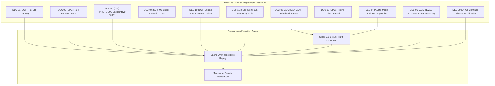

# Researcher Decision Register: Overnight Governance & Experimental Readiness (Proposed — Awaiting Review)

**Document Type:** Master Governance & Scientific Decision Register  
**Repository State:** Commit `d4db94d4a4ea83ae4c510d65dfc99c5d6798304b`  
**Target Milestone:** Offline Descriptive Benchmark (Conditions B0, B1, B2)  
**Date:** 2026-10-25  
**Author:** Antigravity Autonomous Research Engineering Agent  
**Status:** ACTIONABLE REGISTER — Awaiting Formal Principal Investigator Adjudication.

---

## Executive Summary & Governance Structure

To transition the Train Gate Automation research repository from a frozen investigative posture into an auditable, reproducible descriptive baseline, a specific set of scientific, operational, and administrative decisions must be formally recorded.

Decisions are classified into three governance tiers:
1. **Scientific Research Design (SCI):** Methodological decisions governing experimental framing, metric denominators, censoring models, and operational endpoints.
2. **Operational Governance (OPG):** Codebase execution policies, input contracts, camera scopes, and fail-closed state invariants.
3. **Administrative Compliance (ADM):** Legal, regulatory, media-access, and formal sign-off authorizations.

---

## Master Decision Register

---

### DEC-01: R-SPLIT — Experimental Analysis Framing
- **Classification:** Scientific Research Design (SCI)
- **Authorized Decision-Maker:** Human Principal Investigator
- **Question:** How should the 27-event, two-session single-crossing dataset be partitioned and framed for scientific publication?
- **Documented Options:**
  - **Option A (Recommended): Full-Cohort Descriptive Benchmark.** Evaluate all 27 events as an offline system characterization. Reject train/test splitting; report empirical performance across the complete cohort with exact binomial Wilson intervals. Prohibit claims of cross-crossing out-of-distribution generalization.
  - **Option B: Two-Session Diurnal Domain Shift.** Partition Capture Session 1 (20 events) vs. Capture Session 2 (7 events). Measure performance across daytime vs. dusk/night conditions.
    - *Limitation:* Session 2 contains only 3 train events, confounding lighting shifts with severe sample imbalance.
  - **Option C: Evaluation Freeze Pending Multi-Crossing Field Data.** Defer all empirical evaluation until data is collected from $\ge 5$ distinct crossings.
    - *Limitation:* Freezes all paper progress indefinitely.
- **Evidence Needed:** Dataset metadata verification confirming all events originate from `crossing_A`. (Verified in `docs/B0_B1_B2_EXPERIMENT_DESIGN_REVIEW.md`).
- **Consequences:** Option A updates `src/railway_detection/evaluation/manifest_builder.py` and schemas to accept `evaluation_mode = 'full_cohort_descriptive'`.
- **What Remains Blocked:** Generation of `phase12_event_split_decision.json` and official benchmark manifest generation.
- **Independent Safe Tasks Proceeding Now:** Static code audits, metric specifications, paper draft structure, test plan design.

---

### DEC-02: R04-SCOPE — Camera Ingestion Scope for Benchmark
- **Classification:** Operational Governance (OPG)
- **Authorized Decision-Maker:** Human Principal Investigator
- **Question:** Should the primary official benchmark evaluate single-camera front feeds (B0/B1/B2) or dual-camera feeds (B3/B4/B6/B7)?
- **Documented Options:**
  - **Option A (Recommended): Front-Camera Primary Scope (B0, B1, B2).** Restrict primary benchmark strictly to `camera_front` video and audio. Both streams are container-native ($\tau_{\text{sync}} = 0.0\,\text{s}$), completely eliminating cross-camera clock drift blockers.
  - **Option B: Dual-Camera Full-Cohort Evaluation.** Ingest both front and back cameras across all 27 events.
    - *Limitation:* Fatal blocker. 15 of 27 events possess ambiguous or provisional synchronization under R04, introducing multi-second errors into clearance metrics.
  - **Option C: Dual-Camera Subset Evaluation.** Evaluate dual cameras only on the 12 events supported by R04 calibration.
    - *Limitation:* Acceptable only as a secondary exploratory appendix, not the primary benchmark.
- **Evidence Needed:** R04 calibration closeout records (`docs/R04_ALL_EVENT_CALIBRATION_INVESTIGATION.md`).
- **Consequences:** Configures evaluation runner to execute only conditions B0, B1, and B2. Suppresses back-camera ingestion.
- **What Remains Blocked:** Execution of official replay runner.
- **Independent Safe Tasks Proceeding Now:** Architecture tracing of front pipelines, cache-only replay interface design.

---

### DEC-03: PROTOCOL — Operational Endpoint Definition (v9 vs. M4)
- **Classification:** Scientific Research Design (SCI)
- **Authorized Decision-Maker:** Human Principal Investigator
- **Question:** Which primary hazard endpoint definition shall govern premature gate opening?
- **Documented Options:**
  - **Option A: Protocol v9 (`t1_entry_to_t4_clearance`, $[T_1, T_4)$).** Premature opening is defined as an opening command or unblocked state occurring while $T_1 \le t < T_4$.
    - *Limitation:* Non-computable on front-camera-only replay because $T_4$ occurs on `camera_back.mov` and cross-camera clocks are not genlocked (`clock_mismatch`).
  - **Option B: Design M4 (`first_blocked_to_t4_clearance`, $(t_{\text{blocked}}, T_4)$).** Premature opening is defined as any opening command or blocked $\to$ not-blocked transition strictly within $(t_{\text{blocked}}, T_4)$, paired with M5 (`never_protected`).
    - *Limitation:* Non-computable on front-camera-only replay because $T_4$ occurs on `camera_back.mov` (`clock_mismatch`).
  - **Option C (Recommended for Front Baseline): Formally Exclude Premature Opening from Front Baseline; Defer v9 vs. M4 Selection to Dual-Camera Work.**
    - Classify premature opening as **Tier 3 (Excluded / Non-Computable)** for the front-camera offline benchmark, as specified in `docs/B0_B1_B2_METRIC_SPECIFICATION.md`.
    - *Front Occupancy Note:* If the researcher desires a front-camera occupancy metric, it must be formulated as a *proposed, distinct metric* (e.g. Centerline Occupancy Duration $[T_2, T_3]$) requiring explicit researcher approval and separate implementation—not M4. Note that candidate $T_3$ is currently annotated on `camera_back.mov` in candidate proposals, so evaluating $[T_2, T_3]$ would also require cross-camera sync or front-camera $T_3$ annotation.
- **Evidence Needed:** Boundary observability audit in `docs/DATASET_ANNOTATION_QUALITY_AUDIT.md` and `docs/PREMATURE_OPENING_DECISION_EVIDENCE.md`.
- **Consequences:** Confirms that premature opening is excluded from the front-camera benchmark tables; defers protocol selection to future dual-camera evaluations.
- **What Remains Blocked:** Dual-camera premature opening calculations.
- **Independent Safe Tasks Proceeding Now:** Front-camera descriptive telemetry and Tier 1/2 metric definitions.

---

### DEC-04: M5 — Under-Protection & Extreme Late Warning Handling
- **Classification:** Scientific Research Design (SCI)
- **Authorized Decision-Maker:** Human Principal Investigator
- **Question:** How should the evaluator handle events where the gate fails to close before arrival ($t_{\text{close}} > T_2$) or never reaches `CLOSED` state?
- **Documented Options:**
  - **Option A (Recommended): Strict Fail-Closed Penalty (M5 Active).** Any event where gate closure occurs after $T_2$ is assigned $\text{WLT} = 0.0\,\text{s}$ (or negative latency), flagged as `under_protected = True`, and counted as an operational safety failure. If the gate never reaches `CLOSED`, it is flagged as `never_protected = True` and scored as a missed train ($\text{MTR} = 1$).
  - **Option B: Censored Latency Exclusion.** Exclude late-closing events from lead-time calculations and report only on successfully closed events.
    - *Limitation:* Unacceptable survivor bias; conceals safety failures.
- **Evidence Needed:** Metric calculation logic in `src/railway_detection/evaluation/metrics.py`.
- **Consequences:** Fixes penalization formulas in evaluation reports and prevents statistical masking.
- **What Remains Blocked:** Final metric aggregation scripts.
- **Independent Safe Tasks Proceeding Now:** Line-by-line tracing of `metrics.py` completed in `docs/B0_B1_B2_METRIC_EVIDENCE_MATRIX.md`.

---

### DEC-05: ADJ-AUTH — Candidate Annotation Adjudication Authority
- **Classification:** Administrative Compliance & Research Ethics (ADM)
- **Authorized Decision-Maker:** Human Principal Investigator
- **Question:** What formal review procedure must be completed before promoting candidate timestamps in `data/ground_truth/snapshots/candidate_annotation_manifest_20261012.json` to approved Stage-2.1 ground truth?
- **Documented Options:**
  - **Option A (Recommended): Human Researcher Adjudication.** The human researcher individually reviews the 27 candidate proposals, verifies boundary frames ($T_1, T_2, T_3, T_4$), applies the coincidence rule on `engine_events/event_001`, signs adjudication certificates, and updates status to `STAGE_2_1_APPROVED`.
  - **Option B: Autonomous Agent Algorithmic Acceptance.** Direct the autonomous agent to promote candidate proposals automatically.
    - *Limitation:* Strictly prohibited by repository governance (`docs/PHASE11_6_LEGACY_RECORD_DISPOSITION.md`); automated promotion invalidates scientific defensibility.
- **Evidence Needed:** Visual inspection of candidate timestamp frames by the human researcher.
- **Consequences:** Generates valid, cryptographically bound Stage-2.1 review records in `data/ground_truth/reviews/`.
- **What Remains Blocked:** Loading of approved ground truth by `src/railway_detection/evaluation/ground_truth_loader.py`.
- **Independent Safe Tasks Proceeding Now:** Quality audit of candidate proposals completed in `docs/DATASET_ANNOTATION_QUALITY_AUDIT.md`.

---

### DEC-06: EVAL-AUTH — Benchmark Execution Authorization Gate
- **Classification:** Operational Governance & Administrative Compliance (ADM)
- **Authorized Decision-Maker:** Human Principal Investigator
- **Question:** What prerequisites must be verified before executing official benchmark replay commands?
- **Documented Options:**
  - **Option A (Recommended): Cryptographic Pre-Flight Authorization.** Require verified frozen config SHA-256, approved Stage-2.1 ground-truth hashes, an explicit execution manifest, and a human-signed `EVAL-AUTH` token before running `evaluation_runner.py`.
  - **Option B: Unrestricted Command Invocation.** Allow background scripts to trigger evaluation runs whenever code compiles.
    - *Limitation:* Violates repository governance; risks generating unverified, non-reproducible artifacts.
- **Evidence Needed:** Pre-flight gate check script (`src/railway_detection/evaluation/execution_gate.py`).
- **Consequences:** Prevents accidental execution of unauthorized benchmark runs.
- **What Remains Blocked:** Execution of `railway_detection evaluation run` or equivalent scripts.
- **Independent Safe Tasks Proceeding Now:** Design of test plans, paper drafts, and cache interfaces.

---

### DEC-07: MEDIA-INCIDENT — Formal Administrative Disposition of Media Access Hold
- **Classification:** Administrative Compliance (ADM)
- **Authorized Decision-Maker:** Human Principal Investigator
- **Question:** What is the formal administrative disposition of the Media Access Incident investigated on October 20, 2026 (`docs/MEDIA_ACCESS_INCIDENT_INVESTIGATION_20261020.md`)?
- **Documented Options:**
  - **Option A (Recommended): Maintain Active Media Access Hold; Mandate Cache-Only Replay.** Formally confirm that raw media files (`.mov`, `.wav`) remain sequestered under Media Access Hold. Mandate that all upcoming benchmark replays consume pre-computed perceptual feature caches (`.jsonl`), eliminating raw video decoding and ffmpeg subprocess invocations.
  - **Option B: Unconditional Media Access Resumption.** Lift the hold and permit all scripts to decode video and extract audio.
    - *Limitation:* Fails to address the underlying ffmpeg subprocess vulnerabilities and hash integrity ambiguities documented in the incident report.
- **Evidence Needed:** Incident investigation closure review (`docs/INCIDENT_CLOSURE_REVIEW_20261020.md`).
- **Consequences:** Hardens replay pipelines against raw media access; specifies cache-only interface.
- **What Remains Blocked:** Direct access to source media files.
- **Independent Safe Tasks Proceeding Now:** Specification of cache-only replay architecture in `docs/CACHE_ONLY_REPLAY_DESIGN.md`.

---

### DEC-08: TIMING-PILOT — Deferral of Timing Pilot from Benchmark Prerequisites
- **Classification:** Operational Governance (OPG)
- **Authorized Decision-Maker:** Human Principal Investigator
- **Question:** Should the physical timing-pilot hardware experiment be a blocking prerequisite for the offline descriptive benchmark?
- **Documented Options:**
  - **Option A (Recommended): Separate and Defer Timing Pilot.** Formally decouple the offline descriptive benchmark (B0/B1/B2) from the physical timing pilot. The offline benchmark uses simulated gate dynamics ($T_{\text{travel\_down}} = 3.0\,\text{s}$); the physical timing pilot is deferred to post-publication hardware trials.
  - **Option B: Gate Benchmark on Physical Timing Pilot Completion.** Block all offline evaluation until physical actuator timing and microsecond hardware timers are benchmarked on real crossing barriers.
    - *Limitation:* Imposes physical hardware prerequisites on an algorithmic software evaluation, halting paper completion.
- **Evidence Needed:** Stage 2.1 timing pilot incident records (`docs/STAGE21_TIMING_PILOT_INCIDENT_20261019.md`).
- **Consequences:** Unblocks offline software evaluation pipeline.
- **What Remains Blocked:** Real-world hardware latency claims.
- **Independent Safe Tasks Proceeding Now:** Software simulation profiling in `docs/PHASE14_PROFILING_INFRASTRUCTURE.md`.

---

### DEC-09: CONTRACT-MOD — Formal Research Contract Schema Modification
- **Classification:** Operational Governance (OPG)
- **Authorized Decision-Maker:** Human Principal Investigator
- **Question:** How should the research contract schemas (`schemas/evaluation_manifest.schema.json` and `src/railway_detection/research_contracts.py`) be modified to formally support full-cohort descriptive evaluations?
- **Documented Options:**
  - **Option A (Recommended): Add `full_cohort_descriptive` Evaluation Mode.** Extend schemas to allow `evaluation_mode: full_cohort_descriptive`, where train/val/test split hashes are replaced by a single full-cohort manifest hash, and cross-crossing generalization claims are explicitly prohibited by schema validation.
  - **Option B: Maintain Rigid Train/Val/Test Requirement.** Force the candidate split (16/6/5) into the schema despite known session leakage.
    - *Limitation:* Compromises scientific validity.
- **Evidence Needed:** Research contract definitions in `src/railway_detection/research_contracts.py`.
- **Consequences:** Enables strict schema-validated execution manifests without fraudulent splits.
- **What Remains Blocked:** Manifest builder validation for descriptive mode.
- **Independent Safe Tasks Proceeding Now:** Test plan design for schema validation.

---

### DEC-10: ENGINE-EVENT — Isolated Reporting Policy for `engine_events/event_001`
- **Classification:** Scientific Research Design (SCI)
- **Authorized Decision-Maker:** Human Principal Investigator
- **Question:** How should `engine_events/event_001` be incorporated into benchmark reporting?
- **Documented Options:**
  - **Option A (Recommended): Isolated Single-Event Case Study (Table 4).** Report `engine_events/event_001` in an isolated standalone table. Exclude it from the primary train cohort ($N=23$) and negative controls ($N=3$) because of its unique physical anomaly: length $\approx 20\,\text{m}$, zero trailing cars, and temporal coincidence $T_3 \equiv T_4 = 6.20\,\text{s}$.
  - **Option B: Pool into Train Cohort ($N=24$).** Include the light engine as a standard train event.
    - *Limitation:* Skews passage duration statistics, clearance latency distributions, and introduces coincidence boundary edge cases into aggregate metrics.
  - **Option C: Exclude Completely from Publication.** Omit the event entirely.
    - *Limitation:* Conceals valuable operational data on how the vision and state machine handle high-speed single-locomotive passes.
- **Evidence Needed:** Coincidence rule analysis in `docs/DATASET_ANNOTATION_QUALITY_AUDIT.md`.
- **Consequences:** Configures Table 4 in paper draft and isolates denominator filtering in `metrics.py`.
- **What Remains Blocked:** Aggregate statistical pooling script.
- **Independent Safe Tasks Proceeding Now:** Structure of Table 4 authored in `docs/PAPER_DRAFT_DESCRIPTIVE_BENCHMARK.md`.

---

### DEC-11: CENSOR-005 — `train_events/event_005` Left-Censoring Boundary Exclusion
- **Classification:** Scientific Research Design (SCI)
- **Authorized Decision-Maker:** Human Principal Investigator
- **Question:** How should `train_events/event_005` be handled in the Missed-Train Rate (MTR) and Warning Lead Time (WLT) calculations given that Dining Car 1402 occupies the frame at $t=0.0\,\text{s}$ ($T_1 = \text{null}$)?
- **Documented Options:**
  - **Option A (Recommended): Explicit Denominator Reduction ($N_{\text{eval}} \le 22$).** Because entry into the crossing is unobservable ($T_1$ is physically left-censored), exclude `event_005` from MTR and WLT denominators. Report MTR denominator as $N_{\text{eval}} \le 22$ with an explicit methodological footnote. Retain `event_005` for steady-state holding and clearance evaluation.
  - **Option B: Fabricate Synthetic $T_1 = 0.0\,\text{s}$.** Impute $T_1$ as the video start time.
    - *Limitation:* Artificially inflates warning lead time and introduces unverified ground-truth assumptions.
  - **Option C: Discard Entire Event.** Remove `event_005` from all analyses.
    - *Limitation:* Discards valid steady-state railcar holding and departure telemetry.
- **Evidence Needed:** Ground-truth proposal `data/ground_truth/proposals/train_events/event_005_proposal_v4.json` ($T_1 = \text{null}$).
- **Consequences:** Eliminates divide-by-zero or null-dereference errors in `metrics.py`; aligns manuscript denominators.
- **What Remains Blocked:** Final metric report generation.
- **Independent Safe Tasks Proceeding Now:** Metric specification repaired in `docs/B0_B1_B2_METRIC_SPECIFICATION.md`.

---

## Master Decision Summary Matrix

| ID | Title | Class | Authorized Role | Recommended Default | Downstream Milestone Blocked | Safe Independent Work |
|:---:|---|:---:|:---:|---|---|---|
| **DEC-01** | R-SPLIT Framing | SCI | Principal Investigator | Option A: Full-Cohort Descriptive | Manifest Builder & Replay Runner | Metric matrices, paper drafts |
| **DEC-02** | R04 Camera Scope | OPG | Principal Investigator | Option A: Front Camera (B0, B1, B2) | Replay Execution Scope | Cache-only architecture design |
| **DEC-03** | PROTOCOL Endpoints | SCI | Principal Investigator | Option C: Exclude POR from Front Baseline; Defer v9 vs M4 | Premature Opening Metric Run | Metric formulas & Tier definitions |
| **DEC-04** | M5 Under-Protection | SCI | Principal Investigator | Option A: Fail-Closed Penalization | Aggregate Score Generation | Metric code tracing & unit tests |
| **DEC-05** | ADJ-AUTH Adjudication | ADM | Principal Investigator | Option A: Human Review of Proposals | Ground Truth Promotion (Stage-2.1) | Candidate timestamp quality audits |
| **DEC-06** | EVAL-AUTH Authority | ADM | Principal Investigator | Option A: Cryptographic Pre-Flight Gate | Official Benchmark Replay | Test plan formulation |
| **DEC-07** | Media Incident Disposition | ADM | Principal Investigator | Option A: Maintain Hold; Enforce Cache | Source Video Decoding | Cache-only pipeline design |
| **DEC-08** | Timing-Pilot Deferral | OPG | Principal Investigator | Option A: Defer to Post-Publication | Hardware Actuation Claims | Software simulation benchmarking |
| **DEC-09** | Contract Schema Mod | OPG | Principal Investigator | Option A: Add `full_cohort_descriptive` | Official Manifest Build | Schema review and linting |
| **DEC-10** | Engine Event Isolation | SCI | Principal Investigator | Option A: Isolated Case Study (Table 4) | Aggregate Train Pooling | Single-event metric definition |
| **DEC-11** | `event_005` Censoring | SCI | Principal Investigator | Option A: Denominator $N_{\text{eval}} \le 22$ | MTR & WLT Final Computation | Denominator documentation |

---

## Next Steps for the Principal Investigator

To formally ratify these recommendations:
1. Review the options and consequences detailed above.
2. Provide written confirmation approving the recommended defaults (or specifying alternate choices).
3. Upon approval, execute the human adjudication workflow (`DEC-05`) for candidate proposals.
4. Sign the pre-flight evaluation authorization token (`DEC-06`), enabling the autonomous agent to execute the verified, cache-only front-camera benchmark.
