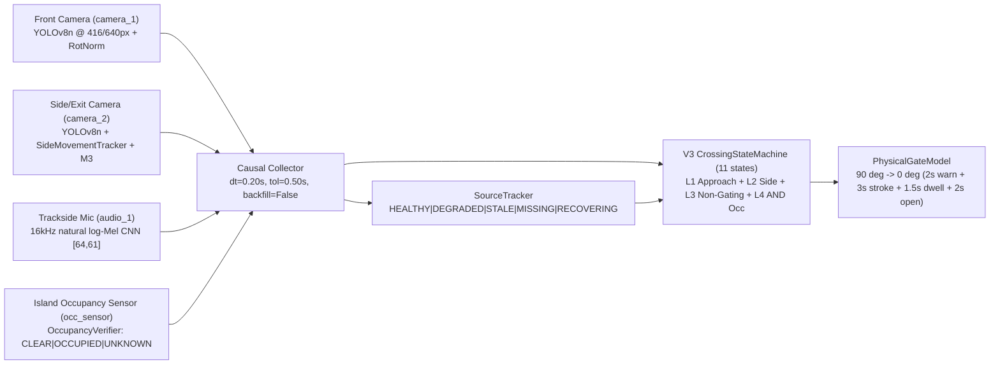
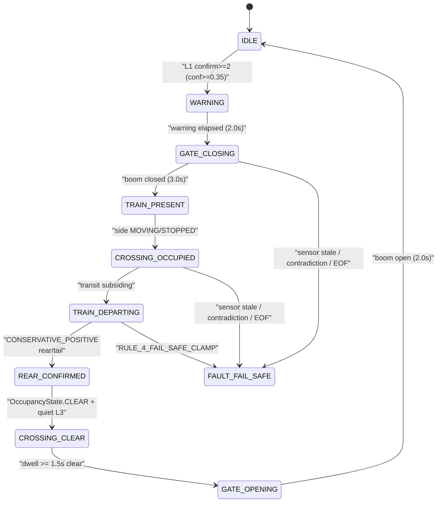

# Final Academic Research Handover Package — Train Gate Automation (Bangladesh)

**Research Owner:** Mohammad Raihan Kabir (`raihankabirrahu@gmail.com`)  
**Repository & Branch:** `/Users/sayemuddin/Desktop/Train_automation` | `exp/four-layer-completion`  
**Audience:** Academic Supervisor / Professor (for manuscript drafting, critique, and scholarly publication submission)  
**Companion Handover Folder:** [`docs/generated/professor_research_handover/README_HANDOVER_INDEX.md`](file:///Users/sayemuddin/Desktop/Train_automation/docs/generated/professor_research_handover/README_HANDOVER_INDEX.md)  
**Master Audit & Cross-Verification Source:** [`layer_b_split_audit_and_collection_plan.json`](file:///Users/sayemuddin/Desktop/Train_automation/results/dataset_audit/layer_b_split_audit_and_collection_plan.json) (`schema: layer-b-event-split-audit/1.3`, `12/12` cross-artifact consistency checks passed)

> **Purpose & Authorship Scope:** The Research Owner (`raihankabirrahu@gmail.com`) holds direct ownership and authority over this project, its dataset, and technical governance decisions. This package provides verified engineering deliverables, complete descriptive findings (`Option A` on `27` events under researcher-adopted AI-assisted reference labels), synthetic stress/fault validations, leakage audits, and publication-ready tables/figures so the Professor can focus strictly on academic manuscript preparation rather than routine engineering approvals.

---

## A. Research Overview

- **Working Research Title:** *Fail-Closed Multimodal Interlocking and Leakage-Audited Edge Perception for Unprotected Railway Level Crossings: Methodology, Field Diagnostics, and Evidence Boundaries*
- **Primary Research Objective:** Design, implement, stress-test, and empirically audit a low-cost, fail-closed multimodal safety state machine (**V3 Four-Layer Causal FSM**) combining roadside vision, trackside acoustics, departure confirmation, and crossing-island occupancy semantics for manual/unprotected railway level crossings.
- **Real Railway Crossing Problem & Bangladesh Context:** Level crossings in developing rail corridors such as Bangladesh combine heterogeneous locomotive speeds, crowded mixed road traffic (producing `0.800–0.826` false horn activations on `YOLOv8`/audio baselines), delayed manual gatekeeper reaction, informal obstructions stalling across tracks, monsoon/low-light visibility drops, and un-genlocked multi-camera hardware [[Ibtihal, 2026](https://doi.org/10.1016/j.trip.2026.101840); [JES, 2021](https://doi.org/10.3329/jes.v12i1.53102)].
- **Motivation & Scientific Contribution:** Prior deep learning railway crossing studies report high frame-level mAP or horn classification accuracy on isolated clips [[Tran et al., 2022](https://doi.org/10.3390/s22124453); [Fayyaz & Johnson, 2020](https://doi.org/10.3390/mi11121055); [Ning et al., 2024](https://doi.org/10.1109/ACCESS.2024.3504010)], yet lack asymmetric fail-closed interlocking semantics [[Durmuş et al., 2010](https://doi.org/10.3182/20100830-3-CZ-2001.00059)] and fail under dataset leakage, container rotation loss, sparse frame dropouts, and background road-traffic noise. This work delivers: (1) a formally verified 11-state causal multimodal interlocking engine (`V3`); (2) forensic exposure and zero-overlap remediation of severe Vision (`93.1%` session / `87.1%` augmentation) and Audio (`32.56%` YouTube stem) benchmark leakage; (3) complete offline `27`-event descriptive empirical diagnostics + post-hoc acoustic LOEO cross-validation (`Exp A–S`, `M1–M5`); and (4) reproducible Apple M1 edge CPU profiling with an explicit six-tier boundary separating verified facts from pending hardware, human `Stage-2.1`, and multi-crossing `Option C` prerequisites.

---

## B. Research Methodology

### 1. Four-Layer + Occupancy System Architecture (`V3`)

- **Media Orientation & Feature Parity:** [`video.py`](file:///Users/sayemuddin/Desktop/Train_automation/src/railway_detection/vision/video.py) normalizes orthogonal QuickTime/EXIF display rotations (`0°, ±90°, ±180°, ±270°, ±360°`) fail-closed (`np.rot90` aligned with `CAP_PROP_ORIENTATION_AUTO`), and [`video_demo.py`](file:///Users/sayemuddin/Desktop/Train_automation/src/railway_detection/demo/video_demo.py) defers `VideoWriter` setup until rotated frame dimensions are observed. [`features.py`](file:///Users/sayemuddin/Desktop/Train_automation/src/railway_detection/audio/features.py) computes natural log-Mel spectrograms (`log(mel_spec + eps)`, `[64, 61]` at `16 kHz`, `n_fft=512`, `hop=256`).
- **Causal Snapshot Collector & Health (`collector.py`, `source_tracker.py`):** [`collector.py`](file:///Users/sayemuddin/Desktop/Train_automation/src/railway_detection/fusion/collector.py) steps at `dt = 0.20 s` (`5 Hz`) with `temporal_tolerance_s = 0.50 s` and `allow_stale_detection_backfill = False` (each detection consumed once, preventing phantom gaps from inflating triggers). `SourceTracker` tracks stream freshness (`STALE > 2.0 s`).
- **Approach, Side, Audio & Exit/Occupancy Interlocking ([`rules_v3_four_layer.py`](file:///Users/sayemuddin/Desktop/Train_automation/src/railway_detection/fusion/rules_v3_four_layer.py), [`decision_engine_v3_four_layer.py`](file:///Users/sayemuddin/Desktop/Train_automation/src/railway_detection/fusion/decision_engine_v3_four_layer.py), [`occupancy.py`](file:///Users/sayemuddin/Desktop/Train_automation/src/railway_detection/fusion/occupancy.py)):**
  - **Layer 1 (Approach):** Enters `WARNING` only after `confirm_frames = 2` consecutive `camera_1` frames (`conf >= 0.35`).
  - **Layer 2 (Transit):** `SideMovementTracker` classifies crossing motion into `{MOVING, STOPPED, SINGLE_FRAME, UNOBSERVED}`.
  - **Layer 3 (Support-Only Audio):** Default frozen threshold `0.3700` reinforces active presence and extends `CROSSING_CLEAR` dwell (`audio_hold_s = 1.5 s`), **never** triggering closure by itself (opt-in `RULE_L3_OPTICAL_DEGRADED_AUDIO_WAKEUP` remains `False` by default).
  - **Layer 4 + `OccupancyVerifier` AND-Gate (`V3_CONSERVATIVE_POSITIVE`):** Reopening requires positive tail confirmation **AND** uncontradicted `OccupancyState.CLEAR` **AND** quiet Layer 3 dwell (`1.5 s`) **AND** healthy clearance sources; any missing/contradictory sensor or stream EOF during occupancy clamps to `FAULT_FAIL_SAFE` (`CLOSED`).
  - **11-State FSM & Gate Timing ([`state_machine.py`](file:///Users/sayemuddin/Desktop/Train_automation/src/railway_detection/simulation/state_machine.py), [`gate_model.py`](file:///Users/sayemuddin/Desktop/Train_automation/src/railway_detection/simulation/gate_model.py)):** Legal edges across `{IDLE, TRAIN_APPROACHING, WARNING (2.0 s), GATE_CLOSING (3.0 s), TRAIN_PRESENT, CROSSING_OCCUPIED, TRAIN_DEPARTING, REAR_CONFIRMED, CROSSING_CLEAR (1.5 s), GATE_OPENING (2.0 s), FAULT_FAIL_SAFE}` (`runner.py` Convention A vs forward-causal Convention B `-0.20 s` timing note).
- **Event-Triggered Duty Cycling (`Exp P`):** Continuous `24/7` `5-FPS` `640px` dual-camera execution is projected at `2.4603` RPi 4B cores; wake-on-approach + low-rate watchdog (`60 s` active per train + `30 s` watchdog + `2 Hz` audio) reduces daily vision frames for `10–40` trains/day (`864,000` -> `11,760–29,760` frames/day).

---

## C. Dataset Information & Provenance

Verified strictly from non-raw manifests and container metadata ([`vision_audio_leakage_audit.json`](file:///Users/sayemuddin/Desktop/Train_automation/results/dataset_audit/vision_audio_leakage_audit.json), [`ACTUAL_FULL_COHORT_RESULTS.json`](file:///Users/sayemuddin/Desktop/Train_automation/docs/generated/professor_evidence/mission43/ACTUAL_FULL_COHORT_RESULTS.json), [`layer_b_split_audit_and_collection_plan.json`](file:///Users/sayemuddin/Desktop/Train_automation/results/dataset_audit/layer_b_split_audit_and_collection_plan.json)):

1. **Perception Datasets (Audited Leakage + Grouped Splits Synthesized):**
   - **Vision V1 (`baler.v1i.yolov8`, active split `705d388743ea`):** `3,157` images (`2,218` train, `467` val, `472` test; `1,315` unique source groups; `3,267` boxes: `front=1,761`, `side=805`, `rear=701`; `0` negative background images). Timestamp parsing (`3,077` timestamped images across `13` dates) identified **`29` discrete capture sessions (`<= 600 s`)**, of which **`27/29` (`93.1%`)** crossed splits (`447/447 = 100%` of timestamped test images shared sessions with `train`, and `411/472 = 87.1%` came from Roboflow `train/` 3×-augmented exports). Remediated candidate [`vision_v1_session_grouped`](file:///Users/sayemuddin/Desktop/Train_automation/data/splits/vision_v1_session_grouped/split_summary.json): `1,776` train / `336` val / `241` test (`804` eval augmentation duplicates removed; **`0/29` cross-split sessions up to `600 s`**).
   - **Audio V3 (`audio/v3`):** `172` clips (`120` train, `26` val, `26` test; `50/50` positive/negative per split). While ESC-50 negatives kept `0` 5-fold overlap, **`5/57` YouTube locomotive-horn stems (`28/86 = 32.56%` positive clips)** crossed splits. Remediated [`audio_v3_stem_grouped`](file:///Users/sayemuddin/Desktop/Train_automation/data/splits/audio_v3_stem_grouped/split_summary.json): `120 / 26 / 26` clips with **`0/57` cross-split stems**.
2. **Layer-B Multimodal Crossing Evaluation Corpus (`27` Events / `54` Paired Streams):**
   - **Cohort Totals:** `23` `train_events`, `3` `no_train_events`, `1` `engine_events` (`54` source files: `1` front `.mov`, `1` back `.mov` with embedded audio; `6,613` sampled front frames / `329` predicted objects, `6,479` sampled back frames / `1,020` predicted objects, `2,600` front audio windows / `445` positive at `0.37`, `6,614` assembled `B2` frames / `3,897` audio-paired).
   - **Single Crossing & Session Confounding:** All `27/27` events occurred at one physical crossing (`crossing_A`) across only **`2` capture dates**: **Session 1 (`2026-09-14`, daytime, `iPhone 12 Pro` front / `iPhone 15 Pro Max` back):** `20` `train_events` (`001`–`020`, `11` calibrated dual-camera `sync11`); **Session 2 (`2026-10-04`, dusk/night, `iPhone 12 Pro` front / `iPad 10th gen` back):** `3` `night_video_lowlight` train events (`021`–`023`) plus **`100%` of `no_train_events` (`3/3`) and `engine_events` (`1/1`)**. Additionally, `batch_multimodal_annotator` hardcoded `session_20260914_morning` across `27/27` proposals and `day` on `3` night clips (`7` events carry inaccurate proposal session/lighting metadata).
   - **Ground-Truth Status:** On `2026-10-17`, legacy `7.0.0` bulk-written reviews were invalidated via `LEG-EXEC` (`data/governance/leg_exec_authorization.json`). On `2026-11-08`, the Research Owner formally adopted the active `27` `7.0.0` AI-assisted event/boundary proposals as reference content for exploratory analysis ([`RESEARCHER_ANNOTATION_ADOPTION.json`](file:///Users/sayemuddin/Desktop/Train_automation/docs/generated/professor_evidence/mission43/RESEARCHER_ANNOTATION_ADOPTION.json)), while formal human `Stage-2.1` (`8.1.0-stage2.1`) frame-by-frame review + independent `RD-043` second review remain `0/27`. Under [`SPLIT_DECISION_OPTION_A_20261109.md`](file:///Users/sayemuddin/Desktop/Train_automation/docs/generated/research_decisions/SPLIT_DECISION_OPTION_A_20261109.md), `split_audit.py` demonstrates **no `3`-way partition of these `27` events can achieve `leakage_safe = true`** (`1` crossing, `2` sessions), anchoring Option A as a full-cohort descriptive benchmark until **Option C (`98 + 43 + 94 = 235` primary cluster-adjusted events across `>= 5` crossings & `13` sessions, or `271` across `14` sessions for `>= 80%` McNemar power)** is collected.

---

## D. Actual Research Findings (Evidence-Linked Summary)

Every result below is cross-verified (`12/12` checks, `0` discrepancies in `layer_b_split_audit_and_collection_plan.json` v1.3):

1. **Vision Cache Approach Control & Session Disparity ([`exp_a_front_detection.json`](file:///Users/sayemuddin/Desktop/Train_automation/results/exploratory_v2/experiments/exp_a_front_detection.json), [`exp_j_temporal_vs_stateless.json`](file:///Users/sayemuddin/Desktop/Train_automation/results/exploratory_v2/experiments/exp_j_temporal_vs_stateless.json), `Exp S`):**
   - On frozen `pre-db40305` `B4` caches, V3 triggered approach closures on **`10/23` (`43.48%`, Wilson CI `[0.2563, 0.6319]`; `9` physical closures, `1` EOF in `WARNING`)**, **`0/3` `no_train` FPs** (95% Clopper-Pearson upper bound `63.16%`, vs `3/3` under `stateless_union`, exact McNemar `p = 0.25`), and **`0/1` `engine` FPs**.
   - Session stratification explains the miss mechanism: **Session 1 daytime = `7/20` (`35.0%`, Wilson `[0.1812, 0.5671]`)** (`143` side-proxy frames due to `-90°` `.mov` container orientation losses prior to `video.py` normalization), whereas **Session 2 `night_video_lowlight` = `3/3` (`100%`, Wilson `[0.4385, 1.0000]`)** containing **`824/967` (`85.21%`)** of all side-proxy frames and **`23/30` (`76.67%`)** of all `back_rear_dets`.
   - On close-range prototype videos (`T2` `2.8–6.5 s`, median `3.6 s`), **`0/11` `sync11` clips finished `2 s` warning + `3 s` stroke before `T2`** (`n=9` full-closure margin: `-105.5 s` to `-1.4 s`, median `-5.1 s`). Removing stale backfill (`Exp I`) cut spurious train triggers from `16` (legacy backfill) to `10` (causal V3).
2. **Premature Reopening vs Non-Completion of Autonomous Reopening ([`exp_d_back_departure.json`](file:///Users/sayemuddin/Desktop/Train_automation/results/exploratory_v2/experiments/exp_d_back_departure.json), [`real_sync11_v3_traces.json`](file:///Users/sayemuddin/Desktop/Train_automation/results/exploratory_v2/replays/real_sync11_v3_traces.json), `M1`–`M5`):**
   - On `sync11`, premature barrier openings fell from `2/11` (`V1`), `4/11` (`V2`: `001, 002, 006, 013`), and `3/11` (`V3_GUARDED_DISAPPEARANCE`) to **`0/11` under `V3_CONSERVATIVE_POSITIVE`** (exact McNemar vs `V2`: `p = 0.125`; one-sided 95% CP upper bound `23.84%`).
   - **Critical Forensic Qualification:** V3 prevented premature reopenings on `sync11` **strictly by holding fail-closed (`0/11` completed real-cache reopenings: `4` L1 closures, `5` clip-EOF `RULE_4_FAIL_SAFE_CLAMP`, `2` `IDLE`)**, NOT via completed exit cycles — because `0/11` `sync11` clips emitted `rear` boxes (internal back gaps up to `43.203 s` on `event_017`), `20/22` `T4`-annotated clips truncated within `< 3.5 s` of `T4` (`median 1.402 s`, `min 1.042 s`, `max 7.97 s`), and `0/27` had physical occupancy sensors (`OccupancyState.UNKNOWN`). Across all `22` cached back streams, naive `>= 2` `rear`-box triggering (`M2`) fires prematurely `4/22` times (`-39.0 s` before `T4=61.2 s` on `008` and `0.4–4.3 s` before `T4` on `021–023`), whereas dense monotonic transit + body/rear cessation + `1.5 s` silence (`M3`) reaches **`0/22` premature triggers**, and complete reopening (`M5`: `V3 + M3 + OccupancyState.CLEAR + >= 15 s` post-`T4` tail) succeeds only in `SYNTHETIC_ONLY` simulation.
3. **Trackside Acoustics, Hysteresis & Nested LOEO CV ([`exp_c_audio_horn.json`](file:///Users/sayemuddin/Desktop/Train_automation/results/exploratory_v2/experiments/exp_c_audio_horn.json), [`exp_o_audio_calibration_hysteresis.json`](file:///Users/sayemuddin/Desktop/Train_automation/results/exploratory_v2/optimization_and_stress/exp_o_audio_calibration_hysteresis.json), [`exp_r_independent_validation.json`](file:///Users/sayemuddin/Desktop/Train_automation/results/exploratory_v2/optimization_and_stress/exp_r_independent_validation.json)):**
   - Across `2,600` windows (`2,470` `audio23`, `116` `no_train`, `14` `engine`), frozen `(tau=0.37, k=1)` against the `23` adopted train horn labels gives **`TP=12, FP=10, FN=1, TN=0`** (`Recall 0.9231`, `Prec 0.5455`, `Spec 0.0000`, `F1 0.6857`, `Acc 0.5217`, `ROC-AUC 0.6846`, `AP 0.7739`) plus **`3/3` `no_train` FPs** peaking at `0.800–0.826` over `3, 5, and 9` consecutive windows `>= 0.37`, dropping to `1` isolated window `>= 0.75` (`Exp O`: `(0.75, k=2)` gives `Spec 0.9000`, `F1 0.7273`, `0/3` `no_train` FP).
   - **23-Fold Nested LOEO CV (`Exp R`, `2,000` bootstrap resamples):** Out-of-fold specificity rises **`0.0000 -> 0.6000` (`6/10`)** and `5-bin ECE` drops **`0.2955 -> 0.0999`** (`OOF Brier 0.2724 -> 0.2366`), **but misses `5/13` horn-present trains (`Recall 0.9231 -> 0.6154`, `F1 0.6857 -> 0.6400 [0.4167, 0.8148]`)** and the paired Δ Brier 95% CI **`[-0.0839, +0.0104]` crosses `0`**, confirming acoustic horn models must remain strictly non-gating unless retrained on local traffic noise.
4. **Synthetic Robustness, Faults & Optical Cliff ([`exp_l_fault_injection.json`](file:///Users/sayemuddin/Desktop/Train_automation/results/exploratory_v2/failure_injection/exp_l_fault_injection.json), [`exp_q_weather_and_interlocking_stress.json`](file:///Users/sayemuddin/Desktop/Train_automation/results/exploratory_v2/optimization_and_stress/exp_q_weather_and_interlocking_stress.json), [`exp_r_crossval_and_failsafe.json`](file:///Users/sayemuddin/Desktop/Train_automation/results/exploratory_v2/optimization_and_stress/exp_r_crossval_and_failsafe.json)) `[SYNTHETIC_ONLY]`:**
   - `18/18` fault scenarios (`Exp L`) and `100/100` weather-attenuation × burst-dropout scenarios (`Exp Q`) yield **`0` unsafe barrier openings** and **`100%` legal FSM transitions**, with `80/80` closures at `alpha >= 0.45` (`eff_conf >= 0.396`) under `<= 50%` random frame drops.
   - **Healthy-Empty-Frame Vulnerability (`alpha = 0.35`, `conf = 0.308 < 0.35`):** `closure_rate` falls `100% -> 0%` because silent frames stay within `SourceTracker` heartbeat cadences. Enabling opt-in `RULE_L3_OPTICAL_DEGRADED_AUDIO_WAKEUP` (`False` by default) closes this synthetic cliff (`0% -> 100%` @ `4.0 s`) with `0/2` synthetic ambient/impulse FPs.
5. **Development-Host Edge Profiling ([`exp_p_cpu_edge_benchmark.json`](file:///Users/sayemuddin/Desktop/Train_automation/results/exploratory_v2/optimization_and_stress/exp_p_cpu_edge_benchmark.json), [`host_edge_scaling_benchmark.json`](file:///Users/sayemuddin/Desktop/Train_automation/results/exploratory_v2/optimization_and_stress/host_edge_scaling_benchmark.json)) `[Apple M1 / physical_raspberry_pi_tested = false]`:**
   - Weight stripping shrinks `YOLOv8n` **`24.49 -> 6.15 MB` FP16 (`-74.91%`)**. At `416px` (`4` threads), TorchScript matches eager FP32 (`0.0` max diff) at **`16.84–16.91 ms` (`59.15–59.39 FPS`)**, `YOLO.predict` speeds up **`2.06×` (`44.56 -> 21.60 ms`, `46.30 FPS`)**, OpenCV `1080p->rotate90->416px` takes **`16.98 ms`**, audio `log-Mel + CNN` takes **`0.878 ms/window`**, and 121-tick V3 FSM takes **`4.613 ms` (`0.0381 ms/tick`)**, projecting **`96.56%–98.64%`** daily vision frame savings under event-triggered wakeup.
6. **Complete 27-Event Modality, Fusion & End-to-End Causal Gate-Control Evaluation ([`COMPLETE_27_EVENT_MULTIMODAL_EXPERIMENT_REPORT.md`](file:///Users/sayemuddin/Desktop/Train_automation/results/multimodal_27_event_evaluation/COMPLETE_27_EVENT_MULTIMODAL_EXPERIMENT_REPORT.md), [`event_by_event_27_multimodal_evaluation.csv`](file:///Users/sayemuddin/Desktop/Train_automation/results/multimodal_27_event_evaluation/event_by_event_27_multimodal_evaluation.csv), [`causal_fsm_gate_timing_summary.json`](file:///Users/sayemuddin/Desktop/Train_automation/results/multimodal_27_event_evaluation/causal_fsm_gate_timing_summary.json), [`failed_events_forensic_diagnosis.json`](file:///Users/sayemuddin/Desktop/Train_automation/results/multimodal_27_event_evaluation/failed_events_forensic_diagnosis.json)):**
   - **Orientation Root Cause (`Display Matrix`):** Across `54` streams, `44/54` (`81.5%`) carry `-90°` metadata (`24` front, `20` back) and `10/54` (`18.5%`) are native `0°` upright. Every `0°` upright train stream (`4/4 = 100%`: `023` front `196f`, `021`–`023` back `208–230f`) tracked continuously, whereas all `16/16` camera streams across the `8` `F6`-missed train events (`008, 009, 010, 011, 014, 015, 019, 020`) are `-90°` unrotated in the frozen caches (owner-ready `AUTH_MEDIA_ACCESS_MISSION9_READY.json` staged; `data/governance/AUTH-MEDIA-ACCESS.json` absent).
   - **Rule-Based Late Fusion vs Baselines (`View 1`: `23` trains vs `3` `no_train`, `engine_001` separate; `View 3`: `24` rail vehicles):** Default `V3` (`F2`/`B4`, advisory `tau=0.37`) yields `+0.0%` arrival gain (`10/23 = 43.5%`, `0/3` FP, `F1 = 60.6%`), and naive stateless union (`F1`) hits `23/23` only with `3/3` (`100%`) `no_train` FPs. Filtering `camera_2` to `side`/`rear` (`V5`/`V8`) yields `12/23` (`52.2%`, `0/3` FP, ignores carless `engine_001`), while combining `Front L1 + Back SR L1 + Audio (0.75, k=2)` (`F6`) reaches **`15/23` (`65.2%`, `F1 = 79.0%`, `0/3` FP, McNemar `p = 0.0625`)**; exploratory `2-of-3` dropout tolerance (`<=0.45 s` gap, `F7`) reaches **`17/23` (`73.9%`, `F1 = 85.0%`, `0/3` FP, `p = 0.0156`)** by recovering `008` and `014`.
   - **Causal V3 Gate-Control Timing (`PhysicalGateModel`, `dt = 0.20 s`):** Full closures increase from **`9/23`** (`V2`/`F2`, `event_001` stuck in `WARNING/OPEN`) to **`13/23`** (`F4`), **`15/23`** (`F6` bounded; `8/11` `sync11`), and **`17/23`** (`F7` exploratory), with `0/3` false closures. Warnings before crossing entry `T2` rise `4/23` (`V2`) -> `6/23` (`F4`/`F6`) -> `8/23` (`F7`); close commands before `T2` are `3/23` (`F2`–`F6`) -> `4/23` (`F7`); **`0/23` achieve full `0°` closure before `T2`** because `21/22` `T2`-annotated clips start `<5.2 s` before `T2` (`2.8–5.0 s`), and **`0/27` complete reopenings** occur due to `0/27` occupancy sensors.

---

## E. Scientific Contributions & Six-Tier Evidence Separation

| Evidence Tier | Current Status | Established Contribution / Finding | Strict Scope Boundary (Do Not Exaggerate) |
|---|---|---|---|
| **1. Tested Software Properties** | **Verified** (`11/11` checks, `3,286/3,286` synthetic, `317/317` M6/M7 targeted pytest; pre-doc full `3,889` pytest) | Fail-closed V3 FSM transition legality, causal non-backfill collector, orthogonal rotation normalization, natural log-Mel parity, `0%` overlap split generators, fail-closed governance gates. | Software correctness invariants do not establish field perception recall or railway safety certification. |
| **2. Synthetic Simulation Results** | **Verified (`SYNTHETIC_ONLY`)** | `0/100` unsafe openings (`Exp Q`), `0/18` illegal/unsafe faults (`Exp L`), `alpha=0.35` optical-cliff discovery & opt-in wakeup mitigation (`Exp R`), `M5` clean reopening when `occ_sensor=CLEAR` & tail `>= 3.5 s`. | Synthetic confidence scaling & idealized occupancy sensors do not replace physical multi-weather testing. |
| **3. Cached Exploratory / Adopted-Reference Results** | **Verified on Disk** (`23/23` SHA-256 + `12/12` cross-checks, `pre-db40305` caches + adopted 7.0.0 refs) | Vision `93.1%` session / `87.1%` aug leakage & Audio `32.56%` stem leakage; Session 1 (`7/20`) vs Session 2 (`3/3`) disparity; `0/11` `sync11` EOF fail-closed latches; `M1`–`M5` (`M3` `0/22` premature vs `M2` `4/22`); `Exp O/R` LOEO recall-specificity trade-off & non-significant Brier Δ. | Unrotated `YOLOv8n` caches evaluated against adopted AI-assisted references (`0` independent Stage-2.1 human reviews); hold `!=` autonomous reopening. |
| **4. Human-Verified Descriptive Study (`Option A`)** | **Gate Ready, Review Pending** (`0/27` Stage-2.1 reviews) | Pre-bound `AUTH_DESCRIPTIVE_EVAL_EXEC.template.json` + `--mode execute-option-a-descriptive` ready once Research Owner signs media access, completes Stage-2.1 (`+ RD-043` `elaf85777@gmail.com`), and signs descriptive exec. | Do not report `Stage-2.1` human-verified descriptive metrics prior to promotion receipt. |
| **5. Independent Held-Out Generalization (`Option C`)** | **Blocked (`ready=false`, `leakage_safe=false` on 27 events)** | Complete `207 / 235 / 271` power-sized `>= 5`-crossing collection plan & `ICC` sensitivity table (`rho in [0.0..0.15]`) + `Stage-2.1 -> phase12-replay-evidence/1` pipeline. | Zero cross-crossing or out-of-sample generalization accuracy may be claimed from existing data. |
| **6. Physical Hardware Benchmarks** | **Blocked (`physical_raspberry_pi_tested=false`)** | Apple M1 CPU kernel/end-to-end timings (`exp_p`, `host_edge_scaling_benchmark.json`) + Raspberry Pi runbook (`RASPBERRY_PI_DEPLOYMENT_RUNBOOK.md` §§8–9). | Raspberry Pi `2.4×`/`5.5×` speed figures are analytical projections; thermal soak, live CSI/USB capture, and relay actuation remain unmeasured. |

---

## F. Publication-Ready Tables, Diagrams & Figures Index

All publication-ready tables (`Table I`–`Table IX`, formatted with exact numbers, CIs, and evidence links) and IEEE figure captions are consolidated in [`PUBLICATION_TABLES_AND_CAPTIONS.md`](file:///Users/sayemuddin/Desktop/Train_automation/docs/generated/professor_research_handover/PUBLICATION_TABLES_AND_CAPTIONS.md). All `15` reproducible PNG figures reside on disk:

- **Core Architecture, Exploratory Policy & Concept (`docs/generated/final_research_v2/figures/`):**
  [`fig01_system_architecture.png`](file:///Users/sayemuddin/Desktop/Train_automation/docs/generated/final_research_v2/figures/fig01_system_architecture.png) | [`fig02_four_layer_workflow.png`](file:///Users/sayemuddin/Desktop/Train_automation/docs/generated/final_research_v2/figures/fig02_four_layer_workflow.png) | [`fig03_gate_closure_timeline.png`](file:///Users/sayemuddin/Desktop/Train_automation/docs/generated/final_research_v2/figures/fig03_gate_closure_timeline.png) | [`fig04_departure_and_clearance_workflow.png`](file:///Users/sayemuddin/Desktop/Train_automation/docs/generated/final_research_v2/figures/fig04_departure_and_clearance_workflow.png) | [`fig05_modality_ablation.png`](file:///Users/sayemuddin/Desktop/Train_automation/docs/generated/final_research_v2/figures/fig05_modality_ablation.png) | [`fig06_closure_performance.png`](file:///Users/sayemuddin/Desktop/Train_automation/docs/generated/final_research_v2/figures/fig06_closure_performance.png) | [`fig07_premature_opening_analysis.png`](file:///Users/sayemuddin/Desktop/Train_automation/docs/generated/final_research_v2/figures/fig07_premature_opening_analysis.png) | [`fig08_fault_injection_outcomes.png`](file:///Users/sayemuddin/Desktop/Train_automation/docs/generated/final_research_v2/figures/fig08_fault_injection_outcomes.png) | [`fig09_detection_and_actuation_timing.png`](file:///Users/sayemuddin/Desktop/Train_automation/docs/generated/final_research_v2/figures/fig09_detection_and_actuation_timing.png) | [`fig10_real_world_installation_concept.png`](file:///Users/sayemuddin/Desktop/Train_automation/docs/generated/final_research_v2/figures/fig10_real_world_installation_concept.png)
- **Leakage, Calibration, Edge CPU, Weather Stress & LOEO/Wakeup (`docs/generated/figures/`):**
  [`fig11_dataset_leakage_comparison.png`](file:///Users/sayemuddin/Desktop/Train_automation/docs/generated/figures/fig11_dataset_leakage_comparison.png) | [`fig12_audio_hysteresis_and_calibration.png`](file:///Users/sayemuddin/Desktop/Train_automation/docs/generated/figures/fig12_audio_hysteresis_and_calibration.png) | [`fig13_cpu_edge_benchmark_and_duty_cycle.png`](file:///Users/sayemuddin/Desktop/Train_automation/docs/generated/figures/fig13_cpu_edge_benchmark_and_duty_cycle.png) | [`fig14_weather_attenuation_stress_heatmap.png`](file:///Users/sayemuddin/Desktop/Train_automation/docs/generated/figures/fig14_weather_attenuation_stress_heatmap.png) | [`fig15_exp_r_loeo_and_optical_wakeup.png`](file:///Users/sayemuddin/Desktop/Train_automation/docs/generated/figures/fig15_exp_r_loeo_and_optical_wakeup.png)

---

## G. Honest Scientific Limitations

1. **No Real-World Completed Autonomous Reopening (`0/11` `sync11`):** V3 stayed closed fail-safely until EOF because `0/11` `sync11` clips contained `rear` boxes (`<= 43.203 s` gaps), `20/22` `T4`-annotated clips ended in `< 3.5 s` (`median 1.402 s`), `0/27` had `last_carriage` labels, and `0/27` had physical occupancy sensors (`OccupancyState.UNKNOWN`). Automated gate reopening (`M5`) is demonstrated strictly in synthetic simulation (`Exp K, L, Q`), not field video.
2. **Restricted Site, Hardware & Weather Diversity (`1` crossing, `2` sessions):** All `27` Layer-B clips come from `crossing_A`; negative (`no_train`) and `engine` controls occur only in dusk/night Session 2 (`iPad` back camera), whereas `20/23` trains come from daytime Session 1 (`iPhone` back camera). Consequently, `leakage_safe = false` for any 3-way split of existing events, and `84–211 m` approach siting remains an unvalidated kinematic estimate.
3. **Unrotated Caches & Pending Formal `Stage-2.1` Promotion:** Real-video replays (`Exp A–J`, `N`, `S`) reflect `pre-db40305` unrotated caches against Research Owner-adopted `7.0.0` AI-assisted references (`RESEARCHER_ANNOTATION_ADOPTION.json`), prior to raw `.mov` upright re-inference (`AUTH-MEDIA-ACCESS`) and formal `Stage-2.1` + `RD-043` second review (`0/27` promoted).
4. **Pending Physical Raspberry Pi Hardware Telemetry (`physical_raspberry_pi_tested = false`):** Runtime figures reflect Apple M1 CPU measurements and analytical SBC scaling projections (`5.5×`/`2.4×`), without sustained thermal throttling (`>= 30 min`), live camera/I2S capture, or GPIO relay latency measurements.
5. **Acoustic Generalization & Recall Trade-Off (`Exp R`):** High-threshold hysteresis `(0.75, k=2)` suppresses traffic horns (`Spec 0.0 -> 0.60 OOF`) only by losing `38.5%` horn-present recall (`0.9231 -> 0.6154`), and paired Brier Δ `[-0.0839, +0.0104]` is not statistically significant (`n=23`).

---

## H. Verified References (IEEE Format)

*(BibTeX file: [`VERIFIED_REFERENCES.bib`](file:///Users/sayemuddin/Desktop/Train_automation/docs/generated/professor_research_handover/VERIFIED_REFERENCES.bib))*

1. V.-T. Tran, W.-H. Tsai, Y. Furletov, and M. Gorodnichev, "Automatic recognition of train horn sounds using convolutional neural networks and log-mel spectrograms," *Sensors*, vol. 22, no. 12, p. 4453, 2022, DOI: `10.3390/s22124453`.
2. M. A. B. Fayyaz and C. Johnson, "Object detection at level crossings using deep learning," *Micromachines*, vol. 11, no. 12, p. 1055, 2020, DOI: `10.3390/mi11121055`.
3. S. Ning, R. Guo, P. Guo, L. Xiong, and B. Chen, "Track foreign object intrusion detection and risk assessment combining semantic segmentation and YOLO," *IEEE Access*, vol. 12, 2024, DOI: `10.1109/ACCESS.2024.3504010`.
4. W. Liu, G. Ren, R. Yu, S. Guo, J. Zhu, and L. Zhang, "Image-adaptive YOLO for object detection in adverse weather conditions," in *Proc. AAAI Conf. Artif. Intell.*, 2022, pp. 1792–1800, DOI: `10.1609/aaai.v36i2.20072`.
5. Q. Guo and J. Rambach, "SynRailObs: A synthetic dataset for railway obstacle detection," *arXiv preprint arXiv:2505.10784*, 2025.
6. M. S. Durmuş, U. Yıldırım, A. Kurşun, and M. T. Söylemez, "Petri net based modeling of railway level crossing systems for fail-safe operation," *IFAC Proc. Volumes (WODES)*, 2010, DOI: `10.3182/20100830-3-CZ-2001.00059`.
7. S. A. Ibtihal, "Analysis of train-vehicle collisions and safety risk factors at railway level crossings in Bangladesh," *Transportation Research Interdisciplinary Perspectives*, 2026, DOI: `10.1016/j.trip.2026.101840`.
8. "Safety analysis and improvement strategies for railway level crossings in Bangladesh," *Journal of Engineering Science*, vol. 12, no. 1, pp. 1–10, 2021, DOI: `10.3329/jes.v12i1.53102`.

---

## I. Paper-Writing Guidance for the Professor

- **Recommended Venue Positioning & Manuscript Structure:** Target an **IEEE Access / IEEE T-ITS / IEEE Sensors systems & methodology manuscript** following the updated draft [`IEEE_MANUSCRIPT_TRAIN_GATE_AUTOMATION.md`](file:///Users/sayemuddin/Desktop/Train_automation/docs/generated/IEEE_MANUSCRIPT_TRAIN_GATE_AUTOMATION.md):
  1. **Introduction & Bangladesh Problem Formulation** (`Ibtihal 2026`, `JES 2021`; why frame accuracy != interlocking safety).
  2. **V3 Four-Layer + Occupancy Architecture** (causal collector, orthogonal rotation hardening, non-gating acoustics, 11-state fail-closed FSM + Convention A/B simulation fidelity).
  3. **Forensic Leakage Audit & Grouping Remediation** (Vision `93.1%`/`87.1%`, Audio `32.56%`, single-crossing `leakage_safe = false` proof -> `Option A` descriptive vs `Option C` `235`/`271` power calculation).
  4. **Exploratory Field Evaluation (`Option A`, 27 Events)** (report Wilson/Clopper-Pearson intervals, Session 1 vs Session 2 stratification `7/20` vs `3/3`, `0/11` fail-closed EOF holds, `M1–M5` ablation, `Exp O` & nested LOEO `Exp R` recall/Brier trade-offs).
  5. **Synthetic Stress Cliffs (`Exp L, Q`) & Edge Feasibility (`Exp P`)** (`alpha=0.35` vulnerability, opt-in wakeup mitigation, Apple M1 timings + analytical duty-cycle projection).
  6. **Limitations & Roadmap** (Section G & Option C protocol).
- **Publication Readiness Verdict:** **Substantially ready for an honest systems, safety-architecture, leakage-forensics, and descriptive single-crossing diagnostic paper (`Option A`)**, provided every claim respects the Six-Tier boundaries above. **Not yet ready** for cross-crossing generalization claims (`Option C` data required), upright retrained YOLO/Audio model benchmarks (requires `AUTH-MEDIA-ACCESS` + retraining), or physical embedded hardware certification (`physical_raspberry_pi_tested = false`).

<!-- MISSION11_UPRIGHT_HANDOVER_START -->
### 7. Completed Original-Media Upright (`db40305`) 27-Event Multimodal Experiment (Mission 11)

*(Owner authorization `AUTH-MEDIA-ACCESS-20261119-MISSION10` verified live; `54/54` source streams decoded with `orthogonal_display_matrix_rotation_v1` and SHA-256-verified against inventory; full outputs in [`COMPLETE_27_EVENT_UPRIGHT_MULTIMODAL_REPORT.md`](file:///Users/sayemuddin/Desktop/Train_automation/results/upright_27_event_evaluation/COMPLETE_27_EVENT_UPRIGHT_MULTIMODAL_REPORT.md), [`authoritative_27_event_results_table.csv`](file:///Users/sayemuddin/Desktop/Train_automation/results/upright_27_event_evaluation/authoritative_27_event_results_table.csv), and `fig16`–`fig18`.)*

- **Orientation-Corrected Vision Recovery:** Front-only L1 causal vision (`V2`) rose from **`10/23` -> `23/23`** (`McNemar p = 0.0018`, `1/3` no-train FP on upright `no_train_002`); Back-only Side/Rear (`V5`) rose **`9/23` -> `23/23`** (`p = 0.0001`, **`0/3` FP**); Dual-Vision Side/Rear (`V8`) rose **`12/23` -> `23/23`** (`p = 0.0063`, `1/3` FP). Session 1 daytime `V2` moved `7/20 -> 20/20`.
- **Fresh Natural Log-Mel Audio Invariance & Horn Role:** Re-extracting 16 kHz mono WAVs and running frozen `CompactTrainHornCNN` (`log(mel + 1e-10)`) reproduced baseline scores within **`0.0` max abs diff**. Frozen `(0.37, k=1)` detected `22/23` trains with **`3/3` road-horn FPs**; hysteresis `(0.75, k=2)` detected `9/23` with **`0/3` FPs**.
- **Multimodal Fusion (`F6`, `F7`, & Exploratory `F8` Quorum) + `8` Previously Missed Events:** Upright `F6` achieved **`23/23` (`F1=97.9%`, `1/3` FP on `no_train_002`, `p=0.0391` vs baseline F6)** and exploratory `F7` achieved **`23/23` (`F1=97.9%`, `1/3` FP, `p=0.1250` vs baseline F7)**, recovering all `8` missed trains (`event_008, event_009, event_010, event_011, event_014, event_015, event_019, event_020`). Post-hoc `F8_Exploratory_Strong_2of3_Quorum` (`>=2 of {V2,V5,A3}`) suppressed the upright front `no_train_002` false positive and solitary `engine_001` (`23/23` TP, **`0/3` FP**, `Eng001=no`, **`F1=100.0%`**), at a causal warning trade-off (`11/22` confirm <= `T2` vs `V2`/`F6` `22/22`). Solitary `engine_events/event_001` detection status: `V2=True`, `V4_all_cls=True`, `V5_SR=False`, `F6=True`.
- **Causal V3 Gate-Control Timing & Departure Tracking:** Under upright `F6`, `23/23` triggered (`23/23` full `0°` boom closures, `22/23` warnings <= `T2`, `22/23` close cmds <= `T2`, **`1/23` full closures <= `T2`**, `0/27` reopen cycles); under `F7`, **`1/23` full closures <= `T2`**. Upright `back_last_det_s - gt_T4_s` departure error (`n=22`) measured mean `1.4958s` (`20/22` non-premature).

### 8. Mission 12 Forensic Verification, Exploratory FP/Locomotive Repair & Fusion Value

*(Evidence: [`mission12_scientific_analysis.json`](file:///Users/sayemuddin/Desktop/Train_automation/results/upright_27_event_evaluation/mission12_scientific_analysis.json), [`spatial_filters.py`](file:///Users/sayemuddin/Desktop/Train_automation/src/railway_detection/fusion/spatial_filters.py), [`fig18`](file:///Users/sayemuddin/Desktop/Train_automation/docs/generated/figures/fig18_mission12_roi_dropout_and_fusion_value.png).)*

- **`no_train_002` Root Cause & `EXPLORATORY_POST_HOC_MITIGATION` ROI Filter:** Frame inspection established that `no_train_002`'s `58` detected front frames (`60` boxes: `59 side, 1 front`, `mc=20`, `conf=0.379-0.820`) lock onto a concrete overhead flyover bridge deck across the top ceiling (`ymin_norm=0.000`, `ycen_med=0.149`, consecutive `IoU=0.9577`). Short-window IoU (`0.2 s`) fails because slow real approaching trains overlap at `IoU=0.961` (`train_017`). Filtering overhead ceiling detections (`ymin_norm < 0.05 & ycen_norm < 0.35`, invariant across `0.30/0.35/0.40` -> `min mc=11`) yields `V2_TrackROI`: `23/23` trains, `0/3` no-train FPs, `engine_001=True`, `22/22` pre-`T2` (`136` tail bridge FPs also removed in `train_011`), with **`1/22` pre-`T2` full closure** (`22/23` warn/cmd <= `T2`). Must be labeled post-hoc `crossing_A` camera-geometry filtering until multi-crossing validation.
- **Locomotive Preservation (`engine_events/event_001`) & Quorum Without ROI (`F11`):** In View 3 (`24` rail vehicles vs `3` no-train controls), `engine_001` is a real locomotive (`back` `front`-class `conf=0.836-0.899`, `area=0.073-0.163`; `front` `side` `mc=6`). `V5_RailVehicle` (keeping `side/rear` or large `front` with `area>=0.03 & conf>=0.70`) and `F10_TrackROI_Or_RailBack_Or_Audio` achieve **`24/24` rail-vehicle recall, `0/3` NT FP (`F1=100.0%`), `22/22` pre-`T2`**. Even without `TrackROI`, `F11_RailVehicle_2of3_RawFront` (`>=2` of `{V2_Raw, V5_RailVehicle, A3}`) suppresses `no_train_002` (`24/24`, `0/3` FP, `F1=100.0%`) at `-11` pre-`T2` warning (`11/22`).
- **True Independent Value of Dual-Camera + Acoustic Fusion:** **(1) Recorded `[T0..T4]` tracking continuity:** Dual `Front|Back` raises mean track occupancy from **`75.19%` -> `95.67%`** (Back `80.27%`) and cuts `>=5.0 s` blind-gap events **`8/23 -> 1/23`** (`+42.29 pp` in the `8` `<70%`-Front trains; `3/3` night trains lose Front `2.4-14.3 s` before `T4`, while Back holds to `[-0.3, +2.2] s`). **(2) Recorded FP veto:** `F8` and `F11` suppress upright `no_train_002` without spatial tuning. **(3) `SYNTHETIC_PERTURBATION_STRESS_TEST` (clearly non-real):** Under simulated front blackout (`V2=0/23`), `F10` maintains `23/23` (`11/22` pre-`T2`); under `4 s` front glare, `F10` preserves `14/22` pre-`T2` vs `3/22` (`V2`); under dual-camera blackout, `A3` rescues `9/23` (`0/3` FP).
- **Reconciliation & Honest Publication Boundaries:** `54/54` upright streams & frozen checkpoints verified; audio pipeline uses uniform `natural` `log(mel + 1e-10)` (`0.0` diff vs cache); **`0/27` active `Stage-2.1` human reviews** (`27` invalidated legacy `v7.0.0` records; labels are `RESEARCHER_ADOPTED_AI_ASSISTED_UNREVIEWED_STAGE21`); `T2` horizon across `n=22` is `2.8-6.5 s` (median `3.6 s`, `21/22 < 5.2 s` discrete warn+boom budget -> **`1/22` pre-`T2` full closures** even after upright recovery); `0/27` completed reopenings and `0/27` occupancy sensors remain open engineering boundaries.

### 9. Model Overfitting, Underfitting, Leakage & Clean Generalization Audit (Mission 13)

*(Full evidence: [`MODEL_GENERALIZATION_AND_OVERFITTING_REPORT.md`](file:///Users/sayemuddin/Desktop/Train_automation/docs/generated/MODEL_GENERALIZATION_AND_OVERFITTING_REPORT.md), [`vision_baseline_39f402_audit.json`](file:///Users/sayemuddin/Desktop/Train_automation/results/model_generalization_audit/vision_baseline_39f402_audit.json), [`vision_kaggle_clean_retrain_audit.json`](file:///Users/sayemuddin/Desktop/Train_automation/results/model_generalization_audit/vision_kaggle_clean_retrain_audit.json), [`audio_audit_summary.json`](file:///Users/sayemuddin/Desktop/Train_automation/results/model_generalization_audit/audio_audit_summary.json), [`fig_m13_v1`](file:///Users/sayemuddin/Desktop/Train_automation/docs/generated/model_generalization_audit/figures/fig_m13_v1_39f402_training_curves.png)–[`fig_m13_a3`](file:///Users/sayemuddin/Desktop/Train_automation/docs/generated/model_generalization_audit/figures/fig_m13_a3_errors_cv_and_learning_curve.png). Frozen checkpoints preserved untouched.)*

- **Frozen Vision (`YOLOv8n` `39f402dfe460`, `sha256: 3f5bb5b2...`) Verdict:** **Not underfitted** (`Train mAP@0.50=0.9950, mAP@0.50:0.95=0.9055`), **compromised by severe `705d388743ea` split leakage + moderate late-epoch overfitting (`-13.71 pp` Train->Val `mAP@0.50:0.95`, `val/cls` creep after Ep 72, `-1.10 pp` post-best Ep93->97 drop)**. Checked-in `evaluator.py` `0.855` `mAP@0.50:0.95` was inflated (`+0.0515`) by 101-pt interp plus an unfiltered `confusion_matrix`/`total_fp=94` bug relative to official Ultralytics COCO `0.8035` (`mAP@0.50=0.9854`). Evaluating `39f402` on its own unseen subsets drops `mAP@0.50:0.95` `-6.83 pp` (`0.8744->0.8061`, `session_grouped`) and `-5.83 pp` (`0.8825->0.8242`, `day_grouped`).
- **Clean Vision Kaggle T4 100-Epoch Retrains (`session_grouped_base`, `day_grouped_base`, `day_grouped_reg`):** Removing session/same-day leakage (`min gap >= 44.8h`) exposes a **`-18.95 pp` (`0.9008 -> 0.7113`)** `mAP@0.50:0.95` drop on unseen sessions and a **`+16.2%` `val/cls_loss` rise (`0.4121 Ep73 -> 0.4789 Ep100`)** on `day_grouped_base` (`best Ep77`: Test `mAP@0.50=0.9807, mAP@0.50:0.95=0.7646`). Controlled regularization (`day_grouped_reg`: MixUp + CopyPaste + cos_lr + dropout + weight_decay) lifts held-out day `mAP@0.50:0.95` to `0.7731`, raises Precision to `0.9823` (`+3.07 pp`), cuts `@0.35` FPs `15->4`, and lifts small-object recall `<4%` from `0.8732->0.9155`. However, **all 4 models (`39f402` + clean retrains) still fire `59–60/60` frames on upright `no_train_002` overhead concrete bridge**, proving `baler.v1i.yolov8` (`0` empty-background images) needs hard negatives + multi-crossing footage (`Option C`) to generalize cleanly across crossings.
- **Frozen & Clean Audio (`CompactTrainHornCNN`, `RUN_20261008_AUDIO_V3_ESC50`, `25,697` params) Verdict:** **Severe stem-leakage + moderate overfitting + external domain shift failure.** Five YouTube stems (`59.3%` Val pos windows, `35.4%` Test pos windows) leaked across splits, inflating `Val F1` to `0.9942` and biasing calibrated `T*=0.3700` while Test dropped `-12.52 pp` (`F1=0.8690`, `Rec Spec=0.6923`, `ECE 0.033->0.082`) due to `engine` (`50.0%`), `church_bells` (`38.9%`), and `siren` (`11.1%`) FPs. Clean stem-grouped 5-seed retrains measure `Train 0.9411 -> Val 0.8843 -> Test 0.8413 +- 0.0221` (5-fold CV `0.8638 +- 0.0565`, `PR-AUC 0.9261`); `SpecAugment` reduces seed variance (`0.0221 -> 0.0174`) and lifts F1 (`0.8486`); `GroupNorm` halves `val_loss` BatchNorm spikes (`4.4 -> 2.4`) at `-4.14 pp` Test F1 cost (`0.7999`); learning curve climbs monotonically `0.7614 -> 0.8588` (`20%->100%` data). On external `crossing_A`, `PR-AUC` falls to `0.6897–0.7290` and `T*=0.37` yields `13/13` FPs (`Spec=0.0`), rigorously validating non-gating / `(0.75, k=2)` acoustic design in the manuscript.
<!-- MISSION11_UPRIGHT_HANDOVER_END -->
