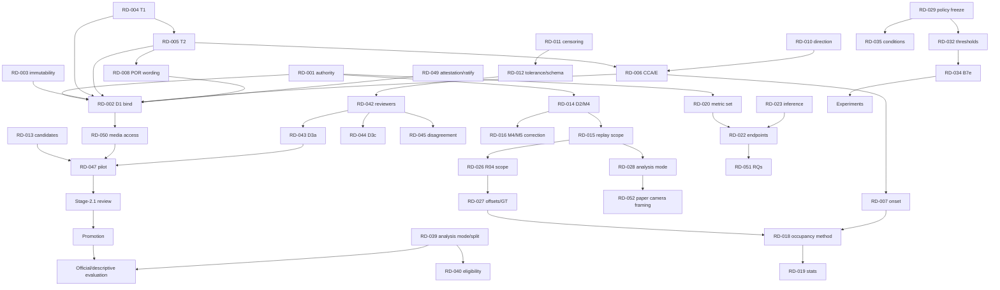

# Mission 4E.4 — Complete Researcher Decision Discovery & Consolidated Decision Register

**Project:** Train Gate Automation — Bangladesh Railway Level-Crossing Research
**Repository:** `/Users/sayemuddin/Desktop/Train_automation` · **Branch:** `main` · **HEAD:** `d4db94d4a4ea83ae4c510d65dfc99c5d6798304b`
**Date:** 2026-11-01 · **Mode:** DISCOVERY ONLY (read-only) · **Status of this document:** `QUESTIONNAIRE — NO DECISION MADE — NO APPROVAL — NO AUTHORIZATION`

> Every "recommendation" below is the agent's technical opinion. Nothing here binds D1, approves D2, validates a metric, authorizes review, promotion or evaluation, or changes readiness.
> Answer fields read `PENDING`. Evidence labels: **[V]** verified this mission from the repository · **[2nd]** quoted from an earlier-mission document, not re-verified · **[C]** candidate/AI-proposed, unapproved · **[P]** proposal by the agent.

---

## 1. Executive summary

1. **55 researcher decisions** (RD-001…RD-055) are outstanding, in 7 groups, plus **15 governance approvals**, **11 execution authorizations**, **22 technical findings** that need no scientific choice, and **12 blockers**. Many decisions are short; ~20 can be answered immediately from existing evidence.
2. **The single largest hidden issue is camera scope for the headline metrics.** The paper draft frames the benchmark as *front-camera only* (B0/B1/B2) and marks M4/POR/clearance **NON-COMPUTABLE** there, yet M4, M5 and the occupancy duration all need the **back-camera T4**. Your D2 selections are only evaluable on a back-stream or R04-fused replay (RD-015, RD-028, RD-052).
3. **Two governing documents conflict.** `EXPERIMENT_DESIGN_FINAL.md` (untracked, claims to "supersede" v9 for endpoints/statistics) defines metrics M1–M10, McNemar/Wilcoxon/Holm tests and a corrected decision policy; **most of these are not implemented in `src/`**. The implemented evaluator follows v9-style metrics. Which suite is official is undecided (RD-001, RD-020, RD-023, RD-029).
4. **Most of the study's code and documents are untracked in git** (src 87 untracked vs 39 tracked; tests 80 vs 29; docs 312 vs 34; configs 5 vs 4). "Binding" documents by hash does not make them reproducible unless they are committed or snapshotted (RD-003).
5. **Approved-descriptive mode cannot process real data today**: `descriptive_only.py` requires `EvidenceClassification.SYNTHETIC`. If you want descriptive real-data results, a pathway must be approved and built (RD-039).
6. **Only one reviewer identity is allowlisted** (the researcher). D3(a) forbids same-actor second reviews, so any second-review policy is unexecutable until a second reviewer exists or the policy is waived (RD-042, RD-043).
7. **Previously "approved" items (B7d, B7e mechanism, descriptive-only, engine isolation, GT-state separation, Stage-2.1 safeguards)** are recorded in an **agent-authored register** that transcribes chat statements dated 2026-10-30; no researcher-signed artifact exists for them (only LEG-EXEC has one). Ratification is recommended (RD-049).
8. **The M4 incomplete-replay defect is confirmed**: current code is right for 4 of the 6 cases and wrong for 2 (short/empty replay claimed as M5; blocked-then-truncated replay claimed as clean "not premature"). Correction changes counts (RD-016).
9. **Definitions are not yet answerable for occupancy**: T1/T2 wording conflicts, T2's reference line is described three ways, the entry plane is undocumented, and no same-camera pair is established (RD-004…RD-007, RD-018).
10. **Nothing is ready for official evaluation.** Re-verified: `ready=False` per the last gate run (9 blockers; not re-run here); 0 approved Stage-2.1 records; all decision/authorization artifacts absent.

---

## 2. Verified repository state

| Item | Reported by researcher | Verified now | Match |
|---|---|---|---|
| Branch | `main` | `main` | ✔ |
| HEAD | `d4db94d` | `d4db94d4a4ea83ae4c510d65dfc99c5d6798304b` (19 commits) | ✔ |
| Modified tracked | 19 | 19: README.md; FINAL_ABLATION_MATRIX, FINAL_EXPERIMENT_DATA_FLOW, FINAL_GROUND_TRUTH_PROTOCOL, FINAL_REAL_WORLD_EXPERIMENT_PROTOCOL; pyproject.toml; 8 `src/` files; 5 `tests/` files | ✔ |
| Staged | 0 | 0 | ✔ |
| Untracked | — | 355 porcelain entries (`docs/generated/` is collapsed as one untracked directory) | info |
| Ignored (top level) | — | 46 entries | info |
| v9 protocol hash | `7c183b32…` | `7c183b323970591b68f0db692e70413e54dcacfc4bf78a358c28f1b1ed68734c` | ✔ |
| v7 GT hash | `d100c1e6…` | `d100c1e6a63280c375f94e297416efb0cf7dd3c15c9aa8df076ede052d49ecf4` | ✔ |
| `metrics.py` hash | `8e38992c…` | `8e38992cfa9ce841c47296f28669f6f2cfa0ab49532f2b48e6edbd498e29a673` (file is **untracked**) | ✔ |
| 4E.3 tests | 68 passing | `68 passed` (re-run once, synthetic-only, bytecode/caches disabled) | ✔ |
| `.git/lost-found` | 309 files | 146 `commit/` + 163 `other/` = 309; untouched | ✔ |
| This report | — | did not previously exist; created without overwrite | — |

**Differences:** none against the reported state. Read-only git commands used `GIT_OPTIONAL_LOCKS=0`.

**Tracking exposure [V]:** `src/`: 39 tracked / 87 untracked · `tests/`: 29 / 80 · `docs/`: 34 / 312 · `configs/`: 4 / 5. `EXPERIMENT_DESIGN_FINAL.md`, `OPEN_DECISIONS_AND_BLOCKERS.md`, `PAPER_DRAFT_DESCRIPTIVE_BENCHMARK.md`, `metrics.py`, `preflight_validator.py`, the frozen config and both policy files are all untracked.

---

## 3. Existing researcher decisions (what is actually on record)

### 3.1 Recorded as approved (canonical register in `preflight_validator.CANONICAL_DECISION_REGISTER`, 7 `APPROVED_BY_RESEARCHER` entries) plus other dispositions on record

| ID | Decision | Recorded date | Evidence of record | Scope limit |
|---|---|---|---|---|
| `GOV-B7D-DELIVERY-DISORDER` | B7d = delivery-layer disorder; preserve arrival order | 2026-10-30 | agent-authored `RESEARCHER_DECISION_REGISTER_20261101_M2.md` transcribing chat [V] | mechanism only |
| `GOV-B7E-MECHANISM` | B7e = delayed timestamp; content unchanged | 2026-10-30 | same | **numbers not approved** |
| `GOV-D3-DESCRIPTIVE-MODE` | descriptive-only evaluation, isolated, fixed-site claims | 2026-10-30 | same | code accepts **synthetic only** |
| `GOV-ENGINE-EVENT-ISOLATION` | engine event = isolated case study | 2026-10-30 | same | pooling needs a future decision |
| `GOV-GT-STATE-SEPARATION`, `GOV-STAGE21-SAFEGUARDS` | four-state taxonomy; Stage-2.1 integrity safeguards | — | code/schema | — |
| `GOV-LEG-EXEC-INVALIDATION` | invalidate 27 legacy review records (sibling notices only) | 2026-10-17T07:44:22Z | **researcher-attested** `data/governance/leg_exec_authorization.json` (unsigned-level attestation, email `raihankabirrahu@gmail.com`) [V] | no GT labels approved |
| Media-access hold disposition | administrative disposition, bounded | 2026-10-25T10:47:38-04:00 | `docs/MEDIA_ACCESS_HOLD_RESOLUTION_PLAN.md` [V] | bounded scope |
| R04 `event_010` corroboration | promoted to CALIBRATION_SUPPORTED | 2026-10-25 | `ADMINISTRATIVE_DISPOSITION_R04_READ_ONLY_UNBLOCK_20261025` [2nd] | manifest only |

### 3.2 Selected by you in conversation (Missions 4E.1–4E.3) — **not recorded in any repository artifact**

| # | Selection | State |
|---|---|---|
| S1 | D1: protocol v9.0.0 + GT v7.0.0 | selected, **unbound** (`phase12_protocol_decision.json` absent) |
| S2 | D2: both premature gate opening and train-clearance duration | selected, unbound |
| S3 | M4 = `first_blocked_to_t4_clearance` | selected, unbound |
| S4 | M5 never-protected kept as separate outcome | selected, unbound |
| S5 | Duration = full crossing occupancy, physical block onset → T4 | selected; **onset boundary undefined** |

### 3.3 Not yet decided in the canonical register (code) — 8 `PENDING_RESEARCHER_DECISION` + 1 `IMPLEMENTED_BUT_NOT_SCIENTIFICALLY_APPROVED` [V, statuses parsed from code]

*Pending:* `GOV-D1-PROTOCOL-AUTHORITY`, `GOV-D2-EVALUATION-PROFILE`, `AUTH-EVENT-SPLIT`, `GOV-D4-R04-SYNCHRONIZATION`, `EXP-B7E-PARAMETERS`, `EXP-ROI-GEOMETRY`, `AUTH-STAGE21-ADJUDICATION`, `AUTH-EVAL-AUTH`. *Implemented, not approved:* `EXP-OPERATING-THRESHOLDS`. (The register has 17 entries: 7 approved, 8 pending, 1 implemented-not-approved, 1 superseded label entry `M3-OVERLOADED-D1-D2-LABELS`.) **Not in the code register but listed as pending in Mission 4C documents:** D3(a), D3(c), `AUTH-PROMOTE-EXEC`, pilot authorization (TF-05).

### 3.4 Older numbered decisions (`OPEN_DECISIONS_AND_BLOCKERS.md`, 2026-10-13, untracked)

D-1 backup/location · D-2 invalid APPROVED reviews (treated invalid; LEG-EXEC executed) · D-3 audio-sync rule · D-4 clearance rule/fault recovery · D-5 audio authority · D-6 temporal filter · D-7 confirm negatives train-free · D-8 second annotator · D-9 engine T3/T4 · D-10 primary endpoints · D-11 pilot contamination. **No document records a researcher answer to D-1, D-3…D-8, D-10, D-11.** D-9 is effectively settled by v7 (`T3≡T4`, back camera). They are re-asked below (RD-011/012/029-031/037/042/022). Note **three ID schemes collide**: `D-n` (this list), `D1…D4` (governance), and `D3` meaning both "descriptive-only mode" (approved) and "second-review policy D3(a)/(c)" (pending) (TF-04).

---

## 4. Technical findings (no scientific choice required unless marked)

| ID | Finding | Evidence | Resolvable by agent? |
|---|---|---|---|
| TF-01 | Incomplete-replay misclassification (rows 4 and 5 of the 6-case table) | `metrics.py:116-122`; 4E.3 tests [V] | Code change **after RD-016** |
| TF-02 | Bare engine id (`event_001`, no cohort) is evaluated as a train event | pinned by test [V] | Yes — fail closed (RD not needed) |
| TF-03 | Stale gate text says M4 is "not implemented" | `execution_gate.py:150-152` vs `metrics.py:94-95` [V] | Yes (message only) |
| TF-04 | ID overload: `D3`, `D-n`, `D1/D2` (M3 reports used D1/D2 for thresholds/ROI) | register docs [V] | Yes — naming (see RD-009) |
| TF-05 | Canonical register lacks D3(a), D3(c), `AUTH-PROMOTE-EXEC`, pilot; eval-auth id spelled `AUTH-EVAL-AUTH` (code) vs `AUTH-EVAL-OFFICIAL` (4E sheet) | code vs M4C/M4E docs [V] | Yes, once decisions exist |
| TF-06 | `decision_policy_v1.yaml` `tick_interval_s: 0.1` vs frozen config `tick_s: 0.2` | both files [V] | Needs statement of which governs (frozen config is hashed) |
| TF-07 | Design-doc metrics/tests **not implemented**: M2 censor flag, M3 `insufficient_lead_in` screen, M6, M7, M9, T4±u sensitivity, McNemar, Wilcoxon, Holm, ABS/REAR clearance variants (grep of `src/` finds only a bootstrap helper and `R_block` in a readiness audit) | grep [V] | Implementation after RD-020/023/029 |
| TF-08 | Hard-coded 0.25 s step-matching tolerance in `missed_train` | `metrics.py:357` [V] | Report; RD-021 |
| TF-09 | Descriptive-only mode is synthetic-only by construction | `descriptive_only.py:57,131` [V] | Needs RD-039 |
| TF-10 | `dual_report` option described historically but not implemented | `protocol_choices.py` [V] | Needs RD-014 |
| TF-11 | Protocol-choice envelope rejects unknown keys → occupancy metric cannot be bound | `validate_protocol_choices` [V] | Code change after RD-018 |
| TF-12 | Main schema lacks `censoring_direction`, `timestamp_uncertainty_s`, onset provenance (the timing-pilot schema has some) | schema files [V] | Needs RD-012 |
| TF-13 | Legacy annotator still emits GT v6.0.0 proposals and words T2 against a "transverse lens plane" | `batch_multimodal_annotator.py:3,201,322` [V] | Retire/guard after RD-013 |
| TF-14 | Paper draft contains stale statements: "evaluator defaults to [T1,T4)" (no default exists); "[D-10] neither selected"; "Tier 3 requires R04" (design §8.3 says back-stream replay suffices) | draft §6.2 vs code/design [V] | Text fix after RD-015/052 |
| TF-15 | **Tests that exercise only reference functions, not production code:** occupancy rules (no production implementation exists) and the corrected incomplete-replay rule (4E.2/4E.3 test Parts 2–3). Part 1 and the characterization tests do exercise production `m4_premature_opening` / `evaluate_run` / `aggregate_cohort` | test file [V] | Port to production tests when implemented |
| TF-16 | Count discrepancies unreconciled: T0 left-censoring 20/23 vs 23/23; R04 PROVISIONAL/AMBIGUOUS 7/8 (27 events) vs 5/6 (train-only?) | docs [2nd] | Partially (verify counts) |
| TF-17 | Environment: `ultralytics/__init__.py` now exists in `.venv` (earlier memory said it did not); importability, `requirements.lock` drift not re-verified | file check [V] | Not verified; execution mission |
| TF-18 | `.git/lost-found` holds 309 pointer files from an earlier `git fsck --lost-found` | [V] | Leave (researcher) |
| TF-19 | Untracked governing code/docs (see §2) | [V] | Needs RD-003 |
| TF-20 | Historical caches omit checkpoint/config/injector identity in names (cross-run reuse possible) | defect-impact matrix [2nd] | Addressed by provenance work in 4D; verify before any run |
| TF-21 | Legacy-record schema labelled "7.0.0" in reports vs "6.0.0" on disk (R-DISC1) | register-remaining-phases [2nd] | Documentation fix |
| TF-22 | Review-queue/inventory counts consistent: 27 = 23 + 3 + 1; "engine 1 vs 3" confusion was 3 proposal versions of one event | M4A [2nd]; counts re-derived [V] | Closed |

**Candidate-metadata observation [C]:** `proposed_train_metadata.train_direction` is `left_to_right` for all 23 train proposals and the engine proposal (no-train: null). This is AI-proposed and unapproved, but suggests a single direction (informs RD-010).

---

## 5. Unresolved inconsistencies

| # | Inconsistency | Where | Decision link |
|---|---|---|---|
| I-1 | T1 table says "into road danger zone"; operational landmark is the upstream frog line | v9 §5.1 vs §5.4 | RD-004 |
| I-2 | T2: "fully occupies" vs "pilot crosses line"; reference "camera/lens plane" vs "roadway boundary line" vs "roadway occupancy line" | v9/v7; R04 investigation | RD-005 |
| I-3 | "Occupancy" has 5 senses (T2; `[T1,T4]` hazard; `T4−T1`; M6 coverage; your onset→T4) | protocols, design doc | RD-007, RD-009 |
| I-4 | v9/v7 premature-opening text is T1-based; you selected M4 | v9 §5.2, INV-3, §18 | RD-008 |
| I-5 | `EXPERIMENT_DESIGN_FINAL` claims to supersede v9 for endpoints; includes engine in M4/M5; v9/v7 + approved decision exclude it | design §8.3 | RD-001, RD-024 |
| I-6 | Paper: front-only benchmark vs M4/occupancy need back T4 | draft §6, Table 1 | RD-015, RD-052 |
| I-7 | Descriptive mode approved for real "fixed-site" claims but implemented synthetic-only | register vs code | RD-039 |
| I-8 | R04 supported set 12 (manifest) vs 11 (authorized config) | M4D | RD-026 |
| I-9 | Design says fused analysis primary only if ≥20/23 pass; only 12 are CALIBRATION_SUPPORTED | design §3, D-3 | RD-028 |
| I-10 | Governance says acoustic-lag offsets must not shift human GT timestamps (Phase 11 protocol); cross-camera occupancy would need exactly that | `PHASE11_GROUND_TRUTH_PROTOCOL.md:70` | RD-027 |
| I-11 | Design doc inferential tests vs approved "descriptive-only, no official-performance" framing | design §9 vs register | RD-023 |
| I-12 | Frozen policy (v1) vs design §5 corrected policy vs v2 candidate | configs, design | RD-029 |
| I-13 | Paper lists an autonomous agent as an author | draft header | RD-054 |

---

## 6. Complete decision inventory

Class legend: **RD** researcher decision · **GA** governance approval · **EA** execution authorization · **BL** blocker · **TF** technical finding · **IO** information only. "Now?" = answerable immediately from existing evidence (**Y**), needs more evidence (**E**), or must wait for a prerequisite (**W**).

| Group | IDs | Topic | Priority | Now? |
|---|---|---|---|---|
| A | RD-001…013 | Protocol, definitions, GT semantics | P1 | mostly Y |
| B | RD-014…025 | Metrics and outcomes | P2 | mostly Y |
| C | RD-026…028 | Camera synchronization | P2 | Y/E |
| D | RD-029…038 | System, thresholds, experiments | P4 | Y/E |
| E | RD-039…041 | Population, split, eligibility | P2/P3 | Y |
| F | RD-042…050 | Human review & governance | P1/P3 | Y/W |
| G | RD-051…055 | Paper | P5 | Y/W |

(Full list with class/priority in §11–§13 and §8.)

---

## 7. Consolidated researcher questionnaire

Format per item: **Topic · Situation · Question · Options · Recommendation (confidence) · Consequences · Dependencies · Answerable now? · Your answer.** `DEFER` is always allowed.

### GROUP A — Protocol, definitions and ground-truth semantics

### RD-001 — Which document governs metric definitions and statistics?
**Topic:** Authority precedence. **Situation:** v9/v7 (selected, uncommitted) and `EXPERIMENT_DESIGN_FINAL.md` v1.0 (untracked, "governing specification… supersedes v9 for endpoints, taxonomy, timing policy, statistics") overlap. Design defines M1–M10, tests and a policy that code largely lacks. [V]
**Question:** What is the precedence rule?
**Options:**
- A — v7 governs boundaries/GT; v9 governs system and metric text; design doc is a non-binding reference except items you explicitly adopt (listed in RD-020/023/029).
- B — v7 governs boundaries; design doc governs endpoints/statistics/policy; v9 governs the rest.
- C — Merge into one new single-source protocol (new version).
- D — Defer.
**Recommendation (MEDIUM):** A, then adopt design items one by one. Smallest change; matches D1 selection and the approved decisions (engine isolation, descriptive-only).
**Consequences:** A keeps the implemented evaluator authoritative; B obliges implementing TF-07 and includes engine in M4/M5 (conflicts with approval); C is cleanest but costs a protocol rewrite and re-hash.
**Dependencies:** blocks RD-002, RD-020, RD-023, RD-024, RD-029. **Now?** Y. **Your answer:** PENDING.

### RD-002 — Bind D1 (v9.0.0 / v7.0.0) and in what order?
**Situation:** Selected but unbound; envelope requires `decision_id`, `decided_by` (allowlisted), your statement, UTC time, `choices` limited to known keys. Wording edits (RD-004…RD-008) change the file hashes.
**Question:** Bind now as-is, or after wording edits?
**Options:** A — bind current bytes (`7c183b32…`/`d100c1e6…`) now and treat later edits as v9.1/v7.1; B — apply accepted wording (RD-004…008) first, then re-hash and bind; C — keep v8/v6; D — defer.
**Recommendation (HIGH for B):** B. Binding bytes you already intend to change forces a re-bind and may orphan review records.
**Consequences:** A is fast but pins a text with known T2/T1/POR conflicts (any Stage-2.1 record then cites a flawed definition). C discards R03 retirement. B delays binding by one edit pass.
**Dependencies:** needs RD-001, RD-003–RD-008; blocks every review/pilot/evaluation step. **Now?** Y (after RD-004–008). **Your answer:** PENDING.

### RD-003 — How are bound documents and code made immutable?
**Situation:** 87/126 `src` files, 80/109 test files and 312/346 docs are untracked; the two protocol files are uncommitted edits. A SHA-256 pin proves bytes, not recoverability. `git checkout` of either protocol file would silently revert to v8/v6.
**Question:** What preservation mechanism before binding?
**Options:** A — you commit (or branch-commit) the governing set; B — create a read-only hashed snapshot archive outside git; C — both; D — accept hash-only pinning; E — defer.
**Recommendation (HIGH):** C — you perform the commit; the agent never commits unasked.
**Consequences:** D leaves D1/D2 bound to bytes that may not be reproducible; A/C make provenance checkable. **Dependencies:** before RD-002. **Now?** Y. **Your answer:** PENDING.

### RD-004 — T1 definition
**Situation:** v9 §5.1 table: front bumper "crosses into road danger zone"; §5.4/GT §2.4: reaches the **approach** danger-zone line (turnout frog / pedestrian approach corridor line on `camera_front`). Candidate T2≈T1+0.7–0.9 s [C/2nd].
**Question:** Which is T1?
**Options:** A — approach line (frog), table wording corrected; B — T1 = road entry and the frog line becomes a new boundary; C — leave as is; D — defer.
**Recommendation (HIGH for A):** A (operational landmark already used everywhere; no schema change).
**Consequences:** B adds a boundary and invalidates the candidate set; C leaves two meanings.
**Dependencies:** RD-005, RD-007. **Now?** Y. **Answer:** PENDING.

### RD-005 — T2 instant and reference line
**Situation:** T2 = "locomotive fully occupies danger zone" (table) vs "front pilot crosses [camera plane | roadway boundary line | roadway occupancy line] … commencing road lane blockage". The legacy generator uses "transverse **lens** plane"; so candidate T2 values may reference a camera plane [V].
**Question:** What exactly is T2?
**Options:** A — leading end crosses the **roadway boundary line** (entry plane E); lens/camera plane never used; "fully occupies" withdrawn; B — keep "fully occupies" (later instant); C — two boundaries (T2a entry, T2b fully-in; schema extension); D — defer.
**Recommendation (MEDIUM-HIGH for A):** A. It matches "commencing physical road lane blockage" and needs no schema change.
**Consequences:** C gives the richest data but changes the schema/review burden; B shifts occupancy onset later and loses the "road blocked" meaning. All candidate T2 values must be treated as unreliable under A or C.
**Dependencies:** RD-006; feeds RD-007, RD-012. **Now?** Y. **Answer:** PENDING.

### RD-006 — Entry plane E and the crossing conflict area (CCA)
**Situation:** Only the **exit** plane X (departure roadway boundary, vendor-stall line, `camera_back`) is documented as a plane. E is assumed to be the approach-side mirror; the documents name only a "roadway boundary/occupancy line" on `camera_front`. No coordinates exist (R03 retired).
**Question:** Confirm the CCA definition: track stretch within the road/pedestrian corridor, bounded by E and X, occupied while any part of the train lies between them?
**Options:** A — confirm and E = the roadway boundary line used for T2; B — confirm but E is a different, named landmark (state it); C — redefine CCA (state how); D — defer pending an authorized geometry-sheet step.
**Recommendation (MEDIUM for A):** A if you can state the landmark from your own knowledge of the site; otherwise D.
**Consequences:** unconfirmed E leaves the onset physically undefined; a geometry-sheet step needs media-access authorization.
**Dependencies:** RD-005, RD-050 (if media needed). **Now?** Y (from your site knowledge) or E. **Answer:** PENDING.

### RD-007 — Physical occupancy onset boundary (`T_OCC_START`)
**Situation:** `T_OCC_START` exists nowhere in code/docs; it is a proposed alias. Candidates: T2 (supported field), T1 (collapses to v9's `T4−T1`), new boundary.
**Question:** Which boundary defines the onset of full crossing occupancy?
**Options:** A — reconciled T2 (alias only; no new field); B — T1; C — new independently defined boundary (schema+protocol change); D — defer.
**Recommendation (MEDIUM-HIGH for A):** A. T2−T1≈0.7–0.9 s in candidates [C], so A vs B changes D by under 1 s but changes the physical claim.
**Consequences:** A is evaluable only after RD-005/006; B is simplest but not "blocked"; C needs full approvals.
**Dependencies:** RD-004–006; blocks RD-018/019. **Now?** Y. **Answer:** PENDING.

### RD-008 — Replacement of the T1-based premature-opening text
**Situation:** v9 §5.2, INV-3 and §18, and GT §2.2 define POR on `[T1,T4)`. Drafts of replacement text exist (`PROPOSED_REPLACEMENT_WORDING_20261101_M4E3.md`) [P].
**Question:** How is the superseding handled?
**Options:** A — adopt the drafted blocks (M4/M5; INV-3 reworded; §18 renamed "approach-to-clearance time"); B — adopt M4 for the metric but keep v9 text as historical annex; C — keep v9 text, report M4 as secondary; D — defer.
**Recommendation (HIGH for A):** A. Leaving T1-based text produces two live definitions of the same metric name.
**Consequences:** edits change hashes (RD-002 order); INV-3 verification then relies on M4 plus MTR/M5 for timely closure.
**Dependencies:** RD-001, RD-014. **Now?** Y. **Answer:** PENDING.

### RD-009 — Terminology and ID scheme
**Situation:** five "occupancy" senses; `D3` collides; `D-n`/`D1…D4`.
**Question:** Adopt: "approach-to-clearance interval `[T1,T4]`", "crossing-conflict-area occupancy duration", `T2_crossing_occupancy_start` gloss "leading end enters CCA", and single ID scheme `GOV-/EXP-/AUTH-` (retire `D-n`, `D3` shorthand)?
**Options:** A — adopt as drafted; B — adopt with your changes (state); C — keep as is; D — defer.
**Recommendation (HIGH for A).** **Consequences:** cosmetic but prevents misbinding. **Dependencies:** none. **Now?** Y. **Answer:** PENDING.

### RD-010 — Direction of travel and camera roles
**Situation:** protocols fix front=approach, back=departure; schema allows both directions; candidates (unapproved) show all 27 `left_to_right` [C].
**Question:** Is every event the same direction, with fixed roles?
**Options:** A — yes, and review must still record direction per event; B — no, some differ (list events) → per-event role mapping; C — defer to review observation.
**Recommendation (MEDIUM for A, verified at review):** A with a per-event direction field in the review.
**Consequences:** B changes which camera carries entry vs exit and breaks cross-camera assumptions. **Dependencies:** RD-006, RD-012. **Now?** Y/E. **Answer:** PENDING.

### RD-011 — Censoring treatment
**Situation:** documented default `exclude_censored_from_point_estimates`; bounds mode `report_censored_as_bounds` not implemented; design stores censored markers as bounds (schema forbids a value for CENSORED).
**Question:** Primary treatment for left/right-censored boundaries across all metrics?
**Options:** A — exclude from point estimates, count with reasons; B — report one-sided bounds as secondary (needs build and a schema decision); C — A primary + B exploratory; D — defer.
**Recommendation (HIGH for A):** A now; C later if wanted.
**Consequences:** right-censoring of T4 biases retained durations short; left-censoring direction unassessable; B requires pre-recording bound fields (v7 currently forbids synthetic pre-recording stamps). **Dependencies:** RD-012. **Now?** Y. **Answer:** PENDING.

### RD-012 — Annotation tolerance and schema fields
**Situation:** promoted schema has `state/value_s/reference_camera/frame_index/rationale` only. Design default `u=0.5 s` without second annotator.
**Question:** (a) Extend the Stage-2.1 schema (new version) with `censoring_direction`, `timestamp_uncertainty_s`, onset provenance/direction, **before** any real review? (b) Which tolerance `u`?
**Options (a):** A — extend now; B — encode in rationale text only; C — use timing-pilot schema fields for pilot drafts only. **(b):** i — fixed 0.5 s; ii — empirical from second annotator (≥8 events); iii — none.
**Recommendation (MEDIUM-HIGH): (a)A, (b)ii if a second reviewer exists, else i.**
**Consequences:** reviews created under today's schema cannot later carry structured censoring direction without re-review. **Dependencies:** RD-042. **Now?** Y. **Answer:** PENDING.

### RD-013 — Reuse of AI candidates and legacy annotations
**Situation:** 27 legacy reviews invalidated (never reusable). AI candidates show template-like regularity; generator words T2 against a lens plane; v6 generator still present.
**Question:** How are candidates used in Stage-2.1?
**Options:** A — blind first-pass (no candidates shown), compare afterward; B — show candidates as proposals (current Stage-1→2 lifecycle); C — blind for pilot, candidates for rest; D — defer.
**Recommendation (MEDIUM for A or C):** blind first pass for T1/T2/T4 to avoid anchoring; keeps B available later.
**Consequences:** A costs review time; B risks inheriting lens-plane T2 and template bias. **Dependencies:** RD-005. **Now?** Y. **Answer:** PENDING.

### GROUP B — Metrics and outcomes

### RD-014 — D2 profile and M4 binding
**Question:** Confirm the premature-opening profile.
**Options:** A — M4 only (`first_blocked_to_t4_clearance`) bound as `choices.premature_opening_window`; B — M4 primary + v9 `[T1,T4)` secondary on R04-fused events (needs `dual_report`, TF-10); C — v9 only; D — defer.
**Recommendation (HIGH for A).** **Consequences:** B adds code and R04 dependence; C contradicts your selection. **Dependencies:** RD-001, RD-008, RD-015. **Now?** Y. **Answer:** PENDING.

### RD-015 — Replay camera scope for M4 and M5
**Situation:** T4 is on the back clock. Design §8.3 clock rule: M1–M3 on the front-stream replay; M4/M5/M7/M8 on the **back-stream** replay (no R04). Paper draft benchmarks front-only and marks M4 non-computable. A back-only replay can only trigger from what the back camera sees, so M5 means "never protected by that replay's sensing".
**Question:** Which replay produces M4/M5?
**Options:** A — independent-camera mode: back-stream replay for M4/M5, front-stream for MTR/WLT; B — fused replay on R04-accepted events only (exploratory); C — A as primary + B exploratory; D — front-only, M4/M5 excluded; E — defer.
**Recommendation (MEDIUM-HIGH for C).** **Consequences:** D makes your selected metrics unreportable; A requires acknowledging replay-relative M5; B depends on RD-026/027. **Dependencies:** RD-026, RD-028; changes paper framing (RD-052). **Now?** Y. **Answer:** PENDING.

### RD-016 — Corrected incomplete-replay classification (M4/M5)
**Situation (6-case audit; "current" verified by pinned tests [V]):**

| # | Case (T4 approved) | Expected | Current code |
|---|---|---|---|
| 1 | Violation observed before replay ends | EVALUABLE, premature=True | ✔ premature=True |
| 2 | Protected through valid T4, no violation | EVALUABLE, premature=False | ✔ |
| 3 | No blocked step; replay reaches T4 | M5 (excluded from M4) | ✔ M5 |
| 4 | No blocked step; replay short/empty | NOT_EVALUABLE (`replay_ended_before_T4`/`replay_empty`); **M5 not asserted** | ✘ M5 `never_protected=True` |
| 5 | Blocked, no violation, replay ends before T4 | NOT_EVALUABLE (`replay_ended_before_T4`) | ✘ "not premature" (counted in denominator) |
| 6 | Violation already seen, then replay ends before T4 | EVALUABLE, premature=True (witnessed) | ✔ |

**Question:** Adopt this classification? Sub-questions: completeness test `t_last ≥ T4` with **no tolerance**, or a stated sampling tolerance ε? Handle sparse retained steps (vacuous empty interval)?
**Options:** A — adopt as written; B — adopt with ε (state value); C — keep current behaviour; D — defer.
**Recommendation (HIGH for A).** Current error direction: understated premature rate (case 5), overstated never-protected (case 4).
**Required code correction:** `m4_premature_opening`/`evaluate_run` return a three-way outcome with reasons; aggregator adds the two reasons.
**Metric-semantics change:** yes — events move from denominators/M5 to NOT_EVALUABLE.
**Regression tests required:** six cases on production functions; covered-replay equivalence (exhaustive small patterns); M5-evaluable = M4-evaluable + M5-count identity; empty replay; mixed-window refusal; bare engine id (TF-02); sparse-interval case; reason strings in `exclusions`.
**Dependencies:** RD-014; code change is a later implementation mission. **Now?** Y. **Answer:** PENDING.

### RD-017 — M5 reporting form
**Question:** Report M5 as counts only, or add proportion with Wilson CI?
**Options:** A — counts only (current); B — add proportion/CI over M5-evaluable denominator; C — defer. **Recommendation (HIGH for A);** B is a new unapproved reporting choice. **Dependencies:** RD-016. **Now?** Y. **Answer:** PENDING.

### RD-018 — Occupancy duration: status and cross-camera strategy
**Situation:** onset on front (T2), T4 on back; no same-camera pair is established (front lacks T4; back lacks an entry-plane landmark); cross-camera needs R04 and conflicts with the Phase-11 rule against shifting GT with acoustic offsets. Metric is ground-truth-only (describes events, not system performance).
**Question:** How is the duration obtained?
**Options:** A — cross-camera on R04-accepted events only (aligned/partially_aligned, with bounds); B — define a back-camera entry landmark (protocol change) for a same-camera pair; C — report same-clock sub-durations only (e.g. front `T2−T1`; back `T4−T3` tail-passage time) as distinct metrics, no "full occupancy"; D — defer/drop the duration outcome.
**Recommendation (MEDIUM for A+C):** A for the supported subset, with C as always-computable context; B only if you can state the landmark.
**Consequences:** A → at most 12 candidate events and none until R04 accepted; C answers a different physical question; B needs RD-006/013-type review changes. **Dependencies:** RD-005–007, RD-026/027. **Now?** Y. **Answer:** PENDING.

### RD-019 — Occupancy reporting statistics and uncertainty
**Options:** A — per-event table + median/range (design style) with strata (same-camera / aligned / partially aligned); B — mean±SD; C — defer. How to combine endpoint tolerance and offset δ (root-sum-square? worst case?) must be stated.
**Recommendation (MEDIUM for A, with RSS for independent errors).** **Dependencies:** RD-012, RD-018. **Now?** Y. **Answer:** PENDING.

### RD-020 — Official metric set and tiers
**Situation:** implemented: MTR, POR(M4), WLT, excess closed, clearance latency (+ M5, closure stats). Design adds M1–M10, N1, D1, V1, F1.
**Question:** Which metrics are in scope and in which class?
**Proposed classification [P]:** *Safety outcomes:* M4, M5, MTR(M3 with screen). *Operational duration:* occupancy duration, clearance latency (M8), reopened-within-recording (M7), excess closure. *Diagnostic:* M10 chatter, V1 invariants, D1 descriptors, M6 coverage. *Exploratory:* WLT/M2 (left-censored), N1 nuisance, F1 stress.
**Options:** A — adopt the proposed classification, implement only M4/M5/occupancy first; B — adopt the full design set; C — your own list; D — defer. **Recommendation (MEDIUM for A).** No combined score without your authorization (agree). **Dependencies:** RD-001, RD-022. **Now?** Y. **Answer:** PENDING.

### RD-021 — Missed-train metric: feasibility screen and tolerance
**Situation:** with 2 s warning + 3 s closing, the barrier cannot block before ≈3.6 s; candidate entries are ≤3.2 s in 18/22 events [2nd/C]; code matches step within ±0.25 s (hard-coded); design M3 requires an `insufficient_lead_in` screen (not implemented). Historical MTR=0.0 everywhere.
**Options:** A — implement design M3 screen and publish the feasibility table; B — keep v9 MTR with ±0.25 s, report all; C — drop MTR as a headline; D — defer. **Recommendation (HIGH for A);** B would report near-100% "missed" or misleading 0%. **Dependencies:** approved T0/T1. **Now?** Y. **Answer:** PENDING.

### RD-022 — Primary endpoints and hypotheses (D-10)
**Options:** A — M4 (+M5 transparency) primary; M7/clearance and occupancy secondary; MTR secondary with screen; B — design's M4+M7 primary; C — your own; D — defer. Note design RQ1 is "stateful vs stateless policy"; the paper's RQs differ (RD-051).
**Recommendation (MEDIUM for A).** **Dependencies:** RD-020, RD-029, RD-051. **Now?** Y. **Answer:** PENDING.

### RD-023 — Statistical inference policy
**Situation:** approved framing is descriptive; design proposes exact McNemar, Wilcoxon, Holm across 3 contrasts, bootstrap (only a bootstrap helper exists). N=23 (≤22 evaluable).
**Options:** A — descriptive only: counts, Wilson 95 %, paired discordant-count tables, no p-values; B — pre-specified 3 contrasts with Holm (build tests); C — bootstrap intervals for medians only; D — defer.
**Recommendation (MEDIUM-HIGH for A).** Also decide whether to include the "recompute at T4±u" sensitivity (recommend yes, as descriptive). **Consequences:** B conflicts with "descriptive-only" wording unless redefined. **Dependencies:** RD-012, RD-039. **Now?** Y. **Answer:** PENDING.

### RD-024 — Engine event: population and case-study content
**Situation:** isolation approved; design lists engine in M4/M5; `T3≡T4` (back camera); candidate engine T4 right-censored; N=1.
**Question:** (a) Confirm engine excluded from M4, M5, occupancy pooled stats and train aggregates? (b) Case-study content?
**Options (b):** A — one descriptive row (own onset, `T3≡T4`) if approved GT exists; B — qualitative text only; C — omit.
**Recommendation (HIGH for (a) yes; MEDIUM A).** **Consequences:** engine in M4/M5 would require a new decision (current approval forbids pooling). **Dependencies:** RD-001. **Now?** Y. **Answer:** PENDING.

### RD-025 — No-train false-alarm analysis (N1)
**Situation:** 3 clips (~60 s per camera); no hourly rate; per-stream exposure only (concurrent overlap unresolved). D-7: negatives never confirmed train-free by a human.
**Question:** (a) Report form; (b) confirmation of negatives; (c) more footage?
**Options:** (a) A — event-level plus blocked seconds, episodes, exposure (documented default); B — event-level only. (b) you confirm train-free by viewing, or authorize a reviewer to. (c) i — no; ii — collect 30–60 min of fixed-position footage.
**Recommendation: (a)A, (b) required before N1 is reported, (c)ii if a nuisance claim matters.** **Now?** Y/E. **Answer:** PENDING.

### GROUP C — Camera synchronization

### RD-026 — R04 scope
**Situation:** manifest 12 CALIBRATION_SUPPORTED / 7 PROVISIONAL / 8 AMBIGUOUS; authorized exploratory config 11 (omits `train_events/event_010`, promoted later by visual corroboration); no scope-decision artifact.
**Options:** A — keep 11 exploratory; B — revise to 12 (new authorization); C — 11 exploratory + official dual-camera scope deferred; D — restrict all dual-camera claims to the supported subset; combinations allowed.
**Recommendation (MEDIUM for C+D).** **Dependencies:** RD-015, RD-028. **Now?** Y. **Answer:** PENDING.

### RD-027 — Use of R04 offsets with human GT timestamps
**Situation:** offsets are acoustic-lag reproducibility estimates, uncertainty ±0.05 s "geometric jitter bound only"; Phase-11 protocol refuses to shift GT with them; v7 §5 eligibility (δ≤0.5 s / ≤2.0 s).
**Options:** A — never shift GT timestamps; offsets only for replay fusion; B — allow for `aligned` events with stated δ; C — allow only with per-event visual-landmark corroboration (as event_010) and δ recorded; D — defer.
**Recommendation (MEDIUM for C).** **Consequences:** A makes cross-camera occupancy impossible; B treats acoustic correlation as ground truth. **Dependencies:** RD-018, RD-026. **Now?** Y. **Answer:** PENDING.

### RD-028 — Primary analysis mode
**Situation:** design rule: fused primary only if ≥20/23 train events pass calibration; only 12 are supported.
**Options:** A — independent-camera primary (rule fails); B — fused primary on supported subset; C — both reported, independent primary; D — defer. **Recommendation (HIGH for C).** **Dependencies:** RD-015, RD-026. **Now?** Y. **Answer:** PENDING.

### GROUP D — System, thresholds and experiments

### RD-029 — Decision policy to freeze (clearance and fault rules)
**Situation:** frozen `decision_policy_v1` (design lists defects: no rear-confirmation implementation, no exit from fault state); `v2_candidate`; design §5 corrected policy with ABS/REAR variants (not implemented). Behaviour already seen on these 27 events (pilot contamination).
**Options:** A — freeze v1 as-is and report its documented limits; B — implement design §5 (ABS primary, REAR variant, automatic fault recovery) and freeze before any replay; C — v2 candidate; D — defer.
**Recommendation (MEDIUM for B)** if a stateful-vs-stateless contrast is a goal; **A** if the aim is purely descriptive benchmarking of the existing pipeline. **Consequences:** M4 measures *this* policy; changing it changes every safety number. **Dependencies:** RD-022, RD-051, RD-031/030. **Now?** Y. **Answer:** PENDING.

### RD-030 — Audio authority (D-5)
**Options:** A — supporting only (cannot start warning/actuate; can only postpone clearance); B — audio on 2 consecutive windows may start a warning, never grants clearance; C — defer. **Recommendation (HIGH for A):** audio model domain-shift and field outputs previously invalid. **Dependencies:** RD-029. **Now?** Y. **Answer:** PENDING.

### RD-031 — Temporal filter (D-6)
**Options:** A — confirm 2 ticks, tolerate 2 missed, no EMA (matches frozen config); B — implement EMA (needs a definition no document gives); C — defer. **Recommendation (HIGH for A).** **Now?** Y. **Answer:** PENDING.

### RD-032 — Operating thresholds, timing constants and fusion weights
**Situation [V]:** vision approach = departure = 0.35; audio 0.37 (calibrated on validation fold 4); staleness 2.0 s; tick 0.2 s; confirm 2; miss 2; warning 2.0; closing 3.0; opening 3.0; clearance dwell 3.0; fault confirm 2; recovery 3.0. Fusion weights not exposed. None researcher-approved.
**Options:** A — approve as final constants (state which); B — sensitivity analysis protocol instead (state ranges); C — approve for exploratory/descriptive only, require approval/sensitivity for any official run; D — defer.
**Recommendation (HIGH for C).** **Consequences:** A attaches scientific approval to engineering defaults; B multiplies runs. **Dependencies:** RD-029, RD-035. **Now?** Y. **Answer:** PENDING.

### RD-033 — ROI geometry scope
**Situation:** frozen config has no ROI section; no approved ROI; ROI is an optional preflight/cache-provenance input.
**Options:** A — state that no ROI is part of the study (danger zone defined by GT landmarks only); B — manual per-camera ROI for exploratory only; C — calibrated ROI; D — no ROI-dependent official evaluation until calibrated; E — defer.
**Recommendation (MEDIUM for A, else B+D).** **Consequences:** B needs media access and polygon approval. **Dependencies:** RD-050. **Now?** Y. **Answer:** PENDING.

### RD-034 — B7e numerical parameters, source, acceptance
**Situation:** mechanism approved; no `delay_s`, `target_source`, acceptance criteria approved; `delay_s=2.0`/`camera_front` in older reports are software/historical artifacts (not approvals).
**Options:** A — one fixed delay; B — multiple levels on one source (candidate {2.5, 3.5, 5.0} s on `camera_1`) [P/LOW]; C — sweep; D — source-specific; E — defer.
**Also state:** acceptance criteria (e.g., delayed source flagged stale; fail-safe reached; others unaffected; no false clearance; recovery on resume), what stays constant, B7d acceptance/negative controls.
**Recommendation (LOW-MEDIUM for B)** — values must be yours; each delay must exceed `source_staleness_s`. **Dependencies:** RD-032. **Now?** Y. **Answer:** PENDING.

### RD-035 — Condition matrix and baselines
**Situation:** design C×T×P×A canonical conditions (aliases E1–E8); legacy B0–B7f; paper's B0–B2 (front vision/audio/fusion).
**Options:** A — paper's B0–B2 plus back-stream conditions needed for M4; B — design canonical set; C — your list; D — defer. **Recommendation (MEDIUM for C built from A+needed back conditions).** **Dependencies:** RD-015, RD-029. **Now?** Y. **Answer:** PENDING.

### RD-036 — Disposition of historical results
**Situation:** B0–B7f outputs exist; forensic invalidations (cache contamination, default GT, pooled negatives, B6b/B7b/B7f injector defects); summaries lack provenance; stats artifact exploratory (N=21).
**Options:** A — archive as diagnostic only, never cited; B — cite as exploratory with labels; C — A plus controlled reruns after approvals; D — defer. **Recommendation (HIGH for C).** **Now?** Y. **Answer:** PENDING.

### RD-037 — Additional recordings / pilot contamination (D-11, D-7)
**Options:** A — none; disclose policy revised after viewing these recordings; B — small confirmatory set (tripods, 30 s margins, sync clap) evaluated once; C — long no-train recording; D — B+C. **Recommendation (MEDIUM):** A now, B/D as future work (the only route to a held-out claim and to fixing short clips). **Now?** Y. **Answer:** PENDING.

### RD-038 — Fault-injection (stress) reporting
**Options:** A — descriptive section, never pooled with natural replay; B — appendix; C — omit. **Recommendation (HIGH for A).** **Dependencies:** RD-034. **Now?** Y. **Answer:** PENDING.

### GROUP E — Population, split and eligibility

### RD-039 — Analysis mode, split, session handling and descriptive pathway
**Situation:** approved descriptive-only mode is synthetic-only in code; official path requires nonempty disjoint train/val/test; one site, two sessions (S1 2026-09-14: train 001–020; S2 2026-10-04: train 021–023, no-train, engine); candidate hash-ordered split exists (`NOT_APPROVED`).
**Question:** What is the analysis mode?
**Options:** A — descriptive full-cohort only (needs a real-evidence descriptive pathway built and approved; no EVAL-AUTH); B — official event split (session-based or hash-based) plus EVAL-AUTH; C — A primary, B not pursued; D — A plus B exploratory; E — defer.
**Recommendation (MEDIUM-HIGH for C):** with 23 train events, no held-out claim is defensible; report S1/S2 separately.
**Consequences:** A requires authorizing extension of `EvidenceClassification` handling and provenance for real descriptive runs; B maximizes governance cost for little scientific gain.
**Dependencies:** RD-001; blocks RD-049 EVAL-AUTH scope. **Now?** Y. **Answer:** PENDING.

### RD-040 — Train-event eligibility rule
**Options:** A — per-metric evaluable denominators with reason tables (current design); B — fixed global exclusion list decided after review; C — defer. **Recommendation (HIGH for A);** B risks outcome-dependent exclusion. State rule for `event_005` (documented dual-ended censoring) as example. **Now?** Y. **Answer:** PENDING.

### RD-041 — Event inventory freeze
**Question:** Sign off the 27-event inventory (23/3/1; engine = 1 event with 3 proposal versions) and the quarantine/deny-list stance (design mentions a quarantined duplicate engine event; legacy code references `historical_duplicate`).
**Options:** A — sign off 27; B — correct (state); C — defer. **Recommendation (HIGH for A).** **Now?** Y. **Answer:** PENDING.

### GROUP F — Human review and governance

### RD-042 — Reviewer identities and independence
**Situation [V]:** allowlist contains only `raihankabirrahu@gmail.com`; D3(a) rejects same-actor second review. R04 corroboration used the name form `Raihan_Kabir_Rahu` (identity string mismatch risk).
**Options:** A — add a named second reviewer (you supply identity; adding to the allowlist is your instruction only); B — single reviewer, declared limitation, fixed tolerance; C — external audit reviewer for a sample only; D — defer.
**Recommendation (MEDIUM-HIGH for A or C):** one annotator gives no timing-uncertainty estimate.
**Dependencies:** RD-012, RD-043. **Now?** Y. **Answer:** PENDING.

### RD-043 — D3(a) second-review triggers
**Options:** A — explicit disagreement only; B — plus any UNCERTAIN/CENSORED; C — all non-observable; D — risk-based mandatory list (DISPUTED/NEEDS_SECOND; any UNCERTAIN; engine T3/T4; front/back conflict; media-hash inconsistency; boundary corrected from candidate); E — defer.
**Recommendation (MEDIUM for D).** CENSORED alone not a trigger. **Dependencies:** RD-042. **Now?** Y. **Answer:** PENDING.

### RD-044 — D3(c) clear-boundary audit
**Options:** A — none; B — seeded random 25 % of OBSERVABLE boundaries, different auditor; C — full second review; D — risk-based sample; E — defer. **Recommendation (LOW-MEDIUM for B);** percentage is a candidate. **Dependencies:** RD-042. **Now?** Y. **Answer:** PENDING.

### RD-045 — Disagreement resolution and tolerance of agreement
**Question:** Who breaks ties, and what difference counts as agreement?
**Options:** A — you adjudicate, recorded as a third entry with rationale; B — consensus of two reviewers, escalate to you; C — report both values and treat the event as UNCERTAIN; D — defer. Agreement tolerance: `u`-based vs fixed (state). **Recommendation (MEDIUM for A+C).** **Dependencies:** RD-012, RD-042. **Now?** Y. **Answer:** PENDING.

### RD-046 — Review-duration floor
**Situation:** only a flat floor `MIN_PLAUSIBLE_REVIEW_DURATION_S = 30.0`; pilot-derived floor/threshold unset.
**Options:** A — derive from the pilot timings; B — keep flat floor; C — remove duration check; D — defer. **Recommendation (MEDIUM for A).** **Dependencies:** pilot. **Now?** W. **Answer:** PENDING.

### RD-047 — Pilot scope and success criteria
**Situation:** proposed 3 events: `train_events/event_001`, `no_train_events/event_001`, `engine_events/event_001`.
**Options:** A — as proposed; B — different events (state; include a likely-censored event such as `event_005` and a night event); C — skip pilot; D — defer. **Success criteria to state:** duration capture, six-state assignment, rationale quality, tool defects, stop conditions. **Recommendation (MEDIUM for B):** the proposed set contains no hard case. **Dependencies:** RD-002, RD-042–045, RD-050. **Now?** W. **Answer:** PENDING.

### RD-048 — Boundary set, observability criteria and horn truth
**Situation:** schema requires all six boundary keys; metrics need T1, T2 (onset), T4 (+T3 diagnostics); horn truth needed for acoustic analysis; criteria for OBSERVABLE vs UNCERTAIN not numerically defined (e.g. night, distant objects).
**Question:** (a) Review all six + horn for all 27, or prioritize? (b) Observability rule? (c) Is horn truth in scope?
**Options (a):** A — all; B — T1/T2/T3/T4 first, others later; C — metric-minimal. **(c):** yes/no/defer. **Recommendation (MEDIUM for B; horn only if audio analysis is reported).** **Dependencies:** RD-020. **Now?** Y. **Answer:** PENDING.

### RD-049 — Attestation level and ratification of recorded approvals
**Situation:** envelope attestation is `recorded_statement_unsigned`; B7d/B7e/descriptive/engine approvals are agent-transcribed; LEG-EXEC is researcher-attested.
**Question:** (a) Is unsigned recorded-statement acceptable for all future artifacts, or is a stronger mechanism required? (b) Do you ratify the 2026-10-30 transcribed approvals in your own words/artifact?
**Options (a):** A — unsigned recorded statement (current); B — signed (e.g. detached signature of the artifact hash); **(b):** ratify all / ratify with amendments (state) / do not ratify. **Recommendation (MEDIUM): (a)A, (b) ratify.** **Consequences:** unratified items remain provisional in any audit; memory: only the human may author approvals. **Now?** Y. **Answer:** PENDING.

### RD-050 — Media-access policy for review
**Situation:** a containment hold was instituted after a 2026-10-19 incident (closed unresolved; code path shown not to read media); administrative disposition 2026-10-25 adopted a bounded scope; paper still states "media access hold active".
**Question:** What media access is authorized, to whom, for which events, under which controls?
**Options:** A — pilot events only, named reviewer(s), hashes recorded; B — all 27 for review only; C — none until RD-002 bound; D — defer. **Recommendation (HIGH for C→A):** sequence after binding. **Dependencies:** RD-002, RD-042. **Now?** W. **Answer:** PENDING.

### GROUP G — Research paper

### RD-051 — Study framing and research questions
**Situation:** paper: "descriptive offline benchmark of front-camera vision, acoustic, fusion baselines" with RQ1–RQ4; design: RQ1 stateful vs stateless policy, RQ2 warning, RQ3 second camera, RQ4 audio, RQ5 no-train.
**Options:** A — descriptive benchmark (paper RQs); B — policy comparison (design RQs); C — hybrid (state RQ list); D — defer. **Recommendation (MEDIUM for C or A);** B needs RD-029 B and statistics RD-023 B. **Now?** Y. **Answer:** PENDING.

### RD-052 — Camera framing in the paper
**Question:** Keep "front-camera" in title/Table 1, or reframe to independent-camera (front for MTR/WLT; back for M4/M5/occupancy)?
**Options:** A — reframe to independent-camera; B — keep front-only and drop M4/M5/occupancy from the paper; C — front-only paper now, back/dual as a second study; D — defer. **Recommendation (MEDIUM-HIGH for A, tied to RD-015).** **Now?** Y. **Answer:** PENDING.

### RD-053 — Contributions, novelty and permitted claims
**Situation:** safe-claim statements exist; literature plan exists; no results exist ([RESULTS PENDING]).
**Question:** Which contributions may be claimed? Options: A — methodology + auditable descriptive benchmark + governance/provenance framework only; B — A plus system-performance claims at this site (conditional on approved GT and results); C — your own; D — defer. **Recommendation (HIGH for A until results exist).** **Unsupportable today:** any MTR/POR/WLT/occupancy number, any "improves safety", any cross-site/cross-device claim, SIL/compliance. **Now?** Y. **Answer:** PENDING.

### RD-054 — Authorship and AI-use disclosure
**Situation:** the draft lists an "Antigravity Autonomous Research Engineering Agent" as an author; target journals typically bar AI authorship.
**Options:** A — human authors only + AI-use disclosure statement; B — other (state). **Recommendation (HIGH for A);** author list, affiliations and co-authors are yours to supply. **Now?** Y. **Answer:** PENDING.

### RD-055 — Venue and data/code release scope
**Options:** venue (IEEE T-ITS, TR-C, other, undecided); release: none / code only / code + annotations / + hashes of media / media. **Recommendation (MEDIUM):** decide venue later; plan release as code + approved annotations + hashes (no raw media) after privacy review of crowd footage. **Now?** Y. **Answer:** PENDING.

---

## 8. Priority classification and dependency map

**Priority 1 — Foundational (before protocol binding or any adjudication):** RD-001, 002, 003, 004, 005, 006, 007, 008, 009, 010, 011, 012, 013, 049.
**Priority 2 — Metric and evaluation (before official evaluation):** RD-014–028, RD-039, RD-040.
**Priority 3 — Dataset and human review (before Stage-2.1):** RD-041, 042, 043, 044, 045, 046, 047, 048, 050.
**Priority 4 — Experiment (before experiment authorization):** RD-029–038.
**Priority 5 — Paper:** RD-051–055.

**Answerable together (one sitting):** [RD-004, 005, 006, 007, 008, 009] (definitions); [RD-011, 012, 013] (annotation design); [RD-014, 015, 016, 017] (M4/M5); [RD-018, 019, 027] (occupancy/R04 use); [RD-026, 028] (R04 scope); [RD-029–032] (system freeze); [RD-042–045] (review policy); [RD-051–055] (paper). Questions are not repeated across groups; cross-references only.

---

## 9. Technical recommendations (agent opinions — not decisions)

| # | Recommendation | Evidence | Alternatives | Risks | Scientific impact | Conf. | Approval needed |
|---|---|---|---|---|---|---|---|
| T-1 | Resolve T1/T2/E wording **before** binding D1, then bind once (RD-002 B) | C1–C5 conflicts [V] | bind now | rebind, orphaned reviews | removes a defect from every future record | HIGH | yes |
| T-2 | Commit/snapshot the governing set before any hash binding (RD-003) | 69 % of src untracked [V] | hash-only | irreproducible pin | reproducibility | HIGH | yes (researcher acts) |
| T-3 | Independent-camera analysis; back-stream replay for M4/M5 (RD-015 C, RD-028 C) | design §8.3; 12<20 rule | front-only; fused | M5 is replay-relative; fused needs R04 | makes your selected metrics reportable | MED-HIGH | yes |
| T-4 | Adopt the 6-row incomplete-replay classification (RD-016 A) | pinned tests [V] | keep code | counts shift; more NOT_EVALUABLE | removes bias in POR and M5 | HIGH | yes (semantics) |
| T-5 | Treat occupancy as a ground-truth-only descriptive duration with onset = reconciled T2; compute only where same clock or accepted R04+corroboration (RD-007 A, RD-018 A+C, RD-027 C) | docs [V/2nd] | T1; new landmark | zero evaluable events until prerequisites; acoustic offsets ≠ GT | avoids conflating event description with system performance | MED | yes |
| T-6 | Descriptive-only inference (no p-values) with Wilson CIs and discordant-pair tables (RD-023 A) | N=23; approved framing | Holm/McNemar | less statistical power language | honest small-N reporting | MED-HIGH | yes |
| T-7 | Approve current thresholds for exploratory/descriptive use only; require sensitivity analysis or approval for official claims (RD-032 C) | none approved [V] | approve as final | circularity if tuned on evaluation data | blocks over-claiming | HIGH | yes |
| T-8 | Build a real-evidence descriptive pathway only after RD-039 and provenance rules; keep official path untouched | `descriptive_only.py` synthetic-only [V] | amend official contract | governance cost | enables the only realistic claim | MED | yes |
| T-9 | Add a second reviewer or an external audit sample (RD-042) | one allowlisted identity [V] | single reviewer | no tolerance estimate | defensible annotation uncertainty | MED-HIGH | yes |
| T-10 | Blind first-pass review for T1/T2/T4 (RD-013 A/C) | template-like candidates; lens-plane T2 | show candidates | anchoring | reduces bias | MED | yes |
| T-11 | Extend Stage-2.1 schema before any real review (RD-012 a A) | TF-12 | rationale text | rework later | structured censoring/uncertainty | MED-HIGH | yes |
| T-12 | Ratify the transcribed 2026-10-30 approvals in a researcher-authored artifact (RD-049) | agent-authored register [V] | leave | provisional status | audit defensibility | MED | yes |
| T-13 | Fix TF-02 (bare engine id → fail closed), TF-03 (stale message), TF-05/06 documentation | [V] | none | none | prevents silent misclassification | HIGH | no (engineering) |
| T-14 | Retire the v6 annotator or guard it so it cannot generate proposals under v7 | TF-13 | keep | stale wording seeds reviews | integrity | HIGH | no (engineering) |

---

## 10. Outstanding governance approvals (GA)

| # | Approval | Status | Authority | Evidence required | Depends on | Now/wait |
|---|---|---|---|---|---|---|
| GA-01 | `GOV-D1-PROTOCOL-AUTHORITY` | pending; envelope absent | researcher | wording resolved, doc preserved, hashes | RD-001–008 | Now (after edits) |
| GA-02 | `GOV-D2-EVALUATION-PROFILE` (M4) | pending | researcher | contract M4/M5 approved | RD-014–017 | Now |
| GA-03 | D3(a) second-review policy | pending (not in code register) | researcher | trigger list | RD-042,043 | Now |
| GA-04 | D3(c) clear-boundary audit | pending (not in code register) | researcher | mechanism/percentage | RD-042,044 | Now |
| GA-05 | `GOV-D4-R04-SYNCHRONIZATION` | pending | researcher | scope, modes, tolerances | RD-026–028 | Now/E |
| GA-06 | `AUTH-EVENT-SPLIT` / descriptive scope | pending | researcher | RD-039 | RD-039 | Now |
| GA-07 | `EXP-OPERATING-THRESHOLDS` | pending | researcher | RD-032 | RD-029 | Now |
| GA-08 | `EXP-ROI-GEOMETRY` | pending | researcher | RD-033 | RD-050 if media | Now/E |
| GA-09 | `EXP-B7E-PARAMETERS` | pending | researcher | RD-034 | RD-032 | Now |
| GA-10 | M4/M5 and occupancy contracts, incomplete-replay rule, T2/CCA wording | proposals only | researcher | RD-007, 016, 018 | — | Now |
| GA-11 | Reviewer allowlist additions | only 1 identity | researcher's own instruction | identities | RD-042 | Now |
| GA-12 | `AUTH-STAGE21-ADJUDICATION` | pending | researcher | scope/order | RD-047–050 | Wait |
| GA-13 | `AUTH-PROMOTE-EXEC` (promotion + receipt) | pending (not in code register) | researcher | genuine approved records | GA-12 | Wait |
| GA-14 | `AUTH-EVAL-AUTH` (official) / descriptive-run authorization | pending | researcher | all prerequisites | all | Wait |
| GA-15 | Ratification of 2026-10-30 transcribed approvals; descriptive-pathway extension | pending | researcher | RD-049, 039 | — | Now |

## 11. Outstanding execution authorizations (EA)

| # | Authorization | Status | Needs |
|---|---|---|---|
| EA-01 | Media access for pilot review (exact events, named reviewers) | not authorized | GA-01, RD-050 |
| EA-02 | Three-event pilot execution | not authorized | EA-01, GA-03/04 |
| EA-03 | Record-writing permission (real review records) | not authorized | EA-02 |
| EA-04 | Full 27-event review | not authorized | pilot sign-off |
| EA-05 | Geometry-sheet / landmark documentation step (if chosen in RD-006/033) | not authorized | EA-01 |
| EA-06 | Promotion receipt creation | not authorized | GA-13 |
| EA-07 | Production cache generation / replay | not authorized | GA-01,07,08; env check |
| EA-08 | Model inference | not authorized | EA-07 |
| EA-09 | Controlled experiments (conditions B/E set) | not authorized | GA-09, RD-035 |
| EA-10 | Official or descriptive real-data evaluation | not authorized | GA-14 |
| EA-11 | Environment repair/dependency changes; git commit/snapshot | not authorized | researcher action |

## 12. Decisions that must be deferred (cannot be made on current evidence)

- Physical-onset visibility and any same-camera pair (needs media or your site statement): RD-006 (if you cannot state E), RD-018 B.
- Review-duration floor (needs pilot timings): RD-046.
- D3(c) percentage and pilot success criteria (need pilot evidence): RD-044 refinement, RD-047.
- R04 beyond the candidate set (needs further evidence): RD-026 official scope.
- Any threshold, ROI or B7e value if you have no basis to state it: RD-032–034 (DEFER is valid).
- All results-dependent paper claims: RD-053 beyond methodology.

## 13. Recommended next mission after you answer

**Mission 5A — "Definition & Binding Implementation (no execution)"**, in this order, each step gated on your written answers: (1) apply accepted wording to the protocols; (2) you commit/snapshot; (3) re-hash and author the D1/D2 envelope for **your** signature (agent drafts, you write the attestation); (4) implement TF-01/02/03/05/07-subset and RD-016 with production-code regression tests; (5) extend Stage-2.1 schema per RD-012; (6) update the decision register and readiness text without changing gates. Review, pilot, caches, inference and experiments remain separate missions requiring EA-01…EA-10.

---

## 14. Final report block

| Metric | Count / statement |
|---|---|
| Total researcher decisions identified | **55** (RD-001…RD-055) |
| Answerable immediately | **~44** (all except RD-046, RD-047, RD-050 [wait]; RD-006, RD-025b, RD-010, RD-033 partly evidence-dependent) |
| Requiring additional evidence | **~8** (RD-006, RD-010, RD-018B, RD-025, RD-033, RD-046, RD-047, RD-050) |
| Technical findings needing no researcher choice | **13** of 22 (TF-02, 03, 05, 06*, 13, 14, 15, 16, 18, 20, 21, 22, plus TF-17 verification) — *needs a statement of which file governs |
| Governance approvals pending | **15** (GA-01…GA-15) |
| Execution authorizations pending | **11** (EA-01…EA-11) |
| Critical blockers | **12:** (1) D1 unbound; (2) no approved GT (0 Stage-2.1 records); (3) onset boundary/E undefined; (4) R04 scope absent; (5) only one allowlisted reviewer; (6) media-access scope; (7) no event split/descriptive real-data pathway; (8) thresholds/ROI/B7e unapproved; (9) design-doc metrics unimplemented; (10) governing code/docs untracked; (11) EVAL-AUTH/promotion absent; (12) execution environment unverified |
| Files inspected | `.git` metadata (HEAD, reflog counts, status, refs counts); protocols v9/v7 (+HEAD hashes by earlier mission); `EXPERIMENT_DESIGN_FINAL.md`; `OPEN_DECISIONS_AND_BLOCKERS.md`; `RESEARCH_DECISIONS.md`; `RESEARCHER_DECISION_REGISTER_REMAINING_PHASES.md`; `PAPER_DRAFT_DESCRIPTIVE_BENCHMARK.md` (structure, §6–8, claims); `MEDIA_ACCESS_HOLD_RESOLUTION_PLAN.md`; `docs/generated/`: register M2/M4C, readiness matrix M4C, handoffs 4D/4E.1–4E.3, M4E recommendation sheets (D3a, D3c, D4, B7e, thresholds, ROI, split, pilot, engine), B7e scope reconciliation, R04 11-vs-12, wording audit, results reconciliation, defect-impact matrix, provisional-preferences validation, pilot authorization sheet, descriptive-vs-official decision, engine decisions; `configs/frozen_experiment_v1.yaml`, `decision_policy_v1/v2_candidate.yaml`; `preflight_validator.py` (register), `metrics.py`, `descriptive_only.py` (grep), `protocol_choices.py` (earlier); `data/ground_truth/authorized_reviewers.json`; `data/governance/leg_exec_authorization.json`; `CANDIDATE_EVENT_SPLIT_PROPOSAL.json`, `STAGE21_REVIEW_QUEUE.json` (keys); proposal metadata keys (`train_direction`) only |
| Files not inspected in depth | `Railway_Crossing_Automation_Research_Report.docx`; `reports/`, `research/` figure registry; most of the ~163 `docs/generated` files; test files other than the 4E.2/4E.3 one; all `data/raw` media |
| Files created | **1:** `docs/generated/MISSION_4E4_DECISION_DISCOVERY_REPORT_20261101.md` |
| Files modified | **0** (exactly one new report; no existing file changed) |
| Tests run | 1 command: `PYTHONDONTWRITEBYTECODE=1 .venv/bin/python -m pytest tests/unit/test_mission4e2_m4_occupancy_contract.py -p no:cacheprovider -q` → **68 passed** (synthetic-only; run only to verify the 4E.3 claim) |
| Raw media accessed | **No** (no `.mov/.mp4/.wav` opened, previewed, decoded, hashed) |
| Experiments / inference / training / caches | **None executed** |
| Canonical approvals, registers, authorizations, readiness | **Unchanged** |
| Git history and working tree | **Preserved**: HEAD `d4db94d…`, 0 staged, 19 modified tracked files unchanged, no add/commit/push/reset/clean/restore, no `fsck`; `.git/lost-found` untouched |

**Not claimed:** that any decision is approved, D1 bound, D2 selected in the repository, any metric validated, the research reproducible, or the project ready for evaluation.
