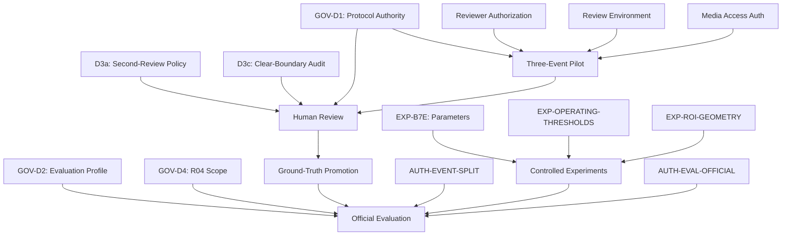

# Pilot Readiness and Decision Dependency Graph

**Date:** 2026-11-01  
**Mission:** 4E — Researcher Decision Finalization  
**Status:** PREPARATION ONLY — NO AUTHORIZATION GRANTED

## Decision Dependency Graph (Mermaid)

## Mandatory Dependencies

| Decision | Blocks | Independent? |
|---|---|---|
| D1 Protocol Authority | Review, Pilot, Evaluation | No — must be first |
| D3(a) Second-Review | Review workflow | No — needed before review |
| D3(c) Clear-Boundary Audit | Review workflow | No — needed before review |
| Reviewer Authorization | Pilot, Review | No — needed before pilot |
| D2 Evaluation Profile | Official Evaluation | Yes — can be decided later |
| D4 R04 Scope | Dual-camera evaluation | Yes — can be decided later |
| B7e Parameters | B7e experiments | Yes — independent of review |
| Thresholds | Official evaluation | Yes — can be decided later |
| ROI | Official evaluation | Yes — can be decided later |
| Event Split | Official evaluation | Yes — can be decided later |

## Independent Decisions (Can Proceed in Parallel)

- D2 (evaluation profile) — does not block review.
- D4 (R04 scope) — does not block single-camera review.
- B7e parameters — does not block review.
- Thresholds — does not block review.
- ROI — does not block review.
- Event split — does not block review.

## Pilot Readiness Checklist

| Requirement | Status | Blocker |
|---|---|---|
| Protocol authority selected | ❌ PENDING | D1 |
| Reviewer identities selected | ❌ PENDING | Researcher action |
| Reviewer independence confirmed | ❌ PENDING | Researcher action |
| Review environment authorized | ❌ PENDING | Researcher action |
| Media access authorized | ❌ PENDING | Researcher action |
| Three-event pilot authorized | ❌ PENDING | AUTH-PILOT-EXEC |
| D3(a) second-review policy | ❌ PENDING | Researcher decision |
| Review instructions prepared | ✅ COMPLETE | M4B onboarding doc |
| Boundary guide prepared | ✅ COMPLETE | M4B T0-T4 guide |
| Queue validated | ✅ COMPLETE | M4B queue audit PASS |
| Progress tracker designed | ✅ COMPLETE | M4B tracker design |
| Execution checklist prepared | ✅ COMPLETE | M4B checklist |

## Pilot Status: **BLOCKED**

The three-event pilot CANNOT proceed until:
1. D1 protocol authority is selected.
2. Named reviewers are authorized.
3. Review environment and media access are approved.
4. AUTH-PILOT-EXEC is explicitly granted.

**No pilot authorization is granted by this document.**