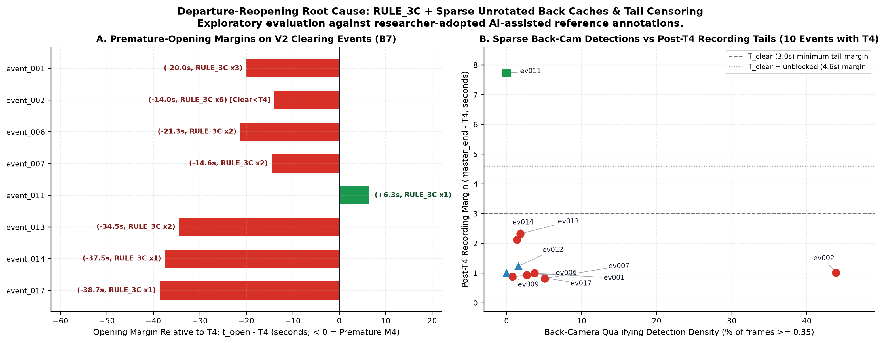
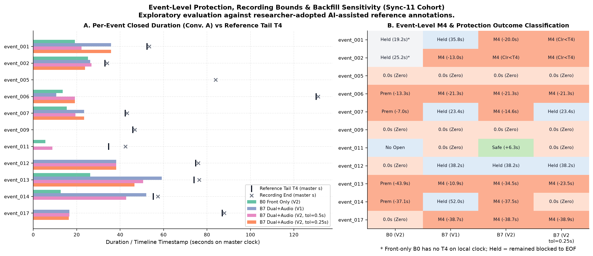

# Error Analysis — Failure Mechanisms, Premature Reopening & Backfill False Alarms

**Evaluation Basis:** *Exploratory evaluation against researcher-adopted AI-assisted reference annotations.*  
This report decomposes every operational failure observed across the `336 + 22` unperturbed runs and explains their exact mechanical causes.

---

## 1. Why `missed_train` Is `10/10` (`sync11`) and `22/22` (`all23`)

Across all `22` evaluable train events (`train_events/event_005` excluded with `T1 = null`), every Temporal V2 and V1 arm has `missed_train = True`:
1. **Structural Left-Censoring + Physical Actuation Bound (Primary Barrier):**
   - Sorted reference $T_1$ across the `22` evaluable train events spans **`2.1 s` to `5.8 s`** (`[2.1, 2.1, 2.3, ..., 4.2, 4.2, 4.2, 5.8]`, median `2.8 s`).
   - Observed warning-to-blocked actuation latency in V2 & V1 traces is **`3.4 s–3.6 s`** (`first_blocked_s - first_warning_s`: e.g. `event_013` warns at `0.6 s`, blocks at `4.0 s > T1 = 3.2 s`). Even instantaneous `t = 0.2 s` warning takes `3.6 s–3.8 s` to reach `CLOSED`, making $t_{\text{blocked}} \le T_1$ physically impossible on `18/22` events with $T_1 \le 3.2\text{ s}$.
   - Only `4` events (`T1 in {4.2, 5.8}`) could theoretically close before `T1` if warning fired by `0.4 s–2.2 s`; under current unrotated caches (`first_warning_s >= 27.2 s` on `event_001`), all closed late.
   - Clamped warning lead time ($\text{WLT} = \max(0, T_1 - t_{\text{warn}})$) was **`> 0` on only `6/16` protecting events in `B0__v2`** (`[0.4, 1.8, 1.9, 2.3, 2.6, 2.6] s`; median `0.0 s`) and **`2/9` in `B7__v2`** (`[0.4, 2.6] s`; median `0.0 s`).
2. **Complete Zero-Protection (`closed_duration == 0.0 s`):**
   - In `B0__v2`, `7/23` (`30.43%`) train events remain completely unprotected (`event_005, 008, 009, 012, 015, 017, 020`) due to near-zero YOLO detections on unrotated Mission 39/43 front frames.
   - Adding calibrated back camera in `B7__v2` rescues **`event_012` (`38.2 s`)** and **`event_017` (`16.6 s`)**, cutting zero-protection among sync11 events from `4/11` to `2/11` (`event_005, 009` stay unprotected).

---

## 2. Premature Reopening Root Cause (`M4 = 7/9` in `B7__v2` vs `4/8` in `V1`)

Examining `DEPARTURE_REOPENING_ANALYSIS.csv` alongside trace transitions yields an airtight three-factor causal chain:

1. **V2's `RULE_3C_DEPARTURE_CONFIRMED_BY_DISAPPEARANCE` (`v2_rule_3c_count >= 1` on `8/8` clearing events):**  
   Whenever `TRAIN_PRESENT -> CROSSING_OCCUPIED -> TRAIN_DEPARTING` lacks `2.0 s` of continuous detections, V2 fires `RULE_3C` (`-> REAR_CONFIRMED`), followed `3.0 s` later by `RULE_3_POSITIVE_CLEARANCE -> CROSSING_CLEAR -> GATE_OPENING`. Across all `11` sync events, **`RULE_3B` (`TRAIN_END`) fired `0` times**, whereas **`RULE_3C` caused `100%` (`8/8`) of V2 clearances** (`event_001: x3`, `event_002: x6`, `006: x2`, `007: x2`, `011: x1`, `013: x2`, `014: x1`, `017: x1`).
2. **Sparse Unrotated Back-Camera Caches:**  
   Because Mission 39/43 ran YOLO on sideways frames before Mission 44's `DISPLAYMATRIX` repair, `cam2_qualifying_density` (`conf >= 0.35`) is just `0.76%` (`event_006`) to `5.07%` (`event_007`) on `9/10` sync events with $T_4$ (`event_002`: `43.86%`, still fragmented into `11` $\ge 2$-tick gaps). Consequently, the gate opens **`14.58 s` (`event_007`) to `38.67 s` (`event_017`) BEFORE real train exit $T_4$** (`event_002` clears at `19.0 s` vs `T4 = 32.99 s`, interrupted by `RULE_7` before finishing unblocking).
3. **Why V1 Performed Better on M4 (`4/8` vs `7/9`) & Why `event_011` Alone Succeeded:**  
   - In `V1`, `event_001` (`35.8 s`), `event_007` (`23.4 s`), and `event_014` (`52.0 s`) held closed to EOF without `RULE_3C`, preventing premature opening.
   - `event_011` (`T4 = 34.6713 s`, `master_end = 42.4 s`, **`7.7287 s` post-$T_4$ margin**) only protected between `t` backfilled frames near $T_4$, clearing safely at `39.4 s` and unblocking at `41.0 s` (**`+6.3287 s` safe margin**); conversely `9/10` other `T4` events end `0.82 s–2.32 s` after $T_4$ (`< 4.6 s`), creating systematic tail censoring.

---

## 3. Why `B0__v2`, `B0__v1`, and `BACK_VISION__v2` False-Alarm on `2/3` No-Train Controls

Under unperturbed `no_train_events` (`60.0 s` total front exposure), `B0__v2` and `B0__v1` false-closed on `event_001` (`7.2 s`) and `event_003` (`7.0 s`; `total = 14.2 s`), while `BACK_VISION__v2` closed on `event_001` (`20.6 s`) and `event_003` (`15.4 s`; `total = 36.0 s`):
- **Mechanical Trigger:** A single false-positive YOLO detection on `event_001` and `event_003` was **re-emitted across `3` consecutive `0.2 s` replay ticks** by `MultimodalEvidenceCollector`'s `window_tolerance_s = 0.50 s > stride_s = 0.20 s` setting, bypassing `confirm_frames = 2` (`0.40 s`)! Meanwhile, under `Stateless RULE_2` (which requires `>= 0.35` live frame presence on `>= 2` distinct ticks or single-tick blip without hysteresis closure), `total_blocked_s = 0.0 s` (`0/3` events sustained >0s blocked duration)!
- **AUDIO_ONLY & Stateless Union Contrast:** `AUDIO_ONLY__v2` triggered `0/3` (`0.0 s`) false alarms, whereas `FRONT_AUDIO__stateless_union` triggered **`3/3` (`16` episodes, `13.8 s`)** due to audio false positives when unconstrained by `RULE_2`.
