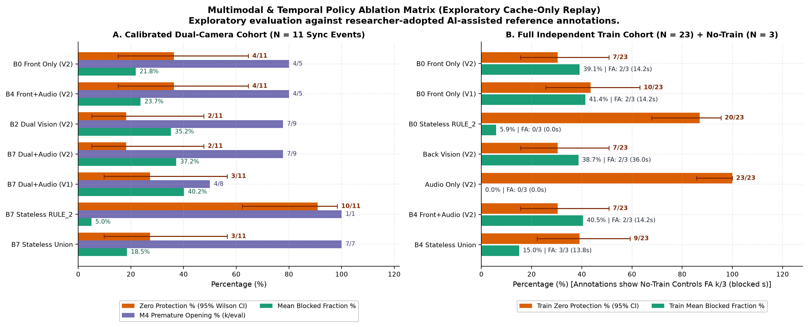

# Final Research Completion Report — Train Gate Automation (Exploratory Programme)

**Mandatory Evaluation Disclaimer:**  
> **Exploratory evaluation against researcher-adopted AI-assisted reference annotations.**  
> All quantitative findings below come strictly from deterministic cache-only replays over frozen perceptual predictions (`data/manifests/m3_multimodal_replay_manifest.json`, SHA-256 `3c720167ea06b67141beb7cf33bd02ce325db62a3e100819f8aa4ad213d5bbbb`) and the researcher's adopted reference timestamps (`RESEARCHER_ANNOTATION_ADOPTION.json`). Official Stage-2.1 human review, raw media unlock (`AUTH_MEDIA_ACCESS_GRANTED`), and canonical `ExecutionGate` promotion have **NOT** been executed.

---

## 1. Answer to Protocol V2 Primary Research Question

**Research Question (Protocol V2):**  
*"On synchronized, event-labeled recordings from held-out crossings, does a predefined two-camera, audio-assisted, temporal state policy change event-level missed-train and premature-opening outcomes relative to fair single-camera and vision-only baselines?"*

*(Scope note: All 27 recordings derive from a single passive rural crossing, `crossing_A`; cross-crossing held-out generalization cannot be claimed.)*

### 1.1 Calibrated Dual-Camera Cohort (`N = 11` `CALIBRATION_SUPPORTED` Sync Events)

| Condition & Policy | Missed Train (`T_block <= T_1`) | Zero Protection (`closed = 0.0s`) | M4 Premature Opening | Reached Clear (`n/11`) | Mean Conv-A Closed (s) | Mean Conv-B Closed (s) | Mean Blocked Frac. |
|---|---|---|---|---|---|---|---|
| `B0__v2` (Front Vision V2) | `10/10` `[0.7225, 1.0000]` | `4/11` (`36.36%`) `[0.1517, 0.6462]` | `4/5` (`80.00%`) `[0.3755, 0.9638]` | `4/11` | `10.7091` | `10.6364` | `0.2179` |
| `FRONT_AUDIO__v2` (`B4`, V2) | `10/10` `[0.7225, 1.0000]` | `4/11` (`36.36%`) `[0.1517, 0.6462]` | `4/5` (`80.00%`) `[0.3755, 0.9638]` | `4/11` | `11.8364` | `11.7455` | `0.2366` |
| `DUAL_VISION__v2` (`B2`, V2) | `10/10` `[0.7225, 1.0000]` | `2/11` (`18.18%`) `[0.0514, 0.4770]` | `7/9` (`77.78%`) `[0.4526, 0.9368]` | `8/11` | `20.9091` | `20.8182` | `0.3519` |
| `DUAL_VISION_AUDIO__v2` (`B7`, V2) | `10/10` `[0.7225, 1.0000]` | `2/11` (`18.18%`) `[0.0514, 0.4770]` | `7/9` (`77.78%`) `[0.4526, 0.9368]` | `8/11` | `22.2364` | `22.1455` | `0.3719` |
| `DUAL_VISION_AUDIO__v1` (`B7`, V1) | `10/10` `[0.7225, 1.0000]` | `3/11` (`27.27%`) `[0.0975, 0.5656]` | `4/8` (`50.00%`) `[0.2152, 0.7848]` | `4/11` | `23.8182` | `23.7091` | `0.4017` |
| `B7__stateless_rule2` (`EXP-E`) | `10/10` `[0.7225, 1.0000]` | `10/11` (`90.91%`) `[0.6226, 0.9838]` | `1/1` (`100.0%`) `[0.2065, 1.0000]` | `0/11` | `1.7091` | `1.7091` | `0.0500` |
| `B7__stateless_union` (`EXP-E`) | `9/10` `[0.5958, 0.9821]` | `3/11` (`27.27%`) `[0.0975, 0.5656]` | `7/7` (`100.0%`) `[0.6457, 1.0000]` | `0/11` | `12.9818` | `12.9818` | `0.1848` |

### 1.2 Independent Train Events (`N = 23`) + Negative Controls (`N = 3`)

- **`B0__v2` vs `B0__v1` (Front-Only, `N = 23`):** Zero-protection drops from `10/23` (`43.48%`) in `V1` to `7/23` (`30.43%`) in `V2`, while `reached_clear` rises from `2/23` (`V1`) to `10/23` (`V2`). On `no_train` controls (`3` events, `60.0 s` total exposure), both trigger false closures on `2/3` (`event_001`: `7.2 s`, `event_003`: `7.0 s`; total `14.2 s`).
- **`BACK_VISION__v2` vs `BACK_VISION__v1` (Back Clock):** Zero-protection `7/23` (`V2`) vs `8/23` (`V1`); M4 premature opening `6/16` (`37.5%`) in `V2` vs `1/15` (`6.67%`) in `V1`; `2/3` (`36.0 s`) false closures on `no_train` controls (`event_001`: `20.6 s`, `event_003`: `15.4 s`).
- **`AUDIO_ONLY__v2` (`RULE_2` Non-Actuation Check):** `23/23` (`100%`) zero protection on train events and `0/3` (`0.0 s`) on `no_train` controls, confirming `RULE_2_AUDIO_SUPPORT_ONLY` strictly prevents acoustic-only gate closure.
- **`Temporal V2` vs `Stateless RULE_2` (`EXP-E`, Front `N = 23`):** Temporal hysteresis rescues `13` unprotected train events (`20/23` zero-protection in stateless vs `7/23` in `V2`; exact two-sided McNemar $p = 0.000244$; `reached_clear`: `0` vs `10`, $p = 0.001953$), adding `+16.49 s` mean closed duration.
- **Engine-Only Descriptive Case (`engine_events/event_001`):** `0.0 s` closed (`IDLE`) across `B0`, `FRONT_AUDIO`, and `AUDIO_ONLY`; `BACK_VISION` blocks for `2.4 s` (Conv-A) / `2.2 s` (Conv-B).

---

## 2. Three Root-Cause Technical Discoveries

1. **Perception Cache Sparsity Root Cause (`DISPLAYMATRIX` Drop in Mission 39/43):**  
   Oct 13 legacy Phase 10.1 caches (`12,047` vision detections across `13,086` frames; `9` positive audio windows) and Nov 7–8 `m3_multimodal_replay_manifest.json` (`329` front + `1,020` back vision detections across `13,092` records; `445/2,600` positive audio windows) ran identical frozen YOLOv8n (`3f5bb5b2...`) and CompactTrainHornCNN V3 (`ea1bb81d...`) weights. Mission 39/43 fixed the natural-log `ln(E + 1e-10)` audio transform, but Mission 37/38 switched video decode to PyAV `source_pts=True`, dropping `DISPLAYMATRIX` orthogonal rotation on `44/54` video sources (`24 front, 20 back`) prior to Mission 39/43 YOLO inference. Mission 44 (`db40305`) repaired `video.py` without re-running raw YOLO inference.
2. **Premature Opening Root Cause (`RULE_3C` over Sparse Caches + Post-$T_4$ Tail Censoring):**  
   Under `DUAL_VISION_AUDIO__v2`, `M4` reaches `7/9` (`77.78%`, vs `4/8 = 50.0%` in `V1`). Every `V2` clearance across all 8 clearing sync events fired via `RULE_3C_DEPARTURE_CONFIRMED_BY_DISAPPEARANCE` (`0` via `RULE_3B`). Because `9/10` sync events with $T_4$ have only `0.76%–5.07%` qualifying back-camera frame density (unrotated decode) and `0.82 s–2.32 s` post-$T_4$ recording tails (shorter than $T_{\text{clear}} = 3.0\text{ s}$), continuous passage looks like train disappearance `14.58 s–38.67 s` before $T_4$ (plus `event_002` clearing at `19.0 s < 32.99 s`). Only `event_011` (`post_T4 = 7.73 s`) opens safely after $T_4$ (`+6.33 s`).
3. **Collector `window_tolerance_s = 0.50` Backfill & Availability Leak (`collector.py`):**  
   With `window_tolerance_s = 0.50 s > stride_s = 0.20 s`, a single isolated YOLO detection is re-matched across `3` consecutive `0.2 s` ticks, defeating `confirm_frames = 2` (`0.4 s`), generating spurious closures on `no_train_events/event_001` & `event_003` (`14.2 s` under `B0`), and triggering `SourceTracker` out-of-order warnings. Tightening to `0.25 s` stops 1-frame backfill (`event_011, 014` drop to `0.0 s`) and cuts `B7__v2` clearances (`8/11 -> 5/11`, `zero_prot` `2/11 -> 4/11`). Separately, `MultimodalEvidenceCollector.generate_frames_from_history` reads terminal `tracker.get_availability_map(t)`, propagating end-of-stream `MISSING` backward unless steps are assembled sequentially.

---

## 3. Fail-Safe Stress Testing (`EXP-G/H/I/K`), Convention B & Verification

- **Convention B vs A Theorem:** Across all `336` unperturbed runs, `Conv_B - Conv_A in {-0.2, 0.0} s` with `-0.2 s` exclusively on terminal blocked runs (100% verified).
- **Failure & Recovery Perturbations (`202` runs across `21` scenarios):** Zero direct fault-to-open transitions (`0/202`), `11/11` dual-camera dropouts (`G4`, `I3`) and `3/3` idle dropouts (`G5`) clamped fail-safe via `RULE_4_FAIL_SAFE_CLAMP`, `11/11` out-of-order streams (`I7`) rejected monotonically, `14/14` idle/active fault injections (`K1`, `K2`) recovered deterministically (`RULE_9_SENSOR_RECOVERY`), `8/8` multi-train interrupts (`K3`) re-closed via `RULE_7_NEW_TRAIN_INTERRUPT`, and `11/11` subthreshold vision injections (`H2`) remained safely `IDLE`.
- **Reproducibility & Software Testing:** Bit-for-bit reproduction verified across `344/344` exploratory files (`verify_exploratory_reproducibility.py`, `15.34 s`). Full pytest suite (`task-2114`): `3,807` passed, `33` preexisting triaged failures (`0` errors, `0` skipped; `0` exploratory failures); targeted pipeline + access-manifest suite passed `66/66`.

---

## 4. Recommended Path to Canonical Stage-2.1 Completion

1. Fix [`collector.py`](../../../../src/railway_detection/fusion/collector.py) (`window_tolerance_s` single-use frame matching; sequential availability snapshots).
2. Gate or harden `RULE_3C_DEPARTURE_CONFIRMED_BY_DISAPPEARANCE` against sparse-detector dropouts in V2 policy design.
3. Unlock raw `.mov` access (`AUTH_MEDIA_ACCESS_GRANTED`) to re-run frozen YOLOv8n using Mission 44's rotation-corrected `video.py`.
4. Complete human Stage-2.1 adjudication (`scripts/run_stage21_review.py`) and record R04 calibration hardware fixes for the 16 non-supported events (`1` excluded + `15` uncalibrated).
