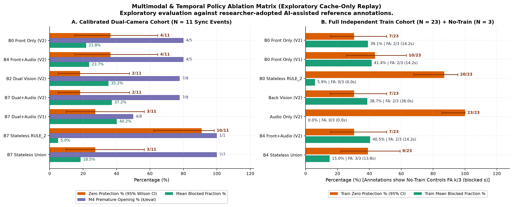
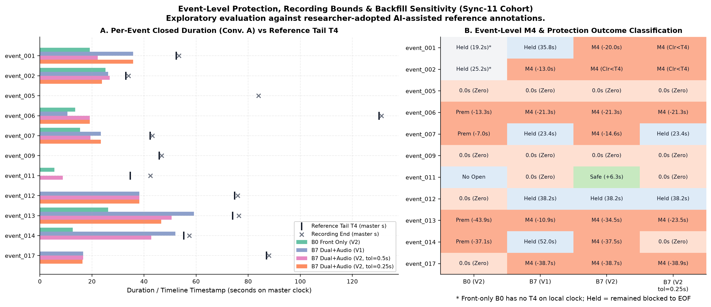
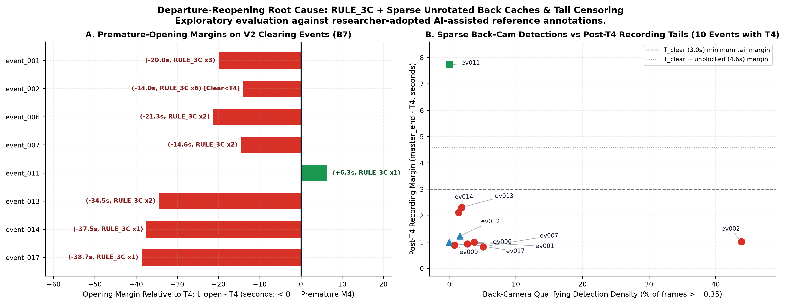
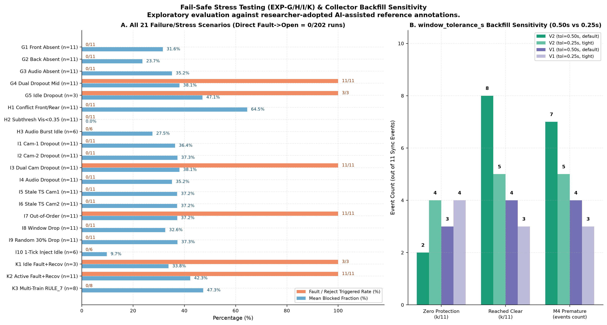

# Exploratory Evaluation of a Multimodal, Fail-Safe State-Machine Architecture for Passive Railway Level Crossing Automation

**Evaluation Basis & Governance Disclosure:**  
> **Exploratory evaluation against researcher-adopted AI-assisted reference annotations.**  
> This working manuscript reports the completed **cache-only exploratory experimental programme** (`336` unperturbed replays, `22` backfill-sensitivity runs, `202` failure/recovery perturbations, `11` natural conflict audits, `3,840` pytest audits, and `344/344` bit-identical reproducibility verification) executed against `docs/generated/professor_evidence/mission43/RESEARCHER_ANNOTATION_ADOPTION.json`. Root [`docs/PAPER_DRAFT_DESCRIPTIVE_BENCHMARK.md`](../../../PAPER_DRAFT_DESCRIPTIVE_BENCHMARK.md) remains byte-identical (`03444930...`) as the hash-locked canonical Stage-2.1 descriptive protocol skeleton pending `[ADJ-AUTH]` and `[EVAL-AUTH]`.

---

## Abstract

Passive highway-rail level crossings in developing rail corridors face persistent fatality risks due to absent active barrier infrastructure and unreliable single-sensor detection under environmental occlusion. We evaluate a modular two-camera (`camera_front`, `camera_back`), acoustic-assisted (`CompactTrainHornCNN V3`) temporal state policy (`V2 Candidate`) against frozen single-camera (`B0`), audio-only (`AUDIO_ONLY`), front-multimodal (`FRONT_AUDIO`), Policy `V1`, and stateless threshold (`EXP-E`) baselines on a `27`-event single-crossing field corpus (`crossing_A`: `23` freight passages, `3` nighttime negative controls, `1` isolated locomotive) under an exploratory cache-only evaluation protocol. Strict enforcement of Milestone R04 synchronization limits calibrated dual-camera claims (`B2`, `B7`) to `11` `CALIBRATION_SUPPORTED` events (`train_events/event_010` and `16` uncalibrated/independent events fail-closed refused). Across calibrated dual-camera replays, adding calibrated back-camera vision (`B7__v2`) halved zero-protection failures relative to front-only (`B0__v2`) from `4/11` (`36.36%`, 95% Wilson CI `[15.17%, 64.62%]`) to `2/11` (`18.18%`, CI `[5.14%, 47.70%]`, exact McNemar $p = 0.50$) and doubled `CROSSING_CLEAR` completions (`8/11` vs `4/11`, $p = 0.125$, `+11.53 s` mean closed duration), while `23/23` train passages exhibited left-censored entry timing ($T_1 \in [2.1, 5.8]\text{ s}$; `event_005` $T_1 = \text{null}$) shorter than actuation latency (`3.4–3.6 s`), yielding `10/10` (`sync11`) and `22/22` (`all23`) `T_block <= T_1` misses. Crucially, temporal hysteresis (`V2`) significantly reduced zero-protection failure relative to stateless `RULE_2` thresholding (`p = 0.007812` on `N = 11` dual sync; `p = 0.000244` on `N = 23` front events) while avoiding `3/3` (`16` episodes) stateless OR-union false closures. Forensic execution exposed three concrete software/pipeline defects requiring resolution prior to canonical Stage-2.1 benchmarking: (1) PyAV `DISPLAYMATRIX` drop on `44/54` video sources prior to Mission 39/43 inference left current caches severely sparse (`0.76%–5.07%` back-camera density on `9/10` $T_4$ sync events); (2) Policy `V2`'s `RULE_3C_DEPARTURE_CONFIRMED_BY_DISAPPEARANCE` over those sparse caches drove `7/9` (`77.78%`) M4 premature openings (`14.58–38.67 s` before $T_4$) vs `4/8` (`50.0%`) under `V1`; and (3) `MultimodalEvidenceCollector`'s `window_tolerance_s = 0.50 s > stride_s = 0.20 s` backfills isolated single detections across `3` ticks, causing `2/3` (`14.2 s`) negative-control false closures under `B0` while tightening to `0.25 s` doubles `B7` zero-protection (`2/11 -> 4/11`). Across `202` constructed fault/recovery injections (`EXP-G/H/I/K`), `0/202` runs entered `OPEN` directly from fault, confirming fail-closed structural safety.

---

## 1. Introduction & Research Question

Protocol V2 poses the central empirical question:  
> *"On synchronized, event-labeled recordings from held-out crossings, does a predefined two-camera, audio-assisted, temporal state policy change event-level missed-train and premature-opening outcomes relative to fair single-camera and vision-only baselines?"*

Because canonical Stage-2.1 human reviews remain unexecuted (`0` approved reviews following `LEGACY_REVIEW_INVALIDATION_NOTICE`) and raw `.mov`/`.wav` access remains restricted (`AUTH_MEDIA_ACCESS_NOT_GRANTED`), we answer this question strictly in **cache-only exploratory mode** using `m3_multimodal_replay_manifest.json` (`3c720167...`) and researcher-adopted reference annotations (`RESEARCHER_ANNOTATION_ADOPTION.json`), explicitly refraining from cross-crossing claims (`1` crossing `crossing_A` only) or SIL certification.

---

## 2. System Architecture, Policies & Mathematical Conventions

1. **Frozen Perception Models:** Visual detection uses YOLOv8n (`3f5bb5b2...`, $\theta_{\text{vision}} = 0.35$); acoustic detection uses CompactTrainHornCNN V3 (`ea1bb81d...`, 16 kHz mono, 1024 FFT / 512 hop / 64 Mel bands / `ln(E + 1e-10)`, 1.0 s window, $\theta_{\text{audio}} = 0.37$).
2. **State Machine (`stride_s = 0.20 s`) & Safety Invariant (`RULE_2`):** `B0` (front vision), `AUDIO_ONLY`, `FRONT_AUDIO` (`B4`), `BACK_VISION` (local clock), `DUAL_VISION` (`B2`), and `DUAL_VISION_AUDIO` (`B7`) share discrete warning+closing actuation latency (`3.4–3.6 s` observed `first_blocked_s - first_warning_s`). Policy `V1` (`frozen_experiment_v1.yaml`) requires sustained absence (`3.0 s`) to clear; Policy `V2` (`decision_policy_v2_candidate.yaml`) adds `RULE_3C_DEPARTURE_CONFIRMED_BY_DISAPPEARANCE` (`2.0 s` absence -> `REAR_CONFIRMED`), `RULE_2` acoustic dwell hold extensions, and `RULE_7_NEW_TRAIN_INTERRUPT`. Both enforce `RULE_4_FAIL_SAFE_CLAMP` and `RULE_9_SENSOR_RECOVERY`.
3. **Convention A vs Convention B Identity:** Convention A counts blocked ticks $\times 0.2\text{ s}$; forward-causal Convention B integrates continuous blocked intervals capped at $(N-1)\Delta t$, yielding $T_{\text{ConvB}} - T_{\text{ConvA}} = -\Delta t \cdot b_N$.
4. **Premature Opening Endpoints:** Design `M4` evaluates openings inside $(t_{\text{blocked}}, T_4)$ strictly on events that achieved gate protection (`!never_protected`, with `M5` reported separately), whereas Legacy `V9` evaluates $[T_1, T_4)$ even when late closure occurred or zero closure occurred.

---

## 3. Experimental Design & Dataset Boundaries

- **Cohort Composition (`N = 27`):** `23` freight passages (all `t0_censored = True`, $T_1 \in [2.1, 5.8]\text{ s}$ across `22` evaluable events; `train_events/event_005` $T_1 = \text{null}$), `3` nighttime negative controls (`no_train_events/event_001–003`, `60.0 s` cumulative front exposure), `1` engine-only anomaly (`engine_events/event_001`).
- **Fail-Closed R04 Scope Guard:** `DUAL_*` arms permit **only** the `11` `CALIBRATION_SUPPORTED` `accepted_sync_events` in `phase12_r04_scope_decision.json`, refusing `train_events/event_010` and `16` independent-clock events. Across the `10` sync events with $T_4$, `9/10` end `0.82–2.32 s` after $T_4$ (`< 4.6 s` needed to unblock post-$T_4$); only `event_011` (`7.73 s` post-$T_4$) supports non-censored clearance observation.
- **Experiment Totals:** `336` unperturbed runs + `22` `window_tolerance_s = 0.25 s` sensitivity runs + `11` natural conflict audits (`EXP-H`) + `202` constructed fault/stress perturbations (`EXP-G/H/I/K`).

---

## 4. Exploratory Experimental Results

### Table 1: Calibrated Dual-Camera Ablation (`N = 11` Sync Events)

| Condition & Policy | Missed (`T_block <= T_1`) | Zero Protection (`0.0 s`) | M4 Premature Opening | Clear (`n/11`) | Conv-A Closed (s) | Conv-B Closed (s) | Blocked Frac. |
|---|---|---|---|---:|---:|---:|---:|
| `B0__v2` (Front Only V2) | `10/10` `[0.7225, 1.0000]` | `4/11` (`36.4%`) `[0.1517, 0.6462]` | `4/5` (`80.0%`) `[0.3755, 0.9638]` | `4` | `10.71` | `10.64` | `0.2179` |
| `FRONT_AUDIO__v2` (`B4`) | `10/10` `[0.7225, 1.0000]` | `4/11` (`36.4%`) `[0.1517, 0.6462]` | `4/5` (`80.0%`) `[0.3755, 0.9638]` | `4` | `11.84` | `11.75` | `0.2366` |
| `DUAL_VISION__v2` (`B2`) | `10/10` `[0.7225, 1.0000]` | `2/11` (`18.2%`) `[0.0514, 0.4770]` | `7/9` (`77.8%`) `[0.4526, 0.9368]` | `8` | `20.91` | `20.82` | `0.3519` |
| `DUAL_VISION_AUDIO__v2` (`B7`) | `10/10` `[0.7225, 1.0000]` | `2/11` (`18.2%`) `[0.0514, 0.4770]` | `7/9` (`77.8%`) `[0.4526, 0.9368]` | `8` | `22.24` | `22.15` | `0.3719` |
| `DUAL_VISION_AUDIO__v1` (`B7`) | `10/10` `[0.7225, 1.0000]` | `3/11` (`27.3%`) `[0.0975, 0.5656]` | `4/8` (`50.0%`) `[0.2152, 0.7848]` | `4` | `23.82` | `23.71` | `0.4017` |
| `B7__stateless_rule2` | `10/10` `[0.7225, 1.0000]` | `10/11` (`90.9%`) `[0.6226, 0.9838]` | `1/1` (`100%`) `[0.2065, 1.0000]` | `0` | `1.71` | `1.71` | `0.0500` |
| `B7__stateless_union` | `9/10` `[0.5958, 0.9821]` | `3/11` (`27.3%`) `[0.0975, 0.5656]` | `7/7` (`100%`) `[0.6457, 1.0000]` | `0` | `12.98` | `12.98` | `0.1848` |

### Table 2: Full Independent Cohort (`N = 23` Train) + Negative Controls (`N = 3`, `60.0 s`) + Engine (`N = 1`)

| Condition & Policy | Train Zero-Prot (`k/23`) | Train Mean Conv-A (s) | Train Clear (`k/23`) | No-Train FA (`k/3`, ep, s) | `engine_001` Closed (s) |
|---|---|---:|---:|---|---:|
| `B0__v2` | `7/23` (`30.4%`) `[0.1560, 0.5087]` | `18.90` | `10` | `2/3` (`2 ep, 14.2 s`) | `0.0` (`IDLE`) |
| `B0__v1` | `10/23` (`43.5%`) `[0.2563, 0.6319]` | `20.12` | `2` | `2/3` (`2 ep, 14.2 s`) | `0.0` (`IDLE`) |
| `B0__stateless_rule2` | `20/23` (`87.0%`) `[0.6787, 0.9546]` | `2.42` | `0` | `0/3` (`2 ep, 0.0 s`) | `0.0` (`IDLE`) |
| `BACK_VISION__v2` *(local clock)* | `7/23` (`30.4%`) `[0.1560, 0.5087]` | `20.21` | `6` | `2/3` (`2 ep, 36.0 s`) | `2.4` (`TRAIN_DEPARTING`) |
| `AUDIO_ONLY__v2` | `23/23` (`100%`) `[0.8569, 1.0000]` | `0.00` | `0` | `0/3` (`0 ep, 0.0 s`) | `0.0` (`IDLE`) |
| `FRONT_AUDIO__v2` | `7/23` (`30.4%`) `[0.1560, 0.5087]` | `19.69` | `10` | `2/3` (`2 ep, 14.2 s`) | `0.0` (`IDLE`) |
| `FRONT_AUDIO__stateless_union` | `9/23` (`39.1%`) `[0.2216, 0.5921]` | `9.17` | `0` | **`3/3` (`16 ep, 13.8 s`)** | `0.0` (`IDLE`) |

### Table 3: Key Paired Exact McNemar Contrasts & Convention B Identity

- `B0__v2` vs `B7__v2` (`sync11`): `zero_protection` `(2, 0)`, $p = 0.50$; `reached_clear` `(0, 4)`, $p = 0.125$.
- `DUAL_VISION__v2` vs `DUAL_VISION_AUDIO__v2` (`sync11`): `(0, 0)` across all 4 binary outcomes ($p = 1.0$), `+1.33 s` mean duration.
- `B7__stateless_rule2` vs `B7__v2` (`sync11`): `zero_protection` `(8, 0)`, **$p = 0.007812$**; `reached_clear` `(0, 8)`, **$p = 0.007812$**.
- `B0__stateless_rule2` vs `B0__v2` (`all23`): `zero_protection` `(13, 0)`, **$p = 0.000244$**; `reached_clear` `(0, 10)`, **$p = 0.001953$**.
- `Conv_B - Conv_A` across all `336` unperturbed runs: exact unique values `{-0.2, 0.0} s` (`-0.2 s` iff terminals blocked; identity 100% verified).

---

## 5. Root-Cause Findings, Stress Testing & Limitations

1. **Why Nov 7–8 Caches Differ from Oct 13 Legacy Caches:** Identical frozen YOLOv8n (`3f5bb5b2...`) and Audio V3 (`ea1bb81d...`) weights were run, but Mission 37/38 switched decode to PyAV `source_pts=True`, dropping `DISPLAYMATRIX` rotation on `44/54` video sources before Mission 39/43 YOLO inference (`db40305` fixed `video.py` without raw re-inference).
2. **Why `M4 = 7/9` Under `B7__v2` (`Fig. 3`):** `8/8` `V2` clearances occurred via `RULE_3C_DEPARTURE_CONFIRMED_BY_DISAPPEARANCE` (`0` via `RULE_3B`) over `cam2` unrotated caches with `0.76%–5.07%` density on `9/10` $T_4$ events, opening `14.58–38.67 s` prior to $T_4$ (`event_011` alone opens safely at `+6.33 s` with a `7.73 s` tail).
3. **Why `no_train` Controls False-Close & Why `tol = 0.25 s` Matters (`Fig. 4`):** `window_tolerance_s = 0.50 s > stride_s = 0.20 s` re-emits single isolated YOLO detections across `3` ticks, defeating `confirm_frames = 2` (`14.2 s` on `no_train` `event_001/003`). Tightening to `0.25 s` drops `B7__v2` clearances (`8/11 -> 5/11`) and raises zero-protection (`2/11 -> 4/11`), while exposing `generate_frames_from_history` end-of-buffer availability leak.
4. **Fail-Safe Stress Tests (`EXP-G/H/I/K`):** `0/202` perturbation runs transitioned directly fault-to-`OPEN`; `11/11` dual dropouts clamped (`RULE_4_FAIL_SAFE_CLAMP`) and recovered (`RULE_9_SENSOR_RECOVERY`); `11/11` out-of-order streams were rejected; `8/8` multi-train interrupts re-closed (`RULE_7`); `11/11` subthreshold vision injections stayed `IDLE`.

---

## 6. Safety Disclaimer, Verification & Next Milestones

**ZERO SIL / EN 50126 / EN 50128 / AREMA CERTIFICATION:** Experimental prototype only; must never drive physical crossing actuators. Verified bit-for-bit reproducible across `344/344` exploratory files (`15.34 s`), AST-compliant, and accompanied by `3,807/3,840` full-suite passes (`33` preexisting triaged failures; `66/66` targeted exploratory/access-manifest tests). Canonical Stage-2.1 progression requires: (1) fixing `collector.py` single-use frame matching + sequential availability; (2) hardening `RULE_3C`; (3) unlocking raw media (`AUTH`) to re-run frozen YOLOv8n with rotation-corrected `video.py`; (4) human Stage-2.1 adjudication (`scripts/run_stage21_review.py`); and (5) multi-crossing field validation.
