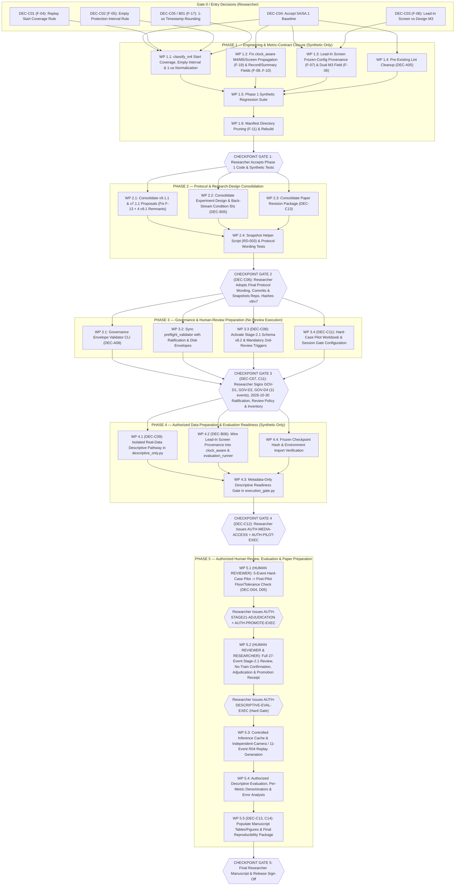

# MASTER FIVE-PHASE IMPLEMENTATION PLAN AND DECISION ANALYSIS

**Project:** Bangladesh Train Gate Automation Research  
**Repository:** `/Users/sayemuddin/Desktop/Train_automation`  
**Branch / HEAD:** `main` / `d4db94d4a4ea83ae4c510d65dfc99c5d6798304b` (unchanged)  
**Document Date:** 2026-11-01  
**Planning Role:** Principal Research Architect, Senior ML Systems Engineer, Software Architect, and Implementation Planner  
**Downstream Implementation Agent:** Claude Sonnet 5.5  
**Current Project Stage:** Mission 5A.1 completed (`PASS WITH CONDITIONS`); researcher review and acceptance pending  
**Document Status:** **PLANNING AND DECISION ANALYSIS ONLY — NOT AN APPROVAL, NOT AN AUTHORIZATION, NO CODE MODIFIED, NO REAL DATA OR MEDIA ACCESSED**

---

## Table of Contents

1. [Executive Summary](#1-executive-summary)
2. [Current Project-State Assessment](#2-current-project-state-assessment)
3. [Mission 5A and 5A.1 Acceptance Conditions](#3-mission-5a-and-5a1-acceptance-conditions)
4. [Remaining Work Inventory](#4-remaining-work-inventory)
5. [Five-Phase Roadmap](#5-five-phase-roadmap)
6. [Complete Decision Register](#6-complete-decision-register)
7. [Researcher Decision Briefs (Category C & Deep-Dive Analyses)](#7-researcher-decision-briefs-category-c--deep-dive-analyses)
8. [Agent Decision Register (Categories A and B)](#8-agent-decision-register-categories-a-and-b)
9. [Dependency Graph](#9-dependency-graph)
10. [Critical Path and Smallest Viable Path](#10-critical-path-and-smallest-viable-path)
11. [File-by-File Implementation Scope](#11-file-by-file-implementation-scope)
12. [Test and Acceptance Strategy](#12-test-and-acceptance-strategy)
13. [Time and Effort Estimates](#13-time-and-effort-estimates)
14. [Risk Register](#14-risk-register)
15. [Deferred-Items Register (Category D)](#15-deferred-items-register-category-d)
16. [Future Sonnet Execution Instructions](#16-future-sonnet-execution-instructions)
17. [Researcher Approval Checkpoints](#17-researcher-approval-checkpoints)
18. [Final Readiness Definition](#18-final-readiness-definition)

---

## 1. Executive Summary

### 1.1 Mission Purpose and Authority Boundaries
This document provides the complete, self-contained five-phase implementation plan and exhaustive decision analysis required to transition the Bangladesh Train Gate Automation Research repository from its post-Mission-5A.1 state (`PASS WITH CONDITIONS`) to a properly authorized, scientifically defensible real-world descriptive evaluation and publication package.

Every recommendation and instruction in this plan strictly enforces the project's five-way authority separation:
1. **Engineering decisions (Category A):** Unambiguous bug fixes, internal propagation repairs, test organization, and safety hardening with zero effect on scientific meaning. Taken directly by the planning architect in this document so the researcher is not burdened with routine software choices.
2. **Reversible implementation conventions (Category B):** Technical defaults, schema field additions, and diagnostic metadata that do not alter research outcomes or governance status. Provisionally selected here and clearly marked for researcher review.
3. **Scientific or methodological decisions (Category C):** Metric boundary definitions, replay start-coverage rules, empty-interval semantics, missed-train feasibility semantics, protocol authority, cohort inclusion rules, human-review policy, and paper claims. Analyzed in full decision briefs with explicit recommendations, but **reserved strictly for researcher choice**.
4. **Researcher approvals:** Formal, researcher-authored governance artifacts (`GOV-*`, `EXP-*`, protocol hash bindings, and ratification of the 2026-10-30 transcribed decisions). Confirmed directional preferences (`RD-001` through `RD-055`) are **direction, not formal approval artifacts**.
5. **Execution authorizations:** Explicit gate-clearing authorizations (`AUTH-*`, media access, Stage-2.1 human review, ground-truth promotion receipt, real-data replay/cache generation, real-data descriptive evaluation, and `EVAL-AUTH`). No real-data or media operation may occur until its specific execution authorization exists on disk.

### 1.2 New Repository Audit Discovery During This Planning Mission
In addition to reconciling all Mission 5A (`RD-001`…`RD-055`, `BR-01`…`BR-20`) and Mission 5A.1 (`F-01`…`F-18`) items, independent code inspection of `src/railway_detection/evaluation/clock_aware.py` (`evaluate_event_replay`, lines 198–261) uncovered an important **new engineering defect (`F-19` / `DEC-A04`)**:
- When `Phase12EvaluationRunner` evaluates a multi-system `EventReplay` (`front` / `back` / `fused`), `clock_aware.evaluate_event_replay` calls `EventMetricsCalculator.evaluate_run(...)` per system, which correctly computes `never_protected`, `m4_status`, `m4_reason`, `m4_replay_complete`, `missed_train_screen`, and `lead_in_available_s` on the `back` (or `front`) system evaluation.
- However, lines 198–261 of `clock_aware.py` only merge five legacy fields (`missed_train`, `premature_opening`, `warning_lead_time_s`, `excess_closed_duration_s`, `clearance_latency_s`) when constructing the returned `SingleEventEvaluation`, **silently dropping** `never_protected`, `m4_status`, `m4_reason`, `m4_replay_complete`, `missed_train_screen`, `lead_in_available_s`, and `m4_class` exclusion reasons!
- Consequently, through `evaluate_event_replay`, an M5 (`NEVER_PROTECTED_M5`) event or a truncated (`replay_ended_before_T4`) event returns `never_protected=None, m4_status=None` and its exclusion reason is overwritten with `"no_usable_replay_observation"`, causing `aggregate_cohort` to report `never_protected_count = 0` and `m4_not_evaluable_count = 0`.
- Because the intended behavior is unambiguously specified by `RD-016`, `RD-017`, and `RD-021`, fixing this field-propagation omission in `clock_aware.py` is classified as a **Category A engineering fix (`DEC-A04`)** scheduled in Phase 1 (WP 1.2).

### 1.3 Summary of the Five Implementation Phases

| Phase | Title | Core Objective | Hard Entry Gate | Hard Exit / Approval Gate | Est. Engineering Effort |
|---|---|---|---|---|---|
| **Phase 1** | **Engineering and Metric-Contract Closure** | Close all Mission 5A.1 code findings (`F-04`…`F-11`, `F-17`, `F-18`), fix `clock_aware.py` M4/M5/screen propagation (`F-19`), and lock synthetic regression coverage. | Researcher accepts Mission 5A/5A.1 baseline (`DEC-C04`) and chooses `DEC-C01` (`F-04`), `DEC-C02` (`F-05`), `DEC-C03` (`F-06`), and `DEC-B01`/`C05` (`F-17`). | Gate 1: Researcher accepts Phase 1 synthetic test report and code diffs. | **1.5–2.5 days** (12–20 hrs) |
| **Phase 2** | **Protocol and Research-Design Consolidation** | Reconcile `v9.1.0` and `v7.1.0` proposals, resolve internal `v9.1.0` remnants (EMA, Audio warning authority, E1–E10 vs B0–B2/back-stream), fix `FINAL_` proposed titles (`F-13`), align `EXPERIMENT_DESIGN_FINAL.md` and paper draft proposals, and prepare the preservation snapshot plan. | Phase 1 complete; researcher direction on protocol in-place adoption vs proposed-file retention (`DEC-C06`). | Gate 2: Researcher adopts final protocol wording, commits/snapshots repo (`RD-003`), and binds SHA-256 hashes. | **1.5–2.0 days** (12–16 hrs) |
| **Phase 3** | **Governance and Human-Review Preparation** | Prepare researcher-authored governance envelopes (`GOV-D1`, `GOV-D2`, `GOV-D4`, review policies), ratify 2026-10-30 decisions (`RD-049`), activate Stage-2.1 schema v8.2 (`DEC-C08`) if approved, and prepare the hard-case pilot and review tooling without starting human review. | Phase 2 complete; researcher supplies reviewer identities (if any beyond the 1 allowlisted) and signs governance artifacts. | Gate 3: Researcher signs `GOV-D1`, `GOV-D2`, 2026-10-30 ratification, review triggers, and (if piloting) `AUTH-MEDIA-ACCESS` + `AUTH-PILOT-EXEC`. | **1.5–2.5 days** (12–20 hrs) + researcher signing time |
| **Phase 4** | **Authorized Data Preparation and Evaluation Readiness** | Implement the isolated real-data descriptive evaluation pathway (`RD-039` / `BR-09`), wire lead-in screen provenance into evaluation manifests (`BR-19`), verify environment/checkpoints, and pass pre-evaluation readiness validators without touching raw media unauthorizedly. | Phase 3 complete; researcher approves `GOV-DESCRIPTIVE-REAL-DATA-PATHWAY` (`DEC-C09`) and inventory sign-off (`DEC-C10`). | Gate 4: Researcher issues explicit execution authorizations for Stage-2.1 review/promotion and real-data descriptive replay. | **2.0–3.0 days** (16–24 hrs) |
| **Phase 5** | **Authorized Evaluation, Analysis, and Paper Preparation** | After human review and ground-truth promotion are completed by authorized human reviewers, execute authorized replays, compute independent-camera descriptive metrics (front MTR/lead-time, back M4/M5/clearance, no-train N1, isolated engine case study), populate paper tables/figures, and assemble the reproducibility package. | Phase 4 complete + completed human Stage-2.1 review + `stage21_promotion_receipt.json` + explicit `AUTH-DESCRIPTIVE-EVAL-EXEC` (or `AUTH-EVAL-AUTH`). | Gate 5: Final researcher sign-off on manuscript results, limitations, AI disclosure, and release manifest. | **2.0–3.5 days** (16–28 hrs) + human review wait time |

### 1.4 Decision Counts at a Glance
- **Total Unresolved / Tracked Decisions Analyzed:** **38 decisions** across all Mission 5A, Mission 5A.1, and repository audit findings.
- **Category A (Made independently by Claude Opus):** **8 decisions** (`DEC-A01` through `DEC-A08`).
- **Category B (Provisional technical selections by Claude Opus, reversible):** **6 decisions** (`DEC-B01` through `DEC-B06`).
- **Category C (Researcher approval / choice required):** **14 decisions** (`DEC-C01` through `DEC-C14`, with 4 combinable into a single Governance Signing Packet).
- **Category D (Deferred until empirical prerequisites exist):** **10 decisions** (`DEC-D01` through `DEC-D10`).

---

## 2. Current Project-State Assessment

### 2.1 Repository and Git Hygiene State (Verified Read-Only)
- **Active Workspace:** `/Users/sayemuddin/Desktop/Train_automation`
- **Git Branch & HEAD:** `main` at `d4db94d4a4ea83ae4c510d65dfc99c5d6798304b` (`docs: consolidate methodology protocols and archive historical records`).
- **Staged Files:** `0`
- **Modified Tracked Files:** `19` (preserved untouched across Mission 5A, Mission 5A.1, and this planning mission):
  1. `README.md`
  2. `docs/FINAL_ABLATION_MATRIX.md`
  3. `docs/FINAL_EXPERIMENT_DATA_FLOW.md`
  4. `docs/FINAL_GROUND_TRUTH_PROTOCOL.md` (SHA-256: `d100c1e6a63280c375f94e297416efb0cf7dd3c15c9aa8df076ede052d49ecf4`)
  5. `docs/FINAL_REAL_WORLD_EXPERIMENT_PROTOCOL.md` (SHA-256: `7c183b323970591b68f0db692e70413e54dcacfc4bf78a358c28f1b1ed68734c`)
  6. `pyproject.toml`
  7. `src/railway_detection/audio/__init__.py`
  8. `src/railway_detection/cli/main.py`
  9. `src/railway_detection/data/layer_b.py`
  10. `src/railway_detection/data/sync.py`
  11. `src/railway_detection/demo/server.py`
  12. `src/railway_detection/evaluation/__init__.py`
  13. `src/railway_detection/fusion/evidence.py`
  14. `src/railway_detection/vision/video.py`
  15. `tests/fixtures/mock_events.py`
  16. `tests/unit/test_audio_v2_pipeline.py`
  17. `tests/unit/test_dashboard_server.py`
  18. `tests/unit/test_layer_b_loader.py`
  19. `tests/unit/test_real_dataset_inventory.py`
- **Untracked Governing Code & Documents:** 734 untracked governing entries recorded in `REPRODUCIBILITY_MANIFEST_20261101_M5A.json` (plus Mission 5A execution report, Mission 5A.1 audit reports, and `tests/unit/test_mission5a1_audit_regressions.py`). Because these files are untracked in Git, **any destructive Git command (`git clean`, `git reset --hard`, `git checkout -- .`) would permanently destroy core project work**.
- **`.git/lost-found/`:** 309 regular files (146 in `commit/`, 163 in `other/`; consisting of 301 41-byte pointer files and 8 blob dumps of 5.5–62 KB). Strictly untouched.

### 2.2 Authority Hierarchy and Document Reconciliation
Per confirmed decision `RD-001`, filenames containing `FINAL` do not confer authority. The reconciled provisional authority hierarchy is:

| Tier | Document / Artifact | Role & Current Authority Status |
|---|---|---|
| **Tier 1 (Formal Governance Envelopes & Code Register)** | `data/governance/leg_exec_authorization.json` · `src/railway_detection/experiments/preflight_validator.py` (`CANONICAL_DECISION_REGISTER`) | **Active enforcement.** Only `GOV-LEG-EXEC-INVALIDATION` has a researcher-signed file on disk. Four 2026-10-30 items (`GOV-B7D-DELIVERY-DISORDER`, `GOV-B7E-MECHANISM`, `GOV-D3-DESCRIPTIVE-MODE`, `GOV-ENGINE-EVENT-ISOLATION`) are marked `APPROVED_BY_RESEARCHER` in code from chat transcription and **require researcher ratification (`RD-049`)**. Twelve items are `PENDING_RESEARCHER_DECISION`; `EXP-OPERATING-THRESHOLDS` is `IMPLEMENTED_BUT_NOT_SCIENTIFICALLY_APPROVED`. |
| **Tier 2 (Ground-Truth & Experiment Protocols)** | Working-tree `docs/FINAL_GROUND_TRUTH_PROTOCOL.md` (v7.0.0) & `docs/FINAL_REAL_WORLD_EXPERIMENT_PROTOCOL.md` (v9.0.0) vs Proposed `docs/generated/mission_5a/FINAL_GROUND_TRUTH_PROTOCOL_v7.1.0_PROPOSED.md` & `FINAL_REAL_WORLD_EXPERIMENT_PROTOCOL_v9.1.0_PROPOSED.md` | **Selected direction, unbound (`GOV-D1-PROTOCOL-AUTHORITY` pending).** v7 governs ground-truth boundaries (`T0`–`T4`, scene clear, horn, censoring); v9 governs system and metric definitions. In-place v9.0.0/v7.0.0 contain known contradictions (`[T1,T4)` POR vs M4, lens-plane T2, inferential tests) that are resolved in `v9.1.0_PROPOSED` / `v7.1.0_PROPOSED`. Per `RD-002`, wording must be finalized and adopted *before* D1 hash binding. |
| **Tier 3 (Experiment Design & Reconciliations)** | `docs/EXPERIMENT_DESIGN_FINAL.md` reconciled by `docs/generated/mission_5a/EXPERIMENT_DESIGN_RECONCILIATION_20261101_M5A.md` | **Non-binding reference** except where explicitly adopted in `EXPERIMENT_DESIGN_RECONCILIATION_20261101_M5A.md`. Specifically: its claim to "supersede" v9 is rejected (`RD-001`); its inclusion of the engine event in M4/M5 is rejected (`RD-024`); its McNemar/Wilcoxon/Holm contrasts are rejected (`RD-023`); its new policy (`ABS`/`REAR`) and audio-warning authority are rejected (`RD-029`, `RD-030`); its unimplemented metrics (`M1, M2, M6–M10, V1, F1, D1`) are out of scope (`RD-020`). |
| **Tier 4 (Historical Decision Logs)** | `docs/OPEN_DECISIONS_AND_BLOCKERS.md` (`D-1`…`D-11`) · `docs/RESEARCH_DECISIONS.md` (`D-001`…`D-014`) | **Historical context only.** `D-1`…`D-11` are superseded by the `RD-001`…`RD-055` matrix and `GOV-`/`EXP-`/`AUTH-` canonical identifiers (`RD-009`). `D-001`…`D-014` are early Phase 0/1 architecture logs from August 2026. |

### 2.3 Newly Identified Residual Contradictions in `v9.1.0_PROPOSED.md` (To Close in Phase 2)
During this planning audit, reading `docs/generated/mission_5a/FINAL_REAL_WORLD_EXPERIMENT_PROTOCOL_v9.1.0_PROPOSED.md` line-by-line revealed four residual internal contradictions that Mission 5A updated in `EXPERIMENT_DESIGN_RECONCILIATION_20261101_M5A.md` but left unedited inside `v9.1.0_PROPOSED.md`:
1. **EMA $\alpha = 0.50$ remnant:** `v9.1.0_PROPOSED.md` §2.3 (line 53), §8 Table (lines 228–233), and §14 (line 296) still state that `EMA (alpha = 0.50)` is active, whereas `RD-031` confirmed **2-tick confirmation, 2-miss tolerance, and no EMA** (EMA is not implemented in the experiment path).
2. **Audio warning authority remnant:** `v9.1.0_PROPOSED.md` §12.1 (line 283) and §16 `INV-2` (line 310) still state that confirmed audio can initiate `IDLE -> APPROACHING -> CLOSING`, whereas `RD-030` confirmed **audio is supporting only** (cannot independently start a warning or grant clearance, matching `decision_policy_v1.yaml` `RULE_2_AUDIO_SUPPORT_ONLY`).
3. **E1–E10 dual-camera matrix vs B0–B2 + back-stream conditions:** `v9.1.0_PROPOSED.md` §8 (lines 223–239) and §26 (lines 428–436) still list the E1–E10 dual-camera ablation matrix as the primary execution order, whereas `RD-015`, `RD-028`, and `RD-035` re-scoped the descriptive benchmark to **independent-camera primary analysis** (front B0–B2 + back-stream condition(s), with fused R04 exploratory only on the 11-event subset).
4. **Supported claims and self-critique remnants:** `v9.1.0_PROPOSED.md` §24 (line 411) and §27 (lines 454, 460–461) still contain legacy language ("Supported: state-machine elimination of premature openings... Statistically supported conclusions: Large effect sizes in POR reduction; planned paired differences"), which conflicts with `RD-023` (descriptive statistics only) and `RD-053` (claims strictly limited; no empirical outcome claimed before evaluation).

All four remnants are scheduled for surgical cleanup in **Phase 2 (WP 2.1)**.

---

## 3. Mission 5A and 5A.1 Acceptance Conditions

### 3.1 Summary of Mission 5A Deliverables and Mission 5A.1 Corrections
Mission 5A implemented the confirmed code changes (`RD-011`, `RD-016`, `RD-017`, `RD-020`, `RD-021`, `RD-024`, `RD-040`, `TF-02`, `TF-03`, `TF-05`, `TF-13`) and drafted 16 proposal/governance documents. Mission 5A.1 audited Mission 5A and issued a verdict of **PASS WITH CONDITIONS**, applying three immediate safety/correctness fixes (`C-1`, `C-2`, `C-3`):
1. **`C-1` (`F-01` — FIXED in 5A.1):** `scripts/mission5a_build_preservation_manifest.py::verify_manifest` now enforces `path_refusal()` before opening any file, refusing media, binaries, symlinks, `..` traversal, out-of-root paths, and output trees (`TestManifestSafety`, 7 tests).
2. **`C-2` (`F-03` — FIXED in 5A.1):** `EventMetricsCalculator.evaluate_run` now fails closed with `UnqualifiedEventIdError` if `resolved_cohort` contradicts `has_train_ground_truth` or `ground_truth_status="engine"`.
3. **`C-3` (`F-02` — FIXED in 5A.1):** `EventMetricsCalculator.evaluate_run` now catches `UnresolvedCohortError` (bare event ID with `cohort=None`) *only* when ground truth is already unverified (`has_train_ground_truth is None` or `ground_truth_status in UNVERIFIED_GROUND_TRUTH_STATUSES`), restoring pre-5A `ground_truth_missing` behavior for the diagnostic runner while keeping all evaluable paths fail-closed (`TestUnannotatedEventsDoNotAbortAndDoNotLeak`, 11 tests).

### 3.2 Conditions Required to Move From `PASS WITH CONDITIONS` to Full Acceptance
To convert Mission 5A + 5A.1 from conditional pass to accepted baseline, the following conditions must be satisfied:

| Condition ID | Source Finding | Description | Resolution Path in This Plan |
|---|---|---|---|
| **ACC-01** | `D-4` (`C-1`…`C-3`) | Researcher accepts the three Mission 5A.1 fixes (`metrics.py`, `mission5a_build_preservation_manifest.py`, `test_mission5a_production.py`, `test_mission5a1_audit_regressions.py`) and rebuilds the reproducibility manifest so its 3 changed file hashes are current. | **Researcher Decision `DEC-C04`** + Phase 1 WP 1.6. |
| **ACC-02** | `F-04` (`D-1`) | Resolve replay *start* coverage in `classify_m4` so late-starting replays or replays starting after $T_4$ cannot be classified as `NEVER_PROTECTED_M5` from zero or partial pre-$T_4$ observation. | **Researcher Decision `DEC-C01`** + Phase 1 WP 1.1. |
| **ACC-03** | `F-05` (`D-2`, `BR-20`) | Confirm or revise `no_steps_in_protection_interval -> NOT_EVALUABLE` when a complete replay has $t_{\text{blocked}} < T_4$ but zero retained steps in $(t_{\text{blocked}}, T_4)$. | **Researcher Decision `DEC-C02`** + Phase 1 WP 1.1. |
| **ACC-04** | `F-06` (`D-3`) | Resolve the two differing cells between `lead_in_screen.py` and the design document's `M3` rule (observable $T_0$ with $T_1 - T_0 < \text{latency}$; unknown $T_0$ with $T_1 \ge \text{latency}$). | **Researcher Decision `DEC-C03`** + Phase 1 WP 1.3. |
| **ACC-05** | `F-07` | Pass `FrozenExperimentConfig` explicitly to `derive_min_block_latency_s()` and record its config hash in provenance rather than relying on constructor defaults. | **Agent Decision `DEC-A01`** + Phase 1 WP 1.3. |
| **ACC-06** | `F-08`, `F-09`, `F-10` (`D-6`) | Clean up record-level and summary-level conventions (`m4_status` on `evaluable=False` train records; `cohort` field on `SingleEventEvaluation`; `unverified_ground_truth_count` in `CohortEvaluationSummary`). | **Agent Provisional Decisions `DEC-B02`, `DEC-B03`, `DEC-B04`** + Phase 1 WP 1.2. |
| **ACC-07** | `F-11`, `F-13` (`D-7`) | Prune output trees at directory level in `mission5a_build_preservation_manifest.py` so raw media file names are not enumerated (`F-11`), and prefix `# PROPOSED —` on proposed protocol headlines (`F-13`). | **Agent Decisions `DEC-A02`, `DEC-A03`** + Phase 1 WP 1.6 & Phase 2 WP 2.1. |
| **ACC-08** | `F-17` (`D-5`) | Establish timestamp normalization/rounding policy (`round(t, 6)` microsecond grid vs exact float) for boundary-coincident replay steps. | **Provisional Decision `DEC-B01` / Researcher confirmation `DEC-C05`** + Phase 1 WP 1.1. |
| **ACC-09** | `F-19` (New) | Propagate `never_protected`, `m4_status`, `m4_reason`, `m4_replay_complete`, `missed_train_screen`, and `lead_in_available_s` through `clock_aware.evaluate_event_replay`. | **Agent Decision `DEC-A04`** + Phase 1 WP 1.2. |

---

## 4. Remaining Work Inventory

Every remaining item across code, protocols, governance, human review, data preparation, evaluation, and paper writing is catalogued below with its source ID, phase assignment, and authority level:

| Item ID | Category | Source Reference | Description of Remaining Work | Target Phase | Authority |
|---|---|---|---|---|---|
| **W-01** | Code / Metrics | `F-04` (`D-1`) | Implement approved replay start-coverage check in `classify_m4` and update pinned synthetic tests (`test_phase12_metric_arithmetic.py:321`, `test_mission5a1_audit_regressions.py:144`). | Phase 1 (WP 1.1) | Cat C (`DEC-C01`) |
| **W-02** | Code / Metrics | `F-05` (`D-2`, `BR-20`) | Finalize `no_steps_in_protection_interval` behavior (keep as `NOT_EVALUABLE` or split into `blocked_at_last_pre_t4_tick` vs `sparse_unsampled_protection_interval`). | Phase 1 (WP 1.1) | Cat C (`DEC-C02`) |
| **W-03** | Code / Metrics | `F-17` (`D-5`) | Normalize step and boundary timestamps to 1-microsecond precision (`round(float(t), 6)`) in `classify_m4` and `evaluate_run` to eliminate IEEE-754 `0.1 + 0.2 != 0.3` boundary artifacts without introducing a time tolerance. | Phase 1 (WP 1.1) | Cat B/C (`DEC-B01`/`C05`) |
| **W-04** | Code / Plumbing | `F-19` (New audit) | Propagate `never_protected`, `m4_status`, `m4_reason`, `m4_replay_complete`, `missed_train_screen`, `lead_in_available_s`, and M4/screen exclusion reasons in `clock_aware.evaluate_event_replay`. | Phase 1 (WP 1.2) | Cat A (`DEC-A04`) |
| **W-05** | Code / Schema | `F-08`, `F-09`, `F-10`, `F-18` | Null out `m4_status`/`m4_reason`/`m4_replay_complete` when `evaluable=False` (`F-08`); add `cohort: str \| None = None` to `SingleEventEvaluation` and check `(cohort, event_id)` uniqueness (`F-09`); add `unverified_ground_truth_count` and `excluded_train_events_count` to `CohortEvaluationSummary` (`F-10`). | Phase 1 (WP 1.2) | Cat B (`DEC-B02`..`B04`) |
| **W-06** | Code / Screen | `F-06`, `F-07` | Update `derive_min_block_latency_s()` to accept/require `FrozenExperimentConfig` and return provenance string with config SHA-256 (`F-07`); support dual-reporting or selected M3 rule in `lead_in_screen.py` (`F-06`), keeping screen default-off and unwired until Phase 4. | Phase 1 (WP 1.3) | Cat A (`DEC-A01`) & Cat C (`DEC-C03`) |
| **W-07** | Code / Lint | Mission 5A Report §6 | Clean up pre-existing untouched Ruff lint in `preflight_validator.py` (36), `batch_multimodal_annotator.py` (16), and `test_mission2_pipeline_integrity.py` (7) without altering logic. | Phase 1 (WP 1.4) | Cat A (`DEC-A05`) |
| **W-08** | Tooling / Safety | `F-11` | Prune `EXCLUDED_OUTPUT_TREES` (`data/raw`, `data/processed`, etc.) at `os.walk` directory level in `scripts/mission5a_build_preservation_manifest.py` so raw media directory trees are not enumerated during manifest builds, and rebuild manifest. | Phase 1 (WP 1.6) | Cat A (`DEC-A02`) |
| **W-09** | Protocols | `RD-001`..`008`, `F-13`, New remnants | Prefix `# PROPOSED —` on proposed protocol titles (`F-13`), clean up the 4 legacy remnants in `v9.1.0_PROPOSED.md` (EMA, audio warning authority, E1–E10 vs independent-camera conditions, unsupported claim remnants), and produce clean v9.1.1/v7.1.1 proposed files (or apply to working tree upon researcher instruction). | Phase 2 (WP 2.1) | Cat A (`DEC-A03`, `DEC-A06`) & Cat C (`DEC-C06`) |
| **W-10** | Design & Paper | `RD-020`..`038`, `RD-051`..`055` | Consolidate `EXPERIMENT_DESIGN_RECONCILIATION` and `PAPER_REVISION_PROPOSAL` with final condition identifiers for back-stream replays (`DEC-B05`), exact denominator tables, and human-only author / AI-disclosure placeholders. | Phase 2 (WP 2.2, 2.3) | Cat B (`DEC-B05`) & Cat C (`DEC-C13`) |
| **W-11** | Preservation | `RD-003` | Execute researcher-authorized Git preservation commit/branch and off-Desktop read-only snapshot (`SNAPSHOT_PROPOSAL_20261101_M5A.md`) before binding D1 protocol hashes. | Phase 2 (WP 2.4) | Researcher Action (`DEC-C06`) |
| **W-12** | Governance | `RD-002`, `RD-014`, `RD-026`, `RD-049` | Author and validate researcher-signed JSON governance artifacts: `GOV-D1-PROTOCOL-AUTHORITY`, `GOV-D2-EVALUATION-PROFILE` (`data/manifests/phase12_protocol_decision.json`), `GOV-D4-R04-SYNCHRONIZATION` (`data/manifests/phase12_r04_scope_decision.json`, 11 events), and 2026-10-30 ratification record. | Phase 3 (WP 3.1, 3.2) | Cat C (`DEC-C07`) |
| **W-13** | Review Gov. | `RD-012`, `RD-013`, `RD-042`..`048` | Approve `GOV-REVIEW-SECOND-REVIEW-TRIGGERS` and `GOV-REVIEW-CLEAR-BOUNDARY-AUDIT`; decide whether to promote `stage2_1_schema_proposed.py` (`8.2.0-stage2.1`) into the active Stage-2.1 workflow; update `authorized_reviewers.json` if a second/audit reviewer is appointed; prepare hard-case pilot package (`event_005`, `event_021`, `engine_events/event_001` + controls). | Phase 3 (WP 3.3, 3.4) | Cat C (`DEC-C08`, `DEC-C11`) & Cat D (`DEC-D04`..`D07`) |
| **W-14** | Data / Pathway | `RD-039`, `BR-09`, `BR-19` | Design and implement the isolated real-data descriptive evaluation pathway (accepting provenance-verified real replay evidence distinct from `SYNTHETIC` and from official split-based Phase 12 evaluation); wire optional lead-in screen provenance into evaluation manifests. | Phase 4 (WP 4.1, 4.2) | Cat C (`DEC-C09`) & Cat B (`DEC-B06`) |
| **W-15** | Readiness | `RD-041`, `TF-22` | Complete dataset inventory sign-off (27 events = 23 train + 3 no-train + 1 engine), verify frozen checkpoints and Python environment, and run metadata-only readiness validators. | Phase 4 (WP 4.3, 4.4) | Cat C (`DEC-C10`) |
| **W-16** | Human Review & Evaluation | `BR-11`..`BR-16` | *Strictly after explicit authorizations:* execute hard-case pilot, full Stage-2.1 human review & adjudication, ground-truth promotion receipt, controlled replay generation, descriptive evaluation, error analysis, and manuscript table/figure completion. | Phase 5 (WP 5.1–5.5) | Cat C (`DEC-C12`, `DEC-C13`, `DEC-C14`) |

---

## 5. Five-Phase Roadmap

### Why This Five-Phase Structure Is Optimal
The five-phase ordering is dictated by strict technical and governance dependencies:
1. **Phase 1 (Engineering & Metric-Contract Closure)** must come first because protocol wording (Phase 2) and formal D2 metric-contract approval (Phase 3) must bind to the **exact, verified production metric behavior** (`classify_m4`, `evaluate_event_replay`, `screen_missed_train_lead_in`). Fixing code after protocol hash binding would invalidate the bound hashes.
2. **Phase 2 (Protocol & Research-Design Consolidation)** must precede Phase 3 because `RD-002` explicitly requires finalizing protocol wording and preserving/hashing the repository *before* the researcher authors `GOV-D1-PROTOCOL-AUTHORITY`.
3. **Phase 3 (Governance & Human-Review Preparation)** must precede Phase 4 and Phase 5 because Stage-2.1 human review and the real-data descriptive pathway cannot be activated or executed without signed governance records (`GOV-D1`, `GOV-D2`, review policies, schema activation).
4. **Phase 4 (Authorized Data Preparation & Evaluation Readiness)** builds and synthetic-tests the isolated real-data descriptive pathway (`RD-039`) and lead-in provenance plumbing (`BR-19`) so that when human review completes, the evaluation pipeline is turn-key and readiness-validated.
5. **Phase 5 (Authorized Evaluation, Analysis, & Paper Preparation)** contains all tasks that require **human-reviewed ground truth, media access authorization, or execution authorization** (`AUTH-PILOT-EXEC`, `AUTH-STAGE21-ADJUDICATION`, `AUTH-PROMOTE-EXEC`, `AUTH-DESCRIPTIVE-EVAL-EXEC` / `AUTH-EVAL-AUTH`).

---

### PHASE 1 — Engineering and Metric-Contract Closure

#### A. Objective
Close all open software and metric-contract findings from Mission 5A.1 (`F-04`, `F-05`, `F-06`, `F-07`, `F-08`, `F-09`, `F-10`, `F-11`, `F-17`, `F-18`) and the newly discovered `clock_aware.py` M4/M5/screen propagation defect (`F-19`), achieving 100% synthetic test pass and zero Ruff lint across all touched evaluation, annotation, and manifest modules.

#### B. Entry Conditions
1. Researcher reviews Mission 5A and Mission 5A.1 reports and accepts the 5A.1 baseline (`DEC-C04`).
2. Researcher selects options for:
   - `DEC-C01` (`F-04`: replay start coverage rule in `classify_m4`).
   - `DEC-C02` (`F-05`: `no_steps_in_protection_interval` retention or refinement).
   - `DEC-C03` (`F-06`: missed-train lead-in screen vs design M3 cell semantics).
   - `DEC-C05` / `DEC-B01` (`F-17`: microsecond timestamp normalization `round(t, 6)`).

#### C. Work Packages
- **WP 1.1 — M4/M5 Replay Start Coverage, Empty Protection Interval, and Timestamp Normalization (`F-04`, `F-05`, `F-17`):**
  1. In `src/railway_detection/evaluation/metrics.py::classify_m4`, implement the researcher-approved replay start coverage check (`DEC-C01` recommended Option B1/B2: require `first_step_s < clearance_time_s`, and if `expected_start_s` is provided—default `0.0` for standard replays when enabled—require `first_step_s <= expected_start_s`; otherwise return `M4_STATUS_NOT_EVALUABLE` with reason `M4_REASON_REPLAY_STARTED_AT_OR_AFTER_T4 = "replay_started_at_or_after_T4"` or `M4_REASON_REPLAY_STARTED_LATE = "replay_started_late"`, never `NEVER_PROTECTED_M5`). Note: a witnessed violation strictly inside `(t_blocked, T4)` remains definite (`EVALUABLE`, `premature=True`) even if the replay started late (`replay_complete=False`).
  2. Implement the researcher's choice on `F-05` (`DEC-C02`: keep `no_steps_in_protection_interval -> NOT_EVALUABLE`, or split into `blocked_at_last_pre_t4_tick` vs `no_steps_in_protection_interval` using `max_step_gap_s`).
  3. Add `first_step_s: float | None` to `M4Classification`.
  4. Apply deterministic 1-microsecond timestamp normalization (`TIMESTAMP_ROUND_DIGITS = 6`, `round(float(t), 6)`) to step timestamps and boundary timestamps in `classify_m4` and `evaluate_run` (`DEC-B01`/`DEC-C05`) so IEEE-754 representation artifacts (`0.1 + 0.2 == 0.30000000000000004`) cannot flip boundary membership.
- **WP 1.2 — Multi-System `clock_aware.py` Propagation (`F-19`) and Record/Summary Conventions (`F-08`, `F-09`, `F-10`):**
  1. **Fix `F-19` (`DEC-A04`):** In `src/railway_detection/evaluation/clock_aware.py::evaluate_event_replay`, locate the system evaluation that supplied the T4-dependent evaluation (i.e., the first system in `ordered` whose `m4_status is not None`) and the system evaluation that supplied T1-dependent evaluation (whose `missed_train_screen != SCREEN_NOT_APPLIED`), and copy `never_protected`, `m4_status`, `m4_reason`, `m4_replay_complete`, `missed_train_screen`, and `lead_in_available_s` onto the merged `SingleEventEvaluation`. Preserve `item.metric_exclusions["premature_opening"]` and `item.metric_exclusions["missed_train"]` when `m4_status` is `NEVER_PROTECTED_M5` or `NOT_EVALUABLE` (or when lead-in screen excluded `missed_train`) so they are not overwritten with `"no_usable_replay_observation"`.
  2. **Fix `F-08` (`DEC-B02`):** In `EventMetricsCalculator.evaluate_run`, when `evaluable=False`, set `m4_status=None`, `m4_reason=None`, and `m4_replay_complete=None` so non-evaluable records never carry `m4_status="EVALUABLE"` alongside `premature_opening=None`.
  3. **Fix `F-09` (`DEC-B03`):** Add `cohort: str | None = None` to `SingleEventEvaluation` (populated from `resolved_cohort` in `evaluate_run` and `truth.cohort` in `clock_aware.py`). In `aggregate_cohort`, validate uniqueness on `(e.cohort, e.event_id)` when `cohort` is present while preserving fail-closed rejection of duplicate bare IDs.
  4. **Fix `F-10` (`DEC-B04`):** Add `unverified_ground_truth_count: int = 0` and `excluded_train_events_count: int = 0` to `CohortEvaluationSummary` and `to_dict()`, ensuring the partition identity `total_events == eligible_events + no_train_events + engine_events + unverified_ground_truth_count + excluded_train_events_count` holds for every cohort summary.
- **WP 1.3 — Lead-In Feasibility Screen Config Provenance and M3 Alignment (`F-06`, `F-07`):**
  1. **Fix `F-07` (`DEC-A01`):** Update `derive_min_block_latency_s()` in `src/railway_detection/evaluation/lead_in_screen.py` to accept `config: FrozenExperimentConfig | None = None` (or `config_path`), pass `config` to `EventSimulationRunner(config=config)`, and provide a helper `derive_min_block_latency_with_provenance(config, config_sha256=...) -> tuple[float, str]` that returns `(latency_s, f"synthetic_constant_front_conf0.9:tick={tick_s}:config_sha256={sha}")`.
  2. **Implement `F-06` (`DEC-C03`):** Implement the researcher's chosen M3 cell semantics (recommended: keep the physical rule `T1 - T0 >= latency` as primary `missed_train_screen` and add `m3_design_literal_evaluable: bool | None` on `LeadInScreenResult` so both the physical rule and literal design M3 rule can be reported side-by-side without loss of information). Keep the screen **default-off** (`lead_in_min_block_latency_s=None`) and unwired from official callers until Phase 4.
- **WP 1.4 — Pre-Existing Untouched Lint Cleanup (`DEC-A05`):**
  1. Clean up the 59 pre-existing Ruff lint warnings in `src/railway_detection/experiments/preflight_validator.py`, `src/railway_detection/annotation/batch_multimodal_annotator.py`, and `tests/unit/test_mission2_pipeline_integrity.py` without changing runtime behavior.
- **WP 1.5 — Synthetic Regression Suite Expansion:**
  1. Update `tests/unit/test_phase12_metric_arithmetic.py:321` and `tests/unit/test_mission5a1_audit_regressions.py:144` to reflect the approved `F-04` replay start coverage rule.
  2. Add synthetic tests for `clock_aware.evaluate_event_replay` verifying M4/M5/screen propagation (`F-19`), microsecond boundary normalization (`F-17`), `evaluable=False` nulling (`F-08`), `cohort` field and partition identity (`F-09`, `F-10`), and config-bound `derive_min_block_latency_s` (`F-07`).
- **WP 1.6 — Preservation Manifest Directory Pruning (`F-11`) and Rebuild:**
  1. In `scripts/mission5a_build_preservation_manifest.py`, prune `EXCLUDED_OUTPUT_TREES` (`data/raw`, `data/processed`, `results`, `experiments`, `outputs`, `models`, `scratch`, `reports`, `research/figures`) in-place from `dirnames[:]` during `os.walk` whenever `--count-excluded-trees` is not explicitly passed, so raw media filenames under `data/raw` are never enumerated or `lstat`ed during manifest builds (`DEC-A02`).
  2. Generate `docs/generated/phase1/REPRODUCIBILITY_MANIFEST_PHASE1.json` and verify `clean: true`.

#### D. File-Level Scope
- **Existing files to inspect:** `src/railway_detection/evaluation/metrics.py`, `src/railway_detection/evaluation/clock_aware.py`, `src/railway_detection/evaluation/lead_in_screen.py`, `src/railway_detection/evaluation/evaluation_runner.py`, `scripts/mission5a_build_preservation_manifest.py`.
- **Existing files to modify:**
  - `src/railway_detection/evaluation/metrics.py`
  - `src/railway_detection/evaluation/clock_aware.py`
  - `src/railway_detection/evaluation/lead_in_screen.py`
  - `src/railway_detection/experiments/preflight_validator.py` (lint only)
  - `src/railway_detection/annotation/batch_multimodal_annotator.py` (lint only)
  - `scripts/mission5a_build_preservation_manifest.py`
  - `tests/unit/test_phase12_metric_arithmetic.py`
  - `tests/unit/test_mission5a_production.py`
  - `tests/unit/test_mission5a1_audit_regressions.py`
  - `tests/unit/test_mission2_pipeline_integrity.py` (lint only)
- **New files to create:**
  - `tests/unit/test_phase1_metric_closure.py` (dedicated synthetic regression suite for Phase 1 closures)
  - `docs/generated/phase1/PHASE_1_COMPLETION_REPORT.md`
  - `docs/generated/phase1/REPRODUCIBILITY_MANIFEST_PHASE1.json`
- **Files that must NEVER be modified in Phase 1:** All 19 modified tracked files (`docs/FINAL_REAL_WORLD_EXPERIMENT_PROTOCOL.md`, `docs/FINAL_GROUND_TRUTH_PROTOCOL.md`, etc.), `configs/decision_policy_v1.yaml`, `configs/frozen_experiment_v1.yaml`, `data/**`, `.git/**`.

#### E. Implementation Instructions
- Save pre-edit copies of every target file to the scratch directory before editing.
- Never introduce an arbitrary numeric time tolerance (e.g., `0.5s` or `1.0s` start slack) into `classify_m4`. Only exact boundary checks after 1-microsecond IEEE-754 rounding (`round(t, 6)`) are permitted.
- Ensure `m4_premature_opening` remains a backward-compatible `(premature, never_protected)` tuple view over `classify_m4`.

#### F. Tests
- Run synthetic unit suites only with `PYTHONDONTWRITEBYTECODE=1 .venv/bin/python -m pytest ... -p no:cacheprovider -q`.
- Categories required:
  1. `TestReplayStartCoverage`: first step $> T_4 \to$ `NOT_EVALUABLE`; first step $= T_4$ (no step $< T_4$) $\to$ `NOT_EVALUABLE`; first step $< T_4$ with `first_step_s == 0.0` and no block $\to$ `NEVER_PROTECTED_M5`; late start `0.0 < first_step_s < T_4` with `expected_start_s=0.0` $\to$ `NOT_EVALUABLE` (`replay_started_late`) unless a violation is witnessed inside `(t_blocked, T4)`.
  2. `TestClockAwareM4M5Propagation`: end-to-end synthetic `EventReplay` (`front` + `back`) through `evaluate_event_replay` and `aggregate_cohort` for M4 violation, M4 no-violation, M5 never-protected, truncated replay, and empty interval.
  3. `TestCohortPartitionIdentity`: verify `total_events == eligible_events + no_train_events + engine_events + unverified_ground_truth_count + excluded_train_events_count` across mixed synthetic cohorts.
  4. `TestManifestNoMediaEnumeration`: spy on `os.listdir`/`os.scandir` to prove `data/raw` is pruned at directory level.

#### G. Acceptance Criteria
1. All 674 existing synthetic tests + ~35 new Phase 1 synthetic tests pass (`0 failed`, `0 skipped`).
2. `.venv/bin/ruff check` passes with `0` warnings across all modified/new files and the 3 previously lint-dirty files.
3. `REPRODUCIBILITY_MANIFEST_PHASE1.json` builds without traversing `data/raw` and passes `verify --root .` with `clean: true`.
4. `git status --short` confirms `0` staged files and the exact same `19` modified tracked files.

#### H. Dependencies
- Upstream: Researcher decisions `DEC-C01`, `DEC-C02`, `DEC-C03`, `DEC-C04`, `DEC-C05`.

#### I. Stop Conditions
- Stop immediately if any edit requires touching one of the 19 modified tracked files or any file under `data/` or `configs/`.
- Stop if any test imports or opens real dataset inventories or media files.

#### J. Deliverables
1. Updated `metrics.py`, `clock_aware.py`, `lead_in_screen.py`, `mission5a_build_preservation_manifest.py`, and lint-cleaned modules.
2. `tests/unit/test_phase1_metric_closure.py`.
3. `docs/generated/phase1/PHASE_1_COMPLETION_REPORT.md` and `REPRODUCIBILITY_MANIFEST_PHASE1.json`.

#### K. Researcher Approval Gates
- **Checkpoint Gate 1:** Researcher reviews `PHASE_1_COMPLETION_REPORT.md` and approves Phase 1 closure before Phase 2 starts.

#### L. Rollback and Preservation
- Pre-edit copies of all modified untracked files are saved in `<scratch>/phase1_backup/` with SHA-256 checksums so any file can be restored by byte copy without `git checkout` or `git restore`.

---

### PHASE 2 — Protocol and Research-Design Consolidation

#### A. Objective
Consolidate a single, internally consistent protocol and research-design package (`v9.1.1_PROPOSED`, `v7.1.1_PROPOSED`, experiment-design reconciliation, and paper revision proposal) that eliminates all remaining internal contradictions, reflects the Phase 1 metric contract, and prepares the repository for researcher Git preservation and `GOV-D1-PROTOCOL-AUTHORITY` hash binding.

#### B. Entry Conditions
1. Phase 1 completed and accepted at Gate 1.
2. Researcher confirms `DEC-C06` (whether consolidated protocol text should remain in `docs/generated/` as `PROPOSED` until the researcher copies it to `docs/FINAL_*.md`, or whether Sonnet should prepare an explicit copy script for the researcher to run).

#### C. Work Packages
- **WP 2.1 — Protocol Proposal Consolidation (`v9.1.1_PROPOSED` & `v7.1.1_PROPOSED`):**
  1. Fix `F-13` (`DEC-A03`): Change the H1 titles of the proposed protocol files to `# PROPOSED — Final Real-World Experiment Protocol (v9.1.1-PROPOSED)` and `# PROPOSED — Final Ground Truth Annotation Protocol (v7.1.1-PROPOSED)` so no reader can mistake the title line for an approved final protocol.
  2. Resolve the 4 internal remnants in `v9.1.0_PROPOSED.md` (`DEC-A06`):
     - In §2.3, §8, and §14: wrap `EMA (alpha = 0.50)` in `<!--HISTORICAL-->` blocks and state the confirmed `RD-031` rule (2-tick confirmation, 2-miss tolerance, no EMA).
     - In §12.1 and §16 (`INV-2`): wrap "audio can initiate Warning/Closing" in `<!--HISTORICAL-->` blocks and state the confirmed `RD-030` rule (`RULE_2_AUDIO_SUPPORT_ONLY`: audio is supporting only; cannot independently initiate warning/closing from `IDLE` and cannot grant clearance).
     - In §8 and §26: clarify that under independent-camera primary analysis (`RD-015`, `RD-028`, `RD-035`), front-stream conditions (`B0` vision, `B1` audio, `B2` front fusion) feed front-camera outcomes (MTR with screen, warning lead time) and back-stream conditions (`B0_back` vision, `B2_back` back fusion; see `DEC-B05`) feed $T_4$-dependent outcomes (M4, M5, clearance latency), while dual-camera fused conditions remain exploratory on the 11-event R04 subset (`RD-026`).
     - In §24 and §27: replace pre-evaluation outcome claims ("state-machine elimination of premature openings", "planned paired differences") with descriptive-benchmark scope statements (`RD-023`, `RD-053`).
  3. Update §5.2 of `v9.1.1_PROPOSED.md` and §2.2 of `v7.1.1_PROPOSED.md` to reflect the exact Phase 1 `classify_m4` start-coverage rule (`DEC-C01`), empty-interval rule (`DEC-C02`), and 1-microsecond timestamp normalization (`DEC-B01`/`C05`).
  4. Generate unified diffs against the untouched working-tree `docs/FINAL_REAL_WORLD_EXPERIMENT_PROTOCOL.md` and `docs/FINAL_GROUND_TRUTH_PROTOCOL.md`.
- **WP 2.2 — Experiment Design & Condition Naming Consolidation:**
  1. Update `EXPERIMENT_DESIGN_RECONCILIATION` (`docs/generated/phase2/EXPERIMENT_DESIGN_CONSOLIDATED.md`) to define explicit canonical names for the back-stream descriptive conditions (`DEC-B05`: `B0_back` = back-camera vision with state machine; `B0_back_stateless` = back-camera stateless vision baseline; `B2_back` = back-camera vision + back-stream audio if audio track is verified present).
  2. Document the exact per-metric denominator and exclusion table across the 27-event inventory (`23 train_events`, `3 no_train_events`, `1 engine_events`), preserving `event_010` outside the 11-event exploratory R04 scope (`RD-026`) and keeping full occupancy duration deferred (`RD-018`).
- **WP 2.3 — Paper Revision Package Alignment:**
  1. Produce `docs/generated/phase2/PAPER_REVISION_CONSOLIDATED.md` aligning research questions (`RQ1`–`RQ4`), table templates (Tables 1–12 with `[RESULTS PENDING — AWAITING AUTHORIZED HUMAN REVIEW & EVALUATION]`), independent-camera vs exploratory 11-event fused framing, M4/M5/MTR denominator formulas, human-only authorship block, and draft AI-use disclosure (`RD-051`–`RD-055`).
- **WP 2.4 — Preservation and Snapshot Readiness Helper (`RD-003`):**
  1. Update `tests/unit/test_mission5a_production.py` protocol-wording assertions to verify both `v9.1.1_PROPOSED` and `v7.1.1_PROPOSED`.
  2. Provide a non-destructive, dry-run-capable shell/Python helper (`scripts/prepare_researcher_snapshot.py`, read-only unless invoked by the researcher with `--destination <path>`) that verifies the preservation manifest and copies the 858+ governing files + protocol hashes into an off-Desktop read-only snapshot directory per `SNAPSHOT_PROPOSAL_20261101_M5A.md`.

#### D. File-Level Scope
- **Existing files to inspect:** `docs/FINAL_REAL_WORLD_EXPERIMENT_PROTOCOL.md`, `docs/FINAL_GROUND_TRUTH_PROTOCOL.md`, `docs/EXPERIMENT_DESIGN_FINAL.md`, `docs/PAPER_DRAFT_DESCRIPTIVE_BENCHMARK.md`, `docs/generated/mission_5a/*`.
- **Existing files to modify:** `tests/unit/test_mission5a_production.py` (if needed to add `v9.1.1_PROPOSED` / `v7.1.1_PROPOSED` wording checks).
- **New files to create:**
  - `docs/generated/phase2/FINAL_REAL_WORLD_EXPERIMENT_PROTOCOL_v9.1.1_PROPOSED.md`
  - `docs/generated/phase2/FINAL_GROUND_TRUTH_PROTOCOL_v7.1.1_PROPOSED.md`
  - `docs/generated/phase2/v9_working_tree_vs_v9.1.1_PROPOSED.diff`
  - `docs/generated/phase2/v7_working_tree_vs_v7.1.1_PROPOSED.diff`
  - `docs/generated/phase2/EXPERIMENT_DESIGN_CONSOLIDATED.md`
  - `docs/generated/phase2/PAPER_REVISION_CONSOLIDATED.md`
  - `scripts/prepare_researcher_snapshot.py`
  - `tests/unit/test_phase2_protocol_consolidation.py`
  - `docs/generated/phase2/PHASE_2_COMPLETION_REPORT.md`
- **Files that must NEVER be modified by the agent:** Working-tree `docs/FINAL_REAL_WORLD_EXPERIMENT_PROTOCOL.md` and `docs/FINAL_GROUND_TRUTH_PROTOCOL.md` (unless the researcher explicitly authorizes in-place adoption at Gate 2), `docs/EXPERIMENT_DESIGN_FINAL.md`, `docs/PAPER_DRAFT_DESCRIPTIVE_BENCHMARK.md`.

#### E. Implementation Instructions
- Keep all historical v9.0.0/v7.0.0 text inside `<!--HISTORICAL-->…<!--/HISTORICAL-->` blocks so nothing is silently erased.
- Never represent `v9.1.1_PROPOSED` or `v7.1.1_PROPOSED` as approved or bound.
- Do not invent author names, affiliations, ORCIDs, target venues, or empirical numbers.

#### F. Tests
- `tests/unit/test_phase2_protocol_consolidation.py`:
  1. Verify working-tree `v9.0.0` and `v7.0.0` SHA-256 hashes remain unchanged (`7c183b32…8734c` and `d100c1e6…49ecf4`).
  2. Verify `v9.1.1_PROPOSED` and `v7.1.1_PROPOSED` carry `# PROPOSED —` headlines, contain no active (non-historical) EMA or audio-warning-authority statements, preserve the 11-event R04 scope, keep occupancy duration deferred, and match Phase 1 `classify_m4` rules.
  3. Test `scripts/prepare_researcher_snapshot.py` on a synthetic temp directory.

#### G. Acceptance Criteria
1. Zero active contradictions between `v9.1.1_PROPOSED`, `v7.1.1_PROPOSED`, `EXPERIMENT_DESIGN_CONSOLIDATED.md`, and `RD-001`…`RD-055`.
2. Working-tree `v9.0.0` and `v7.0.0` files remain byte-identical to baseline until the researcher executes the Gate 2 adoption step.
3. All synthetic tests pass and Ruff is clean.

#### H. Dependencies
- Upstream: Phase 1 complete; `DEC-C06`.

#### I. Stop Conditions
- Stop if any script attempts to overwrite `docs/FINAL_REAL_WORLD_EXPERIMENT_PROTOCOL.md` or `docs/FINAL_GROUND_TRUTH_PROTOCOL.md` without explicit researcher command, or attempts to run `git add` / `git commit`.

#### J. Deliverables
- Consolidated protocol proposals (`v9.1.1_PROPOSED`, `v7.1.1_PROPOSED`) + diffs, consolidated experiment design and paper revision documents, snapshot helper script, and `PHASE_2_COMPLETION_REPORT.md`.

#### K. Researcher Approval Gates
- **Checkpoint Gate 2 (Protocol Adoption & Preservation):**
  1. Researcher reviews `v9.1.1_PROPOSED` and `v7.1.1_PROPOSED`.
  2. When satisfied, the **researcher** adopts the wording into `docs/FINAL_REAL_WORLD_EXPERIMENT_PROTOCOL.md` and `docs/FINAL_GROUND_TRUTH_PROTOCOL.md`, commits/snapshots the repository (`RD-003`), and records the final SHA-256 hashes of both files for Phase 3 D1 binding.

#### L. Rollback and Preservation
- Delivering `v9.1.1_PROPOSED` and `v7.1.1_PROPOSED` in `docs/generated/phase2/` guarantees zero risk to the working-tree protocol files.

---

### PHASE 3 — Governance and Human-Review Preparation

#### A. Objective
Prepare and validate the governance infrastructure, researcher-authored decision envelope templates, 2026-10-30 ratification mechanism, Stage-2.1 schema v8.2 activation (if approved by the researcher), and hard-case human-review pilot tooling—so the researcher can formally sign governance artifacts without any agent-fabricated approvals or premature human review.

#### B. Entry Conditions
1. Phase 2 completed and accepted at Gate 2.
2. Researcher has decided:
   - `DEC-C07`: Ready to author/sign the Governance Signing Packet (`GOV-D1`, `GOV-D2`, `GOV-D4`, review policies, and 2026-10-30 ratification).
   - `DEC-C08`: Whether to activate `stage2_1_schema_proposed.py` (`8.2.0-stage2.1`) as the official schema for new Stage-2.1 reviews while preserving legacy `6.0.0` invalidation notices.
   - `DEC-C11`: Reviewer allowlist policy (single reviewer vs adding an external audit reviewer identity to `data/ground_truth/authorized_reviewers.json` and choosing the 3–5 hard-case pilot events).

#### C. Work Packages
- **WP 3.1 — Governance Envelope Validator and CLI Helper (Strictly Researcher-Run):**
  1. Inspect `src/railway_detection/evaluation/governance.py`, `protocol_choices.py`, `execution_gate.py`, and `src/railway_detection/experiments/preflight_validator.py`.
  2. Create a validation-only CLI tool (`scripts/validate_governance_artifacts.py`) that checks whether researcher-authored JSON files at:
     - `data/manifests/phase12_protocol_decision.json` (`GOV-D1-PROTOCOL-AUTHORITY` + `GOV-D2-EVALUATION-PROFILE`)
     - `data/manifests/phase12_r04_scope_decision.json` (`GOV-D4-R04-SYNCHRONIZATION`, 11 events)
     - `data/governance/ratification_20261030_decisions.json` (`RD-049`: `GOV-B7D-DELIVERY-DISORDER`, `GOV-B7E-MECHANISM`, `GOV-D3-DESCRIPTIVE-MODE`, `GOV-ENGINE-EVENT-ISOLATION`)
     - `data/governance/review_governance_policy.json` (`GOV-REVIEW-SECOND-REVIEW-TRIGGERS`, `GOV-REVIEW-CLEAR-BOUNDARY-AUDIT`)
     satisfy all schema, allowlist (`authorized_reviewers.json`), and SHA-256 hash-pin requirements.
  3. **Critical constraint:** This script **validates** existing files or prints blank templates to stdout; it **never writes** an `APPROVED` artifact or fills in `decided_by`, `researcher_statement`, or `decided_at_utc`.
- **WP 3.2 — Synchronize `preflight_validator.py` with Ratification & Governance Files:**
  1. Update `src/railway_detection/experiments/preflight_validator.py` so that:
     - The four 2026-10-30 decisions (`GOV-B7D-DELIVERY-DISORDER`, `GOV-B7E-MECHANISM`, `GOV-D3-DESCRIPTIVE-MODE`, `GOV-ENGINE-EVENT-ISOLATION`) report `attestation_status: "RECORDED_UNRATIFIED_CHAT_TRANSCRIPTION"` until `data/governance/ratification_20261030_decisions.json` is present and valid on disk, and `"RATIFIED_BY_RESEARCHER_ARTIFACT"` once the researcher authors that file.
     - `GOV-D1-PROTOCOL-AUTHORITY`, `GOV-D2-EVALUATION-PROFILE`, `GOV-D4-R04-SYNCHRONIZATION`, `GOV-REVIEW-SECOND-REVIEW-TRIGGERS`, and `GOV-REVIEW-CLEAR-BOUNDARY-AUDIT` remain `PENDING_RESEARCHER_DECISION` in code until their respective researcher-authored JSON files exist and validate on disk.
- **WP 3.3 — Stage-2.1 Schema v8.2 Integration (`DEC-C08`, `RD-012`, `RD-045`):**
  1. Conditional on researcher approval of `DEC-C08`: wire `src/railway_detection/annotation/stage2_1_schema_proposed.py` (promoted to version `"8.2.0-stage2.1"`) into `src/railway_detection/annotation/stage2_1_schema.py`, `review_session.py`, `adjudication_session.py`, `ground_truth_loader.py`, and `execution_gate.py` so that new Stage-2.1 human review records use the reconciled schema (`OBSERVABLE` / `UNCERTAIN` / `CENSORED` with required `censoring_direction` `LEFT`/`RIGHT` / `NOT_OBSERVABLE` with reason; per-event `DirectionObservation`; `onset_provenance` requiring human visual landmark on T1/T2; `blind_first_pass` flag; immutable `FIRST`/`SECOND` reviewer entries; separate `AdjudicationEntry`).
  2. Preserve backward-compatible rejection of all 27 legacy `"6.0.0"` review records and their invalidation notices.
  3. Keep `timestamp_uncertainty_s` optional (`None` valid) so review tolerance remains deferred (`RD-012`).
  4. Encode mandatory second-review trigger detector (`evaluate_second_review_triggers(record)`) matching `RD-043`: (1) `DISPUTED`/`NEEDS_SECOND_REVIEW`, (2) any `UNCERTAIN` boundary, (3) `engine_events/event_001` T3/T4, (4) front/back conflict, (5) media hash mismatch, (6) boundary corrected from candidate.
- **WP 3.4 — Hard-Case Pilot Workbook and Session Configuration (No Execution):**
  1. Prepare the non-executing configuration and reviewer workbook for the hard-case pilot (`RD-047`, `DEC-C11`): `train_events/event_005` (dual-ended censoring), `train_events/event_021` (night / distant tail), `engine_events/event_001` ($T_3 \equiv T_4$), `train_events/event_001` (clean control), and `no_train_events/event_001` (negative control).
  2. Enforce a hard gate in `review_session.py` requiring `data/governance/pilot_execution_authorization.json` (`AUTH-PILOT-EXEC`) and `data/governance/media_access_authorization.json` before any review session can open media or write a review file.

#### D. File-Level Scope
- **Existing files to inspect:** `src/railway_detection/evaluation/governance.py`, `src/railway_detection/evaluation/protocol_choices.py`, `src/railway_detection/evaluation/execution_gate.py`, `src/railway_detection/evaluation/ground_truth_loader.py`, `src/railway_detection/experiments/preflight_validator.py`, `src/railway_detection/annotation/stage2_1_schema.py`, `src/railway_detection/annotation/stage2_1_schema_proposed.py`, `src/railway_detection/annotation/review_session.py`, `src/railway_detection/annotation/adjudication_session.py`, `data/ground_truth/authorized_reviewers.json`.
- **Existing files to modify:**
  - `src/railway_detection/experiments/preflight_validator.py`
  - `src/railway_detection/annotation/stage2_1_schema.py` (if `DEC-C08` approved)
  - `src/railway_detection/annotation/review_session.py` (if `DEC-C08` approved)
  - `src/railway_detection/annotation/adjudication_session.py` (if `DEC-C08` approved)
  - `src/railway_detection/evaluation/ground_truth_loader.py` (if `DEC-C08` approved)
  - `src/railway_detection/evaluation/execution_gate.py` (if `DEC-C08` approved)
- **New files to create:**
  - `scripts/validate_governance_artifacts.py`
  - `tests/unit/test_phase3_governance_and_schema.py`
  - `docs/generated/phase3/HARD_CASE_PILOT_EXECUTION_PACKET.md`
  - `docs/generated/phase3/PHASE_3_COMPLETION_REPORT.md`
- **Files that must NEVER be modified by the agent:** `data/ground_truth/authorized_reviewers.json` (edited only by the researcher), `data/governance/*.json` (authored only by the researcher), `data/manifests/phase12_*.json` (authored only by the researcher), `data/ground_truth/reviews/**` (legacy records & notices untouched).

#### E. Implementation Instructions
- Never generate or write any file under `data/governance/` or `data/manifests/` claiming researcher approval.
- Ensure all unit tests for `validate_governance_artifacts.py` and schema v8.2 use `tmp_path` synthetic fixtures with clearly synthetic reviewer IDs allowed only in test-local allowlists.

#### F. Tests
- `tests/unit/test_phase3_governance_and_schema.py`:
  1. Test `validate_governance_artifacts.py` on synthetic valid, missing, unsigned, non-allowlisted, and hash-mismatched envelopes.
  2. Test `preflight_validator.py` attestation state transitions (`RECORDED_UNRATIFIED` vs `RATIFIED` in `tmp_path`).
  3. Test Stage-2.1 schema v8.2 loader integration, mandatory second-review trigger detection (`RD-043`), immutable `FIRST`/`SECOND` entries, and separate `AdjudicationEntry` resolution (`RD-045`).
  4. Verify that legacy `"6.0.0"` files are still rejected by `ground_truth_loader.py` and `execution_gate.py`.

#### G. Acceptance Criteria
1. All synthetic governance and schema tests pass; zero real review records or governance files created by the agent.
2. `validate_governance_artifacts.py` accurately reports the exact remaining researcher-authored files needed.
3. No raw media or real dataset inventory accessed.

#### H. Dependencies
- Upstream: Phase 2 complete; `DEC-C07`, `DEC-C08`, `DEC-C11`.

#### I. Stop Conditions
- Stop if asked to sign, attest, or populate a researcher identity in any governance file or allowlist.
- Stop if any code path attempts to start a real Stage-2.1 human review session.

#### J. Deliverables
- `scripts/validate_governance_artifacts.py`, updated `preflight_validator.py` and Stage-2.1 schema/loader modules, `HARD_CASE_PILOT_EXECUTION_PACKET.md`, `tests/unit/test_phase3_governance_and_schema.py`, and `PHASE_3_COMPLETION_REPORT.md`.

#### K. Researcher Approval Gates
- **Checkpoint Gate 3 (Governance Signing & Pilot Authorization):**
  1. Researcher authors and signs `data/manifests/phase12_protocol_decision.json` (`GOV-D1`, `GOV-D2`), `data/manifests/phase12_r04_scope_decision.json` (`GOV-D4`, 11 events), `data/governance/ratification_20261030_decisions.json` (`RD-049`), and `data/governance/review_governance_policy.json`.
  2. Researcher updates `data/ground_truth/authorized_reviewers.json` if adding a second/external reviewer.
  3. Researcher runs `python scripts/validate_governance_artifacts.py` to confirm all governance checks pass.

#### L. Rollback and Preservation
- Pre-edit copies of modified files saved in `<scratch>/phase3_backup/`; all legacy review files and notices verified byte-identical via manifest check.

---

### PHASE 4 — Authorized Data Preparation and Evaluation Readiness

#### A. Objective
Implement and synthetic-test the isolated real-data descriptive evaluation pathway (`RD-039`, `BR-09`), wire lead-in feasibility screen provenance into the evaluation runner (`BR-19`), verify checkpoint and environment readiness, and prepare the full pre-evaluation readiness validator—without running any real-data inference, replay, or evaluation.

#### B. Entry Conditions
1. Phase 3 completed and accepted at Gate 3.
2. Researcher approves:
   - `DEC-C09` (`GOV-DESCRIPTIVE-REAL-DATA-PATHWAY`: authorization to implement the code path for full-cohort descriptive evaluation on provenance-verified real replay evidence, isolated from official split-based evaluation).
   - `DEC-C10` (`RD-041`: inventory sign-off on the 27-event cohort = 23 train + 3 no-train + 1 engine).

#### C. Work Packages
- **WP 4.1 — Isolated Real-Data Descriptive Pathway Implementation (`RD-039`, `BR-09`):**
  1. Inspect `src/railway_detection/evaluation/descriptive_only.py`, `input_contracts.py`, `clock_aware.py`, `replay_producer.py`, and `src/railway_detection/experiments/cache_provenance.py`.
  2. Currently, `descriptive_only.py` (line 131) refuses everything except `EvidenceClassification.SYNTHETIC` (`DESCRIPTIVE_ONLY_SCHEMA = "PROPOSED-descriptive-only-synthetic/1"`).
  3. Add a distinct, governance-gated function `run_authorized_descriptive_cohort_evaluation(...)` and schema `DESCRIPTIVE_REAL_COHORT_SCHEMA = "descriptive-real-cohort-evaluation/1"` in `src/railway_detection/evaluation/descriptive_only.py` that:
     - Requires an explicit researcher-authored authorization file `data/governance/descriptive_eval_authorization.json` (`AUTH-DESCRIPTIVE-EVAL-EXEC`) verified via `governance.py`.
     - Requires `GOV-D1-PROTOCOL-AUTHORITY` and `GOV-D2-EVALUATION-PROFILE` to be approved on disk.
     - Accepts `EvidenceClassification.REAL_DESCRIPTIVE_COHORT` (added to `EvidenceClassification` enum in `input_contracts.py`), which is strictly separate from both `SYNTHETIC` and `OFFICIAL_PHASE12` (`official_evaluation_eligible = False` always).
     - Requires `ControlledCacheProvenance` (verifying frozen config hash, vision/audio checkpoint hashes, media manifest hash, and isolation from legacy `results/experiments/` diagnostic outputs) and a valid `stage21_promotion_receipt.json` for any ground-truth-dependent metric (`MTR`, `M4`, `M5`, `warning_lead_time_s`, `clearance_latency_s`, `excess_closed_duration_s`).
     - Evaluates independent-camera replays (`front` stream for `MTR`/lead-time; `back` stream for `M4`/`M5`/clearance latency), 3 `no_train_events` for `N1` (`blocked_seconds`, `closure_episodes`, `exposure_s`, no hourly rate), and `engine_events/event_001` as an isolated case study (never pooled).
     - Optionally evaluates the 11-event `accepted_sync_events` R04 subset in a separate `exploratory_fused_r04` section clearly labeled non-primary.
     - Enforces the existing `_is_forbidden_claim` guard (forbidding any cross-site, generalization, or official held-out test claim).
- **WP 4.2 — Wire Lead-In Feasibility Screen Provenance into Official & Descriptive Runners (`BR-19`, `DEC-B06`):**
  1. In `src/railway_detection/evaluation/clock_aware.py::evaluate_event_replay` and `src/railway_detection/evaluation/evaluation_runner.py`, add optional parameters `lead_in_min_block_latency_s: float | None = None` and `lead_in_latency_source: str | None = None`.
  2. When enabled by the evaluation manifest/config, extract `T0_first_visual_appearance` from `ApprovedEventGroundTruth` (`first_visible_time_s` when `T0` is in `observable_boundaries` on the `front` camera; `first_visible_left_censored=True` when `T0` is in `censored_boundaries` with direction `LEFT`), pass to `EventMetricsCalculator.evaluate_run`, and record `min_block_latency_s` and `min_block_latency_source` (including the frozen config SHA-256 from WP 1.3) in `EvaluationProvenance` and `DescriptiveOnlyReport.provenance`.
- **WP 4.3 — Metadata-Only Readiness Gate for Descriptive Cohort Pathway:**
  1. Extend `src/railway_detection/evaluation/execution_gate.py` with `check_descriptive_evaluation_readiness(repo_root)` (reading only small JSON/YAML metadata and checkpoint hashes—never opening raw media) so the researcher can inspect a complete checklist of what is ready vs pending before issuing `AUTH-DESCRIPTIVE-EVAL-EXEC`.
- **WP 4.4 — Environment and Checkpoint Verification (No Media / No Inference):**
  1. Verify SHA-256 hashes of the two frozen checkpoints (`experiments/vision/39f402dfe460/checkpoints/weights/best.pt` = `3f5bb5b2…` and `experiments/audio/RUN_20261008_AUDIO_V3_ESC50/checkpoints/best.pt` = `ea1bb81d…`) and `configs/frozen_experiment_v1.yaml` (`999a7970…`).
  2. Check Python package importability (`.venv/bin/python -c "import torch, ultralytics, cv2, yaml"`) without loading any video/audio file or running any model forward pass.

#### D. File-Level Scope
- **Existing files to inspect:** `src/railway_detection/evaluation/descriptive_only.py`, `src/railway_detection/evaluation/input_contracts.py`, `src/railway_detection/evaluation/clock_aware.py`, `src/railway_detection/evaluation/evaluation_runner.py`, `src/railway_detection/evaluation/execution_gate.py`, `src/railway_detection/evaluation/ground_truth_loader.py`, `src/railway_detection/experiments/cache_provenance.py`.
- **Existing files to modify:**
  - `src/railway_detection/evaluation/input_contracts.py`
  - `src/railway_detection/evaluation/descriptive_only.py`
  - `src/railway_detection/evaluation/clock_aware.py`
  - `src/railway_detection/evaluation/evaluation_runner.py`
  - `src/railway_detection/evaluation/ground_truth_loader.py` (expose `censoring_directions: dict[str, str]` on `ApprovedEventGroundTruth` for left-censored `T0`)
  - `src/railway_detection/evaluation/execution_gate.py`
- **New files to create:**
  - `tests/unit/test_phase4_descriptive_pathway_and_readiness.py`
  - `docs/generated/phase4/PHASE_4_COMPLETION_REPORT.md`
  - `docs/generated/phase4/REPRODUCIBILITY_MANIFEST_PHASE4.json`
- **Files that must NEVER be modified in Phase 4:** All 19 modified tracked files, `configs/decision_policy_v1.yaml`, `configs/frozen_experiment_v1.yaml`, `data/**`, `.git/**`.

#### E. Implementation Instructions
- Keep `aggregate_descriptive_only(DescriptiveOnlyInput)` working unchanged for `EvidenceClassification.SYNTHETIC` so existing Mission 4/5A synthetic tests remain 100% green.
- Ensure `run_authorized_descriptive_cohort_evaluation` fails closed (`DescriptiveOnlyRefusal`) if:
  1. `data/governance/descriptive_eval_authorization.json` is missing or unsigned,
  2. `GOV-D1` or `GOV-D2` is missing,
  3. any input claims to come from `historical_diagnostic` (`results/experiments/`),
  4. `stage21_promotion_receipt.json` is missing when ground-truth boundaries are supplied, or
  5. `engine_events/event_001` is pooled into train or no-train denominators.

#### F. Tests
- `tests/unit/test_phase4_descriptive_pathway_and_readiness.py` (100% synthetic `tmp_path` fixtures):
  1. Refusal tests when `descriptive_eval_authorization.json`, `GOV-D1`, `GOV-D2`, `ControlledCacheProvenance`, or `stage21_promotion_receipt.json` is missing/invalid.
  2. Refusal test when historical diagnostic caches are passed.
  3. End-to-end synthetic run of `run_authorized_descriptive_cohort_evaluation` with 23 synthetic train events (`front` + `back` systems), 3 no-train events, 1 engine event, and 11 exploratory fused events—verifying exact front MTR (with lead-in screen), back M4/M5, no-train N1, isolated engine report, and provenance output.
  4. Readiness gate test (`check_descriptive_evaluation_readiness`) on synthetic incomplete and complete trees.

#### G. Acceptance Criteria
1. All existing + Phase 1–4 synthetic tests pass (`0 failed`).
2. `check_descriptive_evaluation_readiness` accurately enumerates only the remaining human-review and execution-authorization blockers.
3. Zero real media or real dataset files opened during Phase 4 implementation and testing.

#### H. Dependencies
- Upstream: Phase 3 complete; `DEC-C09`, `DEC-C10`.

#### I. Stop Conditions
- Stop if any code or test attempts to run real-data inference, decode `.mov`/`.wav` files, or issue an authorization file.

#### J. Deliverables
- Updated `descriptive_only.py`, `input_contracts.py`, `clock_aware.py`, `evaluation_runner.py`, `ground_truth_loader.py`, `execution_gate.py`; `tests/unit/test_phase4_descriptive_pathway_and_readiness.py`; `PHASE_4_COMPLETION_REPORT.md` and `REPRODUCIBILITY_MANIFEST_PHASE4.json`.

#### K. Researcher Approval Gates
- **Checkpoint Gate 4 (Human Review & Evaluation Execution Authorization Gate):**
  - Before entering Phase 5, the researcher reviews `PHASE_4_COMPLETION_REPORT.md` and explicitly issues the human-review and execution authorizations required for Phase 5 (`AUTH-MEDIA-ACCESS`, `AUTH-PILOT-EXEC`, `AUTH-STAGE21-ADJUDICATION`, `AUTH-PROMOTE-EXEC`, and subsequently `AUTH-DESCRIPTIVE-EVAL-EXEC`).

#### L. Rollback and Preservation
- Pre-edit copies saved in `<scratch>/phase4_backup/`; manifest rebuilt and verified (`clean: true`).

---

### PHASE 5 — Authorized Evaluation, Analysis, and Paper Preparation

> [!IMPORTANT]
> **STRICT AUTHORIZATION BOUNDARY:** Phase 5 is the **only** phase in which human review of media, ground-truth promotion, controlled real-data cache/replay generation, and real-data descriptive evaluation occur. Every work package below is hard-gated on its specific researcher-authored execution authorization on disk. Work packages that involve human visual/acoustic judgment (WP 5.1 and WP 5.2) are executed **by the human researcher/reviewers**, never by the AI agent.

#### A. Objective
Complete authorized human Stage-2.1 ground-truth review and promotion (performed by the human reviewer(s)), execute controlled provenance-verified inference/replays and descriptive cohort evaluation across the 27 events, perform error and robustness analysis, and populate the manuscript tables, figures, and reproducibility package for publication submission.

#### B. Entry Conditions
1. Phase 4 completed and accepted at Gate 4.
2. Signed governance artifacts from Phase 3 (`GOV-D1`, `GOV-D2`, `GOV-D4`, 2026-10-30 ratification, review triggers) present and validated on disk.
3. Explicit researcher-authored execution authorizations present on disk for each sub-stage (`AUTH-MEDIA-ACCESS`, `AUTH-PILOT-EXEC`, `AUTH-STAGE21-ADJUDICATION`, `AUTH-PROMOTE-EXEC`, `AUTH-DESCRIPTIVE-EVAL-EXEC`).

#### C. Work Packages
- **WP 5.1 — Authorized Hard-Case Timing & Usability Pilot (Human Reviewer Task; Gated on `AUTH-MEDIA-ACCESS` + `AUTH-PILOT-EXEC`):**
  1. **Human Reviewer Action:** The authorized human reviewer(s) inspect the 5 pilot events (`train_events/event_005`, `train_events/event_021`, `engine_events/event_001`, `train_events/event_001`, `no_train_events/event_001`) using a blind first pass (`RD-013`), recording `T0`, `T1`, `T3`, `T4`, `T_scene_clear`, `direction`, and no-train confirmation (`RD-025`) under Stage-2.1 schema v8.2 (`T2` marked `NOT_OBSERVABLE: landmark_not_defined` unless the researcher first resolves `RD-006`).
  2. **Post-Pilot Researcher Decisions (`DEC-D04`, `DEC-D05`):** From the measured pilot review durations and any dual-reviewer comparisons, the researcher sets or keeps the review-duration floor (`RD-046`) and decides whether to define a review timestamp tolerance $u$ (`RD-012`) or keep $u$ deferred.
- **WP 5.2 — Full 27-Event Stage-2.1 Human Review, Second Review, Adjudication, and Promotion (Human Reviewer & Researcher Task; Gated on `AUTH-STAGE21-ADJUDICATION` + `AUTH-PROMOTE-EXEC`):**
  1. **Human Reviewer Action:** Complete Stage-2.1 review records (`data/ground_truth/reviews/{train_events,no_train_events,engine_events}/event_XXX_review.json`) for all 27 events, plus mandatory risk-based second reviews (`RD-043`) and clear-boundary audit sample (`RD-044`) if a second reviewer is appointed.
  2. **Human Reviewer Action on No-Train Clips (`RD-025`, `DEC-D03`):** Explicitly confirm in the review record whether each of the 3 `no_train_events` clips contains zero rail vehicles (visual or acoustic).
  3. **Researcher Action:** Adjudicate any disagreements via separate `AdjudicationEntry` records (`RD-045`; unresolved boundaries remain `UNCERTAIN`), run `python -m railway_detection.annotation.readiness_cli --receipt-path data/governance/stage21_promotion_receipt.json`, and author `data/ground_truth/ground_truth_manifest.json`.
- **WP 5.3 — Authorized Controlled Inference Cache & Replay Generation (Agent Task ONLY AFTER `AUTH-DESCRIPTIVE-EVAL-EXEC`):**
  1. Verify `check_descriptive_evaluation_readiness(repo_root)` reports `READY`.
  2. Run controlled 5 Hz vision (`best.pt`, SHA-256 `3f5bb5b2…`) and 1.0s/0.5s audio V3 (`best.pt`, SHA-256 `ea1bb81d…`) inference into an isolated, hash-bound run directory `results/runs/<run_id>/` with full `ControlledCacheProvenance` and `stream_status.json` (verifying all 54 video and 54 audio streams reach `FULL` status, or recording `PARTIAL`/`FAILED` exclusions explicitly).
  3. Generate independent-camera replays (`front` conditions: `B0` vision, `B1` audio, `B2` front fusion, plus stateless baseline `B0_stateless`; `back` conditions: `B0_back` vision state-machine, `B0_back_stateless`, `B2_back` back fusion) and exploratory fused replays for the 11-event `accepted_sync_events` R04 subset (`RD-026`, `RD-035`).
  4. If the researcher has specified `B7e` parameters (`DEC-D02`) or authorized synthetic fault-injection runs (`B6`/`B7`, `RD-038`), execute them into a separate `fault_injection/` subdirectory, never pooled with natural events.
- **WP 5.4 — Authorized Descriptive Evaluation, Denominator Accounting, and Error Analysis (Agent Task Under `AUTH-DESCRIPTIVE-EVAL-EXEC`):**
  1. Execute `run_authorized_descriptive_cohort_evaluation` to produce deterministic JSON and Markdown tables:
     - **Front-stream outcomes (23 train events, S1 and S2 reported separately and combined):** Missed-Train Rate (`MTR`) with lead-in feasibility screen (`passed`, `insufficient_lead_in`, `lead_in_unverifiable`, `t1_missing` counts alongside both physical and literal-M3 rules per `DEC-C03`), Wilson 95% CIs, and Warning Lead Time (median, range, left-censored `T0` count).
     - **Back-stream outcomes (23 train events, S1 and S2 separately and combined):** Premature Opening Rate (`POR` under `M4` `first_blocked_to_t4_clearance`) with Wilson 95% CIs, `m4_no_violation_count`, `NEVER_PROTECTED_M5` count (counts only, beside M4 denominator), `m4_not_evaluable_count` by exact reason (`t4_missing`, `replay_ended_before_T4`, `replay_started_at_or_after_T4`, `no_steps_in_protection_interval`, plus boundary `censored`/`uncertain` exclusions), and Clearance Latency (`T_open - T4` median, range, right-censored count).
     - **No-train negative controls (3 events, 120.788 camera-stream-seconds):** `N1` event-level false-alarm count (`k/3`), `blocked_seconds`, `closure_episodes`, per-stream exposure (`60.300s` front, `60.488s` back), with **no hourly rate**.
     - **Engine-only case study (`engine_events/event_001`, $N=1$):** Dedicated qualitative and timing trace table ($T_3 \equiv T_4$), strictly excluded from all pooled train metrics.
     - **Exploratory 11-event R04 fused comparison:** Reported in a separate exploratory section with explicit disclosure that only 11 events are in the authorized exploratory scope (`event_010` excluded) and the 20/23 criterion is not met.
- **WP 5.5 — Paper Revision, Figures/Tables Generation, and Reproducibility Package (`RD-051`–`RD-055`):**
  1. Populate the manuscript tables and figures from the verified `results/runs/<run_id>/metrics/` artifacts (replacing `[RESULTS PENDING]` cells with hash-linked empirical numbers).
  2. Complete the limitations section (single site, two sessions, handheld devices, pilot policy contamination disclosure, simulated barrier kinematics, full occupancy duration deferred, thresholds/ROI exploratory).
  3. Insert researcher-supplied human author names/affiliations and researcher-approved AI-use disclosure (`RD-054`).
  4. Build the final reproducibility manifest and code/annotation release checklist (excluding all raw media per `RD-055` privacy governance).

#### D. File-Level Scope
- **Existing files to inspect:** `src/railway_detection/evaluation/descriptive_only.py`, `src/railway_detection/evaluation/replay_producer.py`, `docs/PAPER_DRAFT_DESCRIPTIVE_BENCHMARK.md`.
- **Files created by Human Reviewer / Researcher (WP 5.1–5.2):**
  - `data/ground_truth/reviews/{train_events,no_train_events,engine_events}/event_XXX_review.json` (Stage-2.1 v8.2)
  - `data/ground_truth/{train_events,no_train_events,engine_events}/event_XXX.json` (promoted approved GT)
  - `data/ground_truth/ground_truth_manifest.json`
  - `data/governance/stage21_promotion_receipt.json`
  - `data/governance/descriptive_eval_authorization.json`
- **New files created by Agent (WP 5.3–5.5, ONLY after authorizations exist):**
  - `results/runs/<run_id>/...` (isolated inference, replay, and descriptive metric artifacts)
  - `docs/PAPER_DESCRIPTIVE_BENCHMARK_REVISED.md` (new file so `docs/PAPER_DRAFT_DESCRIPTIVE_BENCHMARK.md` is preserved)
  - `docs/generated/phase5/PHASE_5_FINAL_EVALUATION_AND_REPRODUCIBILITY_REPORT.md`
  - `docs/generated/phase5/REPRODUCIBILITY_MANIFEST_FINAL.json`
- **Files that must NEVER be modified by the agent:** Raw media files (`data/raw/**`), human review records (`data/ground_truth/reviews/**`), approved ground truth (`data/ground_truth/**`), governance authorizations (`data/governance/**`).

#### E. Implementation Instructions
- **Zero Fabrication Rule:** Never invent, interpolate, or synthesize a ground-truth timestamp, review record, cache entry, or metric value. Every number in `PAPER_DESCRIPTIVE_BENCHMARK_REVISED.md` must trace by SHA-256 to `results/runs/<run_id>/metrics/descriptive_cohort_report.json`.
- **Full Occupancy Duration Prohibition (`RD-018`):** Do not compute or report crossing-conflict-area occupancy duration anywhere in Phase 5 unless `DEC-D01` (`BR-01` + `BR-03`) has been explicitly resolved and approved by the researcher.

#### F. Tests
- Run full synthetic regression suite + provenance verification checks on `results/runs/<run_id>/` verifying:
  1. Every reported table cell matches `descriptive_cohort_report.json`.
  2. Denominator partition identities hold across all 27 events.
  3. `engine_events/event_001` is absent from all pooled train/no-train denominators.
  4. `REPRODUCIBILITY_MANIFEST_FINAL.json` verifies `clean: true`.

#### G. Acceptance Criteria
1. All 27 events accounted for with explicit per-metric denominators and exclusion reasons.
2. Independent-camera results (front and back) and 11-event exploratory R04 fused results clearly separated.
3. Zero unsupported claims, zero p-values, zero hourly false-alarm rates, zero occupancy duration claims, and zero AI authorship in the revised manuscript.

#### H. Dependencies
- Upstream: Phase 4 complete + Human Stage-2.1 Review & Promotion (WP 5.1–5.2) + `AUTH-DESCRIPTIVE-EVAL-EXEC` (`DEC-C12`, `DEC-C13`, `DEC-C14`).

#### I. Stop Conditions
- Stop immediately if any required authorization file (`AUTH-DESCRIPTIVE-EVAL-EXEC`, `stage21_promotion_receipt.json`, `GOV-D1`, `GOV-D2`) is missing, expired, or fails hash verification.
- Stop if any stream fails decoding without recording an explicit `PARTIAL`/`FAILED` stream status.

#### J. Deliverables
- Verified `results/runs/<run_id>/` artifacts, `docs/PAPER_DESCRIPTIVE_BENCHMARK_REVISED.md`, `PHASE_5_FINAL_EVALUATION_AND_REPRODUCIBILITY_REPORT.md`, and `REPRODUCIBILITY_MANIFEST_FINAL.json`.

#### K. Researcher Approval Gates
- **Checkpoint Gate 5 (Final Manuscript & Release Sign-Off):** Researcher reviews the empirical tables, error analysis, manuscript text, AI disclosure, and release manifest before any external submission or public repository release.

#### L. Rollback and Preservation
- Writing all Phase 5 outputs to `results/runs/<run_id>/`, `docs/PAPER_DESCRIPTIVE_BENCHMARK_REVISED.md`, and `docs/generated/phase5/` leaves all prior working-tree files untouched and reversible.

---

## 6. Complete Decision Register

### 6.1 Authority Categories Defined
- **Category A — Agent may decide independently:** Routine engineering implementation, unambiguous bug fixes, internal propagation repairs, test/lint cleanup, and documentation organization with zero change to scientific meaning or governance status.
- **Category B — Agent may recommend and provisionally select:** Reversible implementation conventions, schema metadata additions, and technical defaults with no scientific interpretation. Marked provisional until researcher review.
- **Category C — Researcher approval required:** Scientific metric definitions, replay start/interval censoring rules affecting denominators, protocol authority, R04 scope, human review policy, real-data pathway governance, and paper claims.
- **Category D — Deferred:** Decisions that cannot responsibly be made with current evidence and must wait for new calibration, site specification, or human review data.

### 6.2 Master 15-Column Decision Register (All 38 Tracked Decisions)

#### Part I — Category A Decisions (Made Independently by Claude Opus: 8 Decisions)

| 1. ID | 2. Decision Question | 3. Why It Matters | 4. Current State | 5. Available Options | 6. Advantages / Disadvantages | 7. Technical Consequences | 8. Scientific Consequences | 9. Dependencies | 10. Recommendation / Selection | 11. Authority | 12. Opus Decides? | 13. Researcher Approval Req? | 14. Deferrable? | 15. Blocks If Unresolved |
|---|---|---|---|---|---|---|---|---|---|---|---|---|---|---|
| **DEC-A01** (`F-07`) | Should `derive_min_block_latency_s()` explicitly load/accept `FrozenExperimentConfig` and include its SHA-256 in provenance instead of using `EventSimulationRunner()` constructor defaults? | Prevents silent drift if constructor defaults ever diverge from `frozen_experiment_v1.yaml`. | Uses `EventSimulationRunner()` default constructor (coincidentally 3.6s today). | **A1:** Pass `FrozenExperimentConfig` explicitly + record config SHA-256 in provenance string.<br>**A2:** Keep constructor defaults. | A1 enforces frozen-config provenance by construction; zero change to the 3.6s numerical output at 0.2s tick. | Adds optional `config` param and provenance helper in `lead_in_screen.py`. | None (3.6s unchanged). | None. | **Selected A1.** | **Cat A** | **Yes** | No | No | Phase 1 WP 1.3 & Phase 4 wiring. |
| **DEC-A02** (`F-11`) | Should `mission5a_build_preservation_manifest.py` prune excluded output trees (`data/raw`, `data/processed`, etc.) at `os.walk` directory level by default? | Eliminates unnecessary directory enumeration / `lstat` of 3,492 raw media filenames during manifest builds. | Walks all directories to count excluded files (11,322), though it never opens them. | **A1:** Prune `EXCLUDED_OUTPUT_TREES` from `dirnames[:]` in `os.walk` by default (add `--count-excluded-trees` flag if counts ever wanted).<br>**A2:** Keep walking `data/raw`. | A1 is faster and strictly avoids even `lstat`ing raw media paths during routine manifest builds. | Modifies 6 lines in `mission5a_build_preservation_manifest.py`; hashes of 858 governing files unchanged. | None. | None. | **Selected A1.** | **Cat A** | **Yes** | No | No | Phase 1 WP 1.6 safety hygiene. |
| **DEC-A03** (`F-13` / `W-1`) | Should proposed protocol files prefix `# PROPOSED —` on their H1 title and subtitle lines? | Prevents a reader inspecting only line 1 of `FINAL_*_PROPOSED.md` from inferring final approval status. | Banner on line 5 says `PROPOSED — NOT APPROVED`, but line 1 says `# Final Real-World Experiment Protocol`. | **A1:** Prefix H1 and subtitle with `PROPOSED —` in `v9.1.1_PROPOSED.md` and `v7.1.1_PROPOSED.md` (removed only when researcher copies into `docs/FINAL_*.md`).<br>**A2:** Leave H1 as `# Final...`. | A1 closes Mission 5A.1 wording audit finding `W-1`/`F-13` cleanly. | Updates H1/H2 lines in proposed protocol files and corresponding wording test. | None. | None. | **Selected A1.** | **Cat A** | **Yes** | No | No | Phase 2 WP 2.1. |
| **DEC-A04** (`F-19`, New) | Should `clock_aware.evaluate_event_replay` propagate `never_protected`, `m4_status`, `m4_reason`, `m4_replay_complete`, `missed_train_screen`, `lead_in_available_s`, and M4/screen exclusion reasons from the per-system `SingleEventEvaluation`? | Without this fix, official multi-system (`front`+`back`) replays silently drop M5 (`NEVER_PROTECTED_M5`), M4 incomplete-replay reasons, and lead-in screen fields! | `clock_aware.py:198-261` only merges 5 legacy fields and leaves `never_protected=None, m4_status=None`. | **A1:** Propagate all M4/M5 fields from the T4-bearing system and lead-in screen fields from the T1-bearing system in `evaluate_event_replay`.<br>**A2:** Leave unpropagated. | A1 is an unambiguous bug fix required to make `clock_aware.py` honor `RD-016`, `RD-017`, and `RD-021`. | Updates ~25 lines in `clock_aware.py` + synthetic tests in `test_phase1_metric_closure.py`. | Restores intended `RD-016`/`RD-017` behavior on multi-system replays. | None. | **Selected A1.** | **Cat A** | **Yes** | No | No | Phase 1 WP 1.2 & all multi-system evaluations. |
| **DEC-A05** (Lint) | Should pre-existing Ruff lint in `preflight_validator.py` (36), `batch_multimodal_annotator.py` (16), and `test_mission2_pipeline_integrity.py` (7) be cleaned up in Phase 1? | Ensures repository-wide `ruff check` passes cleanly without special per-file exemptions. | 59 pre-existing formatting/import/line-length lint items left untouched by Mission 5A. | **A1:** Clean up the 59 lint items in Phase 1 WP 1.4 without altering logic.<br>**A2:** Leave lint warnings in place. | A1 gives a zero-warning lint baseline across all governance and test files. | Formatting-only edits in 3 untracked files. | None. | None. | **Selected A1.** | **Cat A** | **Yes** | No | Yes | Phase 1 WP 1.4 code quality gate. |
| **DEC-A06** (Protocol remnants) | Should the 4 residual legacy blocks in `v9.1.0_PROPOSED.md` (EMA $\alpha=0.50$, audio warning authority, E1–E10 primary execution list, pre-evaluation supported claims) be wrapped in `<!--HISTORICAL-->` blocks and updated to match `RD-023`, `RD-030`, `RD-031`, `RD-035`, `RD-053`? | Eliminates internal contradictions between `v9.1.0_PROPOSED.md` and `EXPERIMENT_DESIGN_RECONCILIATION_20261101_M5A.md`. | `v9.1.0_PROPOSED.md` §2.3, §8, §12.1, §14, §16, §24, §27 still contain legacy text contradicted by confirmed RDs. | **A1:** Reconcile all 4 remnants in `v9.1.1_PROPOSED.md` while preserving old text in `<!--HISTORICAL-->` blocks.<br>**A2:** Leave internal contradictions in `v9.1.0_PROPOSED`. | A1 fulfills the already-confirmed researcher directions (`RD-023`, `030`, `031`, `035`, `053`) without erasing history. | Text updates in `v9.1.1_PROPOSED.md` + diff generation. | Aligns protocol text with confirmed researcher direction. | None. | **Selected A1.** | **Cat A** | **Yes** | No (already confirmed in RDs) | No | Phase 2 WP 2.1 & Gate 2 D1 binding. |
| **DEC-A07** (`TF-06`) | How should the `tick_interval_s: 0.1` entry in `configs/decision_policy_v1.yaml` vs `timing.tick_s: 0.2` in `configs/frozen_experiment_v1.yaml` be handled? | `decision_policy_v1.yaml` is frozen (`RD-029`), and `tick_interval_s` is unread by `src/`. Editing the YAML would alter its frozen hash. | Documented in Mission 5A; `decision_policy_v1.yaml` untouched. | **A1:** Keep `decision_policy_v1.yaml` byte-untouched; add a synthetic assertion verifying `timing.tick_s == 0.2` governs runtime and `derive_min_block_latency_s` is 3.6s at both 0.1s and 0.2s.<br>**A2:** Edit `decision_policy_v1.yaml`. | A1 preserves the frozen policy hash while proving runtime behavior is unambiguous. | 1 synthetic regression test. | None. | `RD-029`. | **Selected A1.** | **Cat A** | **Yes** | No | No | None (closed). |
| **DEC-A08** (Gov CLI) | Should Phase 3 provide a non-writing validation CLI (`scripts/validate_governance_artifacts.py`) that verifies researcher-authored governance envelopes without ever writing or signing them? | Gives the researcher deterministic feedback when authoring `GOV-D1`, `GOV-D2`, `GOV-D4`, and ratification JSONs while strictly respecting the non-fabrication rule. | Validation logic is scattered across `governance.py`, `protocol_choices.py`, and `execution_gate.py`. | **A1:** Build read-only `scripts/validate_governance_artifacts.py` + blank template printer.<br>**A2:** Require manual inspection of Python tracebacks. | A1 eliminates researcher friction at Gate 3 with zero governance boundary risk. | New read-only script in `scripts/`. | None. | None. | **Selected A1.** | **Cat A** | **Yes** | No | No | Phase 3 WP 3.1. |

---

#### Part II — Category B Decisions (Provisional Technical Selections by Claude Opus: 6 Decisions)

| 1. ID | 2. Decision Question | 3. Why It Matters | 4. Current State | 5. Available Options | 6. Advantages / Disadvantages | 7. Technical Consequences | 8. Scientific Consequences | 9. Dependencies | 10. Recommendation / Selection | 11. Authority | 12. Opus Decides? | 13. Researcher Approval Req? | 14. Deferrable? | 15. Blocks If Unresolved |
|---|---|---|---|---|---|---|---|---|---|---|---|---|---|---|
| **DEC-B01** (`F-17` / `D-5`) | How should floating-point representation noise (e.g., `0.1 + 0.2 == 0.30000000000000004 > 0.3`) be handled when comparing step timestamps to $t_{\text{blocked}}$ and $T_4$? | Exact IEEE-754 float arithmetic can make `3 * 0.1` fall outside `(0.0, 0.3)` or satisfy `>= 0.3` by $4 \times 10^{-17}\text{ s}$ even though all ticks and annotations are on $\ge 1\text{ ms}$ grids. | Raw Python `float` comparison (`<`, `>=`) with no rounding (`F-17`). | **B1 (Provisional Selection):** Normalize timestamps via `round(float(t), 6)` (1-microsecond grid) before comparison; **zero physical time tolerance**.<br>**B2:** Keep raw IEEE-754 floats.<br>**B3:** Convert internal timestamps to integer microseconds (`int(round(t * 1_000_000))`). | B1 (and equivalent B3) eliminates IEEE-754 representation artifacts (`round(0.1+0.2, 6) == 0.3`) while keeping the strict no-tolerance rule (`4.999999 < 5.0`). | 5-line helper `_norm_ts(t) -> float` in `metrics.py`. | Preserves strict open interval `(t_blocked, T4)` without float representation bugs. | Confirm with `DEC-C05`. | **Provisional Selection: B1 (`round(t, 6)`).** Fully reversible. | **Cat B** (paired with `DEC-C05`) | Provisional Yes | Confirm at Gate 1 (`DEC-C05`) | No | Phase 1 WP 1.1. |
| **DEC-B02** (`F-08` / `D-6a`) | When `evaluate_run(..., evaluable=False)` is called on a train event, what should `m4_status`, `m4_reason`, and `m4_replay_complete` be on the returned `SingleEventEvaluation`? | Currently `premature_opening` is nulled to `None` when `evaluable=False`, but `m4_status` remains `"EVALUABLE"`, which is self-contradictory in serialized per-event JSON (`F-08`). | `m4_status` is set before checking `evaluable=False` (lines 690–692 of `metrics.py`). | **B1 (Provisional Selection):** Set `m4_status=None, m4_reason=None, m4_replay_complete=None` whenever `evaluable=False`.<br>**B2:** Keep `m4_status="EVALUABLE"` when `evaluable=False`. | B1 makes per-event JSON self-consistent (`evaluable=False` $\implies$ no M4 status asserted). Aggregation is unaffected because `aggregate_cohort` filters to `eligible` (`e.evaluable == True`). | Change lines 690–692 of `metrics.py` to guard with `if evaluable and m4_class is not None else None`. | None (non-evaluable events already excluded from all denominators). | None. | **Provisional Selection: B1.** Fully reversible. | **Cat B** | Provisional Yes | Review at Gate 1 | No | Phase 1 WP 1.2. |
| **DEC-B03** (`F-09` / `D-6b`) | Should `SingleEventEvaluation` store the resolved `cohort: str \| None = None` field explicitly and use `(cohort, event_id)` for uniqueness checks in `aggregate_cohort`? | Currently `SingleEventEvaluation` does not store `cohort`, relying on `event_id` prefix or `notes` for provenance (`F-09`). | No `cohort` attribute on `SingleEventEvaluation`. | **B1 (Provisional Selection):** Add `cohort: str \| None = None` to `SingleEventEvaluation` (default `None` for backward compatibility) and populate it in `evaluate_run` and `clock_aware.py`.<br>**B2:** Do not add `cohort` field. | B1 makes every serialized `SingleEventEvaluation` self-identifying by cohort without breaking any caller that constructs `SingleEventEvaluation(event_id=..., scenario_name=...)`. | Adds 1 optional field to `SingleEventEvaluation`. | None. | None. | **Provisional Selection: B1.** Fully reversible. | **Cat B** | Provisional Yes | Review at Gate 1 | No | Phase 1 WP 1.2. |
| **DEC-B04** (`F-10` / `D-6c`) | Should `CohortEvaluationSummary` report `unverified_ground_truth_count` and `excluded_train_events_count` explicitly? | Currently events with `ground_truth_missing` (or `evaluable=False` train events) are counted in `total_events` but vanish from `eligible_events`, `no_train_events`, `engine_events`, and `exclusions` (`F-10`). | Pre-existing omission in `CohortEvaluationSummary`. | **B1 (Provisional Selection):** Add `unverified_ground_truth_count: int = 0` and `excluded_train_events_count: int = 0` to `CohortEvaluationSummary` and `to_dict()`.<br>**B2:** Keep omitting them from summary counts. | B1 guarantees an exact, auditable partition of `total_events` in every summary JSON (`F-10` + `F-18`). | Adds 2 integer fields to `CohortEvaluationSummary`. | Improves transparency of cohort accounting; does not change any metric denominator. | None. | **Provisional Selection: B1.** Fully reversible. | **Cat B** | Provisional Yes | Review at Gate 1 | No | Phase 1 WP 1.2. |
| **DEC-B05** (`RD-035` naming) | What canonical condition identifiers should be used in code and tables for the back-stream independent-camera replays required by `RD-015` and `RD-035`? | `EXPERIMENT_DESIGN_RECONCILIATION_20261101_M5A.md` §3 noted "Back-stream condition(s) *(names TBD by researcher)*". Standardizing clear identifiers prevents ad-hoc naming in Phase 2/4/5. | Front conditions are named `B0` (vision), `B1` (audio), `B2` (front fusion). Back-stream conditions lack canonical IDs. | **B1 (Provisional Selection):** Use `B0_back` (back-stream vision with frozen state machine, primary for M4/M5), `B0_back_stateless` (back-stream stateless vision baseline), and `B2_back` (back-stream vision + back audio, if audio verified).<br>**B2:** Use `E5_back` / `E4_back` / `E7_back`. | B1 directly mirrors the `B0`–`B2` naming confirmed in `RD-035` ("paper B0–B2 + back-stream conditions") while keeping a clean 1-to-1 mapping in tables. | Used in Phase 2 design docs and Phase 4/5 descriptive runner configs. | None (purely a label convention). | `RD-035`. | **Provisional Selection: B1 (`B0_back`, `B0_back_stateless`, `B2_back`).** Trivially renameable. | **Cat B** | Provisional Yes | Review at Gate 2 | Yes (until Phase 4) | Phase 2 WP 2.2 & Phase 4. |
| **DEC-B06** (`BR-19`) | Where should `min_block_latency_s` and `min_block_latency_source` be recorded when the lead-in feasibility screen is wired into the evaluation runner in Phase 4? | `BR-19` notes that wiring the screen requires deciding where its value + provenance string live. | Screen is implemented in `lead_in_screen.py` and `metrics.py`, but unwired in `clock_aware.py` / `evaluation_runner.py`. | **B1 (Provisional Selection):** Record `lead_in_min_block_latency_s` and `lead_in_latency_source` in both the input manifest (`phase12_evaluation_inputs.json` / descriptive manifest) and output provenance (`EvaluationProvenance` / `DescriptiveOnlyReport.provenance`), defaulting to `None` (screen disabled) unless explicitly populated.<br>**B2:** Hardcode in `evaluation_runner.py`. | B1 keeps the screen opt-in, hash-bound in the manifest, and recorded in output provenance without hardcoding 3.6s as a threshold. | Adds 2 optional provenance fields in Phase 4 WP 4.2. | None (preserves `3.6s is not an approved threshold` rule). | `DEC-C03` (`F-06`). | **Provisional Selection: B1.** Fully reversible. | **Cat B** | Provisional Yes | Review at Gate 4 | Yes (until Phase 4) | Phase 4 WP 4.2. |

---

#### Part III — Category C Decisions (Researcher Approval / Choice Required: 14 Decisions)

| 1. ID | 2. Decision Question | 3. Why It Matters | 4. Current State | 5. Available Options | 6. Advantages / Disadvantages | 7. Technical Consequences | 8. Scientific Consequences | 9. Dependencies | 10. Recommendation | 11. Authority | 12. Opus Decides? | 13. Researcher Approval Req? | 14. Deferrable? | 15. Blocks If Unresolved |
|---|---|---|---|---|---|---|---|---|---|---|---|---|---|---|
| **DEC-C01** (`F-04` / `D-1`) | **Unresolved Decision 1:** What replay start-coverage rule must `classify_m4` enforce before classifying an event without a pre-$T_4$ block as `NEVER_PROTECTED_M5` (or `EVALUABLE` no-violation)? | Currently `classify_m4` checks only `last_step >= T4`. A replay starting after $T_4$ (`[6.0, 7.0]` with $T_4=5.0$) or starting late (`[4.0, 6.0]` unblocked) is classified `NEVER_PROTECTED_M5` from zero or partial pre-$T_4$ observation! | Open HIGH finding `F-04`. Pre-5A test `test_phase12_metric_arithmetic.py:321` pins `[(5, True), (6, True)]` at $T_4=5.0$ as M5. | **Option C01-A (Strict Zero-Start Coverage):** Require `first_step_s == 0.0` (after 1-$\mu$s rounding) and `first_step_s < T4`, else `NOT_EVALUABLE` (`replay_started_late` / `replay_started_at_or_after_T4`) unless a violation is witnessed in `(t_blocked, T4)`.<br>**Option C01-B (Two-Tier Exact Start Coverage — Recommended):** Always require `first_step_s < T4` (else `NOT_EVALUABLE: replay_started_at_or_after_T4`, updating the pre-5A `[5.0, 6.0]` test). In addition, add parameter `require_start_at_zero: bool = True` (or `expected_start_s: float \| None = 0.0`) so any replay with `first_step_s > 0.0` and no witnessed violation is `NOT_EVALUABLE: replay_started_late` when `expected_start_s=0.0` (which matches `RealEventReplayProducer`'s `0.0` start grid).<br>**Option C01-C (Minimum 1-Step Pre-T4 Only):** Only require `first_step_s < T4` (so `[4.9, 6.0]` unblocked is still M5).<br>**Option C01-D:** Keep current behavior and disclose M5 as unchecked for start coverage. | **C01-B** eliminates both failure modes (zero pre-$T_4$ observation and partial late-start `[4.0, 6.0]` observation) **without inventing an arbitrary numeric tolerance cliff** because `RealEventReplayProducer` generates frames deterministically starting at `0.0s` (`collector.py:221`). C01-C leaves a discontinuity between `first_step=4.9` (M5) and `5.0` (`NOT_EVALUABLE`). | Updates `classify_m4` (~12 lines) and updates `test_phase12_metric_arithmetic.py:321` (`late` fixture gets a `(0, False, "OPEN")` step at `t=0` so it tests "never blocked before T4, first blocked at T4" on a full `[0, 6]` replay!). | Prevents false inflation of `NEVER_PROTECTED_M5` from truncated/late-starting replays. M4 denominator unchanged; M5 denominator restricted to replays that actually observed `[0, T4]`. | None. | **Recommend Option C01-B** (see full analysis in §7.1). | **Cat C** | **No** | **Yes (Gate 1)** | No | Blocks Phase 1 WP 1.1 & M4/M5 contract closure. |
| **DEC-C02** (`F-05` / `D-2` / `BR-20`) | **Unresolved Decision 2:** How should `classify_m4` treat a replay that reaches $T_4$ (`last_step >= T4`) and has $t_{\text{blocked}} < T_4$, but has **zero retained steps strictly inside** $(t_{\text{blocked}}, T_4)$? | In Mission 5A, `no_steps_in_protection_interval -> NOT_EVALUABLE` was implemented conservatively, but this conflates two distinct physical situations: (1) a sparse/unsampled replay (`[0.0, 5.0]` with `max_step_gap_s = 5.0`), vs (2) a dense normal replay (`tick = 0.2s`) where the barrier first blocked on the **last tick before $T_4$** (e.g., steps at `4.6` open, `4.8` blocked, `5.0` blocked, with $T_4 = 5.0$). | Open MEDIUM finding `F-05` / `BR-20`. Currently returns `NOT_EVALUABLE` (`no_steps_in_protection_interval`) for both. | **Option C02-A (Keep Conservative Single Rule — Recommended Default):** Keep `no_steps_in_protection_interval -> NOT_EVALUABLE` for all empty `(t_blocked, T4)` intervals and report `max_step_gap_s` diagnostically.<br>**Option C02-B (Split Reason Codes, Both `NOT_EVALUABLE` — Recommended Enhancement):** Keep status `NOT_EVALUABLE` (no numeric tolerance!), but split the reason into `no_steps_in_protection_interval` (when `t_blocked` and `T4` are separated by no interior step) and record `first_blocked_s`, `last_step_s`, and `max_step_gap_s` so downstream tables distinguish late blocking near $T_4$ from sparse sampling.<br>**Option C02-C (Revert to Vacuously Safe):** Return `EVALUABLE, premature=False`. | **C02-A / C02-B** uphold the core safety principle ("never count zero interior observation as safe `premature=False`") and avoid inventing a step-gap threshold. C02-C is scientifically unsafe because a 2-step replay `[0.0, 30.0]` would be declared "protected through T4". | Under C02-A/B, production classification logic stays `NOT_EVALUABLE` with zero tolerance; C02-B adds diagnostic clarity in summary reporting. | Excludes zero-interior-step events from M4 and M5 denominators with an explicit reason instead of claiming continuous protection. | None. | **Recommend Option C02-A (with C02-B diagnostic fields)** (see §7.2). | **Cat C** | **No** | **Yes (Gate 1)** | No | Blocks Phase 1 WP 1.1 & GD-2 approval. |
| **DEC-C03** (`F-06` / `D-3`) | **Unresolved Decision 3:** How should the two differing cells between `lead_in_screen.py` (physical rule) and `EXPERIMENT_DESIGN_FINAL.md` `M3` (literal design rule) be resolved? | Cell 1: $T_0$ observable, $T_1 - T_0 < \text{latency}$ (Design M3 = evaluable/miss; `lead_in_screen.py` = `insufficient_lead_in`).<br>Cell 2: $T_0$ unknown/uncertain, $T_1 \ge \text{latency}$ (Design M3 = evaluable; `lead_in_screen.py` = `lead_in_unverifiable`). | Open MEDIUM finding `F-06`. Screen is default-off and unwired. | **Option C03-A (Physical Rule Primary + Dual-Report Literal Design M3 — Recommended):** Keep the physically motivated rule in `lead_in_screen.py` as primary (`insufficient_lead_in` when $T_1 - T_0 < \text{latency}$; `lead_in_unverifiable` when $T_0$ is uncertain), and compute/report the literal Design M3 denominator alongside it as a secondary column.<br>**Option C03-B (Physical Rule Only):** Use only `lead_in_screen.py` rule.<br>**Option C03-C (Literal Design M3 Only):** Change `lead_in_screen.py` to match Design M3 literally. | **C03-A** is scientifically superior: when a train first becomes visible $2.0\text{ s}$ before $T_1$ ($T_1 - T_0 = 2.0\text{ s} < 3.6\text{ s}$), the frozen policy physically cannot block by $T_1$ (`RD-021`), and when $T_0$ is uncertain, assuming the train was visible at $t=0$ fabricates lead-in. Reporting both columns eliminates any suspicion of selective denominator filtering. | Adds `m3_design_literal_evaluable: bool \| None` to `LeadInScreenResult` and summary counts. Screen remains default-off until Phase 4. | Ensures complete transparency on MTR denominators under both rules. | None. | **Recommend Option C03-A** (see §7.3). | **Cat C** | **No** | **Yes (Gate 1)** | Yes (until Phase 4) | Blocks Phase 1 WP 1.3 & Phase 4 WP 4.2. |
| **DEC-C04** (`D-4`) | Does the researcher accept Mission 5A as corrected by Mission 5A.1 (`C-1` manifest `path_refusal`, `C-2` cohort-vs-flag fail-closed check, `C-3` unannotated bare-ID tolerance for unverified GT) as the working baseline? | Formalizes acceptance of the 5A/5A.1 code state before Phase 1 edits begin. | Verdict is `PASS WITH CONDITIONS` pending researcher review. | **Option C04-A:** Accept Mission 5A + 5A.1 corrections as baseline and proceed to Phase 1.<br>**Option C04-B:** Request modifications to `C-1`, `C-2`, or `C-3`. | `C-1`…`C-3` are minimal, synthetic-tested safety and regression fixes verified across 674 tests. | Locks baseline hashes for Phase 1 backup. | None. | None. | **Recommend Option C04-A.** | **Cat C** | **No** | **Yes (Gate 1)** | No | Blocks Phase 1 entry. |
| **DEC-C05** (`F-17` / `D-5`) | Does the researcher approve normalizing replay step and boundary timestamps to a 1-microsecond grid (`round(float(t), 6)`) prior to exact comparison in `classify_m4` and `evaluate_run`? | Confirms that removing IEEE-754 float representation noise (`0.1 + 0.2 = 0.30000000000000004`) via 1-$\mu$s rounding is consistent with the no-tolerance rule. | Paired with provisional selection `DEC-B01`. | **Option C05-A:** Approve 1-microsecond rounding (`round(t, 6)`) with zero physical tolerance.<br>**Option C05-B:** Keep unrounded IEEE-754 floats. | Video frame rates ($\le 60\text{ Hz}$) and simulation ticks ($0.1\text{ s}, 0.2\text{ s}$) are exact at $10^{-6}\text{ s}$; rounding at $1\text{ }\mu\text{s}$ removes binary floating-point noise without introducing any temporal slack. | Confirms `DEC-B01` in WP 1.1. | Eliminates arbitrary IEEE-754 boundary-flip artifacts. | Paired with `DEC-B01`. | **Recommend Option C05-A.** | **Cat C** | Provisional in `DEC-B01` | **Yes (Gate 1)** | No | Blocks Phase 1 WP 1.1. |
| **DEC-C06** (`RD-002`, `RD-003`) | How and when will the researcher adopt the consolidated protocol wording (`v9.1.1_PROPOSED`, `v7.1.1_PROPOSED`) into the working-tree `docs/FINAL_*.md` files and execute the Git commit + read-only snapshot? | `GOV-D1-PROTOCOL-AUTHORITY` cannot be hash-bound until the final protocol wording is in place and preserved (`RD-002`, `RD-003`). | In-place `docs/FINAL_*.md` remain at v9.0.0 / v7.0.0 baseline hashes. | **Option C06-A (Recommended):** Agent produces `v9.1.1_PROPOSED.md` and `v7.1.1_PROPOSED.md` + `scripts/prepare_researcher_snapshot.py` in Phase 2; at **Gate 2**, the researcher copies the approved proposed files over `docs/FINAL_*.md`, commits the governing tree on a preservation branch, runs the snapshot script, and binds the resulting SHA-256 hashes in Phase 3.<br>**Option C06-B:** Researcher authorizes the agent at Gate 2 to copy `v9.1.1_PROPOSED` / `v7.1.1_PROPOSED` into `docs/FINAL_*.md` before the researcher commits. | C06-A (or C06-B at Gate 2) preserves the uncommitted working tree during Phase 1–2 and satisfies `RD-002` + `RD-003` in exact order. | Governs Gate 2 transition between Phase 2 and Phase 3. | Ensures bound D1 hashes point to reconciled protocol text rather than contradictory v9.0.0/v7.0.0 text. | Phase 2 WP 2.1, 2.4. | **Recommend Option C06-A (or C06-B at Gate 2).** | **Cat C** | **No** | **Yes (Gate 2)** | No | Blocks Phase 3 D1 binding. |
| **DEC-C07** (`GOV-D1`, `GOV-D2`, `GOV-D4`, `RD-049`) | **Combined Governance Signing Packet:** Will the researcher author and sign the formal JSON governance envelopes for `GOV-D1-PROTOCOL-AUTHORITY`, `GOV-D2-EVALUATION-PROFILE` (`M4` window), `GOV-D4-R04-SYNCHRONIZATION` (11-event exploratory scope, `event_010` excluded), and the **2026-10-30 Ratification Record** (`RD-049`) at Gate 3? | Directional confirmations (`RD-001`…`RD-055`) are not formal governance artifacts; all downstream readiness gates check for researcher-authored JSON files on disk. | All 4 governance artifacts are currently `PENDING` or unratified drafts (`GOVERNANCE_APPROVAL_DRAFTS_20261101_M5A.md`, `RATIFICATION_DRAFT_20261030_DECISIONS_20261101_M5A.md`). | **Option C07-A (Recommended):** Sign all 4 governance JSON records in a single Gate 3 signing session using the templates validated by `scripts/validate_governance_artifacts.py`.<br>**Option C07-B:** Sign incrementally across separate sessions. | Combining these 4 already-decided directional choices into a single Gate 3 signing packet eliminates 4 separate back-and-forth rounds. | Clears `GOV-D1`, `GOV-D2`, `GOV-D4`, and 2026-10-30 ratification checks in `preflight_validator.py` and `execution_gate.py`. | Formally locks protocol hashes, M4/M5 evaluation contract, 11-event R04 exploratory scope, and 2026-10-30 decisions. | Phase 2 Gate 2 completion. | **Recommend Option C07-A (Combined Signing Packet at Gate 3).** | **Cat C** | **No** | **Yes (Gate 3)** | No | Blocks Phase 4 & Phase 5 readiness gates. |
| **DEC-C08** (`RD-012`, `RD-043`..`045`) | Should the proposed Stage-2.1 schema (`stage2_1_schema_proposed.py`, version `8.2.0-stage2.1`) and risk-based review governance (`GOV-REVIEW-SECOND-REVIEW-TRIGGERS`, `GOV-REVIEW-CLEAR-BOUNDARY-AUDIT`) be activated as the authoritative schema for new Stage-2.1 human reviews in Phase 3? | Currently the active `stage2_1_schema.py` is version `8.1.0-stage2.1` (which lacks explicit `censoring_direction` `LEFT`/`RIGHT`, `DirectionObservation`, `onset_provenance` landmark guard, `blind_first_pass`, and separate `AdjudicationEntry`). | `stage2_1_schema_proposed.py` is implemented and synthetic-tested (Mission 5A) but inactive. | **Option C08-A (Recommended):** Approve activating `8.2.0-stage2.1` in `stage2_1_schema.py`, `ground_truth_loader.py`, and `execution_gate.py` in Phase 3 WP 3.3, and sign `review_governance_policy.json`.<br>**Option C08-B:** Keep `8.1.0-stage2.1`. | C08-A is essential so that when human reviewers conduct Stage-2.1 review in Phase 5, left/right censoring directions, train travel direction (`RD-010`), human visual landmark provenance (`RD-005`), and immutable dual-review/adjudication (`RD-045`) are captured structurally. | Wires `8.2.0-stage2.1` into annotation/loader/gate modules in Phase 3 WP 3.3. | Ensures human review records capture all fields required by `v7.1.1` and `RD-010`–`RD-013`, `RD-043`–`RD-045`. | None. | **Recommend Option C08-A.** | **Cat C** | **No** | **Yes (Gate 3)** | No | Blocks Phase 3 WP 3.3 & Phase 5 human review. |
| **DEC-C09** (`RD-039` / `BR-09`) | Does the researcher approve designing and implementing the isolated real-data descriptive evaluation pathway (`EvidenceClassification.REAL_DESCRIPTIVE_COHORT` in `descriptive_only.py`, gated on `AUTH-DESCRIPTIVE-EVAL-EXEC`) in Phase 4? | Currently `descriptive_only.py` accepts `EvidenceClassification.SYNTHETIC` only (`BR-09`), and `Phase12EvaluationRunner` requires an official train/val/test split (`EVENT_SPLIT_DECISION_MISSING`), whereas `RD-039` selected **full-cohort descriptive evaluation with no official split**. | Blocked by `BR-09` (`GD-4`). | **Option C09-A (Recommended):** Approve implementing `run_authorized_descriptive_cohort_evaluation` in Phase 4 WP 4.1 (strictly isolated from official split-based evaluation, requiring `ControlledCacheProvenance`, `stage21_promotion_receipt.json`, `GOV-D1`, `GOV-D2`, and `AUTH-DESCRIPTIVE-EVAL-EXEC`, with `official_evaluation_eligible=False`).<br>**Option C09-B:** Create a degenerate 100%-test split in `phase12_event_split_decision.json` and use `Phase12EvaluationRunner`. | **C09-A** is cleaner and more honest than C09-B: it honors `RD-039` (descriptive full cohort, no train/val/test split) without pretending a 23-event single-site descriptive study is a held-out split evaluation. | Implements WP 4.1 in `descriptive_only.py` and `execution_gate.py` (tested on synthetic fixtures in Phase 4). | Provides the exact software path needed to produce real descriptive benchmark tables in Phase 5 once authorized. | Phase 3 governance (`DEC-C07`). | **Recommend Option C09-A.** | **Cat C** | **No** | **Yes (Gate 3 / Entry to Phase 4)** | No | Blocks Phase 4 WP 4.1 & all real-data descriptive results. |
| **DEC-C10** (`RD-041` / `TF-22`) | Does the researcher formally sign off on the 27-event Layer B V2 dataset inventory (`23 train_events + 3 no_train_events + 1 engine_events`, with `engine_events/event_001` having 3 proposal versions `v1..v3` and `event_historical_duplicate_010` quarantined)? | `TF-22` noted that while `RD-041` confirmed the 27 = 23 + 3 + 1 inventory as a fact, formal inventory sign-off is pending. | Documented in `PROTOCOL_RECONCILIATION_REPORT_20261101_M5A.md` §5. | **Option C10-A:** Include formal inventory sign-off (27 = 23 + 3 + 1) in the Gate 3 / Gate 4 governance attestation.<br>**Option C10-B:** Defer inventory sign-off. | C10-A closes `TF-22` and locks the denominator population before Phase 4/5 readiness checks. | Recorded in governance validation check. | Fixes cohort population $N=23$ train, $N=3$ no-train, $N=1$ engine. | None. | **Recommend Option C10-A.** | **Cat C** | **No** | **Yes (Gate 3/4)** | No | Blocks Phase 4 WP 4.3 readiness sign-off. |
| **DEC-C11** (`RD-042`, `RD-047`, `BR-11`, `BR-17`) | **Reviewer Identity & Hard-Case Pilot Selection:** Will the researcher appoint an external/second audit reviewer identity in `data/ground_truth/authorized_reviewers.json` (`RD-042`), or proceed as single-reviewer with mandatory disclosure (`EXPERIMENT_DESIGN_FINAL.md` §7.5), and does the researcher approve the 5-event hard-case pilot list (`train_events/event_005`, `event_021`, `engine_events/event_001`, `event_001`, `no_train_events/event_001`)? | Determines whether `SECOND` review entries (`RD-043`) and inter-annotator disagreement tolerance (`RD-012`) can be collected or whether single-annotator disclosure applies. | `authorized_reviewers.json` has 1 identity; hard-case pilot list proposed in `STAGE21_SCHEMA_AND_REVIEW_GOVERNANCE_PROPOSAL_20261101_M5A.md` §3. | **Option C11-A1 (Two Reviewers):** Researcher adds a 2nd human reviewer identity to `authorized_reviewers.json` and approves the 5-event hard-case pilot list.<br>**Option C11-A2 (Single Reviewer with Disclosure):** Researcher proceeds with the single allowlisted identity, self-audits triggered events on a blind second pass, and discloses single-annotator limitation.<br>**Option C11-B:** Modify the pilot event list. | Either C11-A1 or C11-A2 is scientifically defensible provided it is explicitly stated and governed before review starts. | Configures Phase 3 WP 3.4 pilot workbook and Phase 5 WP 5.1–5.2 review workflow. | Determines whether empirical inter-rater tolerance $u$ (`DEC-D04`) can be estimated from two annotators. | Researcher action only. | **Recommend approving the 5-event hard-case pilot list and choosing C11-A1 (if a 2nd human reviewer is available) or C11-A2.** | **Cat C** | **No** | **Yes (Gate 3/4)** | Partial (needed before WP 5.1) | Blocks Phase 5 WP 5.1 pilot execution. |
| **DEC-C12** (`RD-050`, `BR-11`, `BR-12`, `BR-15`, `BR-16`) | **Phase 5 Execution Authorizations (`AUTH-MEDIA-ACCESS`, `AUTH-PILOT-EXEC`, `AUTH-STAGE21-ADJUDICATION`, `AUTH-PROMOTE-EXEC`, `AUTH-DESCRIPTIVE-EVAL-EXEC`):** When Phase 1–4 gates are complete, will the researcher issue the explicit stage-by-stage execution authorizations for Phase 5? | No media access, human review, ground-truth promotion, controlled cache/replay generation, or real-data descriptive evaluation is permitted without these explicit authorizations. | All execution authorizations are currently `PENDING` / prohibited in planning. | **Option C12-A:** Issue execution authorizations sequentially in Phase 5: first `AUTH-MEDIA-ACCESS` + `AUTH-PILOT-EXEC` (for WP 5.1), then `AUTH-STAGE21-ADJUDICATION` + `AUTH-PROMOTE-EXEC` (for WP 5.2), then `AUTH-DESCRIPTIVE-EVAL-EXEC` (for WP 5.3–5.4). | Sequential authorization ensures human review and ground-truth promotion are 100% locked before any real-data evaluation runs. | Unlocks Phase 5 WPs 5.1 $\to$ 5.2 $\to$ 5.3 $\to$ 5.4 in strict sequence. | Guarantees zero data leakage or post-hoc ground-truth adjustment after seeing evaluation metrics. | Phases 1–4 complete. | **Recommend Option C12-A (Strict Sequential Authorization in Phase 5).** | **Cat C** | **No** | **Yes (Gate 4 & Phase 5 sub-gates)** | Yes (Phase 5 only) | Hard gate on all Phase 5 real-data work. |
| **DEC-C13** (`RD-051`..`054`) | Does the researcher approve the consolidated paper framing (independent-camera descriptive benchmark title, `RQ1`–`RQ4`, claim boundaries, human-only authorship block, and draft AI-use disclosure statement)? | Needed to finalize the manuscript structure in Phase 2 (WP 2.3) and complete the paper in Phase 5 (WP 5.5). | Proposed in `PAPER_REVISION_PROPOSAL_20261101_M5A.md`. | **Option C13-A:** Approve the proposed framing, `RQ1`–`RQ4`, claim limits, and AI disclosure draft, and supply human author names/affiliations in Phase 5.<br>**Option C13-B:** Revise RQs, title, or disclosure text. | C13-A aligns the paper with all confirmed `RD-001`…`RD-055` decisions and protects against overclaiming. | Governs Phase 2 WP 2.3 and Phase 5 WP 5.5. | Aligns publication claims strictly with single-site descriptive evidence. | None. | **Recommend Option C13-A.** | **Cat C** | **No** | **Yes (Gate 2 / Gate 5)** | Author names deferrable to Phase 5 | Blocks Phase 5 WP 5.5 manuscript completion. |
| **DEC-C14** (`RD-055`) | What target publication venue and privacy/release approval applies to the future code and approved-annotation release package (with raw media excluded)? | Determines journal/conference formatting and whether approved annotation JSONs can be publicly released after privacy review. | Undecided (`RD-055`). | **Option C14-A:** Keep venue undecided during Phases 1–4; prepare a venue-agnostic reproducibility package (code + hash manifests + approved annotation JSONs, **zero raw media**) in Phase 5 WP 5.5 for researcher privacy sign-off.<br>**Option C14-B:** Select venue now. | C14-A requires no premature decision now and keeps raw crowd footage strictly private. | Phase 5 WP 5.5 packages release artifacts behind a researcher release checklist. | Protects human subject privacy in Bangladeshi crossing recordings. | Phase 5 completion. | **Recommend Option C14-A.** | **Cat C** | **No** | **Yes (Gate 5, before any public release)** | **Yes (until Phase 5 end)** | Only blocks external public release. |

---

#### Part IV — Category D Decisions (Deferred Until Prerequisite Evidence Exists: 10 Decisions)

| 1. ID | 2. Decision Question | 3. Why It Matters | 4. Current State | 5. Available Options | 6. Advantages / Disadvantages | 7. Technical Consequences | 8. Scientific Consequences | 9. Dependencies | 10. Recommendation | 11. Authority | 12. Opus Decides? | 13. Researcher Approval Req? | 14. Deferrable? | 15. Blocks If Unresolved |
|---|---|---|---|---|---|---|---|---|---|---|---|---|---|---|
| **DEC-D01** (`RD-006`, `RD-007`, `RD-018`, `RD-019`, `BR-01`, `BR-03`) | **Physical Entry Landmark (`T2` / `T_OCC_START`) and Full Crossing-Conflict-Area Occupancy Duration:** What is the physical roadway entry landmark for `T2`, and can full crossing occupancy duration (`T4 - T2`) ever be computed? | Only the departure exit plane (vendor-stall clearance line on `camera_back.mov`) is documented; `T2` is on `camera_front` and `T4` is on `camera_back`, so even with an entry landmark, `T4 - T2` crosses unaligned camera clocks unless R04 is resolved or both boundaries are observable on one camera. | **DEFERRED** (`RD-006`, `RD-018`). No occupancy implementation exists in `src/`. | **Keep Deferred:** Mark `T2` as `NOT_OBSERVABLE (landmark_not_defined)` in Stage-2.1 reviews and do not compute or report full occupancy duration unless the researcher provides a written site entry landmark **and** an approved same-camera or R04-aligned clock pair. | Prevents fabricating site geometry or computing cross-clock durations. | None (`T2` and occupancy duration are not required for `MTR`, `M4`, `M5`, `Warning Lead Time`, or `Clearance Latency`). | Paper explicitly states full crossing occupancy duration is deferred (`RD-018`). | Requires written site landmark + clock alignment. | **Keep DEFERRED.** | **Cat D** | **No** | Yes (if ever unblocked) | **Yes (Must stay deferred)** | Blocks **only** `T2` and full occupancy duration (does **not** block the 5-phase plan). |
| **DEC-D02** (`RD-034`, `BR-06`) | **B7e Numeric Parameters (`EXP-B7E-PARAMETERS`):** What are `delay_s`, `target_source`, and acceptance criteria for the B7e delayed-timestamp perturbation? | The delayed-timestamp mechanism is approved (`GOV-B7E-MECHANISM`), but numeric parameters were never specified by the researcher. | **DEFERRED** (`RD-034`, `GD-9`). | **Keep Deferred** unless the researcher specifies `delay_s`, `target_source`, and acceptance criteria before Phase 5 fault-injection runs. | Avoids elevating the software default (`2.0s` / `camera_front`) into an approved scientific parameter without researcher instruction. | B7e fault-injection condition stays disabled until researcher supplies values. | Natural-event descriptive benchmark (`B0`–`B2`, `B0_back`) is completely unaffected. | Researcher specification. | **Keep DEFERRED** unless researcher supplies values for Phase 5 WP 5.3. | **Cat D** | **No** | Yes (if ever run) | **Yes** | Blocks **only** optional B7e stress condition. |
| **DEC-D03** (`RD-010`, `RD-025`, `BR-02`, `BR-04`) | **Per-Event Train Direction (`RD-010`) and Human Confirmation of No-Train Clips (`RD-025`):** What is the verified travel direction for each train event, and are the 3 `no_train_events` clips confirmed free of rail vehicles? | AI candidate metadata cannot be trusted for direction or negative-control validity; human viewing during Stage-2.1 review is required. | **DEFERRED** until authorized human review in Phase 5 WP 5.1–5.2 (`BR-02`, `BR-04`). | **Defer to Phase 5 WP 5.1–5.2 Human Review:** Capture `DirectionObservation` and no-train confirmation in Stage-2.1 schema v8.2 during authorized human review. | Honors media-access prohibition now while ensuring both facts are recorded before Phase 5 evaluation. | Schema v8.2 already includes `DirectionObservation` and no-train verification fields. | Unlocks direction metadata and the "confirmed train-free negative control" statement for `N1`. | `AUTH-MEDIA-ACCESS` + Phase 5 human review. | **Keep DEFERRED until Phase 5 WP 5.1–5.2.** | **Cat D** | **No** | Yes (via Stage-2.1 review) | **Yes (until Phase 5 WP 5.1–5.2)** | Blocks `N1` "train-free" claim until WP 5.2 completes. |
| **DEC-D04** (`RD-012`, `BR-07`) | **Review Timestamp Tolerance $u$ (`T4 ± u` sensitivity):** What numeric timestamp uncertainty tolerance $u$ (if any) applies to human boundary annotations? | Setting $u$ without empirical pilot/second-review disagreement data would be arbitrary fabrication. | **DEFERRED** (`RD-012`, `BR-07`). `timestamp_uncertainty_s` is nullable (`None`) in `stage2_1_schema_proposed.py`. | **Defer until after Phase 5 WP 5.1 Pilot / WP 5.2 Second Review:** Compute empirical disagreement from dual-reviewed events in Phase 5, or keep `T4 ± u` sensitivity omitted if single-reviewer. | Zero fabricated numbers; primary `M4` evaluation uses exact strict `(t_blocked, T4)` with no tolerance regardless. | `classify_m4` requires no tolerance parameter; optional sensitivity loop in Phase 5 WP 5.4 runs only if $u$ is empirically established. | Keeps primary M4/M5 results exact and tolerance-free. | Phase 5 WP 5.1/5.2 empirical review data. | **Keep DEFERRED until after Phase 5 WP 5.1/5.2.** | **Cat D** | **No** | Yes (post-pilot) | **Yes** | Blocks only optional `T4 ± u` sensitivity analysis. |
| **DEC-D05** (`RD-046`, `BR-08`) | **Stage-2.1 Review-Duration Floor:** Should the current flat 30-second minimum review-duration plausibility check be changed to boundary-count-dependent floors? | Requires empirical review timing measurements from the hard-case pilot (`RD-046`). | **DEFERRED** (`BR-08`); flat 30s floor remains in place. | **Defer until after Phase 5 WP 5.1 Pilot:** Inspect measured pilot durations in WP 5.1 before adjusting the 30s floor. | Prevents guessing how long human review takes before the pilot runs. | Flat 30s floor retained until post-pilot decision. | None. | Phase 5 WP 5.1 pilot timings. | **Keep DEFERRED until after Phase 5 WP 5.1.** | **Cat D** | **No** | Yes (post-pilot) | **Yes** | Does not block Phases 1–4. |
| **DEC-D06** (`RD-044`, `BR-10`) | **Clear-Boundary Audit Sample Selection:** Which specific clear-boundary events are sampled for audit review under `GOV-REVIEW-CLEAR-BOUNDARY-AUDIT`? | `RD-044` rejected a fixed percentage in favor of risk-based sampling criteria (e.g., occlusion/low contrast, first-time landmark use, reviewer-corrected values), which depend on what the first-pass reviewer encounters. | **DEFERRED** (`BR-10`); risk criteria drafted in `STAGE21_SCHEMA_AND_REVIEW_GOVERNANCE_PROPOSAL_20261101_M5A.md`. | **Approve risk criteria in Phase 3 (`DEC-C08`), defer specific event selection until Phase 5 WP 5.2 first-pass review logs exist.** | Matches `RD-044` risk-based design. | Audit queue generated after first-pass reviews in WP 5.2. | Focuses audit effort on genuinely borderline observations. | Phase 5 WP 5.2 first-pass reviews. | **Keep specific sample selection DEFERRED to Phase 5 WP 5.2.** | **Cat D** | **No** | Yes (in WP 5.2) | **Yes** | Does not block Phases 1–4. |
| **DEC-D07** (`RD-032`, `RD-033`, `GD-8`) | **Scientific Approval of Operating Thresholds (`EXP-OPERATING-THRESHOLDS`) and ROI Geometry (`EXP-ROI-GEOMETRY`):** Should the operating thresholds (`0.35`, `0.37`) or ROI geometry be scientifically approved or calibrated? | `RD-032` and `RD-033` confirmed that current constants are **exploratory/descriptive only** (no scientific approval, no calibration/sensitivity run) and **no ROI-dependent official analysis** is performed. | `EXP-OPERATING-THRESHOLDS` = `IMPLEMENTED_BUT_NOT_SCIENTIFICALLY_APPROVED`; `EXP-ROI-GEOMETRY` = `PENDING` / unused (`GD-8`). | **Keep Deferred / Exploratory-Only (`GD-8`):** Record in the Phase 3 governance packet that thresholds are fixed exploratory constants for the descriptive study and ROI is not used. | Honors `RD-029`, `RD-032`, `RD-033` and avoids circular calibration on the 27-event cohort. | Descriptive pathway does not require scientific approval of thresholds/ROI, only their frozen hash in `frozen_experiment_v1.yaml`. | Disclosed as fixed exploratory constants in paper limitations. | would require an independent multi-site calibration dataset (future work). | **Keep DEFERRED / Exploratory-Only (`GD-8`).** | **Cat D** | **No** | Acknowledge in `GD-8` | **Yes (Permanently for this study)** | Does not block descriptive evaluation. |
| **DEC-D08** (`RD-026`, `BR-05`) | **Official Dual-Camera R04 Synchronization Scope (11 vs 12 events & 20/23 criterion):** Should an official dual-camera scope or resolution of `train_events/event_010` be pursued? | Only 11 events are in the existing authorized exploratory scope (`event_010` is a 12th candidate, well below the 20/23 threshold for primary fused analysis). `RD-026` and `RD-028` confirmed preserving the **11-event exploratory scope** with independent-camera analysis as primary. | `BR-05`; `GOV-D4-R04-SYNCHRONIZATION` pending signature for the 11-event exploratory scope. | **Keep Official Dual-Camera Scope Deferred / Unclaimed:** Bind `GOV-D4` to the existing 11-event exploratory scope (`DEC-C07`) and leave official full-cohort synchronization to future hardware-synchronized data collection. | Honors `RD-026` and `RD-028` without silently adding `event_010` or claiming 20/23. | Independent-camera (`front` and `back`) is primary; 11-event fused is exploratory only. | Honest reporting of synchronization limits. | Hardware sync or human frame-pair verification in future study. | **Keep Official Dual-Camera Scope DEFERRED (bind 11-event exploratory scope in `DEC-C07`).** | **Cat D** | **No** | Bound via `DEC-C07` | **Yes** | Does not block independent-camera primary benchmark. |
| **DEC-D09** (`RD-039`, `BR-13`) | **Official Train/Val/Test Event Split (`AUTH-EVENT-SPLIT`):** Should an event-level train/val/test split be created for the 27 events? | With 23 train events, 3 no-train events, and 1 engine event at a single crossing site, `RD-039` confirmed **full-cohort descriptive evaluation with no official split**. | `BR-13`; `data/splits/phase12_event_split_decision.json` absent by design. | **Keep Deferred / Not Pursued (`BR-13`):** Do not create an event split; use the Phase 4 isolated full-cohort descriptive pathway (`DEC-C09`). | Prevents reducing a 23-event cohort to a tiny test split that would have giant confidence intervals and false held-out pretensions. | Handled by `run_authorized_descriptive_cohort_evaluation` (WP 4.1). | Evaluates all 27 events descriptively with session `S1`/`S2` stratification. | Multi-site dataset in future study. | **Keep Not Pursued / Deferred (`BR-13`).** | **Cat D** | **No** | Covered by `DEC-C09` | **Yes (Not pursued)** | Eliminated by `DEC-C09`. |
| **DEC-D10** (`RD-020`) | **Unimplemented Design-Document Metrics (`M1, M2, M6, M7, M8, M9, M10, V1, F1, D1`) and `v9`/`M4` `dual_report`:** Should the remaining `EXPERIMENT_DESIGN_FINAL.md` metrics be built? | `RD-020` explicitly decided: *"adopt classification; implement only M4/M5 + support (no M1–M10 build)"*. Existing code already computes `missed_train` (with lead-in screen), `premature_opening` (`M4`), `never_protected` (`M5`), `warning_lead_time_s`, `clearance_latency_s`, `excess_closed_duration_s`, and no-train `N1` (`blocked_seconds`, `closure_episodes`, `exposure_s`). | Out of scope per `RD-020`. | **Keep Out of Scope / Eliminated:** Do not build `M1, M2, M6–M10, V1, F1, D1`. | Avoids unnecessary engineering bloat and honors `RD-020`. | Zero extra code needed. | Keeps paper focused on primary `M4`, companion `M5`, secondary `MTR` (with screen), timing descriptors, and `N1`. | None. | **Keep Eliminated / Out of Scope (`RD-020`).** | **Cat D** | **No** | Already confirmed (`RD-020`) | **Yes (Eliminated)** | None. |

---

### 6.3 Explicit Answers to the Eight Required Decision-Triage Questions

1. **Which decisions can Claude Opus safely make without asking the researcher?**
   - **All 8 Category A decisions (`DEC-A01` through `DEC-A08`):**
     - `DEC-A01` (`F-07`): Pass `FrozenExperimentConfig` explicitly to `derive_min_block_latency_s()` and include config SHA-256 in provenance.
     - `DEC-A02` (`F-11`): Prune `EXCLUDED_OUTPUT_TREES` (`data/raw`, `data/processed`, etc.) at `os.walk` directory level in `mission5a_build_preservation_manifest.py` so raw media filenames are not enumerated.
     - `DEC-A03` (`F-13`): Prefix `# PROPOSED —` on H1/H2 titles of proposed protocol files.
     - `DEC-A04` (`F-19`, new discovery): Propagate `never_protected`, `m4_status`, `m4_reason`, `m4_replay_complete`, `missed_train_screen`, `lead_in_available_s`, and M4/screen exclusion reasons through `clock_aware.evaluate_event_replay`.
     - `DEC-A05`: Clean up the 59 pre-existing Ruff lint warnings in `preflight_validator.py`, `batch_multimodal_annotator.py`, and `test_mission2_pipeline_integrity.py`.
     - `DEC-A06`: Reconcile the 4 residual legacy text blocks in `v9.1.0_PROPOSED.md` (EMA, audio warning authority, E1–E10 primary execution list, pre-evaluation claims) into `<!--HISTORICAL-->` blocks matching `RD-023`, `RD-030`, `RD-031`, `RD-035`, `RD-053`.
     - `DEC-A07` (`TF-06`): Leave `decision_policy_v1.yaml` untouched and add a synthetic test verifying `timing.tick_s: 0.2` governs runtime.
     - `DEC-A08`: Build read-only `scripts/validate_governance_artifacts.py` to validate researcher-signed envelopes.

2. **Which decisions should Claude Opus recommend and provisionally select, but leave open for researcher review?**
   - **All 6 Category B decisions (`DEC-B01` through `DEC-B06`):**
     - `DEC-B01` (`F-17`): Normalize timestamps to 1-microsecond precision (`round(float(t), 6)`) before comparison (paired with `DEC-C05`).
     - `DEC-B02` (`F-08`): Null out `m4_status`, `m4_reason`, and `m4_replay_complete` when `evaluable=False`.
     - `DEC-B03` (`F-09`): Add `cohort: str | None = None` to `SingleEventEvaluation` and check `(cohort, event_id)` uniqueness.
     - `DEC-B04` (`F-10`): Add `unverified_ground_truth_count` and `excluded_train_events_count` to `CohortEvaluationSummary`.
     - `DEC-B05` (`RD-035`): Use canonical names `B0_back`, `B0_back_stateless`, and `B2_back` for back-stream descriptive conditions.
     - `DEC-B06` (`BR-19`): Record `lead_in_min_block_latency_s` and `lead_in_latency_source` in evaluation input manifests and output provenance, default-off (`None`).

3. **Which decisions require the researcher to choose among options or grant explicit approval?**
   - **The 14 Category C decisions (`DEC-C01` through `DEC-C14`):**
     - Immediate Phase 1 choices (Gate 1): `DEC-C01` (`F-04` replay start coverage), `DEC-C02` (`F-05` empty protection interval), `DEC-C03` (`F-06` lead-in screen vs M3), `DEC-C04` (accept 5A/5A.1 baseline), `DEC-C05` (`F-17` confirm 1-$\mu$s rounding).
     - Phase 2 protocol adoption & preservation (Gate 2): `DEC-C06` (`RD-002`/`RD-003`), `DEC-C13` (paper RQs/claims).
     - Phase 3 governance signing & review policy (Gate 3): `DEC-C07` (combined signing packet: `GOV-D1`, `GOV-D2`, `GOV-D4`, `RD-049` ratification), `DEC-C08` (activate Stage-2.1 schema v8.2 + review triggers), `DEC-C09` (approve real-data descriptive pathway design), `DEC-C10` (27-event inventory sign-off), `DEC-C11` (reviewer allowlist & 5-event hard-case pilot list).
     - Phase 5 execution & release authorizations (Gates 4 & 5): `DEC-C12` (`AUTH-MEDIA-ACCESS`, `AUTH-PILOT-EXEC`, `AUTH-STAGE21-ADJUDICATION`, `AUTH-PROMOTE-EXEC`, `AUTH-DESCRIPTIVE-EVAL-EXEC`), `DEC-C14` (venue & privacy release sign-off).

4. **Which decisions should not be made at all yet (Deferred)?**
   - **All 10 Category D items (`DEC-D01` through `DEC-D10`):** Physical entry landmark `T2` and full occupancy duration (`DEC-D01`), `B7e` numeric parameters (`DEC-D02`), per-event train direction and human confirmation of no-train clips (`DEC-D03` — awaits Phase 5 human viewing), review timestamp tolerance $u$ (`DEC-D04` — awaits pilot/second-review data), review-duration floor adjustment (`DEC-D05` — awaits pilot timings), clear-boundary audit sample IDs (`DEC-D06` — awaits first-pass reviews), scientific threshold/ROI calibration (`DEC-D07`), official dual-camera R04 expansion (`DEC-D08`), official train/val/test split (`DEC-D09`), and unimplemented M1–M10 metrics (`DEC-D10`).

5. **Which decisions can be eliminated because they are unnecessary?**
   - **`DEC-D09` (`AUTH-EVENT-SPLIT` / `BR-13`)** and **`DEC-D10` (`M1–M10` unimplemented design metrics)** are eliminated from the active critical path because `RD-039` selected full-cohort descriptive evaluation (`DEC-C09`) and `RD-020` scoped implementation strictly to `M4`, `M5`, and existing support metrics.
   - **`DEC-D07` (`EXP-ROI-GEOMETRY` / `EXP-OPERATING-THRESHOLDS` calibration)** is eliminated as a blocker because `RD-029`, `RD-032`, and `RD-033` froze `decision_policy_v1` as exploratory constants and excluded ROI-dependent analysis.

6. **Which decisions can be combined?**
   - **Combination Group 1 (Phase 1 Metric-Contract Brief):** `DEC-C01` (`F-04`), `DEC-C02` (`F-05`), `DEC-C03` (`F-06`), `DEC-C04` (`D-4`), and `DEC-C05` (`F-17`) can be answered by the researcher in a single 5-line response to start Phase 1.
   - **Combination Group 2 (Gate 3 Governance Signing Packet — `DEC-C07` + `DEC-C08` + `DEC-C09` + `DEC-C10`):** `GOV-D1-PROTOCOL-AUTHORITY`, `GOV-D2-EVALUATION-PROFILE`, `GOV-D4-R04-SYNCHRONIZATION` (11 events), `RD-049` (2026-10-30 ratification), `GOV-REVIEW-SECOND-REVIEW-TRIGGERS`, `GOV-REVIEW-CLEAR-BOUNDARY-AUDIT`, `GOV-DESCRIPTIVE-REAL-DATA-PATHWAY`, and the 27-event inventory sign-off can all be attested in a **single consolidated Gate 3 researcher signing session**.

7. **Which decisions are immediately blocking the five-phase implementation?**
   - **Phase 1 entry blockers:** `DEC-C01` (`F-04`), `DEC-C02` (`F-05`), `DEC-C03` (`F-06`), `DEC-C04` (5A/5A.1 baseline acceptance), and `DEC-C05` (`F-17`).
   - **Phase 3/4 blocker:** `DEC-C06` (protocol wording adoption & preservation), `DEC-C07` (Gate 3 governance signing), `DEC-C08` (Stage-2.1 schema v8.2 activation), and `DEC-C09` (real-data descriptive pathway approval).
   - **Phase 5 blocker:** `DEC-C11` (reviewer identity & pilot list) and `DEC-C12` (stage-by-stage media access, review, promotion, and evaluation authorizations).

8. **Which decisions are only needed much later?**
   - `DEC-D04` (review tolerance $u$) and `DEC-D05` (review-duration floor) are needed only *after* the Phase 5 WP 5.1 pilot completes.
   - `DEC-D06` (clear-boundary audit sample IDs) is needed only *after* Phase 5 WP 5.2 first-pass reviews complete.
   - `DEC-C14` (target publication venue and public annotation release approval) and human author ORCIDs/affiliations (`DEC-C13`) are needed only at the end of Phase 5 (WP 5.5).
   - `DEC-D01` (entry landmark `T2` and full occupancy duration) and `DEC-D02` (`B7e` numeric parameters) are optional/deferred and never needed for the core descriptive benchmark.

---

## 7. Researcher Decision Briefs (Category C & Deep-Dive Analyses)

### 7.1 Deep-Dive Analysis: Unresolved Decision 1 — Replay Start Coverage (`DEC-C01` / `F-04`)

#### 1. Exact Failure Scenario in Current Production Code
In `src/railway_detection/evaluation/metrics.py` (lines 268–301), `classify_m4(sim_result, clearance_time_s)` currently executes:
```python
last = timestamps[-1]
covered = last >= clearance_time_s
t_blocked = next((s.timestamp_s for s in steps if s.is_passage_blocked), None)
if t_blocked is not None and t_blocked < clearance_time_s:
    ...
if covered:
    return result(
        M4_STATUS_NEVER_PROTECTED, None, True, None, True, t_blocked, last, 0, max_gap
    )
```
Notice that `covered` checks **only** the right endpoint (`last >= clearance_time_s`) and never inspects `first = timestamps[0]`. This creates two concrete failure modes when no blocked step exists before $T_4$:
- **Failure Mode X2 (Zero Pre-$T_4$ Observation):** Suppose $T_4 = 5.0\text{ s}$, and the replay contains retained steps only at $t \in \{5.0, 6.0\}$ (or $t \in \{6.0, 7.0\}$). The replay observed **zero ticks strictly before $T_4$** (`[0, 5.0)` was completely unobserved). Yet because `last = 6.0 >= 5.0` and no step has `t_blocked < 5.0`, `classify_m4` returns `M4_STATUS_NEVER_PROTECTED` (`never_protected = True`), asserting an empirical safety failure (M5: "barrier never blocked before $T_4$") from **zero pre-$T_4$ evidence**.
- **Failure Mode X3 (Partial / Late-Starting Replay Observation):** Suppose $T_4 = 5.0\text{ s}$, and the replay starts late at $t = 4.0\text{ s}$ with unblocked steps at $t \in \{4.0, 5.0, 6.0\}$. The interval $[0.0, 4.0)$ was never observed (for instance, due to a partial stream or dropped head frames), during which the barrier might or might not have been blocked. Again, `classify_m4` classifies the event as `NEVER_PROTECTED_M5` (`never_protected = True`).

#### 2. Why the Narrow Fix Attempted During Mission 5A.1 Was Reverted
During Mission 5A.1, a narrow fix (`require timestamps[0] < clearance_time_s`) was tried and reverted for two reasons:
1. **Historical Test Pin:** In `tests/unit/test_phase12_metric_arithmetic.py` (line 321), a pre-Mission-5A test wrote:
   ```python
   late = _m4_steps([(5, True, "CLOSED"), (6, True, "CLOSED")])  # first block exactly at T4
   ```
   with `clearance_time_s = 5.0`, asserting `ev.never_protected is True`. That test author wanted to test *"what if the barrier stays open until $T_4$ and first blocks at $t = 5.0 = T_4$?"*, but as a shorthand omitted the earlier unblocked steps `(0, False, "OPEN"), ..., (4, False, "OPEN")` from the synthetic fixture! Because the fixture had no steps before `t = 5.0`, requiring `first_step < T4` flipped that shorthand fixture from `NEVER_PROTECTED_M5` to `NOT_EVALUABLE`.
2. **Boundary Discontinuity if Only `first_step < T4` Is Checked:** If `classify_m4` only checks `first_step < T4`, then a replay starting at `t = 5.0` ($T_4 = 5.0$) is `NOT_EVALUABLE` (unobserved pre-$T_4$), whereas a replay starting at `t = 4.9` ($T_4 = 5.0$, missing `[0, 4.9)`) is still classified `NEVER_PROTECTED_M5`. Conversely, inventing an arbitrary cutoff like `first_step <= 1.0s` would violate the project's strict prohibition against inventing arbitrary numeric time tolerances.

#### 3. Scientific and Engineering Consequences
- **Scientific Consequence:** `RD-016` established the core methodological invariant: *"incomplete replay evidence is never counted as safe (`premature=False`) and never counted as never-protected (`M5`)"*. Leaving `F-04` unfixed violates the second half of that invariant whenever a replay is left-truncated.
- **Engineering Reality of Official Replays:** Inspection of `src/railway_detection/evaluation/replay_producer.py` (line 251) and `src/railway_detection/fusion/collector.py` (line 221) proves how `RealEventReplayProducer` actually constructs replays:
  ```python
  frames = collector.generate_frames_from_history(
      0.0, max(duration, 1.0), stride_s=config.timing.tick_s
  )
  ```
  Every normal replay produced by the pipeline starts deterministically at **`t = 0.0` seconds**! The only way `steps[0].timestamp_s > 0.0` can occur in `SimulationRunResult` is if:
  - A caller passed a manually sliced/left-truncated step list, or
  - Frames at `t = 0.0` were rejected or dropped before recording.

#### 4. Three Defensible Technical Approaches Compared

| Dimension | **Approach 1 (Minimum Pre-$T_4$ Presence):** Require `first_step_s < T4` | **Approach 2 (Strict Zero-Origin Start + Pre-$T_4$ — RECOMMENDED):** Require `first_step_s < T4` AND (when `require_start_at_zero=True`, the default) `first_step_s == 0.0` | **Approach 3 (Explicit `expected_start_s` Contract):** Require `first_step_s <= expected_start_s` (default `0.0`) AND `first_step_s < T4` |
|---|---|---|---|
| **Exact Rule (when no violation is witnessed in `(t_blocked, T4)`)** | If `first_step_s >= T4`: return `NOT_EVALUABLE` (`reason="replay_started_at_or_after_T4"`). | 1. If `first_step_s >= T4`: return `NOT_EVALUABLE` (`reason="replay_started_at_or_after_T4"`).<br>2. If `t_blocked is None or t_blocked >= T4` and `first_step_s > 0.0`: return `NOT_EVALUABLE` (`reason="replay_started_late"`). | Same as Approach 2, parameterized by `expected_start_s: float = 0.0` (exact after 1-$\mu$s rounding; **zero arbitrary tolerance**). Also applies if `t_blocked < T4`? Wait: if `t_blocked < T4`, M4 only evaluates `(t_blocked, T4)`, which IS fully covered once `first_step_s <= t_blocked` and `last_step_s >= T4`! |
| **Arbitrary Numeric Tolerance?** | **None.** | **None** (`0.0` is the exact origin of the recording timeline, not an arbitrary slack). | **None** (`expected_start_s = 0.0` is the exact origin of the recording). |
| **Effect on M4 Denominator** | **Unchanged.** An event with $t_{\text{blocked}} < T_4$ by definition already has `first_step_s <= t_blocked < T4`, and M4 only inspects `(t_blocked, T4)`. | **Unchanged.** Whenever $t_{\text{blocked}} < T_4$, the protection interval `(t_blocked, T4)` begins at $t_{\text{blocked}} \ge \text{first\_step\_s}$, so `(t_blocked, T4)` is completely observed from its start! | **Unchanged.** M4 denominator is identical across all approaches. |
| **Effect on M5 Denominator** | Excludes replays with `first_step_s >= T4` (0 pre-$T_4$ steps) from M5; still includes late-starting unblocked replays (`[4.0, 6.0]`). | Excludes **both** `first_step_s >= T4` (`replay_started_at_or_after_T4`) **and** late-starting unblocked replays `first_step_s > 0.0` (`replay_started_late`) from M5! Only replays that observed `[0.0, T4]` without blocking are counted as M5. | Identical to Approach 2 with `expected_start_s = 0.0`. |
| **Effect on Witnessed Violations (Case 6)** | Witnessed violation inside `(t_blocked, T4)` remains `EVALUABLE` (`premature=True`). | Witnessed violation inside `(t_blocked, T4)` remains `EVALUABLE` (`premature=True`). | Witnessed violation inside `(t_blocked, T4)` remains `EVALUABLE` (`premature=True`). |
| **Compatibility with Historical Tests** | Requires updating 1 shorthand line in `test_phase12_metric_arithmetic.py:321` (`late = _m4_steps([(0, False, "OPEN"), (5, True, "CLOSED"), (6, True, "CLOSED")])`) and flipping `test_open_replay_start_coverage_is_not_checked`. | Requires the exact same 1-line update in `test_phase12_metric_arithmetic.py:321` (`[(0, False, "OPEN"), (5, True, "CLOSED"), (6, True, "CLOSED")]`)—which actually makes that test a true test of *"first block at $T_4$ after being open prior to $T_4$"*—plus checking if any other synthetic test starts at `t = 1.0` without blocking (none in the M5 suite do!). | Same as Approach 2. |

#### 5. Key Insight on Why M4 vs M5 Start Coverage Differs
- **For M4 (`t_blocked < T4`):** The M4 interval is `(t_blocked, T4)`. Since `t_blocked` is the timestamp of a retained step in `sim_result.steps`, `first_step_s <= t_blocked` holds automatically! Therefore, as soon as `t_blocked < T4` and `last_step_s >= T4` (with $\ge 1$ interior step), the entire interval `(t_blocked, T4)` is bracketed on both ends by retained steps. (The only subtlety is if the replay started at `t = 2.0` already blocked, so an earlier block at `t = 1.0` followed by a reopening at `t = 1.5` was missed; requiring `first_step_s == 0.0` for `replay_complete=True` catches that too unless a violation is already witnessed in `(t_blocked, T4)`.)
- **For M5 (no blocked step before $T_4$):** M5 asserts that the barrier *never* blocked during $[0, T_4)$. To assert a universal negative over $[0, T_4)$, the replay **must have started at `0.0` (`first_step_s == 0.0`) and reached `T4` (`last_step_s >= T4`)**. If `first_step_s >= T4`, it observed nothing before $T_4$ (`replay_started_at_or_after_T4`). If `0.0 < first_step_s < T4`, it missed $[0, \text{first\_step\_s})$ (`replay_started_late`).

#### 6. Recommended Choice (`DEC-C01`)
- **Recommendation:** **Approve Approach 2 / Option C01-B:**
  1. If `first_step_s >= T4`: return `M4_STATUS_NOT_EVALUABLE` with `reason = "replay_started_at_or_after_T4"` (`premature=None, never_protected=None, replay_complete=False`).
  2. If no violation is witnessed in `(t_blocked, T4)` and `first_step_s > 0.0` (when `expected_start_s = 0.0`):
     - When `t_blocked is None or t_blocked >= T4` (would otherwise be M5): return `M4_STATUS_NOT_EVALUABLE` with `reason = "replay_started_late"` (`premature=None, never_protected=None, replay_complete=False`).
     - Update `test_phase12_metric_arithmetic.py:321` to `late = _m4_steps([(0, False, "OPEN"), (5, True, "CLOSED"), (6, True, "CLOSED")])` so it tests a genuine full-coverage replay whose first block occurs at $T_4$.
- **Authority:** **Category C (Researcher approval required at Gate 1)** because it refines the M5 eligibility denominator and updates a pre-5A test fixture.

---

### 7.2 Deep-Dive Analysis: Unresolved Decision 2 — Empty Protection Interval (`DEC-C02` / `F-05` / `BR-20`)

#### 1. Exact Scenario
Suppose a replay reaches $T_4$ (`last_step_s >= T4`) and has a blocked step at $t_{\text{blocked}} < T_4$, so the open protection interval $(t_{\text{blocked}}, T_4)$ is non-empty mathematically, **but zero retained simulation steps have $t \in (t_{\text{blocked}}, T_4)$** (`window == []`).

As Mission 5A.1 (`F-05`) identified, this occurs in two physically distinct situations:
- **Case B6-Sparse (Unsampled Protection Interval):** The replay has steps only at `t = 0.0` (blocked) and `t = 5.0` (blocked) with $T_4 = 5.0$ (`max_step_gap_s = 5.0`). Here the 5-second interval `(0.0, 5.0)` was never sampled at all. Treating it as `EVALUABLE (premature=False)` would declare a 5-second unsampled gap "continuously protected".
- **Case B6-LateBlock (Blocked at the Final Pre-$T_4$ Tick):** In a normal 5 Hz (`tick = 0.2s`) replay with $T_4 = 5.0\text{ s}$, the barrier is open at `0.0, 0.2, ..., 4.6`, **first blocks at `t_blocked = 4.8s`**, and remains blocked at `t = 5.0s` ($T_4$). Here `max_step_gap_s = 0.2s` (normal dense sampling), and there is no step strictly inside `(4.8, 5.0)` simply because `4.8s` is the last tick before `5.0s`!

#### 2. Options and Consequences

| Option | Behavior | Effect on M4 / M5 Denominators | Pros & Cons |
|---|---|---|---|
| **Option C02-A (Keep `no_steps_in_protection_interval -> NOT_EVALUABLE` + Diagnostic Fields — RECOMMENDED)** | Any replay with `t_blocked < T4`, `last_step >= T4`, and `len(window) == 0` returns `M4_STATUS_NOT_EVALUABLE` (`reason="no_steps_in_protection_interval"`, `premature=None, never_protected=None`), while recording `first_blocked_s`, `last_step_s`, `interior_step_count=0`, and `max_step_gap_s`. | Excluded from both M4 and M5 denominators; counted in `m4_not_evaluable_count` under `"no_steps_in_protection_interval"`. | **Pros:** Zero numeric tolerance or tick-size assumption; never claims continuous protection from 0 interior observations; even in Case B6-LateBlock (`t_blocked = 4.8s`, $T_4 = 5.0\text{s}$), blocking 0.2s before tail exit provides no meaningful occupancy protection window to evaluate for reopening (`T1` missed-train metric already captures the late closure!). |
| **Option C02-B (Split `NOT_EVALUABLE` Reason Using Nominal Tick)** | Both stay `NOT_EVALUABLE`, but distinguish `blocked_on_final_pre_t4_step` (when `next_step_after_t_blocked == T4` and `next_step - t_blocked <= max_gap`) from `no_steps_in_protection_interval`. | Same denominators as C02-A (both `NOT_EVALUABLE`). | **Pros:** Slightly more descriptive reason string.<br>**Cons:** Adds branching for a rare edge case that `first_blocked_s` and `max_step_gap_s` already show. |
| **Option C02-C (Revert to Vacuously Safe `premature=False`)** | Return `M4_STATUS_EVALUABLE, premature=False, never_protected=False`. | Enters M4 denominator as a clean "no violation" (`m4_no_violation_count += 1`). | **Cons:** Violates `RD-016` on sparse replays (`[0.0, 30.0]` with $T_4=5.0$ would be counted as safe!). **Not recommended.** |

#### 3. Recommended Choice (`DEC-C02`)
- **Recommendation:** **Approve Option C02-A** (keep `no_steps_in_protection_interval -> NOT_EVALUABLE`, with `first_blocked_s` and `max_step_gap_s` preserved on `M4Classification`).
- **Authority:** **Category C (Researcher approval required at Gate 1)** to close `F-05` and `BR-20`.

---

### 7.3 Deep-Dive Analysis: Unresolved Decision 3 — Missed-Train Feasibility Screen vs Design M3 (`DEC-C03` / `F-06`)

#### 1. Exact Comparison of the Two Differing Cells
Let $L$ denote `min_block_latency_s` (derived synthetically from the frozen policy at tick $0.2\text{ s}$ as $3.6\text{ s}$; **not an approved threshold**). Compare `EXPERIMENT_DESIGN_FINAL.md` §8.3 (`M3`: evaluable iff $T_1\text{ ok}$ **and** ($T_0\text{ ok}$ **or** $T_1 \ge R_{\text{block}}$)) against `src/railway_detection/evaluation/lead_in_screen.py` (`available = T1 - (T0 if T0_observable else 0.0) >= L`):

| Case | $T_0$ Status | Available Time | Design M3 Rule (`EXPERIMENT_DESIGN_FINAL.md`) | Implemented Screen (`lead_in_screen.py`) | Why They Differ & Scientific Meaning |
|---|---|---|---|---|---|
| **Cell 1 (Agree)** | $T_0$ observable | $T_1 - T_0 \ge L$ | **Evaluable** | **Evaluable (`passed`)** | Train appeared early enough ($\ge 3.6\text{ s}$ before $T_1$) for the frozen policy to detect, confirm, warn (2s), and close to $45^\circ$ (1.5s). |
| **Cell 2 (DIFFERENCE 1)** | $T_0$ observable | $T_1 - T_0 < L$ (e.g., $T_0 = 1.0\text{ s}, T_1 = 2.5\text{ s} \implies 1.5\text{ s} < 3.6\text{ s}$) | **Evaluable** (counted as a system **missed-train failure**!) | **Not Evaluable (`insufficient_lead_in`)** (excluded from MTR denominator; counted in `missed_train_insufficient_lead_in_count`) | Design M3 assumed that if $T_0$ is observable in the video, the sightline always provides $\ge 3.6\text{ s}$ before $T_1$. If a fast train or occluded curve makes $T_1 - T_0 < 3.6\text{ s}$, Design M3 blames the software even though `RD-021` states: *"insufficient warning opportunity is not a system failure"*. |
| **Cell 3 (Agree)** | $T_0$ left-censored (train already visible at $t=0.0\text{ s}$) | $T_1 - 0.0 \ge L$ | **Evaluable** | **Evaluable (`passed`)** | Even though true $T_0 \le 0$, the recording gave the system $\ge 3.6\text{ s}$ of visible approach before $T_1$. |
| **Cell 4 (Agree)** | $T_0$ left-censored | $T_1 - 0.0 < L$ | **Not Evaluable (`insufficient_lead_in`)** | **Not Evaluable (`insufficient_lead_in`)** | Recording started with the train $< 3.6\text{ s}$ from $T_1$; insufficient clip lead-in. |
| **Cell 5 (DIFFERENCE 2)** | $T_0$ unknown / `UNCERTAIN` / `NOT_OBSERVABLE` (not left-censored) | $T_1 \ge L$ | **Evaluable** (implicitly assumes train was visible from $t=0.0\text{ s}$!) | **Not Evaluable (`lead_in_unverifiable`)** | If $T_0$ is `UNCERTAIN` (e.g. night/glare), the train might not have become visible until $0.5\text{ s}$ before $T_1$. Treating $T_1 \ge 3.6\text{ s}$ as sufficient silently assumes $T_0 = 0.0\text{ s}$ (fabricating visibility). |

#### 2. Recommended Treatment (`DEC-C03`)
- **Recommendation:** **Approve Option C03-A (Physical Rule Primary + Side-by-Side Literal Design M3 Reporting):**
  1. Keep `lead_in_screen.py`'s physically consistent rule (`Cell 2 -> insufficient_lead_in`, `Cell 5 -> lead_in_unverifiable`) as the primary `missed_train_screen` outcome because it directly implements `RD-021` without fabricating visibility.
  2. Add a companion boolean field `m3_design_literal_evaluable: bool | None` to `LeadInScreenResult` and a companion count in `CohortEvaluationSummary` so any descriptive table in Phase 5 reports **both** the physical-screen MTR denominator and the unscreened / literal-Design-M3 MTR denominator side by side.
  3. Never represent `3.6 s` as an approved safety threshold; always label it: *"minimum first-block latency derived from synthetic replay of frozen_experiment_v1.yaml at tick 0.2 s"*.
  4. Keep the screen **disabled by default and unwired** during Phases 1–3; wire it only as an opt-in manifest-provenance parameter in Phase 4 (WP 4.2).
- **Authority:** **Category C (Researcher approval required at Gate 1).**

---

### 7.4 Concise Decision Briefs for Remaining Category C Decisions (`DEC-C04` through `DEC-C14`)

- **Brief `DEC-C04` (Accept Mission 5A + 5A.1 Corrections as Baseline):**
  - *Question:* Accept `C-1` (manifest `path_refusal`), `C-2` (cohort-vs-flag check), and `C-3` (unannotated bare-ID tolerance for unverified GT) from Mission 5A.1?
  - *Recommendation:* **Approve (`Option C04-A`)** at Gate 1. All 3 fixes are verified by 68 new synthetic regression tests (`674 passed` total).
- **Brief `DEC-C05` (Timestamp Normalization Policy — `F-17`):**
  - *Question:* Approve 1-microsecond rounding (`round(float(t), 6)`) of step and boundary timestamps before exact comparison in `classify_m4` and `evaluate_run`?
  - *Recommendation:* **Approve (`Option C05-A`)** at Gate 1. Eliminates IEEE-754 `0.1 + 0.2 != 0.3` float noise while introducing zero physical time tolerance.
- **Brief `DEC-C06` (Protocol Wording Adoption & Git/Snapshot Preservation — `RD-002`, `RD-003`):**
  - *Question:* Confirm the sequence for adopting `v9.1.1_PROPOSED` and `v7.1.1_PROPOSED` into `docs/FINAL_*.md` and creating the Git commit + off-Desktop snapshot at Gate 2?
  - *Recommendation:* **Approve `Option C06-A`** (Agent prepares `v9.1.1_PROPOSED` / `v7.1.1_PROPOSED` and `scripts/prepare_researcher_snapshot.py` in Phase 2; researcher adopts, commits, and snapshots at Gate 2 before Phase 3 D1 hash binding).
- **Brief `DEC-C07` (Combined Gate 3 Governance Signing Packet — `GOV-D1`, `GOV-D2`, `GOV-D4`, `RD-049`):**
  - *Question:* Author and sign the four JSON governance records (`phase12_protocol_decision.json` for `GOV-D1`+`GOV-D2`, `phase12_r04_scope_decision.json` for the 11-event `GOV-D4` scope, and `ratification_20261030_decisions.json` for `RD-049`) at Gate 3?
  - *Recommendation:* **Approve `Option C07-A`** (sign all four in one Gate 3 session using the templates verified by `scripts/validate_governance_artifacts.py`).
- **Brief `DEC-C08` (Activate Stage-2.1 Schema v8.2 & Risk-Based Review Triggers — `RD-012`, `RD-043`–`RD-045`):**
  - *Question:* Promote `stage2_1_schema_proposed.py` (`8.2.0-stage2.1`) into the active Stage-2.1 review/adjudication/loader workflow and approve the 6 mandatory second-review triggers (`RD-043`) and risk-based clear-boundary audit policy (`RD-044`) in Phase 3?
  - *Recommendation:* **Approve `Option C08-A`** at Gate 3 so future human reviews capture left/right censoring direction, train direction, visual landmark provenance, blind first-pass flags, and immutable adjudication entries.
- **Brief `DEC-C09` (Isolated Real-Data Descriptive Pathway — `RD-039`, `BR-09`):**
  - *Question:* Authorize implementing `run_authorized_descriptive_cohort_evaluation` (`EvidenceClassification.REAL_DESCRIPTIVE_COHORT`) in `descriptive_only.py` in Phase 4 (strictly isolated from official split-based evaluation, gated on `AUTH-DESCRIPTIVE-EVAL-EXEC`)?
  - *Recommendation:* **Approve `Option C09-A`** at Gate 3 / Phase 4 entry.
- **Brief `DEC-C10` (Dataset Inventory Sign-Off — `RD-041`, `TF-22`):**
  - *Question:* Formally sign off on the 27-event Layer B V2 inventory (`23 train_events + 3 no_train_events + 1 engine_events`, with `event_historical_duplicate_010` quarantined)?
  - *Recommendation:* **Approve `Option C10-A`** as part of the Gate 3 signing packet.
- **Brief `DEC-C11` (Reviewer Allowlist & 5-Event Hard-Case Pilot Selection — `RD-042`, `RD-047`):**
  - *Question:* Approve the 5-event hard-case pilot (`train_events/event_005`, `event_021`, `engine_events/event_001`, `event_001`, `no_train_events/event_001`) and state whether a 2nd reviewer identity will be added to `authorized_reviewers.json` (`Option C11-A1`) or whether single-reviewer with disclosure (`Option C11-A2`) will be used?
  - *Recommendation:* **Approve the 5-event pilot list and choose `C11-A1` or `C11-A2`** before Phase 5 WP 5.1.
- **Brief `DEC-C12` (Sequential Phase 5 Execution Authorizations — `RD-050`, `BR-11`–`BR-16`):**
  - *Question:* Confirm that Phase 5 execution authorizations (`AUTH-MEDIA-ACCESS`, `AUTH-PILOT-EXEC`, `AUTH-STAGE21-ADJUDICATION`, `AUTH-PROMOTE-EXEC`, `AUTH-DESCRIPTIVE-EVAL-EXEC`) will be issued sequentially as each human-review milestone completes?
  - *Recommendation:* **Approve `Option C12-A`**.
- **Brief `DEC-C13` & `DEC-C14` (Paper Revision Framing, Human Authorship, AI Disclosure, & Release Plan — `RD-051`–`RD-055`):**
  - *Question:* Approve the consolidated independent-camera descriptive paper framing (`Option C13-A`) and venue-agnostic code/annotation release plan excluding raw media (`Option C14-A`)?
  - *Recommendation:* **Approve `Option C13-A` and `Option C14-A`**.

---

## 8. Agent Decision Register (Categories A and B)

For rapid lookup by the future Claude Sonnet 5.5 implementation agent, the table below lists the 14 decisions already made (`Category A`) or provisionally selected (`Category B`) by Claude Opus in this plan:

| Decision ID | Category | Target Phase & WP | Exact Implementation Action Specified for Sonnet | Reversibility & Rationale |
|---|---|---|---|---|
| **DEC-A01** (`F-07`) | **Cat A** (Final) | Phase 1 · WP 1.3 | In `src/railway_detection/evaluation/lead_in_screen.py`, allow `derive_min_block_latency_s` to accept `config: FrozenExperimentConfig \| None = None` and add `derive_min_block_latency_with_provenance(config, config_sha256)` returning `(3.6, "synthetic_constant_front_conf0.9:tick=0.2:config_sha256=...")`. | Pure provenance enforcement; numerical value at 0.2s tick remains 3.6s. |
| **DEC-A02** (`F-11`) | **Cat A** (Final) | Phase 1 · WP 1.6 | In `scripts/mission5a_build_preservation_manifest.py`, prune `EXCLUDED_OUTPUT_TREES` (`data/raw`, `data/processed`, etc.) from `dirnames[:]` during `os.walk` by default (unless `--count-excluded-trees` is passed). | Avoids enumerating/stat-ing 3,492 media filenames under `data/raw`; 858 governing file hashes unchanged. |
| **DEC-A03** (`F-13`) | **Cat A** (Final) | Phase 2 · WP 2.1 | Prefix H1 and subtitle in `FINAL_REAL_WORLD_EXPERIMENT_PROTOCOL_v9.1.1_PROPOSED.md` and `FINAL_GROUND_TRUTH_PROTOCOL_v7.1.1_PROPOSED.md` with `PROPOSED —`. | Prevents misreading proposed files as final; removed when researcher copies into `docs/FINAL_*.md`. |
| **DEC-A04** (`F-19`) | **Cat A** (Final) | Phase 1 · WP 1.2 | In `src/railway_detection/evaluation/clock_aware.py::evaluate_event_replay`, propagate `never_protected`, `m4_status`, `m4_reason`, `m4_replay_complete`, `missed_train_screen`, `lead_in_available_s`, and M4/screen `metric_exclusions` from the per-system evaluations onto the merged `SingleEventEvaluation`. | Fixes critical bug where multi-system replays silently dropped M5 and incomplete-replay reasons. |
| **DEC-A05** (Lint) | **Cat A** (Final) | Phase 1 · WP 1.4 | Fix the 59 pre-existing Ruff lint warnings in `preflight_validator.py`, `batch_multimodal_annotator.py`, and `test_mission2_pipeline_integrity.py`. | Formatting/import cleanup only; zero behavior change. |
| **DEC-A06** (v9.1 remnants) | **Cat A** (Final) | Phase 2 · WP 2.1 | In `v9.1.1_PROPOSED.md`, wrap residual active EMA ($\alpha=0.50$), audio-warning-authority, E1–E10 primary list, and pre-evaluation claim statements in `<!--HISTORICAL-->` blocks and replace with confirmed `RD-023`, `RD-030`, `RD-031`, `RD-035`, `RD-053` wording. | Reconciles internal contradictions in `v9.1.0_PROPOSED` using already-confirmed RDs. |
| **DEC-A07** (`TF-06`) | **Cat A** (Final) | Phase 1 · WP 1.5 | Do not edit `configs/decision_policy_v1.yaml`; add synthetic test confirming `timing.tick_s: 0.2` in `frozen_experiment_v1.yaml` governs runtime. | Preserves frozen policy SHA-256 hash. |
| **DEC-A08** (Gov CLI) | **Cat A** (Final) | Phase 3 · WP 3.1 | Create read-only `scripts/validate_governance_artifacts.py` to validate researcher-signed JSON envelopes and print blank templates without ever writing/signing files. | Reduces researcher friction at Gate 3 while respecting governance boundaries. |
| **DEC-B01** (`F-17`) | **Cat B** (Provisional) | Phase 1 · WP 1.1 | Normalize step and boundary timestamps with `_norm_ts(t) = round(float(t), 6)` (1-microsecond precision) in `classify_m4` and `evaluate_run`. | Eliminates IEEE-754 `0.1+0.2 != 0.3` noise with zero physical tolerance. Reversible via 1 constant. |
| **DEC-B02** (`F-08`) | **Cat B** (Provisional) | Phase 1 · WP 1.2 | In `evaluate_run`, set `m4_status=None, m4_reason=None, m4_replay_complete=None` when `evaluable=False`. | Prevents non-evaluable records from carrying `m4_status="EVALUABLE"`. Reversible 3-line guard. |
| **DEC-B03** (`F-09`) | **Cat B** (Provisional) | Phase 1 · WP 1.2 | Add `cohort: str \| None = None` to `SingleEventEvaluation` and check `(cohort, event_id)` uniqueness in `aggregate_cohort`. | Makes serialized per-event records self-identifying by cohort. Backward-compatible default `None`. |
| **DEC-B04** (`F-10`) | **Cat B** (Provisional) | Phase 1 · WP 1.2 | Add `unverified_ground_truth_count: int = 0` and `excluded_train_events_count: int = 0` to `CohortEvaluationSummary` and `to_dict()`. | Ensures exact partition of `total_events` in summary JSON. Reversible additive fields. |
| **DEC-B05** (`RD-035`) | **Cat B** (Provisional) | Phase 2 · WP 2.2 | Name back-stream descriptive conditions `B0_back` (stateful vision), `B0_back_stateless` (stateless vision), and `B2_back` (back vision + audio). | Mirrors front `B0`–`B2` naming; trivially renameable in config/tables. |
| **DEC-B06** (`BR-19`) | **Cat B** (Provisional) | Phase 4 · WP 4.2 | Store optional `lead_in_min_block_latency_s` and `lead_in_latency_source` in evaluation input manifests and output provenance (default `None` = off). | Keeps screen opt-in and hash-bound without hardcoding 3.6s as a threshold. |

---

## 9. Dependency Graph

The Mermaid flowchart below shows all five phases, work packages, researcher decision gates (`DEC-C*`), human-review dependencies, and execution-authorization boundaries (`AUTH-*`). Parallelizable tasks within each phase are grouped together, and the critical path is highlighted.



---

## 10. Critical Path and Smallest Viable Path

### 10.1 Critical Path Analysis
1. **Sequential Critical Path:**
   `Gate 0 Decisions (DEC-C01..C05)` $\to$ `Phase 1 (WP 1.1 & 1.2: classify_m4 + clock_aware propagation + WP 1.5 tests)` $\to$ `Gate 1` $\to$ `Phase 2 (WP 2.1: v9.1.1 & v7.1.1 protocol consolidation)` $\to$ `Gate 2 (Researcher protocol adoption, Git commit & snapshot, SHA-256 computation)` $\to$ `Phase 3 (WP 3.1–3.3: Governance validator + Stage-2.1 schema v8.2 activation)` $\to$ `Gate 3 (Researcher signs GOV-D1, GOV-D2, GOV-D4, 2026-10-30 ratification)` $\to$ `Phase 4 (WP 4.1–4.3: Isolated real-data descriptive pathway + readiness validator)` $\to$ `Gate 4` $\to$ `Phase 5 WP 5.1–5.2 (Authorized Human Stage-2.1 Review & Promotion Receipt)` $\to$ `AUTH-DESCRIPTIVE-EVAL-EXEC` $\to$ `Phase 5 WP 5.3–5.5 (Controlled Replay, Descriptive Evaluation & Paper Completion)`.
2. **Parallelizable Tracks off the Critical Path:**
   - Within **Phase 1**: WP 1.1 (`classify_m4`), WP 1.2 (`clock_aware.py` + summary counts), WP 1.3 (`lead_in_screen.py`), and WP 1.4 (lint cleanup) can be implemented in parallel before running WP 1.5/1.6.
   - Within **Phase 2**: WP 2.2 (experiment-design consolidation) and WP 2.3 (paper revision template consolidation) can run in parallel with WP 2.1 (protocol consolidation).
   - Within **Phase 3**: WP 3.1/3.2 (governance validator) and WP 3.3/3.4 (Stage-2.1 schema v8.2 activation & pilot workbook) can be built in parallel.
   - Within **Phase 4**: While the researcher begins human Stage-2.1 pilot review (once Gate 3 (`GOV-D1`, schema v8.2) and `AUTH-PILOT-EXEC` are signed), the agent can complete Phase 4 (WP 4.1–4.4 synthetic testing of the descriptive evaluation pathway) in parallel so engineering does not wait on human video annotation time!

### 10.2 Smallest Viable Path to a Defensible Descriptive Evaluation
To reach a scientifically defensible, publication-ready descriptive benchmark with **minimum unnecessary infrastructure**:
1. **Do NOT build** unimplemented design metrics `M1, M2, M6–M10, V1, F1, D1` (`DEC-D10` / `RD-020`).
2. **Do NOT build** a train/val/test split or calibration pipeline (`DEC-D07`, `DEC-D09` / `RD-039`).
3. **Do NOT compute** full crossing occupancy duration (`DEC-D01` / `RD-018`) or `B7e` perturbations (`DEC-D02` / `RD-034`).
4. **Do NOT re-architect** `Phase12EvaluationRunner` (which is coupled to held-out splits); instead, add the ~120-line governance-gated `run_authorized_descriptive_cohort_evaluation` function to `src/railway_detection/evaluation/descriptive_only.py` (WP 4.1) calling `clock_aware.evaluate_event_replay` and `EventMetricsCalculator.aggregate_cohort`.
5. **Evaluate only the minimal core condition set (`RD-035`):**
   - Front stream (`23 train_events` + `3 no_train_events` + `1 engine_events`): `B0` (vision), `B1` (audio), `B2` (front fusion), plus `B0_stateless` baseline $\to$ feeds `MTR` (with lead-in screen), `Warning Lead Time`, and front `N1`.
   - Back stream (`23 train_events` + `3 no_train_events` + `1 engine_events`): `B0_back` (vision state-machine), `B0_back_stateless` (stateless baseline), and `B2_back` (if back audio used) $\to$ feeds `M4` (`POR`), `M5` (never-protected counts), `Clearance Latency`, and back `N1`.
   - Exploratory 11-event R04 fused subset (`RD-026`): reported in one clearly labeled exploratory table.

---

## 11. File-by-File Implementation Scope

### 11.1 Existing Files to Inspect Only (Never Modified by Agent)
| File Path | Purpose of Inspection | Why Never Modified by Agent |
|---|---|---|
| `docs/FINAL_REAL_WORLD_EXPERIMENT_PROTOCOL.md` | Baseline v9.0.0 protocol (`7c183b32…8734c`) | Tracked modified file; only updated by researcher at Gate 2 (`RD-002`). |
| `docs/FINAL_GROUND_TRUTH_PROTOCOL.md` | Baseline v7.0.0 protocol (`d100c1e6…49ecf4`) | Tracked modified file; only updated by researcher at Gate 2 (`RD-002`). |
| `docs/EXPERIMENT_DESIGN_FINAL.md` | Non-binding design reference (`RD-001`) | Historical reference; reconciled via external document. |
| `docs/OPEN_DECISIONS_AND_BLOCKERS.md` | Historical `D-1`…`D-11` register | Historical reference; superseded by `RD-001`…`RD-055` and this plan. |
| `docs/RESEARCH_DECISIONS.md` | Historical `D-001`…`D-014` log | Historical reference. |
| `configs/decision_policy_v1.yaml` | Frozen decision policy (`RD-029`) | Frozen artifact (`TF-06` documented, not edited). |
| `configs/frozen_experiment_v1.yaml` | Frozen experiment config (`999a7970…`) | Frozen hash-pinned configuration. |
| `data/ground_truth/authorized_reviewers.json` | Reviewer identity allowlist | Governance boundary: edited only by the researcher. |
| `data/governance/leg_exec_authorization.json` | Signed legacy invalidation record | Researcher-signed artifact. |
| `data/ground_truth/reviews/**` | 27 legacy `6.0.0` reviews + 27 invalidation notices | Historical forensic evidence; never edited or deleted by agent. |

### 11.2 Existing Untracked Files to Modify (Phase by Phase)
| File Path | Target Phase(s) | Exact Modifications Planned |
|---|---|---|
| `src/railway_detection/evaluation/metrics.py` | Phase 1 (WP 1.1, 1.2) | Add replay start coverage (`DEC-C01`), finalize empty interval (`DEC-C02`), add 1-$\mu$s timestamp normalization `_norm_ts` (`DEC-B01`/`C05`), null `m4_status` when `evaluable=False` (`DEC-B02`), add `cohort` field to `SingleEventEvaluation` (`DEC-B03`), add `unverified_ground_truth_count` and `excluded_train_events_count` to `CohortEvaluationSummary` (`DEC-B04`). |
| `src/railway_detection/evaluation/clock_aware.py` | Phase 1 (WP 1.2), Phase 4 (WP 4.2) | **Phase 1:** Propagate `never_protected`, `m4_status`, `m4_reason`, `m4_replay_complete`, `missed_train_screen`, `lead_in_available_s`, and M4/screen exclusion reasons in `evaluate_event_replay` (`DEC-A04`). **Phase 4:** Accept optional `lead_in_min_block_latency_s` and `lead_in_latency_source` and pass `T0` from `ApprovedEventGroundTruth` (`DEC-B06`). |
| `src/railway_detection/evaluation/lead_in_screen.py` | Phase 1 (WP 1.3) | Pass `FrozenExperimentConfig` to `EventSimulationRunner(config=config)` and add `derive_min_block_latency_with_provenance` (`DEC-A01`); add `m3_design_literal_evaluable` to `LeadInScreenResult` (`DEC-C03`). |
| `scripts/mission5a_build_preservation_manifest.py` | Phase 1 (WP 1.6) | Prune `EXCLUDED_OUTPUT_TREES` (`data/raw`, etc.) from `dirnames[:]` in `os.walk` by default (`DEC-A02`). |
| `src/railway_detection/experiments/preflight_validator.py` | Phase 1 (WP 1.4), Phase 3 (WP 3.2) | **Phase 1:** Fix 36 pre-existing Ruff lint warnings (`DEC-A05`). **Phase 3:** Sync register status with disk ratification (`ratification_20261030_decisions.json`) and governance files (`GOV-D1`, `GOV-D2`, `GOV-D4`, review policy). |
| `src/railway_detection/annotation/batch_multimodal_annotator.py` | Phase 1 (WP 1.4) | Fix 16 pre-existing Ruff lint warnings (`DEC-A05`). |
| `tests/unit/test_mission2_pipeline_integrity.py` | Phase 1 (WP 1.4) | Fix 7 pre-existing Ruff lint warnings (`DEC-A05`). |
| `tests/unit/test_phase12_metric_arithmetic.py` | Phase 1 (WP 1.5) | Update line 321 `late` fixture to include `(0, False, "OPEN")` at `t=0` so it tests a full `[0, 6]` replay under `DEC-C01`. |
| `tests/unit/test_mission5a1_audit_regressions.py` | Phase 1 (WP 1.5) | Flip `test_open_replay_start_coverage_is_not_checked` to assert the approved `DEC-C01` start-coverage behavior. |
| `src/railway_detection/annotation/stage2_1_schema.py` | Phase 3 (WP 3.3) | Promote `8.2.0-stage2.1` schema definitions and mandatory second-review trigger detector (`DEC-C08`). |
| `src/railway_detection/annotation/review_session.py` & `adjudication_session.py` | Phase 3 (WP 3.3, 3.4) | Support `8.2.0-stage2.1` fields and require `AUTH-PILOT-EXEC` / `AUTH-STAGE21-ADJUDICATION` before opening media or writing records. |
| `src/railway_detection/evaluation/ground_truth_loader.py` | Phase 3 (WP 3.3), Phase 4 (WP 4.2) | Accept `8.2.0-stage2.1` approved records (while still rejecting `6.0.0` legacy files) and expose `censoring_directions` for `T0`. |
| `src/railway_detection/evaluation/execution_gate.py` | Phase 3 (WP 3.3), Phase 4 (WP 4.3) | Accept `8.2.0-stage2.1` in readiness checks and add `check_descriptive_evaluation_readiness(repo_root)`. |
| `src/railway_detection/evaluation/input_contracts.py` | Phase 4 (WP 4.1) | Add `REAL_DESCRIPTIVE_COHORT = "real_descriptive_cohort"` to `EvidenceClassification`. |
| `src/railway_detection/evaluation/descriptive_only.py` | Phase 4 (WP 4.1) | Add `run_authorized_descriptive_cohort_evaluation` (gated on `AUTH-DESCRIPTIVE-EVAL-EXEC`, `GOV-D1`, `GOV-D2`, `ControlledCacheProvenance`, and `stage21_promotion_receipt.json`). |
| `src/railway_detection/evaluation/evaluation_runner.py` | Phase 4 (WP 4.2) | Thread optional `lead_in_min_block_latency_s` and `lead_in_latency_source` into `evaluate_event_replay`, `evaluate_run`, and `EvaluationProvenance`. |

### 11.3 New Files to Create (Phase by Phase)
| New File Path | Target Phase | Purpose |
|---|---|---|
| `tests/unit/test_phase1_metric_closure.py` | Phase 1 | Synthetic regression tests for `F-04`…`F-11`, `F-17`, `F-18`, `F-19` (`clock_aware.py` propagation). |
| `docs/generated/phase1/PHASE_1_COMPLETION_REPORT.md` & `REPRODUCIBILITY_MANIFEST_PHASE1.json` | Phase 1 | Phase 1 audit report and updated reproducibility manifest. |
| `docs/generated/phase2/FINAL_REAL_WORLD_EXPERIMENT_PROTOCOL_v9.1.1_PROPOSED.md` & `.diff` | Phase 2 | Consolidated v9.1.1 protocol proposal fixing `F-13`, the 4 v9.1 remnants, and Phase 1 M4/M5 rules. |
| `docs/generated/phase2/FINAL_GROUND_TRUTH_PROTOCOL_v7.1.1_PROPOSED.md` & `.diff` | Phase 2 | Consolidated v7.1.1 ground-truth protocol proposal fixing `F-13` and Phase 1 M4/M5 rules. |
| `docs/generated/phase2/EXPERIMENT_DESIGN_CONSOLIDATED.md` | Phase 2 | Consolidated experiment design with `B0_back`/`B0_back_stateless`/`B2_back` condition specs and denominator table. |
| `docs/generated/phase2/PAPER_REVISION_CONSOLIDATED.md` | Phase 2 | Consolidated manuscript revision proposal with table templates and claim guards. |
| `scripts/prepare_researcher_snapshot.py` | Phase 2 | Researcher-invoked helper to create an off-Desktop read-only governing snapshot (`RD-003`). |
| `tests/unit/test_phase2_protocol_consolidation.py` | Phase 2 | Wording, hash-preservation, and synthetic snapshot-helper tests. |
| `docs/generated/phase2/PHASE_2_COMPLETION_REPORT.md` | Phase 2 | Phase 2 completion report for Gate 2 review. |
| `scripts/validate_governance_artifacts.py` | Phase 3 | Read-only validator for researcher-authored `GOV-D1`, `GOV-D2`, `GOV-D4`, review policy, and 2026-10-30 ratification JSONs. |
| `docs/generated/phase3/HARD_CASE_PILOT_EXECUTION_PACKET.md` | Phase 3 | Reviewer workbook and checklist for the 5-event hard-case pilot (`RD-047`). |
| `tests/unit/test_phase3_governance_and_schema.py` | Phase 3 | Synthetic tests for governance validation, ratification status, and Stage-2.1 schema v8.2 activation. |
| `docs/generated/phase3/PHASE_3_COMPLETION_REPORT.md` | Phase 3 | Phase 3 completion report for Gate 3 signing. |
| `tests/unit/test_phase4_descriptive_pathway_and_readiness.py` | Phase 4 | Synthetic tests for `run_authorized_descriptive_cohort_evaluation`, lead-in provenance wiring, and readiness gate. |
| `docs/generated/phase4/PHASE_4_COMPLETION_REPORT.md` & `REPRODUCIBILITY_MANIFEST_PHASE4.json` | Phase 4 | Phase 4 completion report and manifest before Gate 4 authorization. |
| `docs/PAPER_DESCRIPTIVE_BENCHMARK_REVISED.md` | Phase 5 | Revised manuscript populated only after authorized Phase 5 evaluation completes. |
| `docs/generated/phase5/PHASE_5_FINAL_EVALUATION_AND_REPRODUCIBILITY_REPORT.md` & `REPRODUCIBILITY_MANIFEST_FINAL.json` | Phase 5 | Final evaluation, provenance, and release readiness report. |

---

## 12. Test and Acceptance Strategy

### 12.1 Synthetic-Only Testing Rule (Phases 1–4)
Throughout Phases 1, 2, 3, and 4, **100% of executed tests must be synthetic unit tests** run with:
```bash
PYTHONDONTWRITEBYTECODE=1 .venv/bin/python -m pytest <test_files> -p no:cacheprovider -q
```
- **Prohibited in Phases 1–4:** Integration/smoke tests that decode media, `tests/unit/test_real_dataset_inventory.py`, `tests/unit/test_layer_b_loader.py`, `tests/unit/test_audio_v2_pipeline.py`, or running the official readiness gate against un-authored real repository paths.
- **Required Synthetic Test Suites (Cumulative Pass Target):**
  - Existing 19 synthetic test files (`674 passed` at Mission 5A.1 baseline).
  - `tests/unit/test_phase1_metric_closure.py` (~35 tests): replay start coverage (`F-04`), empty interval (`F-05`), 1-$\mu$s timestamp rounding (`F-17`), `clock_aware.py` M4/M5/screen propagation (`F-19`), record/summary fields (`F-08`..`F-10`), config-bound `derive_min_block_latency_s` (`F-07`), and directory-pruned manifest builds (`F-11`).
  - `tests/unit/test_phase2_protocol_consolidation.py` (~20 tests): protocol wording consistency, removal of active EMA/audio-warning remnants, working-tree hash invariance, and synthetic snapshot builder.
  - `tests/unit/test_phase3_governance_and_schema.py` (~30 tests): `validate_governance_artifacts.py` refusal/pass matrix, 2026-10-30 ratification state in `preflight_validator.py`, Stage-2.1 schema v8.2 loader/gate integration, and mandatory second-review trigger firing.
  - `tests/unit/test_phase4_descriptive_pathway_and_readiness.py` (~30 tests): `run_authorized_descriptive_cohort_evaluation` fail-closed authorization checks, historical cache rejection, lead-in screen provenance propagation, and 27-event synthetic cohort evaluation.

### 12.2 Measurable Phase Acceptance Matrix
| Phase | Quantitative Code / Test Target | Governance / Safety Verification Target |
|---|---|---|
| **Phase 1** | $\ge 705$ synthetic tests passing (`0` failed); `0` Ruff warnings across all touched + 3 cleaned files. | `verify_manifest` reports `clean: true` on `REPRODUCIBILITY_MANIFEST_PHASE1.json`; `data/raw` not enumerated; `0` staged files; `19` modified tracked files unchanged. |
| **Phase 2** | $\ge 725$ synthetic tests passing; unified diffs for `v9.1.1` and `v7.1.1` cleanly generated. | Working-tree `v9.0.0` (`7c183b32…`) and `v7.0.0` (`d100c1e6…`) byte-identical until researcher Gate 2 adoption. |
| **Phase 3** | $\ge 755$ synthetic tests passing; `validate_governance_artifacts.py` tested on all error modes. | Zero agent-created files under `data/governance/` or `data/manifests/`; legacy `6.0.0` review files and notices 100% untouched. |
| **Phase 4** | $\ge 785$ synthetic tests passing; frozen vision & audio V3 checkpoint SHA-256 hashes verified. | `run_authorized_descriptive_cohort_evaluation` proven to refuse execution without `AUTH-DESCRIPTIVE-EVAL-EXEC` and `stage21_promotion_receipt.json`. |
| **Phase 5** | All 27 events evaluated under `AUTH-DESCRIPTIVE-EVAL-EXEC`; every table cell in manuscript traced by SHA-256 to `results/runs/<run_id>/`. | Valid researcher-authored `GOV-D1`, `GOV-D2`, `GOV-D4`, `stage21_promotion_receipt.json`, and `descriptive_eval_authorization.json` verified on disk prior to execution. |

---

## 13. Time and Effort Estimates

Engineering effort (Claude Sonnet 5.5 execution time) is strictly separated below from researcher review/signing and human video-annotation waiting time:

| Work Package | Complexity | Est. Agent Engineering Effort | Est. Researcher / Human Review Wait Time | Risk Level | Priority |
|---|---|---|---|---|---|
| **WP 1.1:** `classify_m4` start coverage (`F-04`), empty interval (`F-05`), 1-$\mu$s rounding (`F-17`) | Medium | 3–5 hours | Gate 0/1 decision review (15–30 min) | Medium | **P0 (Blocker)** |
| **WP 1.2:** `clock_aware.py` M4/M5/screen propagation (`F-19`) & `F-08`..`F-10` fields | Medium | 3–4 hours | — | Low | **P0 (Blocker)** |
| **WP 1.3:** Lead-in screen config provenance (`F-07`) & dual M3 field (`F-06`) | Low | 2–3 hours | — | Low | **P0** |
| **WP 1.4:** Pre-existing lint cleanup in 3 files (`DEC-A05`) | Low | 1–2 hours | — | Low | **P1** |
| **WP 1.5 & 1.6:** Phase 1 synthetic tests + manifest directory pruning (`F-11`) & rebuild | Low–Med | 3–4 hours | Gate 1 review (30 min) | Low | **P0** |
| **Phase 1 Subtotal** | **Medium** | **12–18 hours (1.5–2.5 days)** | **~1 hour researcher review** | **Low–Med** | **P0** |
| **WP 2.1:** Consolidate `v9.1.1_PROPOSED` & `v7.1.1_PROPOSED` (fix `F-13` + 4 remnants) | Medium | 4–6 hours | — | Low | **P0 (Blocker)** |
| **WP 2.2 & 2.3:** Consolidate experiment design (`DEC-B05`) & paper revision proposal | Low–Med | 4–6 hours | — | Low | **P0** |
| **WP 2.4:** Snapshot helper script (`RD-003`) & Phase 2 protocol tests | Low | 3–4 hours | Gate 2: Researcher adopts protocols, commits & snapshots repo (1–2 hours) | Low | **P0** |
| **Phase 2 Subtotal** | **Low–Med** | **11–16 hours (1.5–2.0 days)** | **1–2 hours researcher action** | **Low** | **P0** |
| **WP 3.1 & 3.2:** Governance validator CLI (`DEC-A08`) & `preflight_validator` sync | Medium | 4–6 hours | — | Low | **P0 (Blocker)** |
| **WP 3.3:** Stage-2.1 schema v8.2 activation (`DEC-C08`) & 2nd-review triggers (`RD-043`) | High | 6–9 hours | — | Medium | **P0 (Blocker)** |
| **WP 3.4:** Hard-case pilot workbook & session authorization gate (`RD-047`) | Low–Med | 2–4 hours | Gate 3: Researcher signs `GOV-D1`, `GOV-D2`, `GOV-D4`, ratification, review policy (1–2 hours) | Low | **P0** |
| **Phase 3 Subtotal** | **Medium–High** | **12–19 hours (1.5–2.5 days)** | **1–2 hours researcher signing** | **Medium** | **P0** |
| **WP 4.1:** Isolated real-data descriptive pathway (`run_authorized_descriptive_cohort_evaluation`) | High | 6–10 hours | — | Medium | **P0 (Blocker)** |
| **WP 4.2:** Wire lead-in screen provenance into `clock_aware` & `evaluation_runner` (`BR-19`) | Medium | 3–5 hours | — | Low | **P0** |
| **WP 4.3 & 4.4:** Descriptive readiness validator + checkpoint/env verification + synthetic tests | Medium | 5–7 hours | Gate 4 review & authorization issuance (30–60 min) | Low | **P0** |
| **Phase 4 Subtotal** | **High** | **14–22 hours (2.0–3.0 days)** | **~1 hour researcher review** | **Medium** | **P0** |
| **WP 5.1:** Hard-case pilot review (5 events) & post-pilot floor/tolerance check | Medium | 1–2 hours (support) | **Human Reviewer:** 2–4 hours video review | Medium | **P0 (Hard Gate)** |
| **WP 5.2:** Full 27-event Stage-2.1 human review, 2nd review, adjudication & promotion receipt | High | 2–3 hours (validation) | **Human Reviewer(s) & Researcher:** 10–20 hours across 27 events (2–5 days calendar) | High (Human bottleneck) | **P0 (Hard Gate)** |
| **WP 5.3 & 5.4:** Authorized inference cache, replays, descriptive evaluation & error analysis | Medium–High | 6–10 hours | — | Medium | **P0** |
| **WP 5.5:** Populate manuscript tables/figures, limitations, & final reproducibility package | Medium | 6–9 hours | Gate 5 final manuscript review (2–4 hours) | Low | **P0** |
| **Phase 5 Subtotal** | **High** | **15–24 hours (2.0–3.0 days)** | **14–28 hours human review & adjudication (3–6 days calendar)** | **Medium–High** | **P0** |
| **TOTAL (All 5 Phases)** | — | **64–99 hours (~8–13 engineering days)** | **~18–34 hours researcher/reviewer time** | — | — |

---

## 14. Risk Register

| Risk ID | Risk Description | Likelihood | Impact | Mitigation Built Into This Plan |
|---|---|---|---|---|
| **RSK-01** | **Accidental loss of uncommitted governing code/docs (734 untracked files + 19 modified tracked files).** | Medium (if git misused) | **Critical** | Absolute prohibition on `git reset/clean/checkout/restore`; pre-edit scratch backups before every phase; `mission5a_build_preservation_manifest.py verify` at the start and end of every phase; researcher Git commit + off-Desktop read-only snapshot at Gate 2 (`WP 2.4`). |
| **RSK-02** | **Multi-system evaluation silently dropping M5 (`never_protected`) and M4 incomplete-replay reasons (`F-19`).** | Certain (if unfixed) | **High** | Discovered during this planning audit and scheduled as a mandatory P0 fix in **Phase 1 WP 1.2 (`DEC-A04`)** with dedicated synthetic regression tests. |
| **RSK-03** | **Protocol hashes bound (`GOV-D1`) before metric-contract edge cases (`F-04`, `F-05`, `F-17`) or `v9.1` remnants are edited, invalidating D1 hashes.** | High (if ordered poorly) | **High** | Phase 1 (code closure) and Phase 2 (protocol text consolidation) are strictly sequenced **before** Gate 2 protocol hashing and Phase 3 `GOV-D1` signing. |
| **RSK-04** | **Human Stage-2.1 review bottleneck delays Phase 5 evaluation.** | Medium–High | Medium | Phase 4 (building and synthetic-testing the real-data descriptive evaluation pathway) runs in parallel once Gate 3 is signed, and `RD-048` prioritizes `T1`–`T4` (skipping horn onset unless acoustic lead-time is reported). |
| **RSK-05** | **Back-camera audio stream missing or unusable on some events for `B2_back`.** | Medium | Low–Med | Primary back-stream metric (`M4` / `M5`) uses `B0_back` (vision state-machine) where audio has zero clearance authority anyway (`INV-1` / `RD-030`). Back-stream audio is only used if verified present in `stream_status.json`. |
| **RSK-06** | **High rate of censored $T_1$ or $T_4$ boundaries reduces evaluable denominators ($n < 10$).** | Medium | Medium | `RD-011` and `RD-040` enforce per-metric evaluable denominators with explicit censoring reason counts; if $n_{\text{evaluable}} < 10$, report raw counts (`k/n`) and label proportions as "counts only / small denominator". |

---

## 15. Deferred-Items Register (Category D)

All 10 Category D items (consolidating Mission 5A `BR-01`…`BR-20` and `RD-006`, `RD-010`, `RD-012`, `RD-018`, `RD-019`, `RD-020`, `RD-025`, `RD-026`, `RD-032`–`034`, `RD-039`, `RD-044`, `RD-046`) are tracked below with their exact unblock conditions and owners:

| Deferred ID | Source `BR` / `RD` | Deferred Item | Why It Cannot Be Decided Now | Exact Condition That Unblocks It | Owner | Impact on 5-Phase Plan |
|---|---|---|---|---|---|---|
| **DEC-D01** | `BR-01`, `BR-03` (`RD-006`, `007`, `018`, `019`) | Physical roadway entry landmark (`T2` / `T_OCC_START`) & full crossing-conflict-area occupancy duration (`T4 - T2`). | Only the departure exit plane is documented; entry landmark is unverified and `T2` (front camera) vs `T4` (back camera) lie on unaligned camera clocks. | Written site landmark definition by researcher **plus** either a same-camera visibility proof or approved cross-camera alignment. | Researcher | **None on core plan:** `T2` is marked `landmark_not_defined` and occupancy duration is explicitly deferred and unreported. |
| **DEC-D02** | `BR-06` (`RD-034`, `EXP-B7E-PARAMETERS`) | Numeric parameters (`delay_s`, `target_source`, acceptance criteria) for `B7e` delayed-timestamp fault injection. | Only the delayed-timestamp mechanism (`GOV-B7E-MECHANISM`) was approved; numbers were never specified. | Researcher supplies written numeric parameters prior to Phase 5 WP 5.3 fault-injection runs. | Researcher | **None on natural benchmark:** only affects optional `B7e` stress condition. |
| **DEC-D03** | `BR-02`, `BR-04` (`RD-010`, `RD-025`) | Per-event train travel direction & human confirmation that the 3 `no_train_events` clips are train-free. | Requires human visual/acoustic inspection of raw media, which is prohibited until Phase 5 (`RD-050`). | Authorized human viewing during Phase 5 WP 5.1–5.2 Stage-2.1 review (`AUTH-MEDIA-ACCESS`). | Human Reviewer + Researcher | Resolved in Phase 5 WP 5.1–5.2 before `N1` evaluation. |
| **DEC-D04** | `BR-07` (`RD-012`) | Review timestamp uncertainty tolerance $u$ (`T4 ± u` sensitivity). | Cannot be invented without empirical human review / inter-rater disagreement measurements. | Completion of Phase 5 WP 5.1 pilot / WP 5.2 dual-review comparisons (or omitted with disclosure if single-reviewer). | Researcher | Primary M4/M5 evaluation uses exact `(t_blocked, T4)` with zero tolerance; does not block Phases 1–4. |
| **DEC-D05** | `BR-08` (`RD-046`) | Adjustment of the 30-second Stage-2.1 review-duration floor. | Requires measured review durations from the hard-case pilot. | Completion of Phase 5 WP 5.1 hard-case pilot timing capture. | Researcher | Flat 30s floor remains active until post-pilot review in WP 5.1. |
| **DEC-D06** | `BR-10` (`RD-044`) | Specific clear-boundary events sampled for audit review. | Risk-based sampling depends on first-pass review observations (`RD-044` rejected a fixed percentage). | Completion of first-pass Stage-2.1 reviews in Phase 5 WP 5.2. | Researcher | Risk criteria are approved in Phase 3 (`DEC-C08`); specific events selected in WP 5.2. |
| **DEC-D07** | `GD-8` (`RD-032`, `RD-033`) | Scientific calibration/approval of operating thresholds (`0.35`, `0.37`) and ROI geometry. | Single-site 27-event cohort cannot support both calibration and evaluation without circularity; no ROI is used in frozen config. | Future multi-site data collection study. | Researcher | Acknowledged as exploratory/descriptive constants (`GD-8`); never blocks descriptive evaluation. |
| **DEC-D08** | `BR-05` (`RD-026`, `RD-028`) | Official full-cohort dual-camera R04 synchronization scope (and `event_010` 11-vs-12 candidate resolution). | Only 11 events are in the authorized exploratory scope (< 20/23 required for primary fused mode). | Future hardware-synchronized recording or separate frame-pair verification study. | Researcher | Independent-camera analysis is primary; 11-event R04 scope remains exploratory (`GOV-D4`). |
| **DEC-D09** | `BR-13` (`RD-039`) | Official train/val/test event split (`AUTH-EVENT-SPLIT`). | `RD-039` selected full-cohort descriptive evaluation on the 27 events. | Eliminated unless study design changes. | Researcher | Replaced by isolated descriptive pathway (`DEC-C09`, Phase 4 WP 4.1). |
| **DEC-D10** | `RD-020` | Unimplemented `EXPERIMENT_DESIGN_FINAL.md` metrics (`M1, M2, M6–M10, V1, F1, D1`) and `dual_report`. | `RD-020` explicitly scoped implementation to `M4`, `M5`, and existing support metrics. | Eliminated unless scope is reopened. | Researcher | Out of scope; zero engineering work required. |

---

## 16. Future Sonnet Execution Instructions

The following rules are **mandatory and binding** for the future Claude Sonnet 5.5 implementation agent when executing this plan:

1. **Implement Only the Approved Plan, Phase by Phase:**
   - Do not begin Phase 1 until the researcher has provided Gate 0/1 decisions (`DEC-C01` through `DEC-C05`).
   - Execute one phase at a time (Phase 1 $\to$ stop for Gate 1 review $\to$ Phase 2 $\to$ stop for Gate 2 review $\to$ Phase 3 $\to$ stop for Gate 3 review $\to$ Phase 4 $\to$ stop for Gate 4 review $\to$ Phase 5).
   - Never start Phase $N+1$ before the researcher explicitly accepts Phase $N$'s completion report.
2. **Pre-Edit Backup and Preservation Verification (Mandatory Before Every Edit):**
   - At the start of every phase, run:
     ```bash
     python3 scripts/mission5a_build_preservation_manifest.py verify --root . --manifest <latest_manifest.json>
     GIT_OPTIONAL_LOCKS=0 git status --short
     ```
   - Confirm `0` staged files and the exact `19` modified tracked files before touching any file.
   - Copy every file you plan to edit into `<scratch>/phase<N>_backup/` and record its pre-edit SHA-256 hash before modifying a single line.
3. **Strict Git Non-Interference:**
   - **NEVER** run `git add`, `git commit`, `git push`, `git reset`, `git clean`, `git checkout`, `git restore`, `git revert`, `git stash`, or `git fsck`.
   - Always pass `GIT_OPTIONAL_LOCKS=0` when running read-only `git status` or `git diff`.
   - Never touch `.git/lost-found/` (309 files).
   - Never modify any of the 19 modified tracked files (including `docs/FINAL_REAL_WORLD_EXPERIMENT_PROTOCOL.md` and `docs/FINAL_GROUND_TRUTH_PROTOCOL.md`) unless the researcher explicitly instructs you to copy `v9.1.1_PROPOSED` / `v7.1.1_PROPOSED` at Gate 2.
4. **Strict Governance & Non-Fabrication Boundary:**
   - **NEVER** create, sign, or mark `APPROVED` any governance file under `data/governance/` or `data/manifests/`.
   - **NEVER** invent a researcher name, reviewer ID, email, signature, timestamp, or attestation statement.
   - **NEVER** modify `data/ground_truth/authorized_reviewers.json`.
   - **NEVER** represent the 3.6-second synthetic block latency as an approved safety threshold, expand the 11-event R04 exploratory scope to 12 (`event_010`), pool `engine_events/event_001` into train or no-train metrics, or implement/report full crossing occupancy duration (`RD-018`).
5. **Strict Media and Real-Data Prohibition (Phases 1–4, and Phase 5 Until Authorized):**
   - In Phases 1–4, **NEVER** open, read, decode, play, preview, or hash any `.mov`, `.mp4`, `.wav`, or `.mp3` file, and **NEVER** run real-data replay, cache generation, or inference.
   - Run **synthetic unit tests only** (`PYTHONDONTWRITEBYTECODE=1 .venv/bin/python -m pytest ... -p no:cacheprovider -q`).
   - In Phase 5, WP 5.1 and WP 5.2 are **human reviewer tasks**; do not generate synthetic or AI-authored Stage-2.1 review records. Only execute WP 5.3–5.4 after verifying on disk that `data/governance/descriptive_eval_authorization.json` (`AUTH-DESCRIPTIVE-EVAL-EXEC`), `data/governance/stage21_promotion_receipt.json`, `GOV-D1`, and `GOV-D2` exist and pass `scripts/validate_governance_artifacts.py`.
6. **Mandatory Phase Completion Report:**
   - At the end of each phase, write `docs/generated/phase<N>/PHASE_<N>_COMPLETION_REPORT.md` documenting: (a) exact files changed with before/after SHA-256 hashes, (b) exact synthetic pytest and Ruff commands and outputs, (c) manifest verification status, (d) git status verification (`0` staged, `19` modified tracked unchanged), and (e) explicit confirmation that no safety or governance boundary was crossed.

---

## 17. Researcher Approval Checkpoints

The researcher controls progression through five explicit, low-friction checkpoints:

| Checkpoint | When It Occurs | Exact Decisions / Actions Required from Researcher | Estimated Researcher Time |
|---|---|---|---|
| **Checkpoint Gate 0 / Gate 1 (Start & Accept Phase 1)** | **Immediately upon reviewing this plan** (to start Phase 1) and after Phase 1 report | 1. Confirm the 5 Phase-1 choices (or reply *"Accept recommended Gate 0 defaults"*):<br>   • `DEC-C01` (`F-04`): **Option C01-B** (require `first_step_s < T4` and `first_step_s == 0.0` for M5, updating the shorthand `[5.0, 6.0]` test).<br>   • `DEC-C02` (`F-05`): **Option C02-A** (keep `no_steps_in_protection_interval -> NOT_EVALUABLE` with diagnostic gap fields).<br>   • `DEC-C03` (`F-06`): **Option C03-A** (keep physical lead-in rule primary + report literal Design M3 side-by-side).<br>   • `DEC-C04` (`D-4`): **Option C04-A** (accept Mission 5A + 5A.1 fixes `C-1..C-3` as baseline).<br>   • `DEC-C05` (`F-17`): **Option C05-A** (approve 1-$\mu$s timestamp normalization `round(t, 6)`).<br>2. Review `PHASE_1_COMPLETION_REPORT.md` to authorize Phase 2. | **15–30 min** |
| **Checkpoint Gate 2 (Protocol Adoption & Repo Snapshot)** | After Phase 2 completion report | 1. Review `FINAL_REAL_WORLD_EXPERIMENT_PROTOCOL_v9.1.1_PROPOSED.md`, `FINAL_GROUND_TRUTH_PROTOCOL_v7.1.1_PROPOSED.md`, and `PAPER_REVISION_CONSOLIDATED.md` (`DEC-C06`, `DEC-C13`).<br>2. Copy approved `v9.1.1` / `v7.1.1` into `docs/FINAL_*.md`, commit the governing tree on a preservation branch, and run `scripts/prepare_researcher_snapshot.py --destination <off_desktop_path>` (`RD-003`). | **1–2 hours** |
| **Checkpoint Gate 3 (Combined Governance Signing Packet)** | After Phase 3 completion report | 1. Author and sign the 4 JSON governance files (`DEC-C07`, `DEC-C08`, `DEC-C10`):<br>   • `data/manifests/phase12_protocol_decision.json` (`GOV-D1` bound to Gate 2 protocol hashes + `GOV-D2` set to `first_blocked_to_t4_clearance`),<br>   • `data/manifests/phase12_r04_scope_decision.json` (`GOV-D4` 11-event exploratory scope),<br>   • `data/governance/ratification_20261030_decisions.json` (`RD-049`),<br>   • `data/governance/review_governance_policy.json` (Stage-2.1 v8.2 + 2nd-review triggers + 27-event inventory sign-off).<br>2. Approve `DEC-C09` (implement isolated real-data descriptive pathway in Phase 4) and `DEC-C11` (reviewer allowlist + 5-event hard-case pilot list).<br>3. Run `python scripts/validate_governance_artifacts.py` to confirm all pass. | **1–2 hours** |
| **Checkpoint Gate 4 (Human Review & Evaluation Execution Authorizations)** | After Phase 4 completion report (and sequentially during Phase 5) | 1. Review `PHASE_4_COMPLETION_REPORT.md` and `check_descriptive_evaluation_readiness` output.<br>2. Issue `AUTH-MEDIA-ACCESS` + `AUTH-PILOT-EXEC` $\to$ complete 5-event human pilot (WP 5.1).<br>3. Issue `AUTH-STAGE21-ADJUDICATION` + `AUTH-PROMOTE-EXEC` $\to$ complete 27-event Stage-2.1 human review, adjudication, and `stage21_promotion_receipt.json` (WP 5.2).<br>4. Issue `data/governance/descriptive_eval_authorization.json` (`AUTH-DESCRIPTIVE-EVAL-EXEC`) to unlock WP 5.3–5.4. | **30–60 min** (plus human video review time in WP 5.1–5.2) |
| **Checkpoint Gate 5 (Final Manuscript & Release Sign-Off)** | At completion of Phase 5 | 1. Review `docs/PAPER_DESCRIPTIVE_BENCHMARK_REVISED.md` and `PHASE_5_FINAL_EVALUATION_AND_REPRODUCIBILITY_REPORT.md`.<br>2. Supply final human author names/ORCIDs, approve AI-use disclosure (`DEC-C13`), and sign off on privacy/release scope excluding raw media (`DEC-C14`). | **2–4 hours** |

---

## 18. Final Readiness Definition

The Bangladesh Train Gate Automation Research project will be **officially ready for real-data descriptive evaluation (Phase 5 WP 5.3–5.4)** if and only if every item in the following 12-point checklist is simultaneously true and verified by `check_descriptive_evaluation_readiness(repo_root)`:

1. **Metric Contract & Engineering Closure (Phase 1):** `classify_m4`, `clock_aware.evaluate_event_replay`, and `lead_in_screen.py` enforce approved start coverage (`DEC-C01`), empty-interval handling (`DEC-C02`), dual M3 reporting (`DEC-C03`), 1-$\mu$s timestamp normalization (`DEC-C05`), and full M4/M5/screen propagation (`DEC-A04`), with 100% synthetic test pass and zero Ruff warnings.
2. **Consolidated Protocols Bound by SHA-256 (Phase 2 & Gate 3):** `docs/FINAL_REAL_WORLD_EXPERIMENT_PROTOCOL.md` and `docs/FINAL_GROUND_TRUTH_PROTOCOL.md` contain the reconciled `v9.1.1` / `v7.1.1` wording, are committed and snapshotted off-Desktop (`RD-003`), and match the SHA-256 digests bound in `data/manifests/phase12_protocol_decision.json` (`GOV-D1-PROTOCOL-AUTHORITY`).
3. **Evaluation Profile Bound (`GOV-D2`):** `data/manifests/phase12_protocol_decision.json` specifies `choices.premature_opening_window = "first_blocked_to_t4_clearance"` (`M4`), signed by an allowlisted researcher identity.
4. **2026-10-30 Decisions Ratified (`RD-049`):** `data/governance/ratification_20261030_decisions.json` is authored and signed by the researcher, ratifying `GOV-B7D-DELIVERY-DISORDER`, `GOV-B7E-MECHANISM`, `GOV-D3-DESCRIPTIVE-MODE`, and `GOV-ENGINE-EVENT-ISOLATION`.
5. **R04 Exploratory Scope Bound (`GOV-D4`):** `data/manifests/phase12_r04_scope_decision.json` is authored and signed by the researcher, binding the 11-event exploratory synchronization scope (`train_events/event_010` excluded; independent-camera analysis primary).
6. **Reviewer Allowlist & Review Governance Active (Phase 3):** `data/ground_truth/authorized_reviewers.json` and `data/governance/review_governance_policy.json` are valid on disk, and Stage-2.1 schema `8.2.0-stage2.1` is active in the loader and readiness gate.
7. **27-Event Stage-2.1 Human Review & Adjudication Complete (Phase 5 WP 5.1–5.2):** All 27 events (`23 train_events`, `3 no_train_events`, `1 engine_events`) have schema-valid `8.2.0-stage2.1` human review records with `ADJUDICATED_RESOLVED` / `ADJUDICATED_UNCERTAIN` status, human visual landmark provenance on observable `T1`, verified per-event travel direction (`RD-010`), and human confirmation of no-train clips (`RD-025`), while all 27 legacy `6.0.0` records remain invalidated and unused.
8. **Cryptographic Ground-Truth Promotion Receipt Valid:** `data/governance/stage21_promotion_receipt.json` and `data/ground_truth/ground_truth_manifest.json` exist and match the SHA-256 hashes of all 27 promoted ground-truth files and reviewed media files.
9. **Frozen Models & Configurations Verified:** Vision checkpoint (`3f5bb5b2…`), Audio V3 checkpoint (`ea1bb81d…`), `configs/frozen_experiment_v1.yaml` (`999a7970…`), and `configs/decision_policy_v1.yaml` match their pinned SHA-256 digests, and Audio V2 (`59b0785f…`) is hard-blocked.
10. **Isolated Real-Data Descriptive Pathway Ready (Phase 4):** `run_authorized_descriptive_cohort_evaluation` is verified to enforce `EvidenceClassification.REAL_DESCRIPTIVE_COHORT`, `official_evaluation_eligible = False`, `ControlledCacheProvenance`, engine-event exclusion (`RD-024`), and deferred occupancy duration (`RD-018`).
11. **Explicit Execution Authorization Issued (`AUTH-DESCRIPTIVE-EVAL-EXEC`):** `data/governance/descriptive_eval_authorization.json` is authored and signed by the researcher and bound by SHA-256 to the live ground-truth manifest and protocol decision envelopes.
12. **Reproducibility Manifest Clean:** `scripts/mission5a_build_preservation_manifest.py verify` reports `clean: true` (`0 missing`, `0 changed`, `0 refused`).
