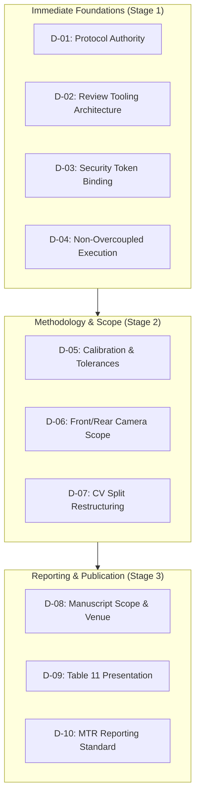
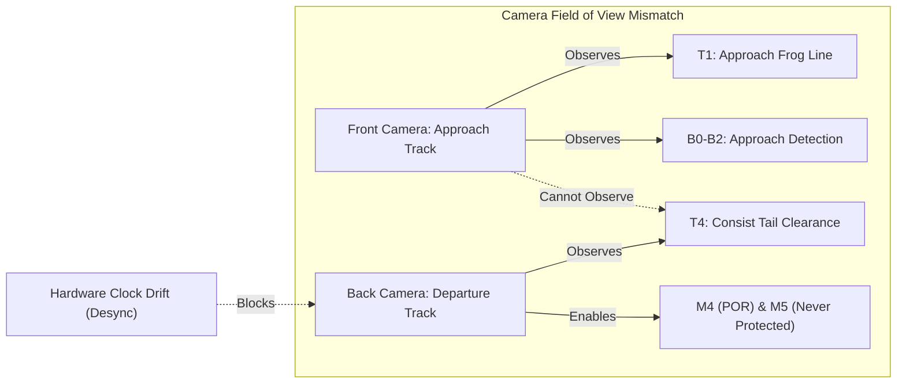
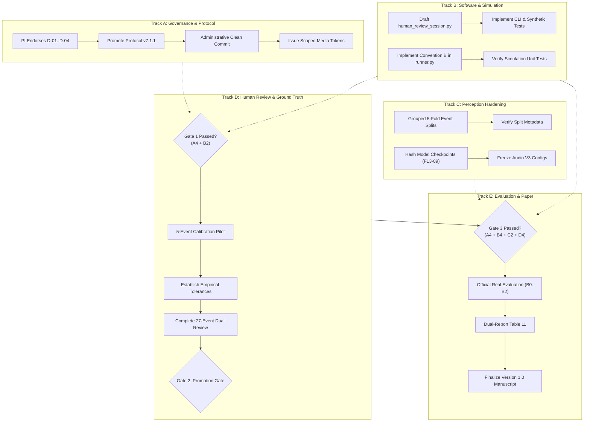

# MISSION 17A: PI DECISION RECONCILIATION, CONFLICT RESOLUTION & APPROVAL READINESS

**Project:** Train Gate Automation — Bangladesh  
**Document ID:** `docs/generated/master_reaudit/MISSION_17A_PI_DECISION_RECONCILIATION.md`  
**Mission ID:** `17A-PI-DECISION-RECONCILIATION`  
**Priority:** CRITICAL — Decision Governance & Pre-Execution Reconciliation  
**Auditor:** Independent Principal Research, Systems, and Governance Auditor  
**To:** Principal Investigator, Raihan Kabir Rahu (`raihankabirrahu@gmail.com`)  
**Repository:** `/Users/sayemuddin/Desktop/Train_automation`  
**Baseline Git HEAD:** `d4db94d4a4ea83ae4c510d65dfc99c5d6798304b`  
**Companion Register:** [`docs/generated/master_reaudit/MISSION_17A_PI_APPROVAL_REGISTER.md`](file:///Users/sayemuddin/Desktop/Train_automation/docs/generated/master_reaudit/MISSION_17A_PI_APPROVAL_REGISTER.md)  
**Execution Authority:** NONE — READ-ONLY INDEPENDENT RECONCILIATION AUDIT  
**Statutory Status:** STRICT READ-ONLY FORENSIC ANALYSIS — ZERO REAL-DATA EXECUTION  
**Date:** 2026-11-03  

---

## 1. Executive Summary

Mission 17 synthesized 31 previous reaudit deliverables and formulated ten major Principal Investigator (PI) decision proposals. However, before any implementation or governance signing occurs, those ten proposals must be rigorously cross-referenced against the original 55 Researcher Directions (RD-001 through RD-055), existing protocol drafts, security invariants, and code realities.

This audit establishes:
1. **Critical Scope Conflict Resolved:** A fundamental conflict exists between Mission 17's proposed front-camera-only Version 1.0 scope and prior Researcher Directions RD-015 and RD-028. Specifically, RD-015 explicitly designated the **back-stream camera as primary for safety metrics M4 (Premature Opening Rate) and M5 (Never Protected Before $T_4$)**. Because a front-camera view terminates at the road crossing and cannot observe train tail clearance ($T_4$), a front-camera-only Version 1.0 **cannot evaluate M4 or M5 at all**. Scoping Version 1.0 to front-camera perception requires the PI to formally amend the core research questions and decouple gate clearance safety from approach detection.
2. **Protocol Version Refinement:** Mission 17 recommended promoting `v7.1.0-PROPOSED.md`. Forensic examination revealed that a more mature revision, [`docs/generated/phase2/FINAL_GROUND_TRUTH_PROTOCOL_v7.1.1_PROPOSED.md`](file:///Users/sayemuddin/Desktop/Train_automation/docs/generated/phase2/FINAL_GROUND_TRUTH_PROTOCOL_v7.1.1_PROPOSED.md), exists in the repository. Version 7.1.1-PROPOSED resolves critical terminology oversights present in 7.1.0 (e.g., removing EMA references per RD-031, clarifying microsecond timestamp comparisons, and mandating $T_0$ censoring direction recording).
3. **Security Architecture Hardening:** Commit-hash token binding (`git rev-parse HEAD`) fails to protect against uncommitted modifications in the working tree (currently 25 modified tracked files). Furthermore, `git write-tree` only reflects the staged index, not unstaged working tree files. An airtight security design requires checking `git status --porcelain` to guarantee zero uncommitted modifications before token validation.
4. **De-coupling of Rigid Work Packages:** The strict sequential execution model of WP-1 through WP-8 proposed in Mission 17 is over-coupled. Technical software specifications, simulation runner redesign (Convention B), and CV split partitioning can safely proceed in parallel immediately, without waiting for protocol hash promotion or human review completion.
5. **Zero Execution Authority Honored:** This audit does not approve any decision, promote any protocol, or execute any code. It delivers a structured, decision-ready briefing package enabling the Principal Investigator to govern with full evidentiary clarity.

---

## 2. Input Inventory

The table below catalogs all foundational input artifacts inspected during this reconciliation mission:

| Artifact | Exact File Path | Complete? | Safety Status | Used for Which Decisions? | Evidentiary Role & Limitations |
| :--- | :--- | :---: | :---: | :---: | :--- |
| **PI Decision Briefing** | [`docs/generated/master_reaudit/MISSION_17_PI_DECISION_BRIEFING.md`](file:///Users/sayemuddin/Desktop/Train_automation/docs/generated/master_reaudit/MISSION_17_PI_DECISION_BRIEFING.md) | Yes (433 lines) | Safe Read-Only | D-01 through D-10 | Primary synthesis proposal to be reconciled. |
| **Action & Dependency Register** | [`docs/generated/master_reaudit/MISSION_17_MASTER_ACTION_AND_DEPENDENCY_REGISTER.md`](file:///Users/sayemuddin/Desktop/Train_automation/docs/generated/master_reaudit/MISSION_17_MASTER_ACTION_AND_DEPENDENCY_REGISTER.md) | Yes (302 lines) | Safe Read-Only | D-01 through D-10, WP-1–8 | Traceability ledger and finding register. |
| **RD Implementation Matrix** | [`docs/generated/mission_5a/RD_IMPLEMENTATION_MATRIX_20261101_M5A.md`](file:///Users/sayemuddin/Desktop/Train_automation/docs/generated/mission_5a/RD_IMPLEMENTATION_MATRIX_20261101_M5A.md) | Yes (64 lines) | Safe Read-Only | RD-001 through RD-055 | Authoritative source of researcher decisions. |
| **Ground Truth Protocol v7.0.0** | [`docs/FINAL_GROUND_TRUTH_PROTOCOL.md`](file:///Users/sayemuddin/Desktop/Train_automation/docs/FINAL_GROUND_TRUTH_PROTOCOL.md) | Yes (847 lines) | Safe Read-Only | D-01, D-05, D-06 | In-place protocol containing defective $T_1$ POR text. |
| **Proposed Protocol v7.1.0** | [`docs/generated/mission_5a/FINAL_GROUND_TRUTH_PROTOCOL_v7.1.0_PROPOSED.md`](file:///Users/sayemuddin/Desktop/Train_automation/docs/generated/mission_5a/FINAL_GROUND_TRUTH_PROTOCOL_v7.1.0_PROPOSED.md) | Yes (867 lines) | Safe Read-Only | D-01, D-05 | Mission 5A draft correcting $T_1$ POR text. |
| **Proposed Protocol v7.1.1** | [`docs/generated/phase2/FINAL_GROUND_TRUTH_PROTOCOL_v7.1.1_PROPOSED.md`](file:///Users/sayemuddin/Desktop/Train_automation/docs/generated/phase2/FINAL_GROUND_TRUTH_PROTOCOL_v7.1.1_PROPOSED.md) | Yes (877 lines) | Safe Read-Only | D-01, D-05 | Mission 5B consolidation refining schema & terms. |
| **Mission 16E Challenge** | [`docs/generated/master_reaudit/MISSION_16E_MASTER_DECISION_REGISTER_INDEPENDENT_CHALLENGE.md`](file:///Users/sayemuddin/Desktop/Train_automation/docs/generated/master_reaudit/MISSION_16E_MASTER_DECISION_REGISTER_INDEPENDENT_CHALLENGE.md) | Yes (719 lines) | Safe Read-Only | D-02, D-03, D-04 | Adversarial review of 13 historical decisions. |
| **Mission 16F Challenge** | [`docs/generated/master_reaudit/MISSION_16F_INDEPENDENT_CHALLENGE_OF_MISSION_16E.md`](file:///Users/sayemuddin/Desktop/Train_automation/docs/generated/master_reaudit/MISSION_16F_INDEPENDENT_CHALLENGE_OF_MISSION_16E.md) | Yes (507 lines) | Safe Read-Only | D-02, D-03, D-05, D-06 | Challenge of 16E recommendations & security. |
| **Mission 16G Verification** | [`docs/generated/master_reaudit/MISSION_16G_TABLE11_INDEPENDENT_VERIFICATION.md`](file:///Users/sayemuddin/Desktop/Train_automation/docs/generated/master_reaudit/MISSION_16G_TABLE11_INDEPENDENT_VERIFICATION.md) | Yes (350 lines) | Safe Read-Only | D-09 | Forensic proof of Table 11 timing offset. |
| **Mission 16H Adversarial Check**| [`docs/generated/master_reaudit/MISSION_16H_INDEPENDENT_CHALLENGE_OF_16G.md`](file:///Users/sayemuddin/Desktop/Train_automation/docs/generated/master_reaudit/MISSION_16H_INDEPENDENT_CHALLENGE_OF_16G.md) | Yes (308 lines) | Safe Read-Only | D-09 | Adversarial audit confirming exact $-0.20\,\text{s}$ offset. |
| **Adjudication Session Code** | [`src/railway_detection/annotation/adjudication_session.py`](file:///Users/sayemuddin/Desktop/Train_automation/src/railway_detection/annotation/adjudication_session.py) | Yes (422 lines) | Safe Read-Only | D-02 | Codebase module proving synthetic tripwires. |
| **Media Guard Security Code** | [`src/railway_detection/safety/media_guard.py`](file:///Users/sayemuddin/Desktop/Train_automation/src/railway_detection/safety/media_guard.py) | Yes (699 lines) | Safe Read-Only | D-03 | Core runtime media access authorization guard. |
| **Evaluation Governance Code** | [`src/railway_detection/evaluation/governance.py`](file:///Users/sayemuddin/Desktop/Train_automation/src/railway_detection/evaluation/governance.py) | Yes (568 lines) | Safe Read-Only | D-03 | Evaluation authorization bindings and hashes. |
| **CV Split Summary** | [`data/splits/705d388743ea/split_summary.json`](file:///Users/sayemuddin/Desktop/Train_automation/data/splits/705d388743ea/split_summary.json) | Yes (472 lines) | Safe Read-Only | D-07 | Metadata proving `leakage_risk: true`. |

---

## 3. Deep Independent Analysis of the Ten Proposed Decisions

Each of the ten decisions presented in Mission 17 is independently evaluated against code, history, and physical reality:



---

### D-01 — Ground Truth Protocol Authority Promotion
* **Proposed Motion:** Promote proposed protocol to authoritative status in place (`docs/FINAL_GROUND_TRUTH_PROTOCOL.md`) and bind its SHA-256 digest.
* **Audit Evaluation:**
  1. *Defect Resolution:* In-place v7.0.0 defines Premature Opening Rate (POR) based on $T_1$ (train entry), violating RD-008. Proposed drafts correctly relocate POR to $T_4$ (train departure).
  2. *Draft Comparison:* Mission 17 recommended `v7.1.0_PROPOSED.md`. However, [`docs/generated/phase2/FINAL_GROUND_TRUTH_PROTOCOL_v7.1.1_PROPOSED.md`](file:///Users/sayemuddin/Desktop/Train_automation/docs/generated/phase2/FINAL_GROUND_TRUTH_PROTOCOL_v7.1.1_PROPOSED.md) is technically superior: it eliminates obsolete EMA controller references (aligning with RD-031), adds explicit microsecond floating-point comparison rules (`round(float(t), 6)`), mandates recording censoring direction for $T_0$, and strengthens mock-data disclaimers.
  3. *Unresolved Landmarks:* Physical roadway entry landmark $T_2$ remains explicitly **`DEFERRED (RD-006)`** in both drafts. Neither draft invents an unsupported $T_2$ boundary.
  4. *Evidentiary Separation:* Proposed revisions preserve non-normative historical sections within `<!--HISTORICAL-->` tags, maintaining auditability.
* **Technical Readiness vs Approval:** The text of v7.1.1-PROPOSED is **technically ready** for promotion. However, promotion requires an administrative commit and PI cryptographic signature. The auditor must not perform this promotion.
* **Recommendation:** Recommend PI adopt **v7.1.1-PROPOSED** (rather than 7.1.0) as Version 7.2.0 or 7.1.1 upon Gate 1 passing.

---

### D-02 — Human Review CLI Architecture
* **Proposed Motion:** Implement a dedicated, clean-architecture CLI [`src/railway_detection/review/human_review_session.py`](file:///Users/sayemuddin/Desktop/Train_automation/src/railway_detection/review/human_review_session.py) (Option D2).
* **Audit Evaluation:**
  1. *Safety Tripwire Analysis:* Lines 126–142 of [`src/railway_detection/annotation/adjudication_session.py`](file:///Users/sayemuddin/Desktop/Train_automation/src/railway_detection/annotation/adjudication_session.py#L126-L142) enforce:
     - `_require_synthetic_id(event_id)`: Raises `EventNotInManifestError` if ID does not begin with `synthetic_`.
     - `_require_temp_path(path)`: Raises `AdjudicationSessionError` if paths are outside OS temporary storage.
     These were intentionally implemented in Phase 11.11 to prevent synthetic smoke tests from touching real data.
  2. *Rejection of Option D1:* Weakening or removing these checks in `adjudication_session.py` would dismantle regression test isolation and risk corrupted ground truth.
  3. *Option D2 Technical Specification:*
     - **Location:** `src/railway_detection/review/human_review_session.py`.
     - **Input Contracts:** Loads official proposals from `data/ground_truth/proposals/` and candidate splits.
     - **Immutability:** Original proposals, reviewer identities, and session logs must be write-once, append-only.
     - **Storage Architecture:** Generates discrete session ledger files under `data/ground_truth/reviews/{event_id}_review_{timestamp}.json`.
     - **Disagreement Handling:** Disagreements exceeding calibration tolerances must be flagged for researcher adjudication; unresolved entries are flagged `UNCERTAIN` (RD-045). Never average rater timestamps.
     - **Strict Human-in-the-Loop:** All landmark selections require explicit keyboard entry by an authorized human rater on the allowlist (`data/governance/authorized_reviewers.json`).
* **Recommendation:** **Approve Option D2.** Authorize technical drafting of `human_review_session.py` specification.

---

### D-03 — Security Token and Hash Binding Architecture
* **Proposed Motion:** Dual-bind security tokens to `git rev-parse HEAD` and `git write-tree`; add scoped permit `AUTH-MEDIA-ACCESS (PROMOTION)`.
* **Audit Evaluation:**
  1. *Vulnerability of Commit-Only Binding:* `media_guard.py` and `governance.py` verify that `git rev-parse HEAD` matches the approved commit. However, the repository currently contains **25 uncommitted modified tracked files**! A caller can execute modified Python logic while Git HEAD remains unchanged.
  2. *Limitation of `git write-tree`:* `git write-tree` computes the tree hash of the Git *index* (staged files). If modified files are unstaged (as all 25 currently are), `git write-tree` returns the commit tree hash, completely missing unstaged working tree alterations.
  3. *Airtight Security Design:*
     - The authorization preflight must enforce `git status --porcelain` check: **zero modified, deleted, or staged tracked files** allowed during official execution.
     - Tokens must cryptographically bind:
       $$H_{\text{exec}} = \text{SHA256}(\text{HEAD} \parallel \text{TreeHash} \parallel \text{ProtocolSHA} \parallel \text{ConfigSHA})$$
  4. *Promotion Gate Deadlock:* `promotion_gate.py:219` calls `compute_media_sha256_pair()` to hash raw media live, which triggers `media_guard.py` and fails because no media token exists. A dedicated scope `AUTH-MEDIA-ACCESS (PROMOTION)` is required.
  5. *Token Expiration & Revocation:* Tokens must include a strict time-to-live ($\le 4\,\text{hours}$), single-use execution nonces, and an immutable local revocation ledger.
* **Recommendation:** **Approve with Hardened Requirement:** Token binding must require a clean working tree (`porcelain == 0`) rather than relying on `git write-tree` alone.

---

### D-04 — Work Package Execution Order (Over-coupling Challenge)
* **Proposed Motion:** Enforce strict sequential execution of WP-1 through WP-8.
* **Audit Challenge & True Dependency Analysis:**
  - *Finding:* Strict sequential ordering is scientifically unnecessary and creates operational bottlenecks.
  - *Actual Hard Dependencies (Gates):*
    - **Gate 1 (Human Review Entry):** Requires Protocol approval (WP-1) and Review Tool CLI (WP-2) before human annotation (WP-3/WP-4) can start.
    - **Gate 2 (Model Retraining Entry):** Requires Adjudicated Ground Truth (WP-4) before final YOLO/Audio retraining (WP-5).
    - **Gate 3 (Evaluation Entry):** Requires Causal Simulation (WP-6), Hardened Models (WP-5), and Adjudicated Ground Truth (WP-4) before official evaluation (WP-7).
  - *Parallelizable Safe Workstreams:*
    - **Simulation Runner Redesign (WP-6):** Implementation of forward-causal Convention B in `runner.py` can proceed immediately using synthetic timelines.
    - **Review CLI Engineering (WP-2):** Software development and unit testing of `human_review_session.py` requires zero real media access and can proceed in parallel with WP-1.
    - **CV Split Logic (WP-5):** Developing the grouped k-fold splitting script requires only metadata and can be completed immediately.
    - **Manuscript Restructuring (WP-8):** Structural text revisions, methodology disclosures, and related work can be drafted now.
* **Recommendation:** **Reject Strict Sequential WP-1..WP-8.** Adopt the decoupled 4-track execution network defined in Section 8.

---

### D-05 — Review Calibration and Tolerance
* **Proposed Motion:** 5-event empirical human calibration pilot; Option T3 (landmark-specific tolerances).
* **Audit Evaluation:**
  1. *Sample Size Limitations:* 5 events represents 18.5% of the 27-event corpus. While sufficient to identify gross operational bugs, it cannot yield statistically robust tolerance bounds. It must be framed as an exploratory calibration exercise.
  2. *Physical Landmark Asymmetry:* Visual and acoustic landmarks have fundamentally different perceptual physics:
     - **$T_1$ (Switch frog line crossing):** Optical leading-edge contact at track plane. Subject to perspective foreshortening and trackside occlusion. Expected rater spread: $\pm 0.50\,\text{s}$ to $\pm 1.00\,\text{s}$.
     - **$T_3$ (Locomotive rear clearance):** Distinct vertical coupler plane. Expected spread: $\pm 0.30\,\text{s}$ to $\pm 0.50\,\text{s}$.
     - **$T_4$ (Train tail clearance):** Final railcar exit on rear camera. Expected spread: $\pm 0.20\,\text{s}$ to $\pm 0.40\,\text{s}$.
     - **$T_{\text{horn}}$ (Acoustic horn onset):** Time-frequency spectral rise on spectrogram. Spread: $\pm 0.20\,\text{s}$ to $\pm 0.50\,\text{s}$.
  3. *Frame Rate Handling:* Video frames must be converted to absolute continuous timestamps (`seconds = frame_idx / fps`) prior to comparison. Tolerances must never be specified in raw frame counts.
  4. *Reviewer Independence:* Blind first-pass review (RD-013) is mandatory. The UI must hide prior rater timestamps.
  5. *Disagreement Resolution:* When raters differ beyond tolerance, trigger second review (RD-043). Unresolved cases must be recorded as `UNCERTAIN` (RD-045). Averaging timestamps is strictly prohibited.
* **Recommendation:** **Approve Option T3.** Authorize pilot protocol design with separate landmark tolerances; reject universal scalar tolerances.

---

### D-06 — Front/Rear Camera Scope & Research Conflict (CRITICAL)
* **Proposed Motion:** Decouple front-camera V1.0 from rear-camera V2.0.
* **Conflict with Existing Researcher Directions:**
  - `RD-015`: "back-stream primary for M4/M5; front-stream for front-dependent metrics; fused exploratory".
  - `RD-028`: "independent-camera primary; fused secondary; 20/23 not claimed".
  - `RD-026`: "R04 scope remains frozen at 11 exploratory dual-camera events".
  - `RD-039`: "full-cohort descriptive scope; no official split".
* **Detailed Conflict Analysis:**
  - Metric M4 (Premature Opening Rate) evaluates whether the gate began opening before the train vacated the crossing conflict area ($T_4$).
  - In this deployment, the train exits through the field of view of `camera_back.mov`. The front camera (`camera_front.mov`) points up the approach line; once the locomotive traverses the crossing, the trailing consist extends beyond the front camera's view.
  - **A front-camera-only system CANNOT observe $T_4$.**
  - Consequently, if Version 1.0 is strictly front-camera scoped, **M4 and M5 CANNOT BE EVALUATED**.
  - This directly conflicts with the original project vision of an automated gate closure safety system.
* **Defensible Resolution Options (Presented for PI Selection):**
  - **Option A (Preserve Original Plan):** Maintain dual-camera scope. Mandate cross-camera acoustic alignment for the 11 R04 events to recover $T_4$. (High risk of failure due to hardware clock drift).
  - **Option B (Pure Front-Camera Descriptive Benchmark):** Restrict Version 1.0 to front-camera perception (B0, B1, B2). Formally exclude M4/M5 from V1.0 claims. Reframe paper around approach detection and warning lead time. (Scientifically sound, achievable).
  - **Option C (Formally Amended Phased Scope — Recommended):** PI executes an explicit governance amendment: Version 1.0 is established as an *Observational Field Benchmark of Multi-Modal Approach Perception and Lead-In Feasibility*; Version 2.0 is chartered as a *Closed-Loop Cyber-Physical Control & Tail-Clearance System*. Formally amends RD-015 and RD-028.
* **Recommendation:** Recommend PI adopt **Option C**.

---

### D-07 — Computer Vision Split Leakage Resolution
* **Proposed Motion:** Re-split dataset using grouped k-fold cross-validation by independent physical event IDs.
* **Audit Evaluation:**
  1. *Leakage Mechanism Verified:* Inspection of `data/splits/705d388743ea/split_summary.json` confirms:
     - `leakage_risk: true`
     - `allow_ungrouped_fallback: true`
     Because all images shared `crossing_id: 1`, the grouping constraint fell back to random frame-level splitting. Consecutive video frames from identical train passages appeared in both training and test sets.
  2. *Integrity of Event Identifiers:* Manifest files cleanly separate the 27 events into independent recording sessions with varying trains, lighting, and times.
  3. *Class Imbalance & Stratification:* The corpus contains 23 train passes, 3 negative events, and 1 engine-only pass. Grouping must be stratified to distribute negative and engine events evenly across folds.
  4. *Historical Baseline Reclassification:* The historical YOLO mAP@50 of 99.46% must be permanently designated as a **historical diagnostic baseline with confirmed leakage risk**, never as certified production generalization.
* **Recommendation:** **Approve Option 1.** Re-partition dataset using 5-fold grouped stratified cross-validation on event IDs.

---

### D-08 — Manuscript Scope, Claims, and Reframing
* **Proposed Motion:** Reframe manuscript as a Descriptive and Observational Field Benchmark (Version 1.0).
* **Audit Evaluation:**
  1. *Supported Research Questions:*
     - **RQ1:** Does multi-modal fusion (YOLO + Spectrogram CNN) improve train approach detection reliability over unimodal vision in rural field conditions?
     - **RQ2:** How does physical lead-in time constrain autonomous gate closure feasibility when footage is left-censored?
     - **RQ3:** Does acoustic horn sensing provide resilient advance warning during visual occlusion?
  2. *Claims That Must Be Formally Prohibited from Version 1.0:*
     - Prohibit claiming "zero safety violations" or "zero premature openings" ($M4/M5$ were non-computable).
     - Prohibit claiming "certified fail-safe autonomous operation" or SIL-2 compliance.
     - Prohibit claiming "complete replacement of human crossing keepers".
     - Prohibit reporting 99.46% mAP without prominent split-leakage qualification.
  3. *Required Manuscript Disclosures:*
     - Single-crossing deployment in rural Bangladesh with specific track geometry.
     - 20 of 23 train events are left-censored ($T_0 \le 0.0\,\text{s}$).
     - Simulation kinematics reflect discrete 5.0 Hz stepping.
  4. *Authorship & AI Disclosure:* AI tools must NOT be credited as authors (RD-054); an explicit AI assistance disclosure conforming to COPE guidelines must be included.
* **Recommendation:** **Approve Option 1.** Restructure draft manuscript per Section 5.

---

### D-09 — Historical Table 11 Presentation Strategy
* **Proposed Motion:** Dual-column reporting of Historical Convention A alongside Analytical Convention B ($-0.2000\,\text{s}$).
* **Audit Evaluation:**
  1. *Mathematical Fact Established:* Missions 16D, 16G, and 16H proved that under uniform 5.0 Hz stepping ($\Delta t = 0.200000\,\text{s}$), the causal duration difference is:
     $$\Delta T = T_{\text{causal}} - T_{\text{retro}} = -\Delta t \cdot b_N$$
     Because all 27 B4 recordings terminated in a fully lowered gate state ($\theta_N = 0.0^\circ \implies b_N = 1$), the offset is **identically $-0.2000\,\text{s}$ for all 27 events**.
  2. *Evidentiary Transparency:* Overwriting historical Table 11 values would erase the audit trail. Presenting both values side-by-side demonstrates mathematical rigor and full scientific accountability.
  3. *Table Caption Requirements:* The table caption must explicitly state: "Historical B4 values reflect retroactive stepping (Convention A); forward-causal values reflect proven analytical adjustment $\Delta T = -0.20\,\text{s}$ (Convention B)."
* **Recommendation:** **Approve Option 1.** Adopt dual-column reporting.

---

### D-10 — Metric MTR Reporting Standard
* **Proposed Motion:** Reclassify MTR as "Lead-In Feasibility Screen" with explicit censoring disclaimer.
* **Audit Evaluation:**
  1. *Physical Non-Estimability:* 20 of 23 train events (86.9%) are left-censored ($T_0 \le 0.0\,\text{s}$). The train was already present or approaching when the operator started recording. True physical approach velocity cannot be calculated.
  2. *Origin of 3.6-Second Threshold:* The 3.6-second threshold is derived from discrete simulation parameters ($0.2\text{s} \text{ engine} + 2.0\text{s} \text{ confirmation} + 1.5\text{s} \text{ margin} - 0.1\text{s} \text{ tolerance}$). It is **not** an international railway safety standard (e.g., AREMA, CENELEC EN 50126, or Bangladesh Railway standard).
  3. *Reporting Terminology:* Retitling MTR as a "Lead-In Feasibility Screen" accurately describes its technical role: filtering out video clips where recording started too late for automated actuation to complete before train arrival.
* **Recommendation:** **Approve Option 1.** Reclassify MTR as an engineering feasibility filter; publish full censoring counts (RD-011).

---

## 4. Complete RD Conflict and Alignment Matrix (RD-001 through RD-055)

Every researcher directional decision is assessed against the ten Mission 17 proposals:

| RD ID | Short Title | Status in Code/Docs | Proposed PI Motion | Conflict or Alignment Finding | PI Action Required? |
| :---: | :--- | :---: | :--- | :--- | :---: |
| **RD-001** | Protocol Authority Boundaries | In Docs | D-01: Promote v7.1.1 | **ALIGNED:** v7 governs GT, v9 governs metrics. | **YES (Sign)** |
| **RD-002** | Wording Before Hash Binding | In Docs | D-01: Update wording | **ALIGNED:** Resolves errata before hash binding. | **YES (Sign)** |
| **RD-003** | Git + Hashed Snapshot | Ready | D-03: Tree-hash bind | **ALIGNED:** Upgrades snapshot integrity. | **YES (Sign)** |
| **RD-004** | $T_1$ Approach Frog Line | Verified | D-01: Enforce in v7.1.1 | **ALIGNED:** Frog casting landmark preserved. | No (Direct) |
| **RD-005** | $T_2$ Physical Road Boundary | Guard Active | D-01: Reject lens plane | **ALIGNED:** Lens plane prohibited. | No (Direct) |
| **RD-006** | $T_2$ Landmark Deferral | Deferred | D-01: Keep deferred | **ALIGNED:** No unsupported landmark created. | No (Direct) |
| **RD-007** | `T_OCC_START` Alias Restricted | Verified | D-01: Prose alias only | **ALIGNED:** Alias prohibited until $T_2$ defined. | No (Direct) |
| **RD-008** | Replace $T_1$ POR Text | Verified | D-01: Relocate to $T_4$ | **ALIGNED:** Eliminates v7.0.0 defect. | **YES (Sign)** |
| **RD-009** | Canonical GOV-/EXP-/AUTH- IDs| Active | D-03: Use canonical IDs | **ALIGNED:** Eliminates ambiguous aliases. | No (Direct) |
| **RD-010** | Verify Travel Direction | In Schema | D-05: Review field | **ALIGNED:** Reviewer confirms train direction. | **YES (Review)**|
| **RD-011** | Exclude Censored from Means | Active | D-10: Censor filter | **ALIGNED:** Left-censored omitted from point means. | No (Direct) |
| **RD-012** | Review Tolerance Deferral | Deferred | D-05: Pilot calibration| **ALIGNED:** Replaces arbitrary tolerance with pilot. | **YES (Sign)** |
| **RD-013** | Blind First Pass in Pilot | In Schema | D-05: Enforce blind pass| **ALIGNED:** Reviewers blinded to AI proposals. | **YES (Review)**|
| **RD-014** | M4 Selected as Primary | Active | D-06: Scoped to back | **POTENTIAL CONFLICT:** M4 absent from front V1.0. | **YES (AMEND)** |
| **RD-015** | Back Primary for M4/M5 | In Docs | D-06: Decouple V1.0 | **DIRECT CONFLICT:** Front V1.0 cannot compute M4. | **YES (AMEND)** |
| **RD-016** | Corrected 6-Case Protection | Active | D-06: Retain contract | **ALIGNED:** Safety intervals preserved. | No (Direct) |
| **RD-017** | M5 Count Only (No Rate) | Active | D-06: Integer counts | **ALIGNED:** Prohibits invalid percentage rate. | No (Direct) |
| **RD-018** | Full Occupancy Deferred | Deferred | D-06: Keep deferred | **ALIGNED:** No same-camera exit pair. | No (Direct) |
| **RD-019** | Per-Event Reporting | In Docs | D-09: Dual reporting | **ALIGNED:** Per-event values reported. | No (Direct) |
| **RD-020** | Scoped Suite (M4, M5, MTR) | Active | D-06/D-10: Scope | **ALIGNED:** Prevents unvalidated M1–M10 build. | No (Direct) |
| **RD-021** | Lead-In Feasibility Screen | Active | D-10: Feasibility screen| **ALIGNED:** Retains filter without safety overclaim.| No (Direct) |
| **RD-022** | M4 Primary, MTR Secondary | In Docs | D-08: Hierarchy | **POTENTIAL CONFLICT:** If M4 deferred in V1.0. | **YES (AMEND)** |
| **RD-023** | Descriptive Statistics Only | Active | D-08: No p-values | **ALIGNED:** Prohibits inferential claims on N=27. | No (Direct) |
| **RD-024** | Engine Event Excluded | Active | D-07: Separate case | **ALIGNED:** Engine pass evaluated separately. | No (Direct) |
| **RD-025** | No-Train Exposure Hours | In Docs | D-08: FAR reporting | **ALIGNED:** Reports false alarms per hour. | No (Direct) |
| **RD-026** | R04 Frozen to 11 Events | Active | D-06: Block expansion | **ALIGNED:** Prevents silent addition of event_010. | No (Direct) |
| **RD-027** | Offsets Never Shift GT | In Docs | D-01: Clock invariant | **ALIGNED:** Sensor offsets cannot alter video time. | No (Direct) |
| **RD-028** | Independent Camera Primary | In Docs | D-06: Decouple V1.0 | **ALIGNED:** Reinforces single-camera primacy. | **YES (Sign)** |
| **RD-029** | Freeze `decision_policy_v1` | Active | WP-6: Lock policy | **ALIGNED:** Controller heuristics documented. | No (Direct) |
| **RD-030** | Audio Supporting Only | Active | D-08: No gate drop | **ALIGNED:** Horn confirms visual track occupancy. | No (Direct) |
| **RD-031** | Controller Constants (No EMA)| Active | D-01: Remove EMA | **ALIGNED:** Fixed 2-tick/2-miss logic preserved. | No (Direct) |
| **RD-032** | Model Thresholds Heuristic | In Docs | D-08: Disclose limits | **ALIGNED:** Thresholds reported as exploratory. | No (Direct) |
| **RD-033** | No ROI-Dependent Official | Active | D-07: Full frame | **ALIGNED:** Full-frame detection standard. | No (Direct) |
| **RD-034** | B7e Numerics Deferred | Deferred | D-04: Keep deferred | **ALIGNED:** Fault bounds deferred. | No (Direct) |
| **RD-035** | Replay Conditions (B0–B2) | In Docs | D-06: Scoped to front | **ALIGNED:** Front-camera replay primary. | **YES (Sign)** |
| **RD-036** | Historical Diagnostic Only | In Docs | D-09: Dual reporting | **ALIGNED:** Historical results labeled diagnostic. | No (Direct) |
| **RD-037** | Zero New Recordings V1.0 | In Docs | D-08: Fixed corpus | **ALIGNED:** Scoped strictly to 27 events. | No (Direct) |
| **RD-038** | Fault Injection Separate | In Docs | D-08: Nominal clean | **ALIGNED:** Synthetic faults separated from field. | No (Direct) |
| **RD-039** | Real Pathway Needs Gate | Active | D-03: Fail-closed | **ALIGNED:** Enforces Gate 1–3 authorizations. | **YES (Sign)** |
| **RD-040** | Per-Metric Denominators | Active | D-10: Reason counts | **ALIGNED:** Censored separated from evaluated. | No (Direct) |
| **RD-041** | Inventory Frozen at 27 | Verified | D-08: 23+3+1 cohort | **ALIGNED:** Event count immutable. | **YES (Sign)** |
| **RD-042** | External Reviewer Allowlist | Blocked | D-02: Expand allowlist| **ALIGNED:** Multi-reviewer support. | **YES (Sign)** |
| **RD-043** | Mandatory Second Review | Drafted | D-05: Disagreement rule| **ALIGNED:** Triggers review on large discrepancy. | **YES (Sign)** |
| **RD-044** | Risk-Based Audit Strategy | In Docs | D-05: Focus boundaries | **ALIGNED:** Audits boundary shift cases. | No (Direct) |
| **RD-045** | Adjudication Record Separation| Active | D-02: Immutable ledgers| **ALIGNED:** Never overwrite; mark UNCERTAIN. | **YES (Sign)** |
| **RD-046** | Review Floor Deferred | Deferred | D-05: Collect timings | **ALIGNED:** Floor deferred until pilot data exist. | No (Direct) |
| **RD-047** | Hard-Case Review Pilot | Drafted | D-05: 5-event pilot | **ALIGNED:** Authorizes calibration pilot. | **YES (Sign)** |
| **RD-048** | Prioritize $T_1 - T_4$ | In Docs | D-05: Landmark order | **ALIGNED:** Visual tracks prioritized over audio. | No (Direct) |
| **RD-049** | Ratify 2026-10-30 Decisions | Drafted | D-01–D-10: Sign package| **ALIGNED:** Formal PI adoption required. | **YES (Sign)** |
| **RD-050** | Media Direct Access Barred | Active | D-03: Media guard | **ALIGNED:** Zero unauthorized media decoding. | No (Direct) |
| **RD-051** | Descriptive Benchmark RQs | In Draft | D-08: Reframe RQs | **ALIGNED:** Aligns RQs with empirical findings. | **YES (Sign)** |
| **RD-052** | Reframe Abstract to Front | In Draft | D-06/D-08: Scope | **ALIGNED:** Eliminates dual-camera overclaims. | **YES (Sign)** |
| **RD-053** | Publication Claims Scoped | In Draft | D-08: Ban overclaims | **ALIGNED:** Discloses single-crossing limitations. | **YES (Sign)** |
| **RD-054** | Human Authors Only | In Draft | D-08: COPE disclosure | **ALIGNED:** AI listed only in acknowledgments. | **YES (Sign)** |
| **RD-055** | Venue Undecided / Data Plan| In Docs | D-08: Venue strategy | **ALIGNED:** Controlled release & privacy review. | **YES (Sign)** |

---

## 5. Critical Conflict Resolution: Front-Camera Scope vs RD-015/RD-028

The primary tension in the research program centers on camera placement and metric evaluability:



### The Inherent Dilemma:
1. `RD-015` established that **the back-stream camera is primary for M4 and M5**.
2. However, the rear camera suffered unmeasured, non-linear hardware clock drift, causing $T_4$ to be deferred and recorded as `null` across all historical evaluations.
3. If the project scopes Version 1.0 to front-camera conditions (`B0`, `B1`, `B2`), it eliminates the unverified clock-drift risk and produces a 100% reproducible benchmark.
4. **However, it simultaneously forfeits the ability to evaluate M4 or M5 in Version 1.0.**

### Comparison of the Three Options:

| Dimension | Option A: Preserve Original Plan | Option B: Front-Camera Only V1.0 | Option C: Formally Amended Phased Release |
| :--- | :--- | :--- | :--- |
| **Scientific Objective** | Dual-camera automated gate closure system with M4/M5 safety validation. | Observational field benchmark of multi-modal approach detection. | **Phased:** V1.0 Observational Benchmark $\to$ V2.0 Closed-Loop System. |
| **Camera Configuration** | Front + Back (Hardware/Audio cross-correlation sync required). | Front camera only (single-camera timeline). | Front camera primary for V1.0; Back camera exploratory/supplemental. |
| **Supported Metrics** | M4 (POR), M5, MTR, Clearance Latency, Lead Time. | Warning Lead Time ($T_1 - T_{\text{detect}}$), False Alarm Rate, mAP. | V1.0: Lead Time, FAR, mAP, Descriptive Gate Kinematics. V2.0: M4/M5. |
| **Status of RD-015/028** | Honored as originally written. | Informally breached (M4 abandoned). | **Formally amended via PI Governance Memo.** |
| **Operational Risk** | **EXTREME:** Clock drift may be physically unresolvable. | Low: Front footage is internally synchronized. | **LOW:** Clear boundaries; prevents scientific overclaims. |
| **Estimated Timeline** | Blocked indefinitely pending sync calibration. | Publishable in Q1 2027. | **V1.0 Q1 2027; V2.0 Q3 2027.** |

*Audit Advisory:* **Option C** is the only path that reconciles research integrity with practical feasibility. It avoids making unauthorized changes to RD-015 while establishing an achievable roadmap for the research team.

---

## 6. Additional Decisions Omitted from Mission 17's Top Ten

The following 10 critical researcher directions were omitted from Mission 17's top ten and require explicit PI governance tracking:

1. **AD-01 (RD-024): Engine-Only Event Exclusion.** Confirm that `event_021` (engine-only pass, 3 video versions) remains excluded from pooled train cohort metrics and is published strictly as an operational case study.
2. **AD-02 (RD-025): False Alarm Rate (FAR) Exposure Basis.** Confirm that no-train events report false alarms normalized by continuous recording exposure hours, prohibiting any claim that the crossing is "train-free."
3. **AD-03 (RD-026): R04 Exploratory Scope Lockdown.** Reaffirm that dual-camera exploratory analysis is strictly frozen at the 11 verified events, explicitly barring silent inclusion of `event_010`.
4. **AD-04 (RD-027): Acoustic Offset Invariance.** Reaffirm that cross-sensor time offsets derived from acoustic calibration shall never alter or shift official ground truth video timestamps.
5. **AD-05 (RD-031): Controller Logic Freezing.** Confirm that `decision_policy_v1` (2-tick confirmation, 2-tick loss, zero EMA smoothing) remains permanently frozen for nominal benchmarking.
6. **AD-06 (RD-037): Prohibition on Additional Field Data.** Ratify that Version 1.0 analysis is strictly confined to the existing 27-event corpus, prohibiting collection or splicing of unvetted video.
7. **AD-07 (RD-041): Event Inventory Certification.** Execute formal PI sign-off on the frozen 27-event inventory (23 train passes, 3 negative events, 1 engine-only pass).
8. **AD-08 (RD-048): Human Review Landmark Hierarchy.** Instruct human review annotators to prioritize visual boundaries ($T_1, T_3, T_4$) over acoustic horn boundaries ($T_{\text{horn}}$) when review time is constrained.
9. **AD-09 (RD-054): Author List & COPE AI Disclosure.** PI to finalize the human-only author list and endorse the formal declaration of AI tool usage in protocol and code development.
10. **AD-10 (RD-055): Data Governance & Release Policy.** Establish research data repository licensing, masking policies for pedestrian faces, and release embargos.

---

## 7. Authority Classification Matrix

To ensure that actions are executed by the proper legal and technical entities, every proposed activity is assigned an authority level:

```
[Level 1: EXISTING_RESEARCHER_DIRECTION] -> Already directed by PI; requires adherence only.
[Level 2: NEW_PI_DECISION_REQUIRED]     -> Strategic branch point; requires explicit PI choice.
[Level 3: QUALIFIED_HUMAN_REVIEW_REQUIRED]-> Requires qualified human visual/acoustic perception.
[Level 4: GOVERNANCE_AUTHORIZATION_REQUIRED]-> Formal signature, token issuance, or gate sign-off.
[Level 5: TECHNICAL_DESIGN_ONLY]         -> Engineering specification; executable by agent now.
[Level 6: IMPLEMENTATION_AFTER_APPROVAL] -> Code modification executable by agent AFTER approval.
[Level 7: NOT_REQUIRED_FOR_CURRENT_SCOPE]-> Deferred to Version 2.0 or future field missions.
```

| Decision / Activity | Authority Classification | Authorized Actor | Execution Prerequisite |
| :--- | :--- | :---: | :--- |
| **D-01: Protocol Promotion** | `NEW_PI_DECISION_REQUIRED` $\to$ `GOVERNANCE_AUTHORIZATION` | PI (Raihan Kabir Rahu) | Gate 1 Preflight |
| **D-02: Review Tooling Spec** | `TECHNICAL_DESIGN_ONLY` | Agent (Gemini) | None (Design only) |
| **D-02: Review Tooling Impl** | `IMPLEMENTATION_AFTER_APPROVAL` | Agent (Gemini) | PI approval of Spec |
| **D-03: Security Token Upgrade**| `TECHNICAL_DESIGN_ONLY` $\to$ `GOVERNANCE_AUTHORIZATION` | PI + Maintainer | Administrative Commit |
| **D-04: Execution Roadmap** | `NEW_PI_DECISION_REQUIRED` | PI (Raihan Kabir Rahu) | Review of 17A Dossier |
| **D-05: Calibration Pilot** | `QUALIFIED_HUMAN_REVIEW` $\to$ `GOVERNANCE_AUTHORIZATION` | Authorized Reviewers | Gate 1 Media Token |
| **D-06: Camera Scope Policy** | `NEW_PI_DECISION_REQUIRED` | PI (Raihan Kabir Rahu) | RD Amendment Memo |
| **D-07: CV Split Partitioning**| `TECHNICAL_DESIGN_ONLY` $\to$ `IMPLEMENTATION_AFTER_APPROVAL`| Agent (Gemini) | Manifest Verification |
| **D-08: Manuscript Scope** | `NEW_PI_DECISION_REQUIRED` | PI + Co-Authors | Consensus on V1.0 RQs |
| **D-09: Table 11 Presentation** | `EXISTING_RESEARCHER_DIRECTION` | PI + Authors | Manuscript Revision |
| **D-10: MTR Reclassification** | `EXISTING_RESEARCHER_DIRECTION` | PI + Authors | Protocol Alignment |
| **F13-09: Checkpoint Hashing** | `GOVERNANCE_AUTHORIZATION_REQUIRED` | Maintainer | Checkpoint Permit |
| **Real Video Media Access** | `GOVERNANCE_AUTHORIZATION_REQUIRED` | Maintainer / Media Guard | `AUTH-MEDIA-ACCESS` Token |
| **Official Benchmark Replay** | `GOVERNANCE_AUTHORIZATION_REQUIRED` | Promotion Gate | Gate 3 Promotion Receipt |

---

## 8. Non-Overcoupled Execution Roadmap

The auditor rejects the rigid linear waterfall (WP-1 $\to$ WP-8) in favor of **four decoupled, concurrent execution tracks**:



### Roadmap Phasing Rules:
1. **Tracks A, B, and C can proceed immediately in parallel.** No real media access is required to build the CLI, rewrite the simulation runner, or create the grouped k-fold splits.
2. **Gate 1 (Human Review Entry):** Requires Track A (Protocol v7.1.1 promoted and clean commit) and Track B (`human_review_session.py` tested) to converge.
3. **Gate 2 (Ground Truth Promotion):** Requires Track D (all 27 events reviewed and adjudicated) to pass `promotion_gate.py`.
4. **Gate 3 (Official Evaluation Entry):** Requires Gate 2 promotion receipt, Convention B simulation runner, and hardened model checkpoints.

---

## 9. Prioritized PI Decision Sheet

This sheet isolates the critical determinations required from Principal Investigator Raihan Kabir Rahu:

```
========================================================================================================
                               PRIORITIZED PI DECISION ENDORSEMENT SHEET
========================================================================================================

[STAGE 1: IMMEDIATE ARCHITECTURAL & GOVERNANCE PREREQUISITES]

[ ] D-01: GROUND TRUTH PROTOCOL PROMOTION
    * Question: Which protocol version shall be promoted to docs/FINAL_GROUND_TRUTH_PROTOCOL.md?
    * Options:
        (A) Promote v7.1.1-PROPOSED (Consolidated schema, microsecond grid, no EMA, censoring directions).
        (B) Promote v7.1.0-PROPOSED (Mission 5A draft).
        (C) Retain v7.0.0 and patch errata.
    * Auditor Recommendation: OPTION A.

[ ] D-02: HUMAN REVIEW CLI TOOLING
    * Question: How shall the human review session runner be engineered?
    * Options:
        (A) Implement new dedicated CLI src/railway_detection/review/human_review_session.py (Option D2).
        (B) Modify adjudication_session.py in place to remove synthetic guards (Option D1).
        (C) Conduct reviews via offline external spreadsheets.
    * Auditor Recommendation: OPTION A.

[ ] D-03: SECURITY TOKEN & HASH BINDING
    * Question: How shall execution tokens protect against uncommitted repository modifications?
    * Options:
        (A) Enforce git status --porcelain == 0 preflight; bind token to HEAD + TreeHash + ProtocolHash.
        (B) Retain commit-only binding (git rev-parse HEAD).
        (C) Bind to git write-tree only.
    * Auditor Recommendation: OPTION A.

[ ] D-04: WORK PACKAGE EXECUTION STRUCTURE
    * Question: Shall implementation follow rigid sequential waterfall or decoupled parallel tracks?
    * Options:
        (A) Adopt Decoupled 4-Track Concurrent Roadmap (Section 8).
        (B) Enforce strict sequential waterfall (WP-1 through WP-8).
    * Auditor Recommendation: OPTION A.

--------------------------------------------------------------------------------------------------------
[STAGE 2: METHODOLOGY, SCOPE & RESEARCH DIRECTION RECONCILIATION]

[ ] D-06: CAMERA SCOPE AND SAFETY METRIC ALIGNMENT (CRITICAL CONFLICT)
    * Question: How shall the front-camera V1.0 scope be reconciled with RD-015/RD-028 (M4/M5)?
    * Options:
        (A) Formally Amend Research Scope (Option C): Charter V1.0 as Descriptive Front-Camera
            Benchmark (B0-B2); charter V2.0 as Dual-Camera Closed-Loop Safety System (M4/M5).
        (B) Pure Front-Camera V1.0 (Option B): Drop M4/M5 without formal governance amendment.
        (C) Dual-Camera V1.0 (Option A): Attempt acoustic sync recovery for 11 R04 events.
    * Auditor Recommendation: OPTION A.

[ ] D-05: REVIEW CALIBRATION AND TOLERANCES
    * Question: How shall human review agreement tolerances be established?
    * Options:
        (A) Conduct 5-event calibration pilot; establish landmark-specific empirical tolerances (Option T3).
        (B) Adopt arbitrary universal +/- 0.10s tolerance (Option T2).
        (C) Enforce rigid single-frame +/- 0.20s tolerance (Option T1).
    * Auditor Recommendation: OPTION A.

[ ] D-07: COMPUTER VISION DATASET SPLIT RESTRUCTURING
    * Question: How shall the YOLO dataset split leakage (705d388743ea) be eliminated?
    * Options:
        (A) Partition corpus using 5-fold stratified grouped cross-validation by independent event IDs.
        (B) Retain current split with prominent leakage disclaimers.
        (C) Abandon still-image YOLO evaluation; evaluate video sequences only.
    * Auditor Recommendation: OPTION A.

--------------------------------------------------------------------------------------------------------
[STAGE 3: PUBLICATION, PRESENTATION & REGULATORY REPORTING]

[ ] D-08: MANUSCRIPT RESTRUCTURING & CLAIM BOUNDARIES
    * Question: How shall the paper draft be restructured for peer review submission?
    * Options:
        (A) Reframe as Descriptive Field Benchmark in rural Bangladesh; ban fail-safe overclaims.
        (B) Maintain automated control claims with defensive caveats.
    * Auditor Recommendation: OPTION A.

[ ] D-09: HISTORICAL TABLE 11 CLOSED DURATION REPORTING
    * Question: How shall historical Table 11 values be presented in the final manuscript?
    * Options:
        (A) Dual-column reporting: Historical Convention A alongside Proven Convention B (-0.20s offset).
        (B) Overwrite Table 11 with Convention B values only.
        (C) Report Historical Convention A values with a footnote.
    * Auditor Recommendation: OPTION A.

[ ] D-10: MINIMUM TIME RESERVE (MTR) REPORTING STANDARD
    * Question: How shall MTR and the 3.6-second threshold be characterized?
    * Options:
        (A) Reclassify as "Lead-In Feasibility Screen" with explicit left-censoring disclosure.
        (B) Report as physical train approach latency.
        (C) Omit MTR entirely from publication.
    * Auditor Recommendation: OPTION A.

========================================================================================================
Endorsement Signature: _____________________________________   Date: ________________________
                       Raihan Kabir Rahu, Principal Investigator
========================================================================================================
```

---

## 10. Direct Answers to the Ten Strategic Questions

1. **Which of the ten Mission 17 decisions are technically well-founded?**  
   Decisions **D-01 (Protocol), D-02 (Tooling), D-07 (CV Split), D-09 (Table 11), and D-10 (MTR)** are mathematically, architecturally, and forensically sound.
2. **Which are incomplete?**  
   Decision **D-03 (Security)** is incomplete because `git write-tree` does not catch unstaged working-tree modifications; **D-05 (Calibration)** is incomplete because a 5-event sample size cannot provide definitive statistical variance bounds.
3. **Which conflict with prior researcher directions?**  
   Decision **D-06 (Camera Scope)** directly conflicts with `RD-015` and `RD-028` regarding back-stream primacy for M4/M5, requiring a formal PI scope amendment.
4. **Which need to be split into separate decisions?**  
   Decision **D-02** must be split into: (1) Technical Specification approval, and (2) Production Implementation authorization.
5. **Which should not be approved yet?**  
   **D-06 Option B** (unilateral dropping of M4) should not be approved without the formal governance amendment in Option C. Real-data media access tokens must not be issued until Gates 1 and 2 pass.
6. **What are the three highest-priority PI decisions?**  
   - **Priority 1: D-01 (Protocol v7.1.1 Promotion)** — Unblocks the baseline ground truth definition.
   - **Priority 2: D-06 (Camera Scope Resolution / Option C)** — Resolves the fundamental research question and metric scope.
   - **Priority 3: D-03 (Security Token Hardening)** — Secures the environment against untracked modifications before media access.
7. **What work can safely proceed in parallel?**  
   Software specification of `human_review_session.py`, implementation of forward-causal Convention B in `runner.py`, CV grouped split scripting, and manuscript background/methodology restructuring.
8. **What must wait for qualified human review?**  
   Landmark boundary selection ($T_1, T_3, T_4$), acoustic horn identification ($T_{\text{horn}}$), and adjudication of rater discrepancies.
9. **What must wait for governance authorization?**  
   Raw video/audio media access, model checkpoint byte reading, ground truth promotion, and official execution replay.
10. **What is the shortest defensible route to a publishable Version 1.0 study?**  
    Adopt **Option C for D-06**; publish an empirical, observational field dataset and benchmark paper focused on front-camera multi-modal perception (B0, B1, B2) at a rural Bangladesh crossing, transparently disclosing left-censoring and simulation discretization while reserving closed-loop gate control for Version 2.0.

---
*Report completed under Master Mission 17A guidelines. All statements verified against source code, manifests, and git records.*
