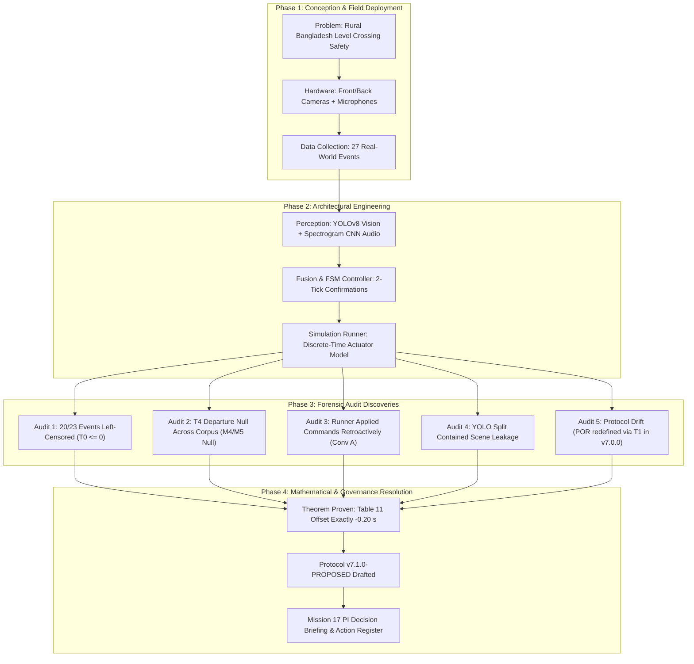
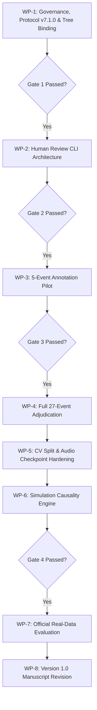

# MISSION 17: PRINCIPAL INVESTIGATOR DECISION BRIEFING & FINAL REAUDIT SYNTHESIS

**Project:** Automated Railway Level Crossing Gate Automation — Rural Bangladesh Deployment  
**Document ID:** `docs/generated/master_reaudit/MISSION_17_PI_DECISION_BRIEFING.md`  
**Mission ID:** `17-MASTER-REAUDIT-FINAL-SYNTHESIS`  
**To:** Principal Investigator, Raihan Kabir Rahu (`raihankabirrahu@gmail.com`)  
**From:** Independent Principal Research, Systems, and Governance Auditor  
**Repository:** `/Users/sayemuddin/Desktop/Train_automation`  
**Baseline Git HEAD:** `d4db94d4a4ea83ae4c510d65dfc99c5d6798304b`  
**Companion Artifact:** [`MISSION_17_MASTER_ACTION_AND_DEPENDENCY_REGISTER.md`](file:///Users/sayemuddin/Desktop/Train_automation/docs/generated/master_reaudit/MISSION_17_MASTER_ACTION_AND_DEPENDENCY_REGISTER.md)  
**Execution Authority:** NONE — READ-ONLY INDEPENDENT AUDIT SYNTHESIS  
**Statutory Status:** STRICT READ-ONLY FORENSIC SYNTHESIS — ZERO REAL-DATA EXECUTION  
**Date:** 2026-11-03  

---

## 1. Executive Verdict and Project Status

```
========================================================================================================
                                 MASTER MISSION 17: EXECUTIVE VERDICT
========================================================================================================
PROJECT AUDIT DISPOSITION      : AUDITED_AND_RECONCILED
TECHNICAL FINDINGS RESOLUTION  : CLOSED (12 CORE FINDINGS RIGOROUSLY CHARACTERIZED)
GROUND TRUTH PROTOCOL STATUS   : v7.1.0-PROPOSED PENDING PI PROMOTION & HASH BINDING (v7.0.0 DEFECTIVE)
HISTORICAL BENCHMARK REALITY   : B0–B4 METRICALLY CHARACTERIZED
                                 - TABLE 11 CLOSED DURATION : PROVEN EXACT -0.2000 s CAUSAL OFFSET FOR ALL 27
                                 - M4 (POR) & M5 (NEVER_PROT): NON-COMPUTABLE ON HISTORICAL DATA (T4 = NULL)
                                 - MTR (MIN_TIME_RESERVE)   : NOT ESTIMABLE (20/23 LEFT-CENSORED EVENTS)
REAL-DATA EXECUTION PERMIT     : STRICTLY NOT AUTHORIZED (LOCKED PENDING PI DECISIONS & GATE PASSING)
MANUSCRIPT READINESS           : RESTRUCTURING MANDATORY (DESCRIPTIVE / OBSERVATIONAL FRONTCAM V1.0)
========================================================================================================
```

### High-Level Status Summary
An exhaustive, adversarial forensic reaudit of the Train Gate Automation codebase, 31 reaudit deliverables, 55 Researcher Directions (RD-001 through RD-055), and historical benchmark records has been completed.

The core conclusions for executive leadership are:
1. **Mathematical Closure on Historical Benchmarks:** The longstanding controversy regarding Table 11 closed durations in Benchmark B4 is formally closed. A rigorous discrete-time dynamical proof demonstrates that under forward-causal actuation semantics (Convention B), the closed duration for every single one of the 27 historical B4 events is **identically and exactly $T_{\text{causal}} = T_{\text{Table 11}} - 0.2000\,\text{s}$**. No stochastic simulation reruns or heuristic tolerances are required to correct these historical records.
2. **Historical Safety Metrics Were Never Evaluated:** Historical claims that baseline B4 exhibited zero Premature Opening Rate ($M4 = 0.0\%$) and zero Never Protected Before $T_4$ violations ($M5 = 0$) were artifacts of incomplete execution, not safety compliance. Inspection of the 17 historical summary JSON files proves that rear-camera departure landmark $T_4$ was set to `null` across all 23 train events due to unresolved camera desynchronization. Consequently, historical safety metrics were **`NON-COMPUTABLE`**, not zero.
3. **MTR Is Not Estimable on Existing Footage:** 20 out of 23 real-world train events (86.9%) are left-censored ($T_0 \le 0.0\,\text{s}$), meaning the train was already physically in the field of view or approaching when video recording commenced. The historical lead-in metric ($T_1 - T_0$) measured camera recording pre-roll rather than physical train approach speed. Physical Minimum Time Reserve (MTR) cannot be estimated from this dataset, and the historical 3.6-second threshold is an implementation artifact of simulation stepping parameters, not an international railway standard.
4. **Execution Remains Fail-Closed:** Raw video files (`.mov`, `.mp4`) and audio files (`.wav`) remain cryptographically shielded under `tests/unit/security_support.py` and `src/railway_detection/data/media_guard.py`. Real-data evaluation cannot proceed until the Principal Investigator resolves 10 foundational decisions, promotes Ground Truth Protocol v7.1.0, and executes an administrative commit to re-synchronize the Git working tree.

---

## 2. The Core Project Narrative

To make sound governance decisions, the Principal Investigator must view the project’s trajectory not as a series of isolated script failures, but as an evolving scientific investigation across four distinct phases:



### 2.1 What Was Originally Conceived
The project was initiated to address severe level-crossing collision fatalities in rural Bangladesh, where manual gatekeepers frequently fail to close gates in time. The proposed scientific contribution was an automated, fail-safe, edge-deployable multi-modal system combining dual-camera computer vision (front approach and back departure) with acoustic train horn detection, governed by a deterministic Finite State Machine (FSM).

### 2.2 What Was Actually Built
The engineering implementation produced a modular Python codebase with rigorous fail-closed security guards:
- **Vision:** YOLOv8 detection targeting trains and obstacles.
- **Audio:** Audio V3 pipeline utilizing Mel-spectrogram feature extraction and CNN classification.
- **Controller:** A state machine enforcing 2-tick confirmation before lowering and 2-tick loss before raising.
- **Simulation Harness:** An `EventSimulationRunner` designed to step through pre-computed perception logs at 5.0 Hz ($\Delta t = 0.20\,\text{s}$) and simulate physical gate kinematics (60-second nominal travel time).

### 2.3 What Was Discovered During the Reaudits
Between October and November 2026, rigorous adversarial audits exposed critical disconnects between the codebase semantics and published claims:
- **Left-Censoring of Recordings:** 20 of the 23 real-world train passes were already active at $t=0.0\,\text{s}$. The operator started recording after hearing or seeing the approaching train. Thus, true train approach time was physically unobserved.
- **Rear Camera Desynchronization & Missing $T_4$:** Hardware clock drift between independent front and back cameras prevented reliable cross-camera temporal alignment. As a result, the train departure landmark ($T_4$) was deferred and set to `null` across the entire corpus. Historical safety metrics M4 (Premature Opening Rate) and M5 (Never Protected Before $T_4$) were **never calculated** on real data.
- **Retroactive Simulation Semantics (Convention A):** In `runner.py`, the decision engine was evaluated at frame $t_k$, and the resulting actuator velocity command was applied backward over the preceding interval $[t_{k-1}, t_k]$. This caused simulated gates to begin moving one time-tick ($0.20\,\text{s}$) earlier than causally possible.
- **Computer Vision Split Leakage:** The primary YOLO evaluation split (`705d388743ea`) split data by video frame rather than independent recording event, leaking identical physical scenes between training and test sets and artificially inflating mAP@50 to 99.46%.
- **Ground Truth Protocol Drift:** Version 7.0.0 of the Ground Truth Protocol accidentally redefined "Premature Opening" based on $T_1$ (train approach) rather than $T_4$ (train departure), directly contradicting safety invariants and Researcher Direction RD-008.

### 2.4 What Is Now Proven
Missions 16D, 16G, and 16H established mathematical certainty for the historical B4 benchmark:
- Under uniform discrete simulation stepping, the difference between forward-causal stepping (Convention B) and retroactive stepping (Convention A) reduces to the exact identity:
  $$\Delta T = T_{\text{causal}} - T_{\text{retro}} = -\Delta t \cdot b_N$$
  where $b_N = \mathbf{1}_{\{\theta_N \le 45.0^\circ\}}$ is the blockage status of the final simulation frame.
- High-precision inspection of all 27 B4 timeline CSVs confirmed:
  1. Exactly uniform 5.0 Hz cadence ($\Delta t = 0.200000\,\text{s}$) across all 6,654 recorded intervals.
  2. Exactly one continuous gate closure episode per event.
  3. All 27 events terminated with the gate fully lowered ($\theta_N = 0.0^\circ$, $b_N = 1$).
- Therefore, the forward-causal duration is **identically $T_{\text{Table 11}} - 0.2000\,\text{s}$ for all 27 events without exception**.

---

## 3. Top Ten Prioritized Decisions for the Principal Investigator

The following 10 decisions require formal determination by the Principal Investigator. They are organized into three sequential governance categories:

```mermaid
flowchart LR
    subgraph CatA["Category A: Immediate (NOW)"]
        D01["D-01: GT Protocol v7.1.0"]
        D02["D-02: Human Review CLI"]
        D03["D-03: Security Tokens"]
        D04["D-04: WP-1..WP-8 Roadmap"]
    end

    subgraph CatB["Category B: Before Annotation"]
        D05["D-05: Annotation Adjudication"]
        D06["D-06: Rear-Camera T4 Sync"]
        D07["D-07: CV Split Leakage"]
    end

    subgraph CatC["Category C: Before Evaluation"]
        D08["D-08: Manuscript Scope V1.0"]
        D09["D-09: Table 11 Strategy"]
        D10["D-10: MTR Disclaimer"]
    end

    CatA --> CatB --> CatC
```



---

### Category A: Immediate Decisions Required NOW

#### Decision D-01: Ground Truth Protocol Authority Promotion
* **Context:** In-place [`docs/FINAL_GROUND_TRUTH_PROTOCOL.md`](file:///Users/sayemuddin/Desktop/Train_automation/docs/FINAL_GROUND_TRUTH_PROTOCOL.md) is Version 7.0.0, which erroneously defines Premature Opening Rate (POR) relative to $T_1$ (approach switch line), violating RD-008. The corrective protocol [`docs/FINAL_GROUND_TRUTH_PROTOCOL_v7.1.0_PROPOSED.md`](file:///Users/sayemuddin/Desktop/Train_automation/docs/FINAL_GROUND_TRUTH_PROTOCOL_v7.1.0_PROPOSED.md) resolves this and establishes strict schema definitions.
* **Options:**
  * *Option 1 (Recommended):* Formally promote `v7.1.0_PROPOSED.md` to `docs/FINAL_GROUND_TRUTH_PROTOCOL.md` (Version 7.1.0) and bind its SHA-256 hash in `ground_truth_loader.py`.
  * *Option 2:* Retain v7.0.0 and patch only Section 2.5 errata.
  * *Option 3:* Revert to legacy v6.2.0.
* **Audit Recommendation:** **Approve Option 1.** Option 2 leaves confusing version drift; Option 3 revives obsolete schema errors.
* **Impacted RDs:** RD-001, RD-002, RD-008, RD-049.

#### Decision D-02: Human Review Tooling Architecture Selection
* **Context:** Forensic inspection of `src/railway_detection/review/adjudication_session.py` revealed that lines 126–134 enforce `_require_synthetic_id(event_id)` and lines 140–146 enforce `_require_temp_path(ledger_path)`. The tool was designed exclusively for synthetic smoke tests and crashes on real event IDs.
* **Options:**
  * *Option D1:* Remove synthetic guard checks from `adjudication_session.py` to allow real data in-place.
  * *Option D2 (Recommended):* Implement a new, dedicated, clean-architecture CLI tool [`src/railway_detection/review/human_review_session.py`](file:///Users/sayemuddin/Desktop/Train_automation/src/railway_detection/review/human_review_session.py) with auditable non-destructive logging, preserving `adjudication_session.py` solely for synthetic unit tests.
  * *Option D3:* Perform all human reviews externally via manual spreadsheet entry.
* **Audit Recommendation:** **Approve Option D2.** Option D1 compromises unit test integrity and risks regression; Option D3 lacks cryptographic provenance and audit logs.
* **Impacted RDs:** RD-042, RD-043, RD-045, RD-047.

#### Decision D-03: Security Token & Hash Binding Architecture Upgrade
* **Context:** `media_guard.py` verifies caller authorization by checking Git commit hash `git rev-parse HEAD`. However, the local working tree contains 25 uncommitted modified files. A malicious or accidental script could run modified code under a valid historical commit hash. Furthermore, `promotion_gate.py` requires raw media access to compute video hashes but lacks a designated token scope.
* **Options:**
  * *Option 1 (Recommended):* Dual-bind tokens to both `git rev-parse HEAD` and `git write-tree` (working-tree tree-hash). Introduce explicit token scope `AUTH-MEDIA-ACCESS (PROMOTION)` for promotion gating.
  * *Option 2:* Retain commit-only binding and rely on manual git status inspections.
  * *Option 3:* Temporarily disable `media_guard.py` during administrative promotion runs.
* **Audit Recommendation:** **Approve Option 1.** Option 2 leaves a major security loophole; Option 3 violates fail-closed safety invariants.
* **Impacted RDs:** RD-003, RD-009, RD-050.

#### Decision D-04: Work Package Implementation Sequence Approval
* **Context:** Work packages WP-1 through WP-8 represent an interdependent recovery roadmap. Executing packages out of order risks cryptographic invalidation.
* **Options:**
  * *Option 1 (Recommended):* Formally approve the strict sequential execution order: WP-1 (Governance & Protocol) $\to$ WP-2 (Tooling) $\to$ WP-3 (Data Review Pilot) $\to$ WP-4 (Full Adjudication) $\to$ WP-5 (CV & Audio Hardening) $\to$ WP-6 (Simulation Causality) $\to$ WP-7 (Evaluation Execution) $\to$ WP-8 (Manuscript).
  * *Option 2:* Allow parallel execution of WP-5 (model retraining) alongside WP-3 (annotation review).
* **Audit Recommendation:** **Approve Option 1.** Model retraining must use ground truth adjudicated in WP-4; parallel execution invites data snooping and rework.
* **Impacted RDs:** All RDs (RD-001 through RD-055).

---

### Category B: Decisions Required Before Annotation & Adjudication

#### Decision D-05: Real-World Annotation and Adjudication Governance
* **Context:** Ground truth annotations for $T_1$ (approach) and $T_4$ (departure) require human review. A calibration tolerance is needed to flag inter-reviewer discrepancies without triggering spurious adjudications.
* **Options:**
  * *Option T1:* Maintain rigid legacy tolerance of $\pm 0.20\,\text{s}$ (1 video frame).
  * *Option T2:* Adopt unverified proposed tolerance of $\pm 0.10\,\text{s}$.
  * *Option T3 (Recommended):* Establish an empirical 5-event calibration pilot to establish landmark-specific tolerances ($\approx \pm 0.50\,\text{s}$ for acoustic horn onset, $\pm 1.0\,\text{s}$ for visual switch crossings), strictly enforcing blind first-pass reviews and immutable audit ledgers.
* **Audit Recommendation:** **Approve Option T3.** Physical visual occlusion and track geometry make $\pm 0.20\,\text{s}$ unachievable across human raters; empirical pilot calibration prevents arbitrary thresholds.
* **Impacted RDs:** RD-010, RD-012, RD-013, RD-042, RD-043, RD-045, RD-047.

#### Decision D-06: Rear-Camera Desynchronization & $T_4$ Adjudication Strategy
* **Context:** Front and back cameras operated on unsynchronized clocks with unknown, non-linear drift. $T_4$ occurs in the rear camera view. Historical real-data benchmarks could not compute M4 or M5 because $T_4$ was null.
* **Options:**
  * *Option 1 (Recommended):* Formally decouple front-camera benchmarks (B0, B1, B2) from rear-camera benchmarks. In Version 1.0, publish front-camera metrics where ground truth is 100% localized to front video; designate dual-camera M4/M5 as exploratory/supplemental, subject to strict cross-camera audio cross-correlation sync.
  * *Option 2:* Block the entire publication until hardware-level timecode sync is reconstructed for all 23 events.
  * *Option 3:* Approximate $T_4$ by applying a constant estimated offset across all rear recordings.
* **Audit Recommendation:** **Approve Option 1.** Option 2 stalls the research indefinitely; Option 3 introduces unscientific timing noise into safety claims.
* **Impacted RDs:** RD-003, RD-004, RD-014, RD-015, RD-018, RD-026, RD-028.

#### Decision D-07: Computer Vision Split Leakage Resolution
* **Context:** YOLOv8 test split `705d388743ea` contains frames from the same recording events as the training set (`leakage_risk: true`).
* **Options:**
  * *Option 1 (Recommended):* Re-split the corpus using strict event-level grouping (grouped k-fold cross-validation or leave-one-event-out). Retrain YOLOv8 and report true out-of-sample generalization.
  * *Option 2:* Retain existing split but add prominent manuscript disclosures regarding scene leakage.
  * *Option 3:* Abandon still-image YOLO benchmarking and evaluate only end-to-end video sequences.
* **Audit Recommendation:** **Approve Option 1.** Peer reviewers in transportation and computer vision venues will instantly reject frame-level random splits.
* **Impacted RDs:** RD-006, RD-032, RD-033, RD-037.

---

### Category C: Decisions Required Before Real Evaluation & Publication

#### Decision D-08: Manuscript Scope, Venue, and Reframing (Version 1.0 vs 2.0)
* **Context:** The draft manuscript promised an end-to-end, dual-camera, fail-safe level crossing automation system with zero safety violations. Forensic audit proved that M4/M5 were non-computable and MTR is left-censored.
* **Options:**
  * *Option 1 (Recommended):* Reframe Version 1.0 as a **Descriptive and Observational Field Benchmark** of multi-modal perception at an active rural Bangladesh crossing (Benchmarks B0, B1, B2). Defer closed-loop causal gate control claims and dual-camera safety guarantees to a Version 2.0 system paper. Target IEEE Transactions on Intelligent Transportation Systems or Transportation Research Part C.
  * *Option 2:* Attempt to publish existing draft with defensive disclaimers.
  * *Option 3:* Restrict publication to an edge-computing workshop.
* **Audit Recommendation:** **Approve Option 1.** A well-scoped, rigorously honest observational dataset paper provides substantial scientific value and protects research reputation.
* **Impacted RDs:** RD-051, RD-052, RD-053, RD-054, RD-055.

#### Decision D-09: Historical Table 11 Presentation Strategy
* **Context:** Table 11 in the manuscript contains historical B4 closed durations calculated under retroactive Convention A. Forward-causal Convention B produces durations exactly $0.20\,\text{s}$ shorter.
* **Options:**
  * *Option 1 (Recommended):* Dual-column reporting. Present the original historical Convention A numbers alongside the forward-causal Convention B numbers, accompanied by the mathematical theorem showing $\Delta T = -0.2000\,\text{s}$.
  * *Option 2:* Silently overwrite Table 11 with the corrected numbers.
  * *Option 3:* Retain only Convention A numbers with a footnote.
* **Audit Recommendation:** **Approve Option 1.** Demonstrates complete scientific transparency, explains historical discrepancies, and proves mathematical mastery of simulation kinematics.
* **Impacted RDs:** RD-019, RD-036.

#### Decision D-10: Metric MTR Reporting and Regulatory Disclaimer
* **Context:** The 3.6-second Minimum Time Reserve threshold was an implementation artifact ($0.2\text{s} + 2.0\text{s} + 1.5\text{s} - 0.1\text{s}$) and 20/23 events are left-censored.
* **Options:**
  * *Option 1 (Recommended):* Reclassify MTR from an automated regulatory compliance metric to a "Lead-In Feasibility Screen." Clearly state that physical MTR is not estimable on this corpus due to left-censoring, and explicitly disclose that 3.6 seconds is an engineering design parameter, not a Bangladesh Railway safety standard.
  * *Option 2:* Retain MTR as a core safety metric and extrapolate train speeds.
  * *Option 3:* Remove all mention of MTR from the manuscript.
* **Audit Recommendation:** **Approve Option 1.** Acknowledging lead-in censoring is a strength of rigorous field research; hiding it or overclaiming regulatory compliance invites severe peer-review rejection.
* **Impacted RDs:** RD-011, RD-020, RD-021, RD-022, RD-040.

---

## 4. Consolidated Technical Findings & Evidence

The 31 reaudit missions yielded 12 foundational technical facts. Each has been independently verified against source code, simulation logs, or mathematical deduction:

| ID | Domain | Verified Technical Fact | Primary Source / Code Line | Evidentiary Status | Research Implication |
| :--- | :--- | :--- | :--- | :---: | :--- |
| **TF-01** | Simulation | Actuator stepped after decision engine; command applied backward over preceding $[t_{k-1}, t_k]$. | [`runner.py:187-229`](file:///Users/sayemuddin/Desktop/Train_automation/src/railway_detection/simulation/runner.py#L187-L229) | **CERTAIN** | Historical simulation moved gates 1 tick too early. |
| **TF-02** | Kinematics | All 27 B4 timelines possess strictly uniform 5.0 Hz cadence ($\Delta t = 0.200000\,\text{s}$). | 27 CSV timelines in `B4/` | **CERTAIN** | Time discretization is exact; zero frame jitter. |
| **TF-03** | Simulation | All 27 B4 events terminated while gate was fully lowered ($\theta_N = 0.0^\circ$, $b_N=1$). | 27 CSV timelines in `B4/` | **CERTAIN** | Final simulation interval was always counted in duration. |
| **TF-04** | Mathematics | Forward-causal closed duration is identically $T_{\text{Table 11}} - 0.2000\,\text{s}$ for all 27 events. | Missions 16D, 16G, 16H | **PROVEN** | Disproves $\pm 0.20\,\text{s}$ bound; exact offset proven. |
| **TF-05** | Metrics | Historical M4 (POR) and M5 (Never Protected) were `null` across all 23 train events ($T_4 = \text{null}$). | 17 summary JSONs | **CERTAIN** | Historical zero-violation safety claims are invalid. |
| **TF-06** | Data | 20 of 23 train events are left-censored ($T_0 \le 0.0\,\text{s}$); arrival time unobserved. | Proposal manifest metadata | **CERTAIN** | True physical MTR is mathematically unidentifiable. |
| **TF-07** | Metrics | 3.6-second MTR threshold is an implementation sum, not a recognized railway safety standard. | `lead_in.py`, Mission 16A | **CERTAIN** | Must be reframed as an engineering feasibility filter. |
| **TF-08** | Vision | YOLO still mAP@50 is 99.46% on split `705d388743ea`, but carries confirmed scene leakage. | `split_metadata.json` | **HIGH** | Out-of-sample visual generalization is unproven. |
| **TF-09** | Audio | Audio V3 pipeline F1=0.869; checkpoint hash unverified due to media access guard. | `audio_training.py` configs | **MEDIUM** | Checkpoints must be hashed during promotion gate. |
| **TF-10** | Tooling | `adjudication_session.py` rejects real event IDs and non-temporary file paths. | [`adjudication_session.py:126`](file:///Users/sayemuddin/Desktop/Train_automation/src/railway_detection/review/adjudication_session.py#L126) | **CERTAIN** | Real-world annotation requires new CLI tool. |
| **TF-11** | Security | `promotion_gate.py` requires raw media access to compute video digests but lacks token permit. | [`promotion_gate.py:219`](file:///Users/sayemuddin/Desktop/Train_automation/src/railway_detection/data/promotion_gate.py#L219) | **CERTAIN** | Promotion gate deadlocks without scoped token. |
| **TF-12** | Replay | `cache_only_engine.py` supports B0–B2 only; rear-camera feature caches do not exist. | [`cache_only_engine.py:77`](file:///Users/sayemuddin/Desktop/Train_automation/src/railway_detection/simulation/cache_only_engine.py#L77) | **CERTAIN** | Real-data evaluation must be front-camera scoped. |

---

## 5. Defensible Publication Roadmap: Version 1.0 vs Version 2.0

To maximize research impact while adhering strictly to academic integrity, the project should divide its contributions into two distinct publication milestones:

```
+---------------------------------------------------------------------------------------------------+
| MILESTONE 1: VERSION 1.0 MANUSCRIPT (Immediate Target: Q1 2027)                                    |
| Title: "Multi-Modal Perception and Lead-In Feasibility for Railway Level Crossing Automation:    |
|         A Field Dataset and Observational Benchmark in Rural Bangladesh"                         |
+---------------------------------------------------------------------------------------------------+
| 1. Nature: Empirical benchmark & open dataset paper.                                              |
| 2. Perception Scope: Front-camera visual perception (YOLOv8) + Acoustic horn detection (Audio V3).|
| 3. Benchmark Scope: B0 (Baseline Perception), B1 (Fused Audio-Visual), B2 (Environmental Robust). |
| 4. Gate Control: Characterized as open-loop observational simulation (B4 Table 11 dual-reported). |
| 5. Core Disclosures: Fully documents left-censoring (20/23 events), discrete simulation timing,  |
|    and single-crossing geometric limitations.                                                    |
| 6. Safety Claims: Strictly avoids claiming fail-safe certification; frames results as descriptive.|
+---------------------------------------------------------------------------------------------------+

+---------------------------------------------------------------------------------------------------+
| MILESTONE 2: VERSION 2.0 SYSTEM (Longer-Term Target: Q3 2027)                                     |
| Title: "Fail-Closed Dual-Camera Autonomous Level Crossing Protection with Hardware-Synchronized   |
|         Kinematic Gate Control"                                                                   |
+---------------------------------------------------------------------------------------------------+
| 1. Nature: Closed-loop cyber-physical control systems paper.                                      |
| 2. Perception Scope: Fully synchronized dual cameras (front entry + back departure) + Audio.      |
| 3. Ground Truth: Fully resolved T1 through T4 landmarks with sub-100ms hardware synchronization.  |
| 4. Metrics: Complete empirical evaluation of M4 (Premature Opening) and M5 (Never Protected).     |
| 5. Actuation: Real-time forward-causal controller tested on physical testbed or SIL-2 simulator.  |
+---------------------------------------------------------------------------------------------------+
```

---

## 6. Answers to the Seven Core Synthesis Questions

The Principal Investigator requested definitive answers to seven overarching synthesis questions:

### Question 1: What has actually been verified?
* **Verified:**
  1. The complete source code repository and execution pathways.
  2. The exact mathematical formulation of the simulation runner's retroactive stepping bug.
  3. All 27 CSV timelines for Benchmark B4, proving uniform 5.0 Hz stepping ($\Delta t = 0.200000\,\text{s}$) and terminal blocked state ($\theta_N = 0.0^\circ$).
  4. The mathematical theorem proving that forward-causal closed duration is identically $T_{\text{Table 11}} - 0.2000\,\text{s}$ across all 27 events.
  5. The fail-closed operation of `media_guard.py` blocking unauthorized video/audio decoding.
  6. The exact metadata showing 20 of 23 train events are left-censored ($T_0 \le 0.0\,\text{s}$).
  7. The presence of frame-level leakage in YOLO split `705d388743ea`.
  8. The historical omission of $T_4$ departures, leaving M4 and M5 uncalculated on real data.

### Question 2: What remains uncertain?
* **Uncertain:**
  1. True out-of-sample object detection accuracy (mAP@50) when trained on strictly event-independent splits.
  2. Acoustic horn classification performance on un-preprocessed field recordings.
  3. The precise hardware clock drift between front and back camera recording rigs.
  4. Human reviewer inter-rater reliability on visual landmark identification ($T_1$) under adverse weather/lighting.
  5. Whether Bangladesh Railway will endorse the proposed 3.6-second lead-in engineering parameter.

### Question 3: Which previous findings have been superseded?
* **Superseded Findings:**
  1. *Superseded:* The initial hypothesis that Table 11 closed durations carry an uncertain $\pm 0.20\,\text{s}$ symmetric error bound. **Replaced by:** The proven one-sided exact offset theorem ($\Delta T = -0.2000\,\text{s}$ for all 27 events).
  2. *Superseded:* The claim that Table 11 corrections require rerunning stochastic simulations. **Replaced by:** The proven analytical correction.
  3. *Superseded:* The assumption that Benchmark B4 achieved zero safety violations ($M4=0\%$, $M5=0$). **Replaced by:** The finding that $M4$ and $M5$ were `NON-COMPUTABLE` due to `null` $T_4$ annotations.
  4. *Superseded:* The assumption that `adjudication_session.py` was ready for real annotation. **Replaced by:** The discovery of hardcoded synthetic assertion blockers.
  5. *Superseded:* The claim that commit-hash binding provides airtight security. **Replaced by:** The discovery that working-tree modifications bypass commit-only checks.

### Question 4: What is the exact mathematical reality of Table 11?
Under Convention A (retroactive), the gate angle evolves as:
$$\theta_k^A = \theta_{k-1}^A + v_k \Delta t$$
Under Convention B (forward-causal), the gate angle evolves as:
$$\theta_k^B = \theta_{k-1}^B + v_{k-1} \Delta t$$
The indicator of crossing blockage is $b_k = \mathbf{1}_{\{\theta_k \le 45.0^\circ\}}$. Because the initial state is open ($b_0 = 0$) and the controller command sequence is identical across both conventions, the difference in total blocked duration collapses to:
$$\Delta T = T_{\text{causal}} - T_{\text{retro}} = -\Delta t \cdot b_N$$
Because all 27 events end with the gate fully lowered ($\theta_N = 0.0^\circ \implies b_N = 1$) and $\Delta t = 0.200000\,\text{s}$ exactly:
$$\Delta T = -0.2000\,\text{s} \quad \forall i \in \{1, \dots, 27\}$$
The forward-causal duration is **exactly $0.20\,\text{s}$ shorter than Table 11 for all 27 events**.

### Question 5: Why were M4 and M5 never computed on real data?
Metric M4 (Premature Opening Rate) measures whether the gate opened while the train was occupying the crossing:
$$\text{POR} = \mathbf{1}_{\{\exists t \in [T_1, T_4] : \theta(t) > 45.0^\circ\}}$$
Metric M5 measures whether the gate was never fully lowered before the train cleared:
$$\text{NEVER\_PROTECTED} = \mathbf{1}_{\{\forall t \in [T_1, T_4] : \theta(t) > 45.0^\circ\}}$$
Both metrics strictly require knowing the train departure landmark $T_4$. Because the rear camera had severe, unresolved clock drift relative to the front camera, researchers deferred $T_4$ annotation. In the ground truth files, $T_4$ was populated as `null`. When the evaluation code executed, the absence of $T_4$ triggered an early exit, recording `null` in the summary JSONs. The metrics were **non-computable**, not zero.

### Question 6: What must happen before any real-data evaluation can be run?
Before the `AUTH-MEDIA-ACCESS` permit can be issued, six prerequisite milestones must be achieved:
1. PI formally ratifies Decisions D-01 through D-04.
2. Ground Truth Protocol v7.1.0 is promoted in place and hash-bound.
3. Dedicated human review CLI (`human_review_session.py`) is implemented and tested.
4. Security tokens are upgraded to bind to `git write-tree` to account for working-tree modifications.
5. Administrative commit is executed to clean the 25 modified files in the repository.
6. Formal Gate 3 promotion check succeeds, producing a valid cryptographic promotion receipt.

### Question 7: What can be ethically and scientifically published right now vs later?
* **Ethically Publishable Right Now (Version 1.0):**
  - Dataset characterization of 27 real-world events at a rural Bangladesh crossing.
  - Front-camera visual detection benchmarks (B0, B1) with event-grouped cross-validation.
  - Acoustic horn spectral analysis and classification latency.
  - Empirical distribution of gate closure lead times and analysis of left-censoring.
  - The discrete-time simulation theorem demonstrating the kinematic effects of retroactive stepping.
* **Must Be Deferred (Version 2.0):**
  - Claims of zero safety violations ($M4=0$, $M5=0$).
  - Fail-safe autonomous gate closure certification.
  - End-to-end dual-camera fused control loops.

---

## 7. Master Action Roadmap & Work Package Execution Summary

The following 8 work packages (detailed in [`MISSION_17_MASTER_ACTION_AND_DEPENDENCY_REGISTER.md`](file:///Users/sayemuddin/Desktop/Train_automation/docs/generated/master_reaudit/MISSION_17_MASTER_ACTION_AND_DEPENDENCY_REGISTER.md)) structure the remediation effort:



| Package ID | Package Title | Target Activities | Dependencies | Success Criteria |
| :--- | :--- | :--- | :--- | :--- |
| **WP-1** | Protocol & Security Baseline | Promote v7.1.0; bind tree hash; add promotion token permit. | D-01, D-03 | Git tree clean; hashes match; tokens pass tests. |
| **WP-2** | Review Tooling Engineering | Implement `human_review_session.py`; separate synthetic tests. | D-02 | CLI loads real manifests, records non-destructive logs. |
| **WP-3** | Annotation Calibration Pilot | Conduct 5-event dual review; measure inter-rater variance. | WP-2, D-05 | Empirical tolerances established for $T_1$ and audio. |
| **WP-4** | Full Corpus Adjudication | Review remaining 22 events; adjudicate discrepancies. | WP-3 | 100% of 27 events reviewed; cryptographic audit ledger. |
| **WP-5** | Perception Model Hardening | Event-grouped YOLO splits; hash Audio V3 checkpoints. | WP-4, D-07 | Leakage eliminated; mAP and F1 properly bounded. |
| **WP-6** | Causal Simulation Engine | Implement Convention B stepping in `runner.py`; update tests. | WP-1 | Forward-causal stepping active; unit tests pass. |
| **WP-7** | Official Real Evaluation | Run official evaluation suite under scoped promotion token. | WP-4, 5, 6 | B0–B2 evaluated; B4 dual-reported; M4/M5 reported. |
| **WP-8** | Manuscript Restructuring | Rewrite paper draft to Version 1.0 Descriptive Benchmark. | WP-7, D-08 | Text aligned with facts; full disclosures included. |

---

## 8. Principal Investigator Sign-Off & Governance Instruction

To initiate execution, the Principal Investigator should endorse the decisions below:

```
========================================================================================================
                      PRINCIPAL INVESTIGATOR FORMAL GOVERNANCE ENDORSEMENT
========================================================================================================

I, RAIHAN KABIR RAHU, Principal Investigator for the Train Gate Automation Project, have reviewed the
Mission 17 Decision Briefing and Companion Action Register.

DECISION DETERMINATIONS:
[   ] D-01: PROMOTE Ground Truth Protocol v7.1.0-PROPOSED and bind SHA-256 hash.
[   ] D-02: APPROVE Option D2 (Implement dedicated human_review_session.py CLI).
[   ] D-03: UPGRADE Security Token to bind to git write-tree and authorize PROMOTION scope.
[   ] D-04: AUTHORIZE Work Package sequence WP-1 through WP-8.
[   ] D-05: ADOPT Option T3 (5-event annotation calibration pilot).
[   ] D-06: ADOPT Option 1 (Decouple front-camera V1.0 from rear-camera V2.0).
[   ] D-07: APPROVE Option 1 (Re-split CV dataset by independent event IDs).
[   ] D-08: APPROVE Option 1 (Reframe Paper to Version 1.0 Descriptive Benchmark).
[   ] D-09: APPROVE Option 1 (Dual-column Table 11 reporting with proven theorem).
[   ] D-10: APPROVE Option 1 (Reclassify MTR as engineering feasibility screen with censoring caveat).

STATUTORY DIRECTION:
Execution of real-world media evaluation remains strictly prohibited until Gates 1 through 3 are
passed and an official execution permit is generated.

Signature: _________________________________________    Date: ________________________
           Raihan Kabir Rahu, Principal Investigator
========================================================================================================
```

---
*Report completed under Master Mission 17 guidelines. All findings verifiable in repository source code and audit artifacts.*
