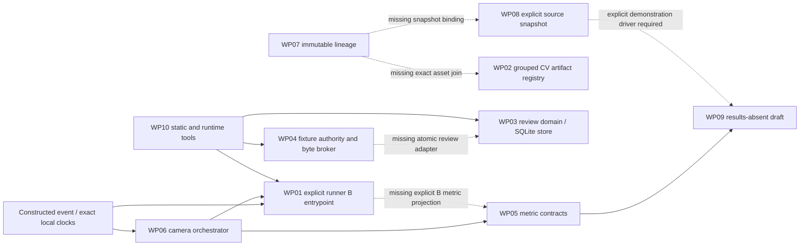

# Mission22 — Architecture and dependency map

Prepared 2026-11-05, America/New_York. Inspected actual source and tests at
`923d4fd39286651aae7b15864c9e5781ad644e24`;38 recorded Python hashes match and
17 source-phase commits exist. Mission21's500 tests are historical evidence,
not this mission's acceptance. The seven pre-existing work files are preserved.

Solid arrows are source-inspected existing calls. Dashed arrows identify
integration gaps at baseline, not completed capabilities. WP06 currently calls
the B coordinator directly; the new demonstration must exercise the public
existing-runner B method explicitly. WP10 validates software; it grants no rights.

| Package / public entry point | Input → output | Internal boundary / failure |
|---|---|---|
| WP01 `EventSimulationRunner.run_frames_convention_b`, `run_pipeline`, `verify_result` | `IntegrationRequest` with canonical constructed frames, exact µs/decimal timestamps and retained settings → `IntegrationResult` and exact `RunResult` | Actual decision engine plus `CausalRunner`; explicit modes, incomplete prefixes and independent replay. No IO. A result/type remains separate. |
| WP02 `allocate`, `role_plan`, `validate_registry`, `verify_receipt` | `SyntheticDataset` + retained allocation/role/inner split/artifact/score registry → allocation and `RegistryReceipt` | FIT/SELECT/initialization DAG checks; no fitting, prediction generation or real split writer. Invalid/unknown/contaminated membership denies. |
| WP03 `ReviewWorkflow`, `ConstructedPlayer`, `ConstructedReviewStore.execute`, `project_constructed_boundaries` | Synthetic role fixtures, neutral PTS, six stateful observations → immutable seals, review commits and non-promotable boundary projection | SQLite journal replay requires retained `(count,head)`; aliases and exposure survive restart. Domain storage itself is not an authorization service. Active8.1/proposed8.2 are projections only. |
| WP04 `ConstructedAuthority`, `ConstructedResourceBroker.use` | Mock grants/current scope + immutable fixture bytes → READ/PROBE/HASH payload and ledger receipt | Same SQLite transaction checks purpose/role/time/fence/quota/resource digest before use. Local roles/clock/anchor are caller trust; no independent identity/OS protection. |
| WP05 `classify_m4`, `summarize_descriptive_rows` | Sampled `SimulationRunResult` and T4; typed rows with reasons → M4/M5 classification and per-metric denominators | OPENING/OPEN and blocked witnesses are distinct. Missing/censored data cannot become zero. Existing input uses A-shaped timeline. |
| WP06 `run_constructed_descriptive` | Explicit camera/condition/source IDs and requests → per-camera receipts, A metric rows and separate B estimators | Rejects source/modality/cohort mismatches; no cross-camera fusion. B1 produces no gate metric. Back audio/stateless are unavailable. |
| WP07 `validate_manifest`, `validate_successor` | Constructed source/derived/annotation records + retained digest → immutable lineage and transitive exposure | Exact same-event parents/roles; no source IO. A digest supplies consistency, not source authenticity or authorization. |
| WP08 `build_source_snapshot`, `write_source_snapshot` | Explicit source/docs path tuple and40-hex code identity → deterministic manifest/content and exclusive new destination | Lexical protected-root denial precedes stat/read; no tree enumeration. Completion marker written last; partial destination remains after failure. |
| WP09 `render_descriptive_support` | No rows, or exact-digest-bound constructed metric rows → Markdown | Results absent or CONSTRUCTED DEMONSTRATION only. Legacy fixed-claim generators refuse before IO. No public release. |
| WP10 local Python/Ruff/Mypy/pytest | Explicit source/test paths → diagnostics and runtime receipts | Mypy2.4.0 restored in Mission21, scoped12-file pass; A instrumentation and disabled optional report bodies remain documented limits. |

## Shared representations and disconnected state

1. Motion input IDs are synthetic frame IDs; CV and review IDs are physical event
IDs; metric rows use a cohort-qualified display slot. No existing service binds
these three namespaces. A typed constructed event manifest must make the join
explicit and must not pretend a display slot is a real V2 event.
2. Input clocks are integer µs or lexical seconds; controllers and A metrics use
float seconds; actuator angles/durations are rational. Conversion/projection
must retain exact source clocks and label its sampled meaning.
3. WP01 has a full retained request, but WP06 returns selected fields and computes
M4/M5 on a newly run A trajectory. These cannot be relabeled as B outcomes.
4. WP02 artifact and WP07 manifest DAGs are independent. Asset IDs, physical
identity, role and exact transitive FIT/SELECT exposure require an explicit join.
5. Authority and review storage both own `BEGIN IMMEDIATE`. Sequential checks
or nesting their public methods cannot provide atomic authorized review writes.
6. WP04 strict integer/NFC codec and WP03 JSON/history schemas are distinct.
A fixture service must version its boundary and validate persisted context on
restart/use; neither mock roles nor local hashes authenticate a real person.
7. Snapshot completion is a filesystem marker, review/authority completion is a
SQLite transaction, and reporting has neither. A driver needs explicit stage
and recovery outcomes rather than treating every file's existence as success.
8. Root pytest conftest reads/hashes `results/experiment_registry.jsonl`. This
mission forbids protected research artifact access; the regression runner must
keep that operation blocked while accounting for all test modules and isolating
incompatible module-import/IO-tripwire suites in separate processes.

The implementation will add adapters around these boundaries. Frozen scientific
constants, historical A behavior, protocol files and live permission guards stay
outside ordinary integration rewrites.
