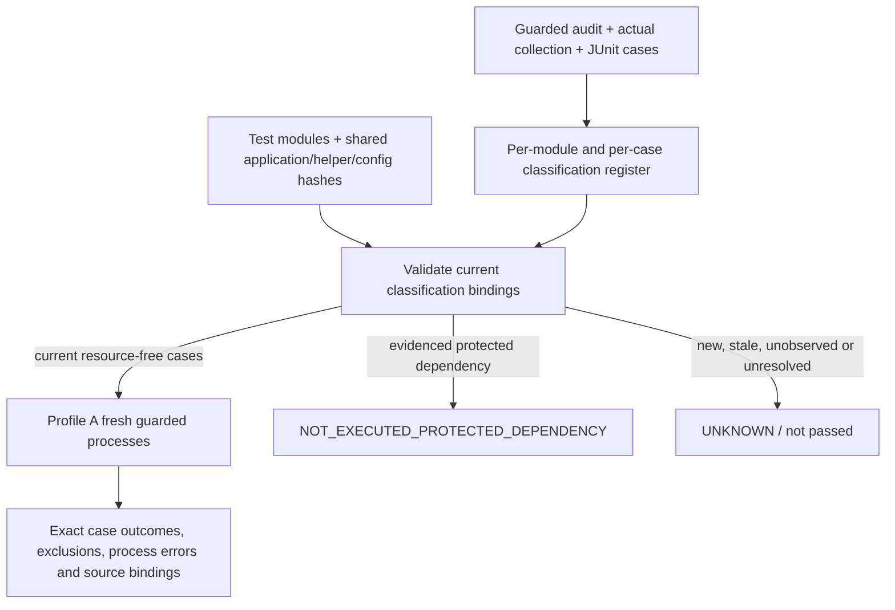

# Mission 23 — Resource-free acceptance

Prepared 2026-11-05, America/New_York. Profile A executes source-bound, observed resource-free test cases under the inherited Mission 22 Python access policy. Profile B remains unavailable and cannot be enabled by this runner. Classification is engineering evidence, not a resource grant.

## Architecture



Every test module has a record; mixed modules are selected by exact pytest node IDs. Module hashes detect edited tests. A conservative shared digest includes application source, scripts, test helpers/conftests, guard implementation and config metadata, including dynamic-import/loader defaults. Changing shared dependencies invalidates prior classifications. New or changed tests default to UNKNOWN. Actual collected cases without results remain UNKNOWN. No unknown classification can silently become safe.

A successful restricted execution is evidence of resource-free software behavior under that policy, including intentional negative guard tests. It does not establish real artifact validity, model performance, genuine human observations or external permission. Protected dependencies require actual refusal diagnostics; the eight indirect cases additionally require inspected source, matching module hash, an explicit dependency-evidence reference and a corroborating fresh protected-path denial.

The original test-access YAML is maintained separately: `sync-inventory` marks new/changed files UNKNOWN with zero invented classifier test counts. It never supplies an original-classifier safe flag from an unexecuted claim. The new register records its own current guarded per-case evidence. All permitted cases are selected; each protected exclusion is listed explicitly and is not counted as passed. Unknowns are listed and make acceptance incomplete.

## Commands

From the existing checkout/environment:

```sh
PYTHONDONTWRITEBYTECODE=1 .venv/bin/python scripts/run_resource_free_acceptance.py validate
PYTHONDONTWRITEBYTECODE=1 .venv/bin/python scripts/run_resource_free_acceptance.py run --output /tmp/mission23-profile-a
```

Choose a new external output directory. The run writes a machine-readable receipt, source bindings, exact commands, actual collection IDs, JUnit/logs and explicit exclusions. Nonzero child exit without JUnit is non-passing; absent test results are never inferred as success. Unexpected policy refusals fail executed tests. Unknown or stale classification is not a green result.

After an authorized source/dependency change, inspect the change and regenerate evidence:

```sh
PYTHONDONTWRITEBYTECODE=1 .venv/bin/python scripts/run_resource_free_acceptance.py sync-inventory
PYTHONDONTWRITEBYTECODE=1 .venv/bin/python scripts/run_resource_free_acceptance.py audit --output /tmp/mission23-reviewed-audit
PYTHONDONTWRITEBYTECODE=1 .venv/bin/python scripts/run_resource_free_acceptance.py refresh --evidence /tmp/mission23-reviewed-audit/receipt.json --dependency-evidence docs/generated/master_reaudit/MISSION_23_PROTECTED_DEPENDENCY_EVIDENCE.json
```

Audit executes the full inventory with resource access denied; it is not Profile B execution or permission to read protected data. Refresh refuses incomplete or changed-source evidence. Existing dependency attestations become ineffective if their module hash or fresh corroborating denial no longer matches. Inspect every newly unresolved case; do not change its category merely to obtain a green total.

## Isolation and limitations

The root conftest and all access guards are retained. As in Mission 22, explicit fresh-process commands replace the root conftest's prohibited real-registry fingerprint with its temporary-registry fixture API plus point-of-use denial of project data/results reads and writes. This is a declared acceptance profile, not stock unrestricted pytest. No test module is silently removed from the audit inventory.

The original 238 suite and other synthetic mission suites retain their separate processes and import/IO tripwires. Legacy modules run in four-module batches to reduce peak temporary storage. Child Python must inherit the deny policy; fixing that inheritance does not permit protected reads. The preservation tests inject empty Git responses for unversioned temporary workspaces instead of declaring arbitrary native programs. A redundant symlink cleanup is delegated to the owning runner after its guarded child exits, preserving the product-refusal assertions.

The runner streams logs, checks available disk before starting groups and cleans only its own generated temporary fixture tree in a finally block while retaining receipts. Machine-level durability, hostile native access and independent identity/clock controls remain unverified. Python audit/profile checks are cooperative controls, not an OS sandbox. Managed-sandbox loopback restrictions may require executing this same guarded command on the ordinary local host; no external network is allowed by the policy.

Final executed counts, unresolved classifications and source hashes are recorded in the final validation and bound execution receipts. Full repository regression remains non-passing whenever protected-resource cases cannot complete; selected Profile A acceptance is a narrower claim.

## Final executed acceptance

Profile A completed in 43 fresh process groups: **3,091 passed,0 failed,0 setup errors,0 skipped**. It executed 148 modules; the register covers all 149 modules. The 118 protected-dependency cases, including the fully protected module, are explicitly `NOT_EXECUTED_PROTECTED_DEPENDENCY`. Unknown cases:0. Exact requested/selected and excluded sets match the validated register; all source bindings remained unchanged.

The separate full guarded audit executed all 3,209 current cases:3,091 passed,87 failed,31 setup errors,0 skipped. Those87+31 non-passes are not converted into successes by exclusion from Profile A. The500 prior package cases, original 238, Mission 22's62 and 23 new cases are included in the passing total. Source/root-conftest/access guards are preserved; no production resource was opened to obtain these results.

MISSION_23_RESOURCE_FREE_EXECUTION_RECEIPT.json records the full selected execution and exclusions. MISSION_23_FINAL_VALIDATION.json binds this receipt, the full audit, classification register,143-case triage and demonstration proof by SHA256. Ruff/syntax cover 15 changed/new Python files; scoped Mypy covers five application/command files. This is selected software acceptance, not protected-resource, genuine-human-review, independent-authority, real-data or production readiness.
