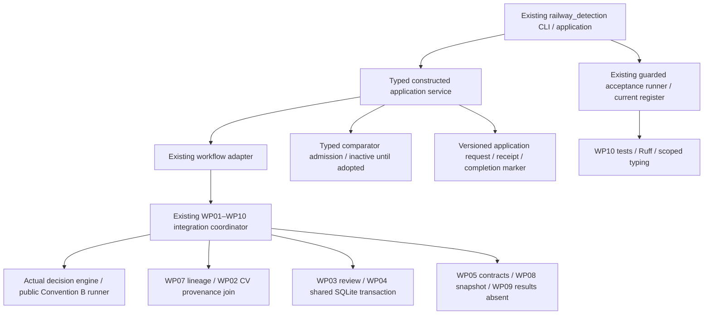

# Mission 24 — Unified application architecture

Prepared 2026-11-05, America/New_York. Baseline `0898a076de1e720ca0c6a85bcad579ae8892b584`, the exact Mission23 final delivery. Local/tracking/live heads match. All prior source/receipt bindings and seven preserved work hashes verify. Mission21–23 reports remain historical records.

The application is an adapter over the existing `integration_workflow.run_demo` coordinator, not a second simulation/review/authorization implementation. Typed application requests, camera/metric/service summaries, evidence classifications and an inactive comparator interface provide the public boundary. The existing project CLI gains an `application` namespace. Source-only acceptance continues through the Mission23 runner and a new source-version-specific Mission24 register; the historical Mission23 register is preserved.

Responsibilities: the coordinator owns exact frame processing and its existing SQLite/history boundary; application adapters validate construction/event/camera/config identities and provide typed summaries. The application owns only its outer request/receipt/completion boundary. No genuine-resource player, protected broker or promotion path is added. Real human records and external inputs remain distinct types and are rejected by constructed execution.

The one remaining comparator definition is M22-COMP-MAPPING. Existing source predicates are history-dependent and do not define eight stateless commands. One consolidated decision request has been sent; unrelated work continues. Technical admission/validation may be implemented while every command remains unavailable. No new scientific rule, EMA, confirmation count, back audio or resource permission is inferred.

## Implemented application responsibilities

| Boundary | Versioned interface | Owner and limits |
|---|---|---|
| CLI → application | ApplicationRequest / CONSTRUCTED_APPLICATION/1 | Explicit seed/event/camera/code identity; no live flags. Duplicate fields and external/pending origin refuse. |
| Application → coordinator | WorkflowPort / WorkflowExecution | ExistingWorkflowAdapter contains legacy wire dictionaries; constructed camera/metric/service summaries leave as immutable dataclasses. |
| Coordinator → fixture resource access | ResourceAccessPort / TYPED_FIXTURE_ACCESS/1 | Existing broker owns current scope checks, byte access, ledger/quota transaction and exact retry. Adapter opens no resource path or second ledger. |
| Coordinator → review | ReviewServicePort / TYPED_REVIEW_REQUEST/1 | Existing domain/store/service own immutable seals/exposure/corrections and one SQLite transaction with authority. Coarse access role and fine domain role remain separate. |
| Camera input → comparator | INACTIVE_BACK_COMPARATOR/1 | Exact observed/receivedµs, producer snapshot and full masks/availability; null commands only. User explicitly retained inactivity. |
| Coordinator → metrics/provenance/report | Existing WP05/WP07/WP02/WP08/WP09 contracts | Exact sampled B software metrics, source/artifact/role/exposure joins, explicit source snapshot and results-absent report. No empirical values. |
| Application → persistence | APPLICATION_ARTIFACT_SET/1 | Outer three-artifact digest closure over request, receipt and nested completion; nested nine-artifact/core SQLite state remain separately owned. |
| CLI → acceptance | Existing resource-free runner with Mission24 register | All permitted cases executed in isolated processes; protected exclusions and unknowns remain distinct from passes. Historical Mission23 register is unchanged. |

The implemented workflow order is: validate application request → establish exact deterministic fixture identity → invoke existing scoped fixture-byte/read and camera/B processing → preserve A/B and command/actuator state distinctions → metric and lineage/CV contracts → typed fixture review/authority history → explicit snapshot/results-absent reporting → inactive comparator diagnostics → typed application receipt → outer completion. Lineage and permission are distinct; comparator diagnostics never influence native controller commands.

User decision in the current conversation: “Retain inactive comparator (Recommended)”. This supersedes the initial pending-response note for this mission; it does not fill any scientific mapping cell. All independent application work continues under the existing authorized engineering scope.
