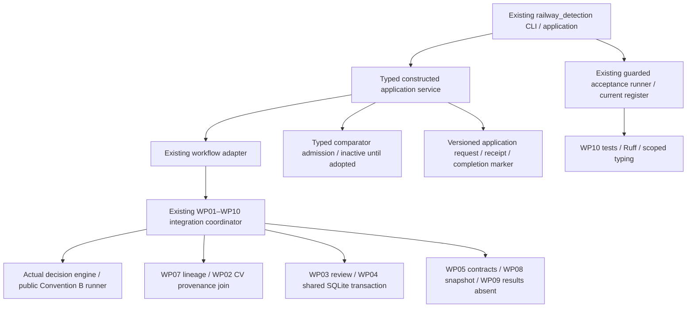

# Mission 24 — Unified application architecture

Prepared 2026-11-05, America/New_York. Baseline `0898a076de1e720ca0c6a85bcad579ae8892b584`, the exact Mission23 final delivery. Local/tracking/live heads match. All prior source/receipt bindings and seven preserved work hashes verify. Mission21–23 reports remain historical records.

The application is an adapter over the existing `integration_workflow.run_demo` coordinator, not a second simulation/review/authorization implementation. Typed application requests, camera/metric/service summaries, evidence classifications and an inactive comparator interface provide the public boundary. The existing project CLI gains an `application` namespace. Source-only acceptance continues through the Mission23 runner and a new source-version-specific Mission24 register; the historical Mission23 register is preserved.

Responsibilities: the coordinator owns exact frame processing and its existing SQLite/history boundary; application adapters validate construction/event/camera/config identities and provide typed summaries. The application owns only its outer request/receipt/completion boundary. No genuine-resource player, protected broker or promotion path is added. Real human records and external inputs remain distinct types and are rejected by constructed execution.

The one remaining comparator definition is M22-COMP-MAPPING. Existing source predicates are history-dependent and do not define eight stateless commands. One consolidated decision request has been sent; unrelated work continues. Technical admission/validation may be implemented while every command remains unavailable. No new scientific rule, EMA, confirmation count, back audio or resource permission is inferred.
