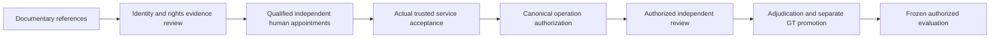

# Provenance and Authorization Gates for a Railway-Crossing Research Workflow

Original methods manuscript preparation draft, 2026-11-06. Human authors, affiliations and venue are unresolved. This draft was prepared with AI assistance; actual human factual verification, authorship/contribution agreement, disclosure approval and artifact-specific R-PUB review remain pending. It is not submitted, accepted or cleared for external publication. No original recording, checkpoint, private human record or third-party figure is reproduced.

Preparation status does not imply repository confidentiality: this original draft is included in the expressly requested Git documentation delivery. That delivery supplies no journal submission or protected-asset release authority.

## Abstract

Research software may be extensively tested before the evidence needed for empirical research is available. This paper describes an implemented workflow for separating documentary references, constructed validation, source verification, review readiness and operation-specific authorization in a railway-crossing research project. The workflow preserves a fixed single-site descriptive protocol while tracking unresolved source identity, rights, human-review and service prerequisites. Its present evidence consists of permitted code and configuration text, documentary records, historical reports and guarded software-validation receipts. The candidate inventory contains 27 documentary events; none is promoted here to a recording with independently verified identity. Historical vision and audio metrics are treated as provenance limitations rather than event-level research results. The methodological contribution is a traceable boundary between implemented engineering and claims that require genuine authorized observations. Real-data evaluation, human annotation, ground-truth promotion and physical railway operation were not performed in this work. We identify an original methods manuscript as a defensible preparation activity, with empirical execution blocked and external publication subject to actual human and artifact-specific release review.

## 1. Problem and scope

A research project can possess model paths, annotation interfaces and apparently precise historical metrics without having authenticated the recordings, established exact-member rights or appointed independent reviewers. Treating these different states as interchangeable can produce unsupported scientific claims. The practical problem examined here is how to preserve useful engineering work while preventing it from becoming a substitute for missing empirical evidence.

This account concerns the documented workflow of the Train Gate Automation repository at the Mission29 evidence reconciliation. The empirical scope remains a descriptive study at one crossing, `crossing_A`. Its documentary inventory contains 23 train candidates, three no-train candidates and one engine-only candidate. Two previously excluded duplicate camera references remain excluded. The adopted R04 subset contains exactly 11 events. A proposed hard-case pilot contains five events and ten source references. These are inventory and planning facts, not verified sample counts for a completed experiment, acquisition signoff or independent recording authentication.

Three explanatory questions organize this methods account: how can evidence states remain explicit across a workflow; how can verification, readiness and authorization remain distinct; and what conclusions can constructed software checks support? These questions organize the manuscript and do not replace the adopted empirical research questions or introduce new scientific thresholds. No claim of methodological novelty follows from this bounded project account.

## 2. Documentation context

Datasheets for Datasets discusses documenting dataset composition, collection and intended uses [1]. Model Cards for Model Reporting discusses structured reporting of model use, evaluation context and limitations [2]. These works provide context for recording provenance and boundaries. Neither establishes that this project's source records are authentic, that its model results are reproducible, or that its railway workflow is effective. The following description concerns the implementation and documentary evidence of this project, rather than an independent comparison against those reporting approaches.

## 3. Evidence states and decision boundaries

The workflow distinguishes a documentary reference from a physical source with verified identity. A file path or member identifier can link documents without proving that an original exists, that it is the claimed acquisition, or that the person presenting it has custody or use rights. A constructed fixture has an explicit testing role and cannot become an original recording merely by passing a schema check. A historical result can be attributed accurately while remaining unreproduced and unsuitable for an empirical conclusion.

Mission29 uses separate categories for verified genuine sources, documentary references, constructed test fixtures, historical results with limitations, unverified external references, protected resources not accessed and unknown evidence. Its register has 182 evidence items, encompassing source references, resource pointers, historical rows, software receipts and bibliographic records. This is not a recording count. None is classified as a genuine source with verified identity. A checked bibliographic entry authenticates the existence of a cited publication, not the external dataset or model discussed elsewhere in the repository.

Readiness asks whether prerequisites are satisfied. Verification asks whether attributable evidence actually supports an identity, right, appointment or other fact. Authorization concerns a particular actor, source, operation, purpose, environment and valid scope. A selected operation is not a grant. Readiness cannot issue a grant, and a successful validation report cannot authenticate an owner declaration or invent a human reviewer. Any future authorized execution must use the existing canonical operation-specific process.

The current repository reconciliation compared the existing permitted discovery fingerprints: 541 text documents were unchanged, with no new, changed or missing item in that scope. The root report's document XML also remained unchanged. No embedded media was read. Targeted reads of unchanged historical documents were necessary to audit requested metrics and contradictions. This bounded observation does not establish that evidence exists nowhere else; it establishes that this permitted repository intake supplied no new original.

## 4. Implemented workflow and outstanding integration

The repository implements canonical schema and metric checks, governance/preflight, provenance and review-event contracts, annotation/intake interfaces, and guarded resource-free acceptance. A bounded Mission29 checker binds specific documentary inputs, checks claim and publication restrictions, and emits a deterministic consistency report. It accepts only a fixed manifest of reviewed text and code paths. It does not follow raw-resource references stored inside records, authenticate external evidence or grant source access.

The conceptual sequence is:

The diagram is an original conceptual description, not a record of completed steps. Actual source identity/rights evidence, reviewer appointments, service integration and authorization remain missing. Interfaces or constructed service implementations demonstrate bounded code behavior, not the acceptance of a real player, identity service, trusted clock, protected storage system or revocation authority.

The workflow retains the existing version 8.1 canonical validator and its 30-second plausibility semantics. This plausibility condition is not a newly validated scientific sufficiency threshold; RD046 remains deferred. The eight-mask comparator remains inactive until its scientific mapping is separately adopted. No new service layer or operational railway controller was built for this manuscript preparation.

## 5. Data rights and human-review protocol

The current records contain 63 identity-unknown source references. Rights are 62 unknown and one partially documented; none has independently established exact-source operation scope, and all 630 individual rights-dimension states remain unknown. Partial upstream or software-license documentation does not establish recording ownership, downloaded member terms, checkpoint lineage or permission for a particular use. Original acquisition/member/custody evidence and exact-member owner/license evidence are the first empirical prerequisites.

Institutional, participant, privacy and site requirements depend on actual involvement and access circumstances. The workflow permits an attributable project-specific non-applicability determination where appropriate, without inventing approval requirements or treating absence of evidence as approval. Nine external questions remain unresolved. Optional appointment of an external auditor remains separate from the mandatory independent second review.

The documented human protocol requires an actual qualified primary reviewer, a distinct independent second reviewer and a separate adjudicator. Appointments must establish identity, assignment, competence, independence/exposure/conflicts and current source-access scope, with applicable validity and revocation. Independently collected observations must precede adjudication. Ground-truth promotion is a separate scoped operation and cannot be inferred from an interface accepting a record. No actual reviewer was appointed or qualified in this work, and no human observation, adjudication decision or ground-truth promotion is reported.

Physical T2 remains deferred. Acoustic alignment cannot shift ground truth or establish physical entry, and no new exit definition is introduced. These restrictions prevent missing physical landmark evidence from being replaced by a convenient model or waveform observation.

## 6. Historical model and event evidence

Historical results are used here solely to explain why documentary precision does not establish event-level validity. They are not primary empirical results of this manuscript.

The README reports a YOLOv8n still-image result with mAP50 0.9946, mAP50:95 0.8550 and 487 objects, associated with 3,165 cropped images. It names partition `705d388743ea`, `development_fallback`, leakage risk true and ungrouped fallback allowed. Those conditions prevent interpretation as independent event-level generalization or validated railway-crossing performance. Current stricter split configuration cannot retrospectively repair the reported historical split. Single-class wording in the README also differs from the frozen front/rear/side class mapping; the exact evaluated asset interpretation is unresolved. No split artifact or production checkpoint was accessed to resolve it.

For Audio V3, the README labels F1 0.869 and AUC 0.961 as validation. The detailed V3 report places window F1 0.8690 and ROC AUC 0.9613 on a test set reported as 182 windows from 26 recordings; it separately reports validation F1 0.9942 at threshold 0.3700 and recording-level test F1 0.8667/AUC 0.9408. These are attributed report counts and metrics, not recordings verified here. The validation/test-label conflict is retained. The report describes source/fold grouping, but the original split and model were not independently verified. The frozen checkpoint hash remains configuration-declared only. Feature settings also differ across historical documents. Audio V2 remains prohibited by the retained guards and provenance/configuration restrictions; no audio inference was run.

Historical event documents disagree on `event_010`: one calls a reported +2.7158-second acoustic versus −17.0-second metadata alignment conflict resolved via audio, another marks it ambiguous, and another claims calibration support with visual corroboration. This paper chooses none of those assertions as ground truth. R04 remains exactly its adopted 11 events, excluding event_010. Likewise, reports of T0 left-censoring include both 20/23 and 23/23. No recording or original annotation was inspected to decide between them.

Historical real M4/M5 diagnostics lack approved T4/evaluable event truth; a null rate is not a measured zero rate. Reported MTR values near 3.6–3.8 seconds have documentary timing and censoring qualifications and cannot be promoted to physical lead-in, a regulatory threshold or a fresh feasibility result. The historical-results register binds exact source documents, configuration identities, split descriptions, metric roles, permission restrictions and reproducibility limitations for each case.

## 7. Software validation and its interpretation

Mission28's selected guarded resource-free acceptance passed 3,614 cases with zero failures, setup errors or skips; 118 protected dependencies remained excluded and unknown classifications were zero. This is a source-bound engineering result, not a statistical sample of railway operation. Mission29 adds 35 constructed claim/pathway/publication consistency and refusal cases. Mission29 selected acceptance passed 3,649/3,649 with zero failures, setup errors or skips, excluding the same 118 protected dependencies with zero unknown classifications. All earlier Mission28/27/26 selected IDs ran within this superset. The full guarded audit separately recorded 3,649 passes, 87 protected-dependency failures and 31 protected-dependency setup errors; it is not a successful execution of those protected cases. Execution status and exact case overlap are supplied in final-validation and per-case receipts. Counts from repeated runs or overlapping subsets must not be added.

Checks exercise consistency and refusal behavior, including attempted promotion of documentary evidence to genuine identity, unsupported field claims, invented rights, historical-result alteration and improper release. A valid documentary package means only that the bounded claims and restrictions are internally consistent with its bound inputs. The checker explicitly excludes assurances of source authenticity, legal clearance, canonical authorization and empirical scientific validity. Deterministic output does not authenticate the underlying historical facts.

The execution policy uses Python deny hooks and isolated temporary work directories. It is not OS isolation or an exhaustive security certification. Guarded audit refusal outcomes for unavailable protected dependencies are reported separately from the selected resource-free pass set. No whole-repository acceptance claim is made. No original media, checkpoint, production cache or protected human-review corpus was opened, decoded or hashed.

## 8. Authorized future evaluation

Empirical research requires original evidence, independently verified rights and identities, applicable external determinations, actual qualified independent reviewers, accepted services and current canonical authorization. Only after those prerequisites should the fixed pilot proceed through authorized review, adjudication and separate ground-truth promotion. Protocol, configuration and provenance must then freeze before real-data evaluation. No such execution occurred here.

The adopted analysis treats cameras independently for primary reporting and fusion as exploratory. Audio is supporting evidence, never gate-control authority. M4 remains the primary measure, M5 its integer companion and MTR a feasibility screen. Each metric requires its own evaluable denominator and censoring/uncertainty record. Missing evidence must not become a zero result or a global exclusion silently applied to unrelated metrics. The engine-only candidate remains separate. Descriptive error analysis must distinguish source uncertainty, human disagreement, model behavior and protocol eligibility without inventing an inferential test or new threshold.

The future-experiment plan retains the existing conditions and R04 scope; the already provisional back-camera audio condition remains dependent on actual availability. It does not authorize new recording, training, calibration, official split creation or comparator mapping. Every proposed experiment remains conditional, with inputs, rights, human evidence, authorization, eligibility and stop conditions specified separately.

## 9. Threats, rights and research direction

The strongest limitation is unavailable empirical evidence: this workflow has not established real-world detection accuracy, direction classification, weather/night/fog/rain robustness, real-time performance, human-review accuracy, physical occupancy, safety improvement or cross-site generalization. Fixture coverage cannot answer those questions. Historical leakage and contradictory labels constrain reuse of old model results. Even a future authorized descriptive study at one crossing would not by itself establish generalization to other sites.

The present task authorizes original manuscript preparation and scoped Git documentation delivery. It does not establish ownership from repository presence, make the proprietary prototype open source, permit copied code/third-party figures, authorize raw data/model release or approve external submission. This draft therefore uses original conceptual prose and qualified summaries. Actual human authors must verify facts, contributions and AI disclosure and complete artifact-specific R-PUB/release review before external publication. Venue selection and acceptance remain unresolved.

The current research direction is an evidence-bounded methods manuscript, followed by actual human revision and release review. Core engineering should freeze because no material new core defect was demonstrated that blocks this next authorized step. Reopening should follow a reproduced material defect, a genuine accepted integration requirement or a separately adopted scientific requirement. In parallel, the responsible humans should pursue the original custody and owner evidence already requested. This finite direction preserves useful implemented work without portraying an engineering milestone as scientific completion.

## References and internal evidence

[1] Timnit Gebru et al. *Datasheets for Datasets*. Original preprint 2018, revised 2021. [Primary record, version 8](https://arxiv.org/abs/1803.09010v8).

[2] Margaret Mitchell et al. *Model Cards for Model Reporting*. 2019. [Primary record, version 2](https://arxiv.org/abs/1810.03993v2). DOI: 10.1145/3287560.3287596.

Internal audit trail: MISSION_29_SOURCE_SCIENTIFIC_EVIDENCE_REGISTER.json, MISSION_29_HISTORICAL_RESULTS_REGISTER.json, MISSION_29_SCIENTIFIC_CLAIMS_REGISTER.json, MISSION_29_PUBLICATION_RIGHTS_REGISTER.json, MISSION_29_FINAL_VALIDATION.json and their bound Mission28/source-document references. The previous descriptive paper is preserved as a historical document; its superseded T0–T4 definitions, R04 count, censoring and author/verification statements are not adopted here.
