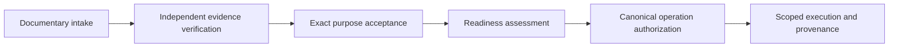
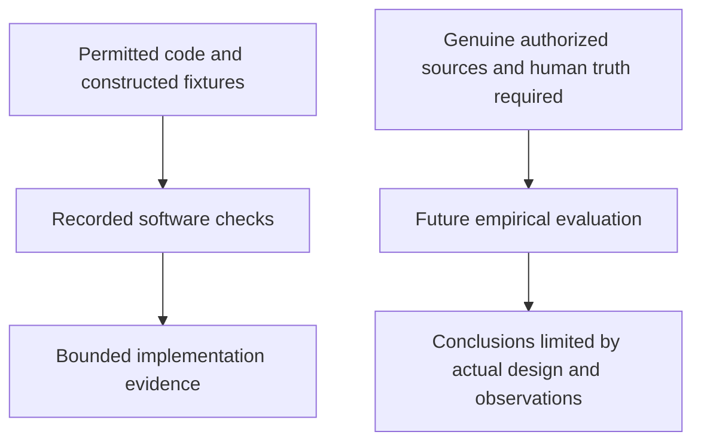
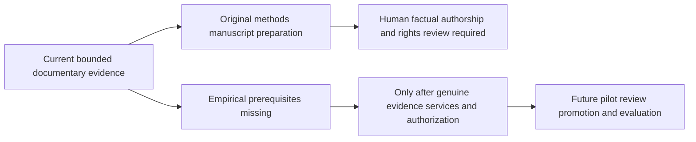

# Provenance and Authorization Gates for Single-Site Railway-Crossing Research: An Implemented Workflow and Documentary Case Study

**Status:** HUMAN_REVIEW_REQUIRED_NOT_SUBMISSION_AUTHORIZED

**Draft date:** 2026-11-07, America/New_York

**Documentary snapshot:** Mission29 final delivery `20d2c9b3edbd62201ca9ce57afaab5167f8bc987`; its tested implementation is `890f60e12e8d3b58c58f160397b68964c7f3252a`.

**Human authors:** [HUMAN COMPLETION REQUIRED]

**Affiliations and ORCID identifiers:** [HUMAN COMPLETION REQUIRED, where applicable]

**Corresponding author and contact:** [HUMAN COMPLETION REQUIRED]

**Authorship approval, contributions, funding and conflicts:** [HUMAN COMPLETION REQUIRED]

This original draft uses AI-assisted writing and documentary checks. Human factual verification and approval of the AI-use disclosure remain pending. No AI is listed as an author. The requested Git documentation delivery does not authorize journal submission, confer publication clearance, or release protected data, models or human records.

## Abstract

Research software can implement annotation, provenance and metric contracts before the evidence needed for empirical evaluation is available. We describe an implemented workflow and documentary case study that separates evidence classification, verification, readiness, operation-specific authorization and execution in a single-site railway-crossing research project. The account draws on permitted repository documents, source code and recorded software-validation receipts. Its documentary inventory contains 27 candidate events; these are planning counts rather than authenticated experimental samples. Historical vision and audio results retain their split, model-identity and reproducibility limitations, including conflicting labels and event records. Recorded selected resource-free acceptance passed 3,649 software cases, while 118 protected dependencies remained excluded. These checks support bounded implementation claims and do not establish detection performance, human-review accuracy or railway safety. Source identity and exact-member rights remain unresolved, no qualified reviewers have been appointed, and no genuine annotation, ground-truth promotion or real-data evaluation was performed for this account. The contribution is an explicit, implemented separation between engineering evidence and prerequisites for empirical research, together with an auditable record of claims that cannot presently be made. Further work requires actual source and rights evidence, qualified independent human review, accepted services and canonical operation authorization. External submission remains unauthorized pending human authorship, factual and artifact-specific publication review.

**Keywords:** research provenance; research software; documentary evidence; operation-specific authorization; human annotation; railway-crossing research; reproducibility.

**Research contribution statement.** This manuscript provides a bounded description of an implemented workflow, its evidence-state model, human-review governance and constructed software validation. It presents a documentary case study of how unresolved provenance limits historical metrics and future execution. It does not establish a novel general method, validate a railway intervention, or report new empirical railway experiments. Methodological design, software implementation and empirical validity are assessed separately.

## 1. Introduction

A model score is meaningful only in relation to what was evaluated, how the data were partitioned and which model and protocol produced it. A repository may retain a precise metric while lacking independently authenticated recordings or a reproducible connection between the metric, split and checkpoint. Computer-vision research also depends on permission to use particular assets for particular purposes. Documentation of a dataset or software license does not, by itself, establish ownership or exact-member use rights.

This case study addresses a practical research-management problem: how to document implemented software honestly when genuine source evidence and review prerequisites remain unresolved. The repository contains annotation and provenance contracts, a review lifecycle and recorded software validation. Its empirical pathway nevertheless remains blocked. The account therefore examines what the software and documentary record support, rather than attempting to fill the evidence gap with generated annotations or new synthetic demonstrations. [D1, D2, D4]

Three questions organize this methods account: **RQ-M1**, how are different evidence states represented without promoting a reference into a verified recording; **RQ-M2**, how are verification, readiness and authorization separated across a research workflow; and **RQ-M3**, what conclusions are justified by the recorded software checks? These explanatory questions organize the manuscript. They do not replace the previously adopted empirical questions, reopen research decisions or introduce scientific thresholds.

The contribution has six distinct parts: a documented research methodology; implemented research-software contracts; a provenance and rights workflow; a specified human-review protocol; bounded constructed/software validation; and an explicit account of empirical evaluation that has not occurred. Only the first five can presently be described as design or engineering contributions. Their existence does not validate the sixth. The manuscript is intended for human factual, authorship and rights review; its novelty and venue suitability remain matters for further assessment.

## 2. Related Work

Gebru et al. propose dataset documentation covering collection, composition and intended use [1]. This supplies context for recording the origins and limitations of candidate data. Our evidence-state distinctions concern the separate question of what the project can establish from its current records. A completed document would not itself authenticate a source or establish project-specific permission.

Mitchell et al. propose model reporting that identifies intended applications, evaluation context and limitations [2]. This motivates keeping a reported metric attached to its stated model and evaluation conditions. It does not validate this implementation, resolve historical split conflicts or supply missing model assets.

Sandve et al. discuss recording computational procedures, versions and analysis details so that results can be reproduced [3]. This informs the manuscript's distinction between traceable software records and unavailable empirical reproduction. Recording a declared identity is useful, but it is not equivalent to independently verifying the asset that identity describes.

These references provide reporting and reproducibility context rather than a comparative evaluation of authorization workflows. The discussion remains insufficient for a claim of novelty or comprehensive related-work coverage. Further literature verification should address event-independent video evaluation, annotation reliability, human factors in review and provenance/access workflows. Domain-specific railway evidence and any applicable legal or institutional requirements require separate assessment. The accompanying literature register identifies these gaps; no unverified candidate is used as a citation here.

## 3. Research Context and Scope

The documented research setting is one crossing, `crossing_A`. The candidate inventory comprises 23 train candidates, three no-train candidates and one engine-only candidate, totaling 27. Two duplicate camera references remain excluded. The restricted R04 exploratory subset contains exactly 11 events. A proposed hard-case pilot contains five events and ten camera references. These are documentary inventory and planning counts, not authenticated recordings, signed-off acquisition counts or verified experimental sample sizes. [D1]

The adopted direction retains independent-camera primary analysis. Front approach and back clearance outcomes retain their own source-clock and observation requirements. Cross-camera fusion remains exploratory within the exact R04 scope. Audio supplies supporting evidence and cannot independently initiate gate lowering or grant clearance. The engine-only candidate remains separate from train-event metric denominators. These are protocol constraints, not demonstrated camera or audio performance. [D2, D7]

No physical source was authenticated, no actual reviewer was appointed or qualified, and no genuine human observation or real-data experiment was produced for this account. The permitted basis is repository text, source code, historical reports and existing software receipts. Protected recordings, checkpoints, caches and review corpora were not opened, decoded or hashed. This bounded documentary scope does not establish that evidence exists nowhere else.

## 4. Evidence Provenance Model

Table 1 defines the evidence categories used by the documentary baseline. Categories describe the evidential role of an item; they are not interchangeable grades on a single readiness scale. In particular, a genuine identity would still require separate use rights and authorization. [D1]

**Table 1. Evidence-state taxonomy. No genuine identity is established in this account.**

| Category | Interpretation | Boundary |
|---|---|---|
| Genuine source with verified identity | Independently supported identity of a particular original | Does not itself establish permission or evaluation validity |
| Documentary reference only | A path, identifier, inventory entry or attributable document | Does not authenticate a physical recording |
| Constructed test fixture | Input made for software checking | Cannot substitute for a recording or human judgment |
| Historical result with limitations | A previously reported result retained with its provenance | Does not become independently reproduced evidence |
| Unverified external reference | An external assertion or source not independently established for its stated purpose | Remains unverified; absence is not a negative finding |
| Protected resource not accessed | A resource whose contents were outside this work's permitted access | No content-based conclusion is drawn |
| Unknown | Evidence is insufficient for the requested determination | Must not be filled with an invented identity or outcome |

The baseline classifies 182 evidence items, including source references, historical rows, software receipts and bibliographic records. This is not a count of recordings, people or experiments. No item is promoted here to a genuine source with verified identity. A verified bibliographic record establishes the existence and stated content of a publication; it does not verify this project's recordings or rights.

Verification, readiness and authorization answer different questions (Table 2). Document submission initiates a reviewable record. Verification requires attributable evidence and a competent verifier. Purpose acceptance concerns a specific supported use. Readiness evaluates prerequisites, while authorization is an exact operation decision. Execution and its output provenance follow only within that authorized scope. [D2, D6, D9]

**Table 2. Research readiness and authorization are distinct determinations.**

| Determination | Question | Insufficient substitute |
|---|---|---|
| Verification | Does attributable evidence support this identity, right or appointment? | A valid schema or self-declared status |
| Readiness | Are the required prerequisites satisfied for the proposed operation? | Implemented interfaces or a selected operation |
| Authorization | May this actor perform this operation on these sources for this purpose, environment and valid scope? | A favorable readiness or consistency report |
| Execution evidence | What actually ran, with which inputs and outputs? | A proposed plan or authorization alone |
| Scientific validity | Do observations and design support the stated conclusion? | A successful software run alone |

**Figure 1. Conceptual evidence-to-authorization workflow; arrows show dependencies, not completed transitions.**

A failed prerequisite may be documented and reviewed without circularly requiring a future execution grant. At point of use, however, an operation must have its own current authorization. Neither this manuscript nor its consistency checks issue such a grant.

## 5. Implemented Software Architecture

The architecture comprises existing canonical schema and metric validation, governance/preflight, provenance and review-event contracts, documentary evidence intake, a human-review lifecycle and guarded resource-free acceptance. The version 8.1 canonical validator retains its existing 30-second review-duration plausibility floor. That software condition is not a newly validated scientific sufficiency threshold; the relevant sufficiency decision remains deferred. [D6, D9]

Provenance and review-event contracts represent source, reviewer, permission, batch and observation metadata. Lifecycle code supports assignment, retained observations, adjudication and separate promotion records. Its implementation explicitly requires deployment-supplied verification for genuine intake. Documentary intake retains submission and verification states and audit history; its output does not authorize source access. These are implemented contracts and state transitions, not evidence that a real institution or reviewer has accepted their deployment. [D9]

Preflight checks bind the preserved operation selections and resource/purpose metadata. The historical 27 selections retain 21 conditional and six denied/deferred outcomes. An operation's selection does not establish its current permission. No new operation is adopted in this manuscript. The Mission29 documentary checker loads a fixed set of reviewed text inputs, checks consistency and restrictions, and emits deterministic reports. Its explicit assurance excludes source authenticity, legal clearance, canonical authorization and empirical scientific validity. [D4, D9]

The acceptance tooling binds permitted test, source, configuration and named documentary inputs to per-case evidence. Source binding can identify changed text within its closure; it cannot prove that a referenced recording or checkpoint is the claimed asset. Likewise, implemented interfaces do not establish acceptance of actual source presentation, identity, trusted time, protected storage or revocation services. Those real integrations remain missing. The present manuscript changes no core software and adds no service, model, synthetic demonstration or execution route.

## 6. Rights and Human-Review Protocol

The source references remain identity-unknown, and exact-member rights are unresolved (Table 3). The collection-level partial status does not resolve any of the separately assessed rights dimensions. Acquisition/member/custody evidence must establish origins and relationships to the inventory; owner or applicable exact-member license evidence must establish scope. Permissions for storage, processing, annotation, evaluation, publication and other uses cannot be transferred implicitly between dimensions. [D4, D5, D6]

**Table 3. Documentary identity and rights state at the bounded baseline.**

| Item | Recorded state | Interpretation |
|---|---|---|
| Source references | 63 identity-unknown | Not 63 verified recordings |
| Overall rights status | 62 unknown; one partially documented | No exact-source operation grant established |
| Individual rights dimensions | 630 unknown assessments across ten dimensions | Partial upstream documentation is not purpose acceptance |
| External applicability questions | Nine unresolved | Approval and non-applicability are both unestablished |
| Actual qualified appointed reviewers | Zero | Role specifications are not appointments |
| Five-event pilot | Not ready | No current canonical execution authorization |

Actual institutional, site, privacy and participant requirements depend on involvement, jurisdiction and access circumstances. The project needs attributable, scoped determinations from relevant actual authorities where applicable. A reasoned non-applicability determination can be appropriate; neither universal approval requirements nor blanket exemptions are assumed. No authority was contacted and no approval was inferred in this work.

**Table 4. Human-review roles and required evidence; no appointments are established.**

| Role | Required evidence | Separation requirement |
|---|---|---|
| Primary reviewer | Actual identity, assignment, relevant competence, conflicts/exposure and current source access | Genuine independent first-pass observations |
| Independent second reviewer | Distinct identity, appointment, competence, independence and exact access scope | Cannot be the primary person renamed; independent observations retained |
| Adjudicator | Separate qualified appointment and adjudication scope | Acts on the required independent parents; preserves unresolved uncertainty |
| External auditor, if appointed | Actual appointment, competence, independence and access | Optional audit does not replace mandatory second review |

Source presentation should retain original clock provenance while withholding model candidates and earlier comparison values during the blind first pass. Applicable independent-review triggers and risk audit remain those already adopted; no fixed audit percentage is introduced. Adjudication follows independent observations, and ground-truth promotion remains a separately authorized operation. The protocol has not demonstrated annotation accuracy or inter-reviewer agreement: there are no genuine observations from which to estimate either. [D2, D6]

## 7. Historical Results and Provenance Limitations

The eight historical categories in Table 5 are limitation and provenance notes, not primary empirical results. Their numeric precision does not resolve source identity, rights, model lineage or evaluation design. The focused accuracy audit records exact document sections and lines separately, allowing the manuscript to avoid exposing protected source paths. [D3]

**Table 5. Attributed historical reports; none was independently reproduced for this manuscript.**

| Category | Reported record | Required limitation |
|---|---|---|
| H29-VISION | YOLOv8n mAP50 0.9946; mAP50:95 0.8550; 487 objects and 3,165 cropped images | `development_fallback`; leakage risk true; ungrouped fallback allowed; no event-independent generalization |
| H29-AUDIO-README | Validation-labeled F1 0.869 and ROC AUC 0.961; threshold 0.3700 | Split-role conflict with the detailed report retained |
| H29-AUDIO-REPORT | Validation F1 0.9942; test-window F1 0.8690/AUC 0.9613; recording F1 0.8667/AUC 0.9408 | Window/recording/validation/test roles remain separate; model identity unverified |
| H29-AUDIO-V2 | Prohibited model in retained configuration and guards | No loading, hashing, execution or rehabilitation |
| H29-SYNC010 | Acoustic +2.7158 s versus metadata −17.0 s; reported discrepancy 19.72 s | Documents disagree on resolution; no ground-truth shift or R04 expansion |
| H29-T0 | Both 20/23 and 23/23 left-censored reported | No choice between conflicting reports and no newly observed censoring rate |
| H29-M4M5 | Historical report records non-evaluability and null outcomes | Missing approved clearance truth; null is not measured zero |
| H29-MTR | Historical simulation/timing diagnostics | Not an approved railway standard or verified physical lead-in |

The README attributes the vision scores to a development-fallback partition and reports image-level leakage risk. Object and cropped-image counts are not independent train events. Its single-class train description also differs from the frozen configuration's front/rear/side mapping. That asset-description inconsistency remains unresolved; appearance classes do not validate travel direction. A stricter current grouping configuration cannot retrospectively repair the reported split.

For Audio V3, the detailed report describes threshold selection on validation at 0.3700 with validation F1 0.9942. It reports test-window F1 0.8690 and AUC 0.9613 over 182 windows from 26 recordings, and recording-level F1 0.8667/AUC 0.9408 using max-window pooling. These are attributed report counts and outcomes, not authenticated assets examined here. The README instead labels its rounded 0.869/0.961 pair as validation. The rounded AUC and split-role disagreement are different issues: numerical closeness does not reconcile the label or establish replication. Configuration-declared checkpoint hashes were not verified against weights. Historical mel-band and transform-setting descriptions also conflict. Audio V2 remains prohibited, irrespective of earlier favorable scores.

For event_010, historical documents respectively assert resolution via audio, ambiguity, and support with claimed visual corroboration. No assertion is selected as ground truth. Acoustic offsets cannot shift human video timestamps or substitute for physical T2. The event remains outside the adopted exact eleven-event R04 subset. Historical T0 statements likewise retain both 20/23 and 23/23 without converting either into a current empirical rate.

Historical M4/M5 documentation reports missing approved T4 clearance truth and non-computable outcomes. An unavailable rate or count cannot support a measured zero or an improvement claim. MTR timing accounts depend on simulation stepping, sampling and censoring conventions. Recording pre-roll is not physical approach lead-in. Historical values around 3.6–3.8 seconds are therefore not adopted as a railway standard, a new threshold or a newly validated physical measurement.

## 8. Software Validation

Table 6 reports existing receipts, not tests newly executed for this manuscript. The selected sets overlap: Mission29 contains all Mission28, Mission27 and Mission26 selected case IDs. Their counts must not be added as independent evidence. Mission29's 35 new constructed cases check documentary consistency and refusal behavior; they are not 35 railway experiments. [D4]

**Table 6. Recorded software-validation scope. “Errors” means setup errors.**

| Recorded run | Passed | Failed | Errors | Skipped | Protected dependency scope |
|---|---:|---:|---:|---:|---|
| Mission28 selected acceptance | 3,614 | 0 | 0 | 0 | 118 excluded |
| Mission29 selected acceptance | 3,649 | 0 | 0 | 0 | Same 118 excluded; unknown classifications zero |
| Mission29 full guarded audit | 3,649 | 87 | 31 | 0 | Same 118 cases encounter refusals; protected dependencies remain unexecuted |

In the full audit, test attempts produced 87 failures and 31 setup errors linked to the same protected dependency set. This is distinct from successfully accessing or evaluating those protected resources. The selected run excludes those cases and passes its remaining 3,649 cases. It is not whole-repository acceptance. Classification receipts reconcile requested, collected and executed selected case IDs once, against unchanged bound inputs. The recorded implementation delivery and final documentary delivery are distinct, and later documentary updates do not alter the tested core source.

The checks support bounded statements about structural transitions, restrictions, provenance binding and refusal behavior under the recorded environment. They do not authenticate source ownership, verify reviewer identities, establish actual service acceptance, measure model detection or human annotation accuracy, certify isolation, or demonstrate railway safety. The execution policy uses Python guards; it is not OS-isolation certification. Passing tests do not make their coverage exhaustive.

**Figure 2. Separate assurance domains; there is no evidential conversion from a software pass to an empirical result.**

## 9. Future Authorized Empirical Protocol

The future protocol is conditional and was not executed for this manuscript. Table 7 summarizes dependency groups, not newly approved experiments. The fixed pilot precedes broader scoped review only after its actual prerequisites and authorization are satisfied. Future adjudication parents and completed ground truth are required at their later stages, not circularly before a first blind observation. [D6, D7]

**Table 7. Prerequisites and stop conditions for future empirical work.**

| Stage | Required before execution | Stop condition |
|---|---|---|
| Source and use verification | Original acquisition/member/custody evidence, exact rights and applicable external determinations | Unknown identity, unsupported scope or unresolved applicable condition |
| Human pilot/review | Qualified distinct reviewers and adjudicator, accepted presentation/identity/time/storage/revocation services, exact operation authorization | Missing, expired, revoked or wrong-scope authority; trust or audit failure |
| Adjudication and GT promotion | Required independent observations, dispute disposition, canonical complete records and separate promotion authorization | Missing parents, unresolved required evidence or incomplete batch |
| Frozen descriptive evaluation | Verified source/model provenance, genuine promoted truth, operative protocol/configuration and evaluation authorization | Unknown lineage, ineligible metric inputs or unapproved protocol change |

The primary analyses retain independent camera clocks and camera-local eligibility. R04 fusion is exploratory for exactly 11 events. Audio remains supporting; the back-camera audio condition remains dependent on actual availability. The eight-mask/stateless comparator is inactive until its scientific mapping is separately adopted. No new recording, training, calibration, official split or comparator rule is authorized by this plan.

M4 remains primary, M5 the integer `NEVER_PROTECTED_M5` companion, and MTR a feasibility screen. Each metric requires its own evaluable denominator, with explicit censoring, uncertainty and null reasons. M5's zero-origin and coverage requirements do not become universal exclusions for other metrics. The engine-only candidate is not pooled into train outcomes. Candidate no-train controls require confirmed exposure before exposure-based reporting; a small documentary control inventory does not establish an hourly false-alarm rate.

Physical T2 and occupancy remain deferred. Lens-plane observations cannot be relabeled as physical roadway entry, and no new exit landmark is introduced. Acoustic timing does not shift ground truth. No new scientific threshold or inferential test is proposed. If authorized descriptive evaluation later occurs, error analysis must separate model errors from unavailable truth, source-clock uncertainty, truncation and unresolved human disagreement. Actual logs, identities and output provenance would be retained for the exact authorized scope.

## 10. Discussion

The case study's practical contribution is to make evidential boundaries inspectable in implemented software and documentation. RQ-M1 is addressed by classifying documentary references, fixtures, historical notes and unknowns without promoting them into genuine sources. RQ-M2 is addressed by separating verification, readiness, authorization and execution. RQ-M3 is addressed by reporting the software receipts alongside the conclusions they cannot support. These are documentary and engineering answers, not a prospective evaluation of whether the workflow improves research quality.

Provenance uncertainty changes the interpretation of a metric even when its numeric value is transcribed accurately. A leakage-flagged still-image result cannot answer an event-independent question, and a validation/test-label conflict cannot be resolved by choosing the higher score. Likewise, precise configuration hashes improve reference specificity without proving that the specified checkpoint was available or used. These distinctions explain why the historical notes belong in limitations rather than a new performance-results section.

Human review remains essential because code cannot generate the missing acquisition testimony, owner authority, qualified appointments or source-linked observations. The proposed lifecycle may structure later review, but its human accuracy and practical burden are unevaluated. This limits both claims about annotation quality and claims about the governance workflow itself.

**Figure 3. Current research pathway and conditional future branch. Neither branch grants external release.**

A single-site descriptive design would constrain interpretation even after genuine observations became available. It could describe eligible events at that site under the frozen protocol; it would not by itself establish other-site generalization, robust weather or night performance, field latency or safety benefit. No such outcomes are claimed here.

Reproducibility also has layers. Documentary hashes and per-case receipts can support tracing a software account to permitted inputs. Historical model reproduction additionally requires verified assets, rights, splits and exact execution provenance; empirical repetition requires genuine observations and an appropriate design. The current record supports the first layer within stated limits and does not establish the latter two.

## 11. Threats to Validity

**Construct validity.** Candidate events, cropped objects, audio windows, recordings and software cases are different units. Treating them as interchangeable would inflate empirical support. Schema acceptance and plausibility checks also differ from evidence authenticity and scientific sufficiency. The manuscript does not use either as a field-performance measure.

**Internal and measurement validity.** There are no independently verified original recordings, completed genuine human review or empirical ground truth for this account. Historical model results were not independently reproduced. The vision split is leakage-flagged; audio split labels and feature descriptions conflict; event_010 synchronization records disagree; and T0 censoring is reported as both 20/23 and 23/23. No favorable value is selected to resolve these conflicts. Missing evidence is not a negative observation.

**Protocol and software validity.** Physical T2 remains deferred and occupancy was not evaluated. The 35 new consistency/refusal checks use constructed artifacts only. Existing selected tests cover bounded software behavior rather than all possible failures, actual service integrations or human competence. Python guards provide no OS-isolation certification. The workflow has not been evaluated against alternative governance approaches, and no comparative effectiveness or novelty claim is supported.

**External validity and reproducibility.** The empirical scope is one crossing and the related-work review is bounded. No cross-site, weather, night, fog/rain or real-time field evaluation is available. No human-review accuracy, measured zero premature-opening outcome or railway safety improvement is established. Source rights and asset availability also prevent full empirical reproduction. These limitations remain visible rather than being treated as completed future work. [D2–D7]

## 12. Ethical, Legal and Publication Limitations

Exact-member source rights and project-specific external applicability remain unresolved. The present task permits original manuscript preparation and scoped Git documentation delivery; it does not establish source ownership, confer an open-source license or authorize protected-resource use. Repository presence is not a release license. This is a statement of the project's documented permission limits, not a determination of applicable law. [D5, D6]

Human authors, affiliations, contributions and corresponding-author approval remain unknown. The manuscript was prepared with AI assistance; human factual verification and approval of the disclosure are pending. Funding, conflicts, ethics/applicability and data/code availability statements require attributable human completion. Unknown funding or conflicts must not be written as “none.” No signature or approval is supplied on a person's behalf.

Artifact-specific R-PUB review must cover manuscript text, historical notes, tables, conceptual figures, recipients and any proposed supporting files. External submission is not authorized. Raw media, extracted source illustrations, production checkpoints/caches, private human records and copied third-party figures are excluded. No venue is selected and acceptance is not guaranteed. The companion checklists identify the unresolved tasks without claiming that checklist completion alone issues a grant.

**Data availability:** [HUMAN COMPLETION REQUIRED: define an approved statement; no protected data release is authorized.]

**Code availability:** [HUMAN COMPLETION REQUIRED: verify ownership, terms, version and actual release scope; no blanket license is inferred.]

**Ethics/applicability, funding, conflicts and contributions:** [HUMAN COMPLETION REQUIRED: attributable project-specific statements.]

**AI-use disclosure:** AI assisted drafting, restructuring and documentary checks. [HUMAN APPROVAL AND FACTUAL VERIFICATION REQUIRED before external use.]

## 13. Conclusion

This manuscript describes an implemented provenance, authorization and human-review workflow through a bounded single-site documentary case study. Its contribution is the explicit separation of methodological intent, implemented contracts, constructed software evidence and empirical prerequisites. The historical-result audit demonstrates documentary inconsistencies and limitations, not newly reproduced model performance. The selected software receipts support engineering claims within their recorded scope; they do not demonstrate railway safety or scientific completion.

The next manuscript step is actual human factual verification, authorship/contribution agreement, disclosure approval and artifact-specific publication-rights review. In parallel, empirical progress requires original acquisition/custody and exact-member rights evidence, applicable external determinations, qualified independent people, accepted services and current operation authorization. Core engineering remains under the existing freeze recommendation. Genuine review, promotion and evaluation must wait for their actual prerequisites; no missing experiment is represented as complete. [D6–D8]

## References

[1] Timnit Gebru, Jamie Morgenstern, Briana Vecchione, Jennifer Wortman Vaughan, Hanna Wallach, Hal Daumé III, and Kate Crawford. 2021. *Datasheets for Datasets*. Communications of the ACM, December 2021; preprint first submitted 2018. [Verified primary version 8](https://arxiv.org/abs/1803.09010v8).

[2] Margaret Mitchell, Simone Wu, Andrew Zaldivar, Parker Barnes, Lucy Vasserman, Ben Hutchinson, Elena Spitzer, Inioluwa Deborah Raji, and Timnit Gebru. 2019. *Model Cards for Model Reporting*. Proceedings of the Conference on Fairness, Accountability, and Transparency (FAT* '19). [Primary version 2](https://arxiv.org/abs/1810.03993v2). [DOI: 10.1145/3287560.3287596](https://doi.org/10.1145/3287560.3287596).

[3] Geir Kjetil Sandve, Anton Nekrutenko, James Taylor, and Eivind Hovig. 2013. *Ten Simple Rules for Reproducible Computational Research*. PLOS Computational Biology 9(10): e1003285. [Primary article and DOI: 10.1371/journal.pcbi.1003285](https://journals.plos.org/ploscompbiol/article?id=10.1371/journal.pcbi.1003285).

### Repository evidence ledger

These documentary citations identify the bounded repository evidence rather than external peer-reviewed validation. Exact line bindings, hashes and claim dispositions are supplied in the companion crosswalk and accuracy audit. No original source-media path is reproduced.

- **D1:** [Mission29 scientific evidence register](../MISSION_29_SOURCE_SCIENTIFIC_EVIDENCE_REGISTER.json): candidate scope, evidence taxonomy and documentary status.
- **D2:** [Mission29 canonical claims register](../MISSION_29_SCIENTIFIC_CLAIMS_REGISTER.json): all 24 retained IDs and restrictions.
- **D3:** [Mission29 historical-results register](../MISSION_29_HISTORICAL_RESULTS_REGISTER.json): eight categories and their exact source-document pointers.
- **D4:** [Mission29 final validation](../MISSION_29_FINAL_VALIDATION.json): selected/full audit counts, source bindings and current unresolved state.
- **D5:** [Mission29 publication-rights register](../MISSION_29_PUBLICATION_RIGHTS_REGISTER.json): artifact-specific preparation and release restrictions.
- **D6:** [Path A requirements](../MISSION_29_PATH_A_EMPIRICAL_RESEARCH_REQUIREMENTS.md): actual evidence, people, service and operation prerequisites.
- **D7:** [Conditional future experiment plan](../MISSION_29_FUTURE_EXPERIMENT_EXECUTION_PLAN.md): adopted analysis, eligibility, censoring and stop conditions.
- **D8:** [Engineering-freeze assessment](../MISSION_29_ENGINEERING_FREEZE_ASSESSMENT.md): scope and conditions for reopening.
- **D9:** Public implementation text: [canonical schema](../../../../src/railway_detection/annotation/stage2_1_schema.py), [preflight](../../../../src/railway_detection/application/preflight/engine.py), [review contracts](../../../../src/railway_detection/annotation/evidence_review/contracts.py), [review lifecycle](../../../../src/railway_detection/annotation/evidence_review/lifecycle.py), [documentary intake](../../../../src/railway_detection/application/evidence_intake/intake.py), [acceptance binding](../../../../src/railway_detection/safety/resource_free_acceptance.py), and [bounded documentary checker](../../../../scripts/validate_mission29_research_decision.py). Implemented source is distinguished from actual deployed services throughout Section 5.
