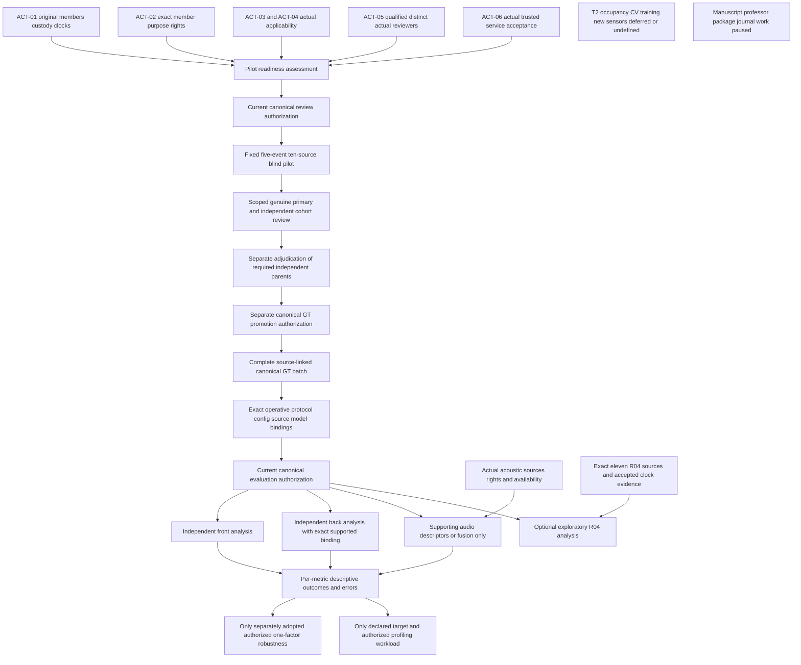

# Mission 31 experiment dependency map

The graph shows prerequisites, not completed transitions or grants. Existing scientific selections remain in force. Current source identity, rights, people, genuine services and canonical authorization are not established. Node names beginning G_ are gate labels for this audit, not new scientific decisions or authorities.

## Gate and activity mapping

| Gate or branch | Existing actual requirements | Inventory anchors |
|---|---|---|
| G_SOURCE | Original recorder/custodian/member provenance, exact camera/clock lineage and inventory disposition; no identity inferred from a filename | M31-DATA-INVENTORY; vision/source lineage rows |
| G_RIGHTS | Exact member/model and operation/purpose/environment/storage/output rights, restrictions and current validity | Applies to every real-data operation; ACT-02 |
| G_EXTERNAL | Actual relevant institution/site/privacy/participant applicability or scoped non-applicability; no universal approval invented | ACT-03/04; actual project circumstances |
| G_PEOPLE | Actual qualified primary, independent second reviewer and separate adjudicator; authentic assignments/conflicts/exposure/source access | M31-HUMAN-PILOT/COHORT; ACT-05 |
| G_SERVICES | Actual guarded presentation, physical identity, trusted time, immutable storage, audit/revocation and accepted transactions | M31-TECH-SERVICES; no fixture provider substitute |
| Review authorization | Current exact actor/source/operation grant at point of use; no grant created by readiness | ACT-06, existing canonical path |
| Human and GT | Genuine independent observations first; later required parents, uncertainty, adjudication and separate complete-batch promotion | M31-HUMAN-COHORT; M31-TECH-GT-PROMOTION |
| Evaluation | Exact operative protocol/config/source/model/cache provenance and current scoped evaluation permission | M31-NEXT-*; no official split fabricated |
| Front/back | Separate clocks and per-metric eligibility; back condition name/backend semantics must actually match | M31-NEXT-B0_front/B0_back; M31-TECH-BACK-MAPPING |
| Supporting audio | Actual source availability and clock/feature/model lineage; cannot independently actuate or clear | M31-NEXT-B1_audio/B2_front; B2_back deferred |
| R04 | Exactly existing eleven events; current independent source/sync acceptance; no event_010 expansion | M31-NEXT-R04; M31-SYNC-CAL |
| Later optional studies | Baseline first; then actual adopted factor map, comparable inputs/seeds and separate authorization or accepted hardware scope | Sweep/robustness/target-hardware rows |

## No invented universal or circular gates

An existing source's own future GT-promotion receipt is not needed before the first blind observation. Canonical permission is required to execute, not to inspect readiness. Optional external audit and future publication review are not blanket private-pilot prerequisites. Resolving excluded event_010 is not an extra gate for the existing R04 eleven; R04 itself does not block independent-camera primary analysis. Physical T2/occupancy, new training/CV, new sensors and hardware actuation remain outside the executable current scope. They do not justify blanket removal of otherwise eligible independent-camera metrics.

The graph introduces no new scientific threshold, truth table, split, protocol approval or software work package. Real integrations may be considered only after an actual accepted requirement, preserving the existing engineering freeze.
