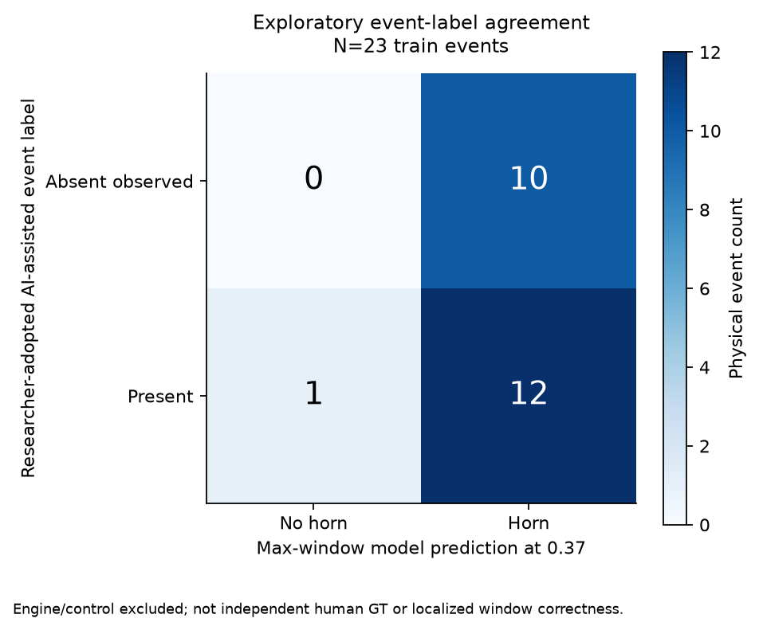
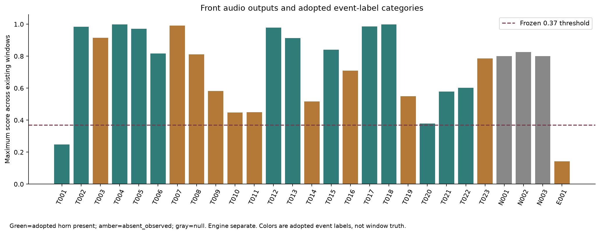
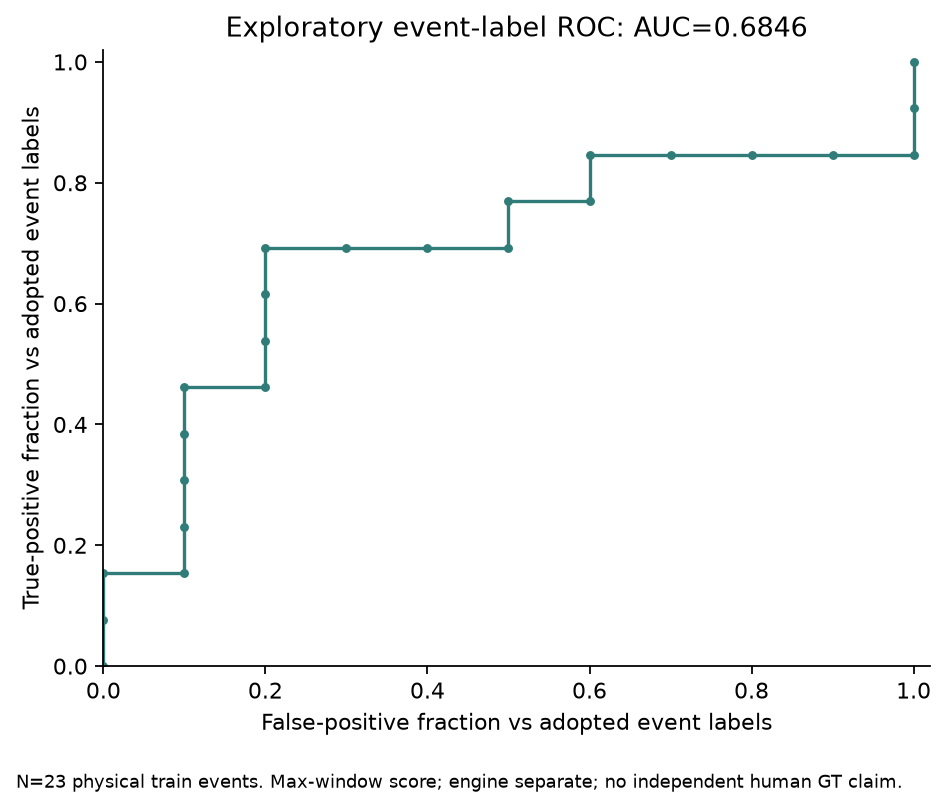
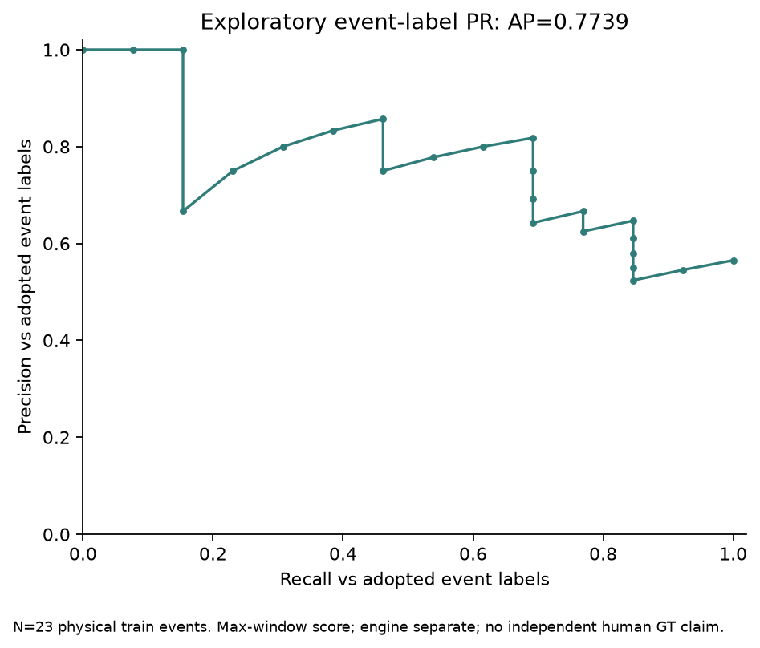

# Full-cohort corrected acoustic findings

All27 front embedded tracks completed with 22 new original inferences and 5 byte-bound prior corrected runs, zero failures. Actual windows=2600; model scores≥0.37=445. Overlapping windows are not independent physical events, horn counts or correctness probabilities. The corrected natural-log feature transform is preserved; the old five-event dB423/80 diagnostics remain superseded and excluded from these totals. No standalone development recordings entered this run.

[Per-event table](AUDIO_PER_EVENT_RESULTS.csv), [actual manifest](ACTUAL_AUDIO_RUN_MANIFEST.json), [model-label runs](AUDIO_MODEL_LABEL_RUNS.csv), [event comparison inputs](AUDIO_ADOPTED_EVENT_COMPARISONS.csv), [complete metrics](AUDIO_ADOPTED_EVENT_LABEL_METRICS.json).

| Adopted event-label endpoint | Actual value / denominator |
|---|---|
| Eligible physical train events | 23:13 horn-present, 10 absent_observed |
| TP/FP/FN/TN | 12/10/1/0 |
| Precision | 12/(12+10)=54.55% |
| Recall | 12/13=92.31% |
| Specificity | 0/10=0.00% |
| F1 | 0.6857 |
| Accuracy | 52.17% |
| ROC-AUC / AP | 0.6846/0.7739 |

The method is existing recording max-window pooling at 0.37, fixed before new audio-result inspection. Against the adopted labels, all 10 absent-observed train cases trigger and event_001 is missed. This is a limited event-label comparison using front audio. Reference horn fields do not independently bind one camera's acoustic truth, annotations are AI-assisted and no separate manual records exist; therefore it is not independent/localized human-GT performance. The engine's absent label matches its negative prediction, reported separately without single-case ROC/PR. Controls have null horn labels and are excluded, never relabeled.

Unwindowed tails and actual native sample/PTS ledgers remain explicit. There is no fabricated horn offset, window label, timestamp shift, padding, calibrated score, hourly false-alarm rate or threshold tuning. Whole-event agreement does not establish horn timing or per-window TP/FP/FN. [Scope and limitations](EVALUATION_SCOPE_FREEZE.md), [independent metric cross-check](METRIC_CALCULATION_CROSSCHECK.json).

