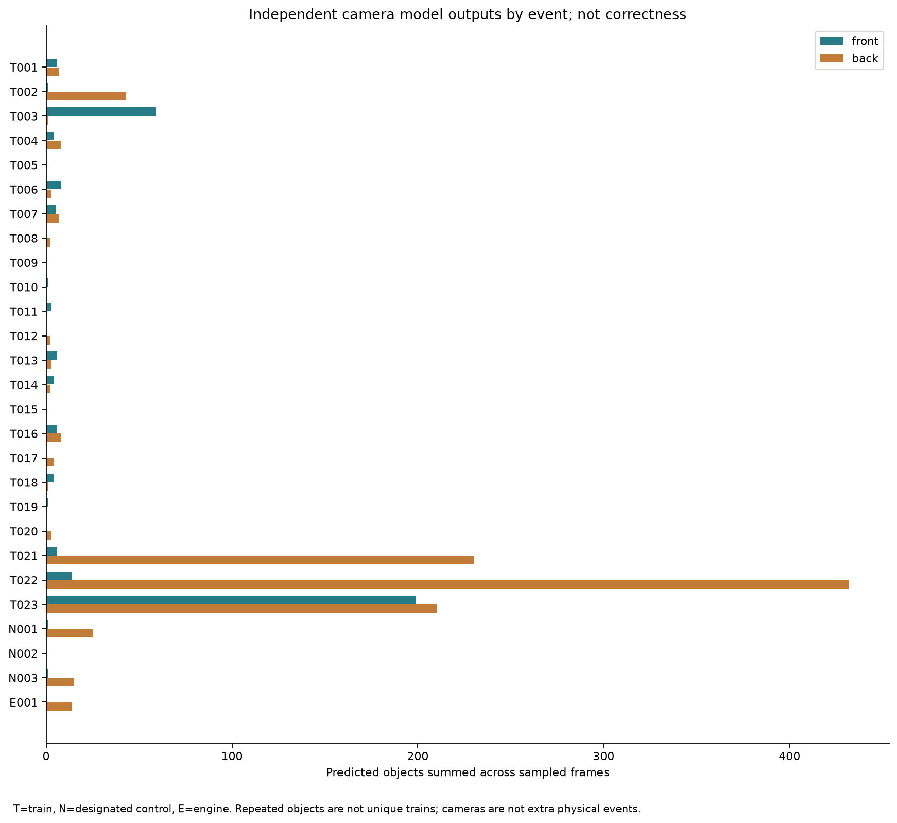
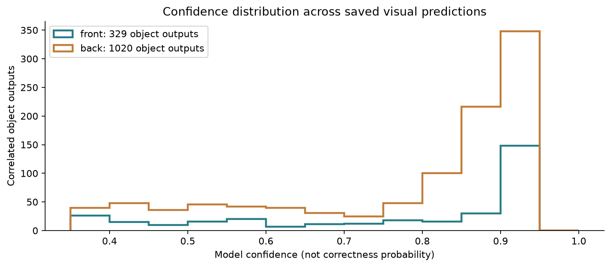

# Full-cohort image inference

All27 fronts and 27 backs completed at the frozen model/configuration. New original executions:22 fronts+22 backs; reused unchanged prior outputs:5 each. Zero inference errors. Actual records:front 6613/back 6479; predicted objects:front 329/back 1020. Independent clocks/stream indices and rational PTS are retained.

[Per-event outputs](VISUAL_PER_EVENT_RESULTS.csv), [per-class prediction counts/confidence](VISUAL_PER_CLASS_PREDICTIONS.csv), [all confidence values/boxes](VISUAL_CONFIDENCE_VALUES.csv), [sampled-output runs](VISUAL_OUTPUT_RUNS.csv), [native sampling intervals](VISUAL_NATIVE_SAMPLE_CADENCE.csv), [actual manifest](ACTUAL_VISUAL_RUN_MANIFEST.json).

There are7 train-front recordings and6 train-back recordings with zero model objects. Designated controls produce2 front/40 back objects. These are concrete detection-coverage/false-output review candidates, not matched-box FN/FP rates. Literal front/rear/side labels are maintained and do not establish a valid back-clearance mapping. Larger back counts do not prove better performance.

Researcher-approved event/boundary annotations do not supply spatial boxes or exact class/instance matching. Image TP/FP/FN, precision/recall/F1, AP/mAP50/mAP50:95 and per-class correctness therefore remain unavailable. No new IoU rule or inference threshold is introduced to force a number. Lighting/weather strata in [condition output table](OUTPUTS_BY_ADOPTED_CONDITION.csv) are adopted annotation context only, not measured difficult-condition accuracy. No scene or physical visibility condition is invented.

Processing times/rates are actual per-member pipeline measurements, combining prior and new runs under their recorded conditions. They are not native video FPS, a matched hardware benchmark, real-time acceptance or a safety claim.
