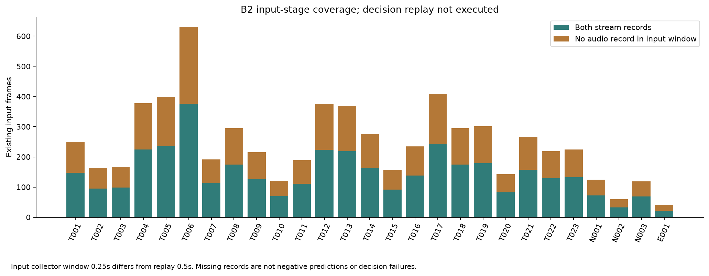

# Full-cohort input assembly; decision replay remains blocked

All27 front/audio input assemblies are available:6614 query frames, 3897 with both stream records and 2717 without an audio record inside the existing input window. Initial missing-record frames=135; later=2582. Missing input is not a negative acoustic prediction or proof the source is absent. No interpolation/fill/padding or scientific tolerance was added. Input window0.25s differs from the replay collector0.5s; input missingness does not establish decision-stage missingness.

Front inference has 6613 records, while assembly has 6614 query frames. The one extra query is train_events/event_010:120 sampled visual records, 121 queries. Last actual visual PTS=23.8166666667s; last causal audio end=24.0s. The existing collector runs to their maximum and its nominal24.0s query retains the real preceding visual record within its existing window. This is not an additional model/decoded frame or invented duration. [Exact reconciliation](INPUT_GRID_RECONCILIATION.json), [per-event coverage](B2_INPUT_COVERAGE.csv), [actual input manifest](B2_EVALUATION_INPUT_MANIFEST.json).

The real-root CacheOnlyReplayEngine.execute_replay boundary returned AUTH_DESCRIPTIVE_EVAL_EXEC_NOT_GRANTED before decision processing. Zero decision events/frames, no B2 decision result or placeholder. The current full 27 scope requires its exact actual manifest plus existing fixed metric set/model/config, genuine Stage2.1 promotion receipt and live canonical protocol hash. data/governance/AUTH-DESCRIPTIVE-EVAL-EXEC.json, data/governance/stage21_promotion_receipt.json and data/manifests/phase12_protocol_decision.json remain absent in the inspection. [Actual refusal](B2_CURRENT_ADMISSION_RECEIPT.json), [binding status](CURRENT_EVALUATION_BINDING_STATUS.json).

Researcher adoption of candidate content does not create those canonical fields/parents/receipts. M4 first_blocked_to_t4_clearance is retained, not reopened; a candidate profile is not a live operative record. The algorithm can compute states without human GT conceptually, but this governed operation remains promotion-bound/fixed-scope. No bypass or alternate synthetic-root replay occurred. No fusion superiority, B2 accuracy, safe gate behavior or hardware actuation is inferred.

