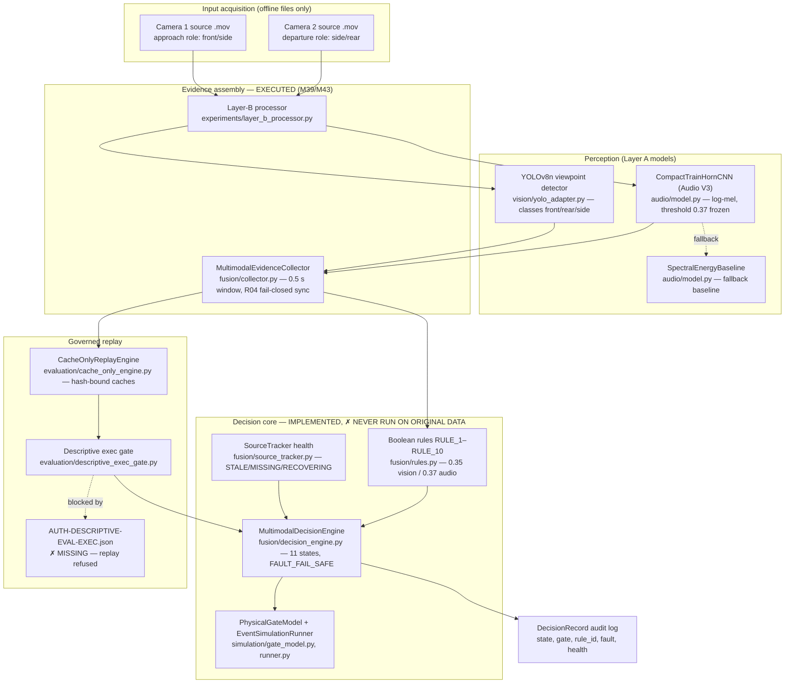

# ORIGINAL RESEARCH TARGET AND BLOCKER REPORT
## Train Gate Automation / Train Automation — Research Recovery Mission

**Repository investigated (authoritative source):** `/Users/sayemuddin/Desktop/Train_automation` (Mac working tree, local `main` HEAD `0454e38d49495e362a82ca7e725be7b1cb43ff9a`, the Mission 43 commit)
**GitHub remote:** `https://github.com/mohammad-sayem-uddin/ai-railway-crossing-safety` — public, but **stale at Mission 32** (`fc3c29a`); Missions 33–43 exist only in the local repository. All load-bearing findings below were verified against the Mac working tree, not the remote.
**Mission type:** READ-ONLY research investigation and project reconstruction. No production code, model, threshold, configuration, annotation, or recording was changed. No experiment was run. No execution guard was bypassed. No authorization was fabricated.
**Date of investigation:** 2026-11-08 (America/New_York)

**Evidence labelling used throughout this report:**

- **[FACT]** — directly verified in a file, code path, or machine-readable artifact named in the citation.
- **[RESEARCHER DECLARATION]** — a statement recorded by the researcher/owner in the repository; reported as declared, not independently verified.
- **[IMPLEMENTATION OBSERVATION]** — a property of the code as read during this investigation.
- **[INFERENCE]** — the investigator's reasoned conclusion from cited evidence; labelled so it is never confused with a documented fact.
- **[NOT FOUND]** — searched for and absent from the repository evidence available to this investigation.

---

# 1. EXECUTIVE SUMMARY

1. **[FACT] The original research target was never "train detection."** The founding document (`docs/archive/RESEARCH_CONCEPT.md`, last updated 2026-08-10) states: *"The goal is **not** simply to detect trains. The goal is to investigate whether a multi-view, audio-assisted, safety-oriented simulated decision architecture can provide more reliable evidence about three critical phases: Approaching → Close the gate; Occupying/Passing → Keep gate closed; Departure → Open the gate."* The image model and the audio model are **evidence suppliers** to a state-aware decision architecture. They are not, individually or as a pair of benchmarks, the research contribution.

2. **[FACT] The authoritative research question is the 2026-08-13 revision.** `docs/archive/RESEARCH_PROTOCOL_V2.md` §2 deliberately replaced "improve" with "change": *"On synchronized, event-labeled recordings from held-out crossings, does a predefined two-camera, audio-assisted, temporal state policy **change** event-level missed-train and premature-opening outcomes relative to fair single-camera and vision-only baselines?"* Protocol V2 carries a supersession banner over the concept document's system-level claims and is the authoritative protocol.

3. **[FACT] The proposed novelty was explicitly hedged by its own authors and was never literature-verified.** `RESEARCH_CONCEPT.md` §13 lists six *potential* novelty areas "Under Investigation" and warns: *"Do not claim: 'No one has ever combined audio and vision for trains.' … Novelty must be defined precisely and defensibly after a thorough literature review."* Unresolved question #11 in the same document is literally *"What is the publication novelty, precisely defined and literature-supported?"* No completed systematic literature review establishing the novelty was found in the repository **[NOT FOUND]**.

4. **[FACT] There is no cascade — anywhere.** A recursive filename search for "cascade" over the whole repository (54,295 entries) returned **0 matches**; a content grep over the GitHub-mirrored tree (all `.md/.py/.yaml/.json/.csv`, state ≤ Mission 32) also returned **0 matches**; full reads of every fusion/decision/simulation module found no conditional-cascade logic. The documented and implemented interaction is: **parallel independent modalities → temporal evidence collection → rule-based state machine**. The closest conditional behaviours are state-dependent rule firing and the asymmetric audio authority (audio may support closure, never authorize opening). Any "conditional cascade" framing is a hypothesis imposed from outside the project, not a documented design.

5. **[FACT] The decision architecture is genuinely implemented — and has never once run on original data.** `src/railway_detection/fusion/` contains a complete deterministic implementation: evidence contracts (`evidence.py`), a time-aligning collector with fail-closed synchronization (`collector.py`, 260 lines), frozen rules (`rules.py`, RULE_1–RULE_10), an 11-state decision engine (`decision_engine.py`, 691 lines, `MultimodalDecisionEngine.evaluate_frame()`), and a sensor-health tracker (`source_tracker.py`, 405 lines). Yet in every mission from 39 to 43, **B2 decision replay processed 0 decision events and 0 decision frames**. The architecture is implemented and synthetic-fixture-tested; it is experimentally undemonstrated on original recordings.

6. **[FACT] The single highest-impact blocker is governance, not code.** The real-root replay boundary returns `AUTH_DESCRIPTIVE_EVAL_EXEC_NOT_GRANTED` because three records do not exist: `data/governance/AUTH-DESCRIPTIVE-EVAL-EXEC.json`, `data/governance/stage21_promotion_receipt.json`, and `data/manifests/phase12_protocol_decision.json` (canonical protocol choice / live protocol hash), plus one undecided definition (`premature_opening_window`). The gate code (`src/railway_detection/evaluation/descriptive_exec_gate.py`) requires a genuine researcher-recorded authorization bound to five hashes — three of which are already computed and verified. Nothing in the gate module creates or fabricates the record, and no mission bypassed it.

7. **[FACT] The annotations structurally cannot support the original evaluation.** Mission 43/44 audits verify: event-level train labels for all 27 events; horn status for 24 (13 present / 11 absent_observed / 3 null); horn onset for 13; **0 events with bounding boxes, 0 frames with box references, 0 audio windows with reference labels, 0 horn offsets, 0 native-PTS annotation fields**. Therefore image mAP / box TP-FP-FN and audio window accuracy are not "unrun" — they are *uncomputable* from the existing reference. The annotations are a **researcher-adopted AI-assisted reference** (adoption receipt, Mission 43), with **zero independently stored human observation records**.

8. **[FACT] Mission 43 executed model inference, not architecture validation.** Its verified full-cohort results (Section 10) establish that the vision and audio models *run* on all 27 events and produce outputs, and that the audio model's event-level agreement with adopted horn labels is weak (precision 54.55%, **specificity 0%** — all 10 horn-absent train events trigger the alarm rule). They establish nothing about fusion, state-policy behaviour, premature opening, fail-safe transitions, or safety.

9. **[FACT] A known v1 decision defect is documented in-repo and its fix is not authorized.** In frozen `rules.py`, `APPROACH_LABELS = {front, side, train}` and `DEPARTURE_LABELS = {rear, side, train}` overlap on `side` and `train`, so departure/rear confirmation can be satisfied without any `rear` detection (the Phase 9 clearance-divergence finding). The v2 candidate (`rules_v2_candidate.py`, `decision_engine_v2_candidate.py`, `configs/decision_policy_v2_candidate.yaml`) fixes this with unambiguous-label logic but is explicitly `CANDIDATE_UNDER_RESEARCH_REVIEW_NOT_AUTHORIZED_FOR_DEPLOYMENT` and is not wired into the frozen execution path. Which policy is canonical is itself part of the missing protocol-choice record (blocker BLK-PROTO-01).

10. **[INFERENCE] Overall research completion:** Layer A perception is built and was benchmarked (with audit-era caveats on its headline claims); Layer B inference is executed at full cohort; the decision layer — the actual research object — is implemented but experimentally untouched on real data; the original novelty is unproven and two of its six candidate items (Bangladesh-scale dataset, cross-crossing generalization) are unattainable with the single-site, daytime-only, 27-event corpus actually collected. The programme is **partially complete**, which is also Mission 43's own verdict.

---

# 2. ORIGINAL RESEARCH TARGET

## 2.1 The problem the research was designed to solve

**[FACT]** `docs/archive/RESEARCH_CONCEPT.md` §1 (2026-08-10): railway level crossings in Bangladesh depend on human operators who must recognize an approaching train, close the gate in time, confirm the train has fully passed, and reopen the gate. Documented vulnerabilities: human error and delayed reaction; poor visibility (rain, fog, nighttime, occlusion); camera detection failure; long trains; false detections and missed detections.

**[FACT]** The 2026-08-31 progress report (`Railway_Crossing_Automation_Research_Report.docx`, root; duplicate in `results/`) frames the same problem with the asymmetric-risk argument that recurs throughout the project: *a false positive (gate closing unnecessarily) results in traffic congestion, whereas a false negative (gate opening while a train is present) causes catastrophic collisions* — and names the specific failure of *"dangerous premature gate openings before a long train has completely vacated the intersection."*

## 2.2 Original research objective

**[FACT]** Concept (2026-08-10), §2: investigate whether a *multi-view, audio-assisted, safety-oriented simulated decision architecture* provides more reliable evidence across the three operational phases (approach / occupancy / departure).

**[FACT]** Protocol V2 (2026-08-13), §1 — the authoritative restatement: *"Determine whether a **predefined**, two-camera, audio-assisted, temporal decision policy changes event-level crossing-detection outcomes relative to fair simpler baselines on synchronized, held-out train-passage recordings."*

## 2.3 Original research questions

**Primary (authoritative, Protocol V2 §2):** "On synchronized, event-labeled recordings from held-out crossings, does a predefined two-camera, audio-assisted, temporal state policy change event-level missed-train and premature-opening outcomes relative to fair single-camera and vision-only baselines?" — with the explicit note: *"The word 'change' is intentional. Improvement may not occur; direction and uncertainty must be reported from data."*

**Secondary (Protocol V2 §3):** (i) benefit of the second camera; (ii) effect of horn evidence on recall / warning lead time; (iii) temporal filtering vs independent per-frame decisions; (iv) **"Does the state-aware policy prevent simulated premature opening relative to non-state-aware fusion?"**; (v) variation across crossings/conditions; (vi) viewpoint-label ambiguity.

**Unresolved questions recorded by the founders themselves** (`RESEARCH_CONCEPT.md` §19, 11 items), including #2 *"What fusion method best balances safety and false-positive rate?"*, #3 *"How does the system degrade as individual components fail?"*, #10 *"How should the decision engine handle conflicting evidence (e.g., vision says no train, audio says horn)?"*, #11 *"What is the publication novelty, precisely defined and literature-supported?"* — all still open at Mission 43 (Section 13).

## 2.4 Intended contribution and proposed novelty

See Section 5 (novelty evidence matrix). In brief: the intended contribution was the **decision architecture and its evaluation** — role-differentiated multi-view evidence, audio as an independent fallback modality, and a state-aware fail-safe policy with explicit failure-mode testing — not the detectors. Decision D-007 (`docs/RESEARCH_DECISIONS.md`, 2026-08-10) states YOLO is a non-novel baseline and research effort should focus on *"the multimodal fusion and decision logic rather than vision architecture innovation."*

## 2.5 Was it independent benchmarking, fusion, cascade, or layered fail-safe?

**[FACT]** A combination, with a precise shape:

- **Independent modality models** — yes, as evidence producers (vision viewpoint detector; binary horn classifier).
- **Multimodal fusion** — yes, but *rule-based temporal/state fusion*: per-tick boolean evidence checks feeding a deterministic state machine. The exact mathematical fusion method was deliberately left unfixed in August 2026 (`RESEARCH_CONCEPT.md` §3.3: *"⚠️ Research question: The exact mathematical fusion method is not finalized"*), with candidates = threshold logic, confidence-weighted fusion, calibrated probabilities, temporal consistency filtering, state-dependent thresholds. Protocol V2 froze it to transparent, predeclared rules; learned/neural fusion was explicitly **deferred** (Idea I-009).
- **Conditional cascade** — **[NOT FOUND]**. No cascade is documented or implemented anywhere (Executive Summary #4).
- **Layered fail-safe decision-making** — yes, as a *simulated conservative-closed policy*: hazard-model invariants (`docs/HAZARD_MODEL.md`), asymmetric close/open logic (Decision D-004), positive-evidence-only reopening, and fault states. After 2026-08-13 the project forbids calling this physical "fail-safe operation" (Protocol V2 terminology decision); it is a *safety-oriented simulated decision policy*.

## 2.6 Intended roles of the models and their interaction

**Vision (role-differentiated, Decision D-001):** a single "train" class was *rejected* because it "would erase this distinction… needed for the research question." Viewpoint roles (`RESEARCH_CONCEPT.md` §6.4): **front** = early approach detection; **side** = continued presence/occupancy evidence; **rear** = departure confirmation (positive departure evidence). Camera 1 (approach side) covers front/side; Camera 2 (departure side) covers side/rear.

**Audio (independent fallback, Idea I-003, literally titled "Audio Train Horn Detection as Fail-Safe"):** binary `TRAIN_HORN` vs `NON_TRAIN_SOUND`, intended to provide evidence *"when vision evidence is unreliable (night, fog, occlusion, camera failure)."*

**Interaction:** both modalities feed a state-based decision engine that considers per-viewpoint confidence, viewpoint type, temporal consistency, current state, camera source identity, audio horn confidence, and detection history (§3.1/§3.3). Naive OR-fusion is explicitly warned against (§12: *"`front OR side OR rear OR horn = train` can inflate false positives… Adding more detectors is not automatically better"*).

**Audio authority (tightened 2026-08-13, Protocol V2 §13):** *"Audio may independently trigger simulated closure only if a validation-only policy decision and held-out event analysis justify it. Until then, it is supporting closure evidence. Audio can never independently authorize simulated opening."* This asymmetric-authority rule is what later code and audits call **RULE_2**.

## 2.7 Intended final decision mechanism

**[FACT]** An 11-state finite state machine (`RESEARCH_CONCEPT.md` §4; Protocol V2 §17 renames the fault state `FAULT_FAIL_SAFE`; gate state tracked separately as OPEN/CLOSING/CLOSED/OPENING):
`IDLE, TRAIN_APPROACHING, WARNING, GATE_CLOSING, TRAIN_PRESENT, CROSSING_OCCUPIED, TRAIN_DEPARTING, REAR_CONFIRMED, CROSSING_CLEAR, GATE_OPENING, FAULT/FAIL_SAFE`.

Governed by two asymmetric principles (§5, Decision D-004):
- **Closing principle (aggressive toward safety):** *"If reliable evidence suggests a train is approaching, the system should move toward the safe closed state"* — low evidence threshold.
- **Opening principle (conservative, positive-evidence invariant):** *"The system must not open the gate merely because the detector stops seeing a train. Loss of detection ≠ proof of departure. Opening requires positive evidence: rear detection confirmed; temporal consistency; crossing-clear condition simulated. If evidence becomes uncertain, the system should prefer the safe state (gate closed)."*

## 2.8 Failure conditions the architecture was supposed to handle

**[FACT]** `docs/HAZARD_MODEL.md` (created 2026-08-13) invariants: (1) missing detection alone must never authorize simulated opening; (2) opening requires predeclared positive departure evidence and independently observed/defined clearance conditions; (3) detected faults are recorded, conservative closure is a policy response; (4) out-of-domain/unresolved multi-train events are not successful normal operation.

Its hazard register specifies expected simulated behaviour for: missed train approach; late warning; unnecessary closure; premature opening; rear detection failure; temporary camera failure ("mark unavailable/stale; retain conservative state"); permanent camera failure ("enter configured degraded/fault policy"); audio false positive ("do not use audio to open"); audio false negative ("vision/state rules remain independent"); stale evidence (reject/flag); out-of-order evidence (reject or documented ordering rule); **conflicting cameras** ("apply explicit conflict priority/conservative rule; flag — prohibited: opening while conflict unresolved"); train appearing while opening; multiple trains (out-of-domain); stopped train ("timeout must not infer clearance"); reversing train; partial occlusion ("no absence-to-open inference").

Failure injection was part of the *original* design (`RESEARCH_CONCEPT.md` §10.2; `EXPERIMENT_PLAN.md` DE-EXP-2): front disabled, side lowered, rear removed, audio noise-corrupted, false-positive injection, temporary camera failure, each camera obstructed — each with expected safe behaviour tabulated (e.g., "rear detection disabled → do not open gate without positive departure evidence").

## 2.9 Expected research outcome

**[FACT]** A defensible, literature-positioned answer — in either direction — to whether the predefined multimodal state policy changes missed-train and premature-opening outcomes versus fair ablated baselines (Protocol V2 §19 conditions B0–B7, §20 paired ablations), on synchronized held-out recordings, with failure-mode behaviour measured. The concept document's own §17 defines the "weak version (avoid)": *"'Train YOLO on 4,000 images and report mAP'; random train/test split; no baseline comparisons; no failure analysis; no audio evaluation; no temporal analysis; no multimodal comparison; unexplained decision logic; unsupported novelty claims."* That list is, in effect, the project's own definition of what it must not degenerate into.

## 2.10 Documented objective vs later modifications — conflicts register

| # | Conflict | Evidence | Authoritative version & reason |
|---|---|---|---|
| C1 | "Improve" (2026-08-10) vs "change" (2026-08-13) | Concept §1 vs Protocol V2 §2 | **Protocol V2.** Its header supersedes the concept's system-level experimental sections; the concept itself carries the 2026-08-13 supersession banner. |
| C2 | "Fail-safe" as a physical claim vs simulated policy | Concept/Idea Log (free use) vs Protocol V2 terminology + `HAZARD_MODEL.md` scope note ("not a railway safety case… not proof of physical fail-safe operation") | **Protocol V2 / Hazard Model.** Post-2026-08-13 usage: "safety-oriented simulated decision policy." |
| C3 | Fusion formula `E_fused(t) = w_v·E_vision(t) + w_a·E_audio(t)` | Appears **only** in the 2026-08-31 .docx progress report §7 | **Not authoritative and never implemented.** No weighted-fusion code or weights exist (Section 3); Protocol V2 froze rule-based fusion before the .docx was written. The .docx is a progress report, not a protocol. |
| C4 | State count: 10 states (.docx §4) vs 11 states (concept §4, Protocol V2 §17, code `rules.py`) | .docx merges/drops states | **11 states** — concept, protocol, and shipped code agree. |
| C5 | Dataset scope: 30+ crossings, ~4,000 images, cross-crossing generalization (concept §8, D-005) vs actual: 1 site (`crossing_A`), 27 events, daytime only | Later protocols forbid "held-out crossings" wording; Nov README: "No claim of cross-site generalization is made" | **Actual data governs.** A scope collapse, not a design change; it kills novelty candidates #1 (scale) and #6 (Section 5). |
| C6 | Vision model identity: 3-class viewpoint detector (D-001, Protocol V2 §14, frozen config classes 0=front/1=rear/2=side) vs Nov README §5 describing a "single-class (`train`)" detector with viewpoint as descriptive tags | README (rewritten, modified 2026-11-03) vs `configs/frozen_experiment_v1.yaml` + Mission 39 B0 report (checkpoint `39f402dfe460`, classes front/rear/side) | **Frozen config + executed runs govern implementation** (3-class checkpoint is what actually ran). The README sentence is flagged as a documentation-integrity defect (BLK-DOC-01): it contradicts the executed configuration. Note the decision engine's label sets accept `train` as well as viewpoint labels, which is precisely what makes the v1 overlap defect possible. |
| C7 | Experiment taxonomy drift: A–G (concept) → B0–B7 (Protocol V2) → B0–B4 legacy (final protocol, criticized) → E1–E10 (`EXPERIMENT_DESIGN_FINAL.md`, 2026-10-13) → Mission 39–43 usage (B0_front/B0_back/B1_audio/B2) | `INDEPENDENT_RESEARCH_DESIGN_AUDIT.md` CF-03 (2026-10-13): the E-series and B-series are "not reconciled" | **None fully reconciled.** Mission 43's B-labels do **not** map cleanly onto Protocol V2's B0–B7 decision conditions (see §3.4). This drift is a real methodological blocker for comparing results across eras. |
| C8 | Narrowed RQ (Oct): stateful vs *stateless* policy on reopening-during-occupancy (`EXPERIMENT_DESIGN_FINAL.md` §1 RQ1, 2026-10-13) vs original multimodal RQ | Drops held-out-crossings and multimodal framing; makes audio RQs conditional | A legitimate *narrowing*, recorded as such; it does not replace the original target for the purposes of this recovery report. |

---

# 3. ACTUAL SYSTEM ARCHITECTURE (RECONSTRUCTED)

## 3.1 Readable explanation

**[IMPLEMENTATION OBSERVATION]** The shipped system has two execution paths into one decision core, and no live path:

1. **Live-model path (input assembly):** `src/railway_detection/experiments/layer_b_processor.py` (806 lines) ingests `.mov` sources, samples frames, runs the YOLOv8n vision checkpoint and the `CompactTrainHornCNN` audio classifier, and builds synchronized `MultimodalFrame`s via `MultimodalEvidenceCollector`. This is what produced the Mission 39/43 B2 *input assemblies*. It is an offline file processor, not a streaming daemon.
2. **Cache replay path (decision evaluation):** `src/railway_detection/evaluation/cache_only_engine.py` (948 lines) — `CacheOnlyReplayEngine` replays hash-bound JSONL evidence caches through `MultimodalDecisionEngine` + `EventSimulationRunner`, with zero raw-media access. This is the *only* path that produces decision/state outcomes, and it is the path blocked by the authorization gate (Section 8.4).
3. **Decision core:** `fusion/collector.py` time-aligns per-source `EvidenceRecord`s into `MultimodalFrame`s (window tolerance 0.5 s; R04 fail-closed: an unregistered vision source raises `ValueError`, never a silent zero offset; duplicate/out-of-order observations are rejected at ingestion and logged). Per tick, `fusion/rules.py` computes three booleans — qualified approach (vision label ∈ {front, side, train} at ≥ 0.35), qualified departure (label ∈ {rear, side, train} at ≥ 0.35), audio train presence (label ∈ {train, horn, rail, train_horn} at ≥ 0.37) — and `fusion/source_tracker.py` computes per-source health (HEALTHY / DEGRADED / STALE / MISSING / RECOVERING). `MultimodalDecisionEngine.evaluate_frame()` advances the 11-state machine and emits an auditable `DecisionRecord` (previous/resulting state, gate state, rule_id, fault status, source health, observation ages).

**What "fusion" actually is in code:** deterministic boolean/rule fusion over normalized evidence records. No fusion weights, no learned combiner, no calibrated probability combination, and no uncertainty estimate exist in the executed path. The weighted formula in the .docx report was never implemented (conflict C3).

**Where fail-safe actually lives:** in `fusion/source_tracker.py` + the engine's RULE_4/5/6/9 — **not** in `src/railway_detection/safety/`, which despite its name contains research-governance/access-control code only (`media_guard.py`, `access_guard_plugin.py`, `constructed_authority.py`, etc.). This naming trap has misdirected at least one prior reading of the project and is recorded here explicitly.

## 3.2 Architecture diagram (as implemented; ✗ = never executed on original data)

## 3.3 Component status table

Full machine-readable version: `ARCHITECTURE_COMPONENT_STATUS.csv`. Summary:

| Component | Intended purpose | Actual implementation | File path | Status |
|---|---|---|---|---|
| Vision detector | Role-differentiated approach/occupancy/departure evidence | YOLOv8n adapter emitting `Detection(label, confidence, bbox)`; default classes [front, rear, side] | `src/railway_detection/vision/yolo_adapter.py` (`UltralyticsYOLOAdapter`, 244 ln) | Implemented; executed on original data (M39/M43 B0) |
| Vision temporal filter | Multi-frame confirmation, evidence persistence | `TemporalEvidenceBuffer` (confirm 3, miss-tolerance 2, expiry 3.0 s, EMA α=0.5); emits evidence only, never decides | `src/railway_detection/vision/temporal.py` (181 ln) | Implemented; note defaults differ from engine confirm_frames=2 |
| Audio classifier | Independent horn evidence / fallback modality | `CompactTrainHornCNN` (~75k params, log-mel 64×61); checkpoint loader refuses missing norm stats and any caller threshold ≠ checkpoint threshold 0.37 | `src/railway_detection/audio/model.py` (292 ln) | Implemented; executed on original data (M39/M43 B1) |
| Audio pipeline | File/window → evidence records | `AudioEvidencePipeline`; tags records `audio_safety_role: supporting_only`; missing file → `available=False` record | `src/railway_detection/audio/pipeline.py` (171 ln) | Implemented |
| Evidence contracts | Normalized modality evidence + auditable decisions | `Detection`, `EvidenceRecord` (invariant: unavailable ⇒ no detections), `DecisionRecord`, `UnavailableSource` | `src/railway_detection/fusion/evidence.py` (95 ln) | Implemented |
| Collector / sync | Time-aligned multimodal frames | `MultimodalEvidenceCollector.collect_frame(window_tolerance_s=0.5)`; R04 fail-closed source registration; duplicate/out-of-order rejection logged | `src/railway_detection/fusion/collector.py` (260 ln) | Implemented; used in assembly |
| Fusion rules (v1, frozen) | Deterministic evidence qualification | 3 boolean checks; thresholds 0.35 / 0.35 / 0.37; label sets overlap on side/train (**defect, §3.5**) | `src/railway_detection/fusion/rules.py` (94 ln) | Implemented, frozen, executed-path default |
| Decision engine (v1, frozen) | 11-state safety policy, exit confirmation, reopening | `MultimodalDecisionEngine.evaluate_frame()`; dwells warning 2 s / closing 3 s / opening 3 s / clearance 3 s; RULE_7 interrupt; RULE_9 recovery never directly to open if train was present | `src/railway_detection/fusion/decision_engine.py` (691 ln) | Implemented; **never executed on original data** |
| Sensor health / fail-safe | Detect stale/missing/degraded sources; clamp to closed | `SourceTracker` health states; staleness > 2.0 s → STALE; recovery needs 2 confirmation frames; engine RULE_4 (all-vision-failed clamp), RULE_5 (departure-source staleness aborts clearance), RULE_6 (degraded departure hold) | `src/railway_detection/fusion/source_tracker.py` (405 ln) | Implemented; synthetic-tested only |
| Rules/engine v2 candidate | Fix v1 label overlap; unambiguous rear confirmation | `UNAMBIGUOUS_APPROACH={front}`, `UNAMBIGUOUS_DEPARTURE={rear}`, `AMBIGUOUS={side,train}` with gap-based reclassification; RULE_3B/3C | `fusion/rules_v2_candidate.py` (230 ln), `fusion/decision_engine_v2_candidate.py` (550 ln) | **Candidate only — not authorized, not default** |
| Simulation mirror | Formal transition matrix + gate physics for replay | `CrossingStateMachine.ALLOWED_TRANSITIONS`; `PhysicalGateModel` (90°/0°, blocked ≤45°); `EventSimulationRunner.run_frames()` | `src/railway_detection/simulation/{state_machine,gate_model,runner}.py` | Implemented; simulation/replay only |
| Failure injection | Fault/robustness experiments (original DE-EXP-2) | `FailureInjector` modes: camera_1/2_dropout, dual_camera_dropout, audio_dropout, stale_timestamps, out_of_order_frames, false_detection, dropped_frames; cache perturbation in `evaluation/perturbation.py` | `src/railway_detection/simulation/failure_injector.py` (296 ln) | Implemented; **never run on original data** |
| Cache replay engine | Governed decision replay on caches (B0/B1/B2 conditions) | `CacheOnlyReplayEngine`; SHA-256 hash gate; media-extension blacklist; conditions B0={front_vision}, B1={front_audio}, B2={front_vision, front_audio} | `src/railway_detection/evaluation/cache_only_engine.py` (948 ln) | Implemented; **execution refused at gate (Section 8.4)** |
| Exec gate | Prevent unauthorized descriptive execution | Requires on-disk AUTH record bound to 5 hashes; absence blocks execution | `src/railway_detection/evaluation/descriptive_exec_gate.py` (310 ln) | Implemented and effective (it is the blocker) |
| Official replay producer | Phase-12 EVAL-AUTH replay | Re-assesses readiness per call; test-split only; dual-camera only with accepted `CALIBRATION_SUPPORTED` sync | `src/railway_detection/evaluation/replay_producer.py` (391 ln) | Implemented; not executed on full cohort |
| `safety/` package | *(name suggests gate fail-safe — it is not)* | Media-access authorization, pytest access guard, constructed (synthetic-fixture) authority/broker, path identity | `src/railway_detection/safety/*.py` (8 files) | Implemented — governance only; **no gate fail-safe code** |
| Fusion config | Executed fusion policy | `configs/fusion.yaml` is a Phase-0 placeholder ("No fusion policy is executed yet", thresholds 0.5). Executed policy = `frozen_experiment_v1.yaml` + `decision_policy_v1.yaml` (hash `999a7970…a42e`) | `configs/` (9 files) | Placeholder superseded in practice; drift is a documentation hazard |

## 3.4 Component dependency map (condensed)

`layer_b_processor` → {`vision/yolo_adapter`, `audio/model` + `audio/pipeline`, `fusion/collector`, `vision/video` (PTS)} → evidence caches → `cache_only_engine` → {`descriptive_exec_gate` (authorization), `fusion/decision_engine` ← `fusion/rules` + `fusion/source_tracker`, `simulation/runner` → `simulation/gate_model` + `simulation/state_machine`} → `DecisionRecord`s → `evaluation/metrics.py` (M4/M5/MTR etc.). Vision/audio adapters depend on `fusion/evidence.py` contracts and explicitly never make gate decisions (`vision/adapter.py` docstring).

**Critical structural observation [FACT]:** the replay conditions in `cache_only_engine.py` are **front-camera-centric**: B2 = {front_vision, front_audio}. The Mission 43 B2 input assembly likewise assembled **front + audio only** (6,614 frames; `MULTIMODAL_EXPERIMENT_REPORT.md`: "All27 front/audio input assemblies are available"). The back/departure camera — the source of the rear-confirmation evidence on which the entire opening policy depends — is **not in the B2 assembly**. Even if the authorization gate opened tomorrow, the currently assembled B2 inputs cannot exercise the departure-confirmation path end-to-end (blocker BLK-ARCH-01).

## 3.5 Missing or disconnected components

1. **Back-camera input to decision replay** — absent from B2 assembly/conditions (above).
2. **Canonical policy selection** — v1 (frozen, defective label overlap) vs v2 candidate (fixed, unauthorized) is undecided in any live record.
3. **Cross-camera synchronization for the full cohort** — frozen config records sync as `independent_or_unverified / R04_UNRESOLVED`, `allow_unverified_zero_offset: false`; only an 11-event `CALIBRATION_SUPPORTED` subset is authorized for dual-camera exploratory work (`configs/exploratory_dual_camera_v1.1.0_authorized_20261013.yaml`, which explicitly "does NOT extend to full-cohort B3, B4, B6, or B7").
4. **Uncertainty / disagreement machinery** — no confidence calibration in the decision path, no disagreement state; conflict handling is implicit priority (approach beats clearance; audio presence resets the clearance clock) plus, in the v2 candidate config only, an explicit approach-priority rule.
5. **Live acquisition** — no camera/microphone streaming daemon feeds the engine; all input is offline files. (Consistent with Decision D-006: software-only scope; edge deployment deferred.)
6. **Single-camera-loss clamp** — v1 clamps to FAULT_FAIL_SAFE on *all*-vision failure or departure-source staleness, but one non-departure camera failing alone does not clamp. Whether that matches the hazard model ("temporary camera failure → retain conservative state") is an open design question, not a settled behaviour.
7. **Conceptual-only components:** weighted/calibrated fusion (docx formula), learned fusion (deferred I-009), cascade (never existed), physical actuation (out of scope by design).

---

# 4. ORIGINAL METHODOLOGY RECONSTRUCTION

Full machine-readable version: `METHODOLOGY_STATUS.csv`. Status key: **P**roposed / **I**mplemented / **E**xecuted / **V**alidated / **B**locked / **D**eferred / **N**ever documented.

## 4.1 The two-layer evidence protocol (the methodological core)

**[FACT]** Decision D-011 (2026-08-13) created the evidence boundary that governs everything after it:

- **Layer A — still-image perception layer:** image dataset for training, hyperparameter selection, and per-frame viewpoint benchmarking. Layer A evidence can support *perception* claims only.
- **Layer B — synchronized passage-event layer:** synchronized, event-labeled recordings (Camera 1 + Camera 2 + audio) for *system* claims: arrival warning lead time, occupancy retention, premature opening. "A multimodal temporal/state-policy claim requires synchronized, event-labeled Layer B."
- D-011's own fallback: *"Narrow the study to a viewpoint-detection paper if Layer B cannot be collected."*

## 4.2 Experimental lifecycle (as originally specified)

`Dataset → Preprocessing → Modality Models → Multimodal Decision → Fail-safe Logic → Evaluation → Findings`

| Element | Original specification | Status |
|---|---|---|
| Dataset acquisition | ~4,000 real images; 30+ crossings; Layer B synchronized event bundles | P; **actual: 1 site, 27 events** (scope collapse C5) |
| Event selection/categories | Train passages, no-train controls, engine-only case; approach/occupancy/departure phases | P/I/E — 23 train / 3 no-train / 1 engine in final corpus |
| Camera strategy | Two spatially separated cameras, role-differentiated (approach vs departure) | P/I/E for inference; sync unresolved for full cohort (R04) |
| Audio strategy | Embedded/container audio + standalone horn recordings; SNR stress +10…−5 dB | P/I/E (embedded front audio evaluated; 87 standalone horn recordings remain development-only) |
| Image preprocessing | YOLO training at 640×640; inference sampling 5 FPS with source PTS preserved | I/E (PTS preservation implemented Mission 37, verified M39/M43) |
| Audio preprocessing | 16 kHz mono; log-mel (64 mels, features [64,61]); 1.0 s window / 0.5 s hop; RMS normalization; bandpass in design docs | I/E — with one real defect found & fixed: training used natural-log mel, runtime used dB; corrected in Mission 39 without changing weights/threshold |
| Model selection | YOLOv8n (non-novel baseline, D-007); CompactTrainHornCNN (Audio V3, ESC-50-informed); validation-only selection; frozen checkpoints with pinned SHA-256 | I/E |
| Training methodology | Grouped splits (vision by `crossing_id`, audio by `session_id`, 70/15/15) to prevent leakage | P/I — with the caveat that single-site data makes the vision grouping degenerate |
| Inference methodology | Frozen config (`frozen_experiment_v1.yaml`); frozen thresholds (vision 0.35, audio 0.37); prohibited-checkpoint list enforced in code | I/E |
| Temporal analysis | Multi-frame confirmation (2 frames in engine), evidence persistence, dwell/debounce (clearance 3 s) | I; synthetic-tested; **not evaluated on original data** |
| Fusion methodology | Rule-based, predeclared, transparent; calibration validation-only; learned fusion deferred | I (rules); **fusion behaviour itself never evaluated on original data** |
| Conditional cascade rules | — | **N — never documented, never implemented** |
| Fail-safe mechanisms | Hazard-model invariants; fault clamp; degraded hold; recovery-never-to-open | I; synthetic/fixture-tested; **not demonstrated on original data** |
| Evaluation methodology | Event-level outcomes vs fair one-component-difference baselines (B0–B7); M4 premature opening, M5, MTR, missed-train, warning lead time; 9-metric descriptive set frozen in Mission 41 scope | P/I (metric code exists); **B — blocked at authorization gate** |
| Ground-truth strategy | Layer B event labels + boundary times (T0–T4); Stage 2.1 human review and promotion to canonical GT | P; **B — promotion never occurred** (Section 6) |
| Validation strategy | Held-out crossings; cross-crossing generalization | P; **invalidated by data** (single site) |
| Baselines | B0 single-camera no-temporal … B6 full, B7 = B6 with source removals + fault simulation (Protocol V2 §19) | P; **never executed as decision conditions on original data** |
| Ablations | Paired ablations (Protocol V2 §20); A–G ladder in concept §10.1 | P; not executed on original data |
| Robustness / failure injection | DE-EXP-2 fault set (Section 2.8) | I (injector code); **not executed on original data** |
| Fault simulation on synthetic fixtures | Constructed/synthetic programme (Missions 17–28 lineage) | I/E — extensively, on synthetic data only |

## 4.3 What the methodology became (audit-era, for contrast)

**[FACT]** By October 2026 the operative methodology had narrowed to a *descriptive, offline, single-site benchmark* (`EXPERIMENT_DESIGN_FINAL.md`, 2026-10-13; `FINAL_REAL_WORLD_EXPERIMENT_PROTOCOL.md` v9, 2026-10-12): stateful-vs-stateless reopening endpoints, M4/M5/MTR metric formalization, and a governance regime (operation-specific authorizations, promotion receipts, protocol hashes) that ultimately gated all descriptive execution. This narrowing is documented and internally consistent — but it is a *different, smaller* methodology than the August original, and it still never reached decision-replay execution.

---

# 5. ORIGINAL NOVELTY AND RESEARCH GAP

Full machine-readable version: `NOVELTY_EVIDENCE_MATRIX.csv`.

## 5.1 The gap as actually documented

**[FACT]** There is **no formal literature-gap statement** in the August documents **[NOT FOUND as a formal statement]**. The implied gap is: (a) Bangladesh crossings are manual and failure-prone; (b) no comparable public Bangladesh crossing dataset was known to the authors; (c) existing crossing automation is single-sensor or track-circuit based and does not evaluate state/failure behaviour at event level. Any stronger gap wording appears only in October/November audit-era documents and must not be back-projected onto the original proposal.

## 5.2 Novelty evidence matrix (summary)

| Proposed contribution | Original evidence | Implemented? | Experimentally demonstrated? | Remaining proof |
|---|---|---|---|---|
| Bangladesh-specific crossing dataset | Concept §13 #1 (conditional: "if no comparable public dataset exists") | Partially — 27 events, 1 site, daytime only | No (dataset exists; its uniqueness/generality unestablished) | Literature verification + dataset characterization; scale/diversity claims unattainable on current data |
| Multi-view detection organized by approach/occupancy/departure roles | Concept §13 #2; §6.4; D-001/D-002 | Yes — 3-class viewpoint detector + role-scoped rules | Perception only (Layer A benchmark; M39/43 inference without box reference) | Layer B role-based evaluation with a box/boundary reference |
| Audio-assisted detection as fallback in a crossing-safety context | Concept §13 #3; §7; Idea I-003 | Yes — Audio V3 CNN + supporting-only pipeline role | Partially — event-level agreement vs adopted labels measured (and weak: specificity 0%) | Fallback *benefit* requires decision-level experiments with vision degraded/removed |
| State-aware fail-safe decision logic with explicit failure-mode testing | Concept §13 #4; §4/§5; HAZARD_MODEL | Yes — engine + rules + health tracker + injector | **No** — synthetic fixtures only; 0 decision frames on original data | Authorized B2 replay + fault-injection runs on original-data caches |
| Safety-oriented failure analysis (behaviour under component failure) | Concept §13 #5; §10.2; EXPERIMENT_PLAN DE-EXP-2 | Injector implemented | **No** on original data | B7-style removal/fault experiments |
| Cross-crossing generalization via location-aware splitting | Concept §13 #6; §8; D-005 | Split code exists | **No — impossible on current data** (1 site) | New multi-site data; otherwise formally withdraw this claim |
| *(Audit-era, 2026-11-02)* Temporal safety metrics M4/M5/MTR + asymmetric sensor authority (RULE_2) as the publishable framework | `docs/generated/master_reaudit/MASTER_SCIENTIFIC_NOVELTY_AUDIT.md` §2–§3 | Metrics formalized; RULE_2 implemented | **No** — M4/M5/MTR never computed on original data (blocked) | Same unblocking as above, plus the undecided `premature_opening_window` definition |

## 5.3 Separation of claim levels

- **Original intended novelty:** the six hedged candidates above (August 2026), explicitly pending literature review.
- **Implemented contribution:** the rule-based multimodal decision architecture with asymmetric authority and positive-evidence reopening, plus its governance/evidence machinery.
- **Experimentally demonstrated contribution:** perception-level results only (Layer A benchmark from the training era; full-cohort inference execution in Mission 43; one exploratory audio event-label agreement measurement). **No decision-level contribution has been demonstrated.**
- **Unsupported claims (must not be made):** the .docx report's "flawless departure confirmation," "eliminating catastrophic premature opening risk," 100% rear precision/recall as a *system* property, the weighted-fusion formula as an implemented method, any cross-site/weather generalization, and any safety improvement or deployment readiness. The November novelty audit itself lists these early overclaims as "severe" and retracted.

## 5.4 The audit-era novelty redefinition — handle with care

**[FACT]** `MASTER_SCIENTIFIC_NOVELTY_AUDIT.md` (2026-11-02) rates the M4/M5/MTR formalization as a "High Scientific Contribution" and locates "genuine novelty" in RULE_2's asymmetric policy integration, while listing YOLOv8n transfer learning, log-mel STFT features, the ESC-50 CNN, and 2-frame confirmation under "STANDARD PRACTICE RE-BADGED." **[INFERENCE]** This is a *redefinition* of the contribution (from architecture+dataset to metrics+policy), produced inside the project's own audit programme, not an external peer judgement. It may be correct, but it is not independent validation, and its headline metrics remain uncomputed on real data.

---

# 6. DATASET AND ANNOTATION AUDIT

Full machine-readable version: `DATASET_ANNOTATION_CAPABILITY_MATRIX.csv`.

## 6.1 Verified inventory (Mission 43, cross-checked in this investigation)

| Item | Mission 43 claim | Verification in this investigation |
|---|---|---|
| Physical events | 27 | **[FACT]** Confirmed in `MISSION_43_FINAL_REPORT.md` and `ACTUAL_FULL_COHORT_RESULTS.json` (identical values) |
| Composition | 23 train / 3 no-train / 1 engine-only | **[FACT]** Confirmed; also matches `docs/PHASE11_EVENT_INVENTORY.csv` row structure (23 train + 3 no-train + 1 engine) |
| Camera source references | 54 (27 front + 27 back) | **[FACT]** "All 54 exact source digests match the established inventory; all 54 have one video and one audio stream" |
| Historical duplicate exclusions | 2 | **[FACT]** "Two historical duplicate camera references remain excluded; no active event was dropped" (held-out reconciliation: 56 historical records → 54 members + 2 exclusions) |
| B0_front | 27 sources, 6,613 records, 329 objects | **[FACT]** Confirmed in both Mission 43 artifacts |
| B0_back | 27 sources, 6,479 records, 1,020 objects | **[FACT]** Confirmed |
| B1_audio | 27 sources, 2,600 windows, 445 positive | **[FACT]** Confirmed (front embedded audio, frozen threshold 0.37) |
| B2 input assembly | 27 events, 6,614 frames, 3,897 paired | **[FACT]** Confirmed; 2,717 frames have no audio record inside the input window (135 initial + 2,582 later). The +1 frame vs B0_front's 6,613 is `train_events/event_010` (120 sampled visual records, 121 queries; last visual PTS 23.8167 s, last causal audio end 24.0 s) — reconciled in `INPUT_GRID_RECONCILIATION.json`, not an invented frame |
| B2 decision replay | Not executed | **[FACT]** 0 decision events / 0 decision frames (Section 8.4) |

**Cohort caveats [FACT]:** the 27 events are 54 sources but *not* 54 independent events; all events come from a single site (`crossing_A`) and, per the November novelty audit, were "recorded exclusively in daytime" — contradicting the August concept's weather/night diversity assumptions. `Unseen_Video/` contains only two August 2026 screen recordings (20 MB / 5.7 MB) and is not an evaluation corpus.

## 6.2 Annotation structures — what exists

Annotation files live in `data/ground_truth/proposals/` (active versions: 26 × schema 7.0.0, 1 × 8.0.0; the 27 superseded schema-6 review bodies retain sibling INVALIDATED notices). Verified content (Mission 43 `ANNOTATION_AND_REFERENCE_VERIFICATION.md`, Mission 44 `ANNOTATION_CAPABILITY_SUMMARY.json`):

- **Event-level labels:** train/no-train/engine event identity for all 27 events.
- **Horn status per event:** 13 present / 11 absent_observed / 3 null.
- **Horn onset:** present for 13 events. **Horn offset: 0 events.**
- **Boundary candidates:** 117 boundary frame references across 24 events; T0–T4-style boundary candidate fields exist in proposals.
- **Researcher adoption:** `RESEARCHER_ANNOTATION_ADOPTION.json` (Mission 43) — **[RESEARCHER DECLARATION]** the researcher confirmed manual verification and approved the AI-assisted annotations as final, binding all 27 active versions/hashes (adoption SHA-256 `4482847…`). All 148 original annotation texts preserved unchanged.

## 6.3 What the annotations do NOT support

| Capability | Status [FACT] |
|---|---|
| Frame-level bounding boxes | **0 events / 0 frames** — image AP/mAP, box TP/FP/FN, per-class correctness are *unavailable* (Mission 43: "approved annotation content has no source-frame bounding boxes") |
| Audio window labels | **0 windows** — window-level accuracy uncomputable ("UNAVAILABLE_NO_WINDOW_LABELS") |
| Horn offsets / acoustic boundaries | **0** — no localized horn-boundary evaluation possible |
| Native-PTS annotation fields | **0** — annotations are not timestamped in source PTS; sampled-frame linkage (`ANNOTATION_SAMPLED_FRAME_LINKAGE.csv`) links only where the exact frame exists among model samples, and "is not by itself canonical clock/state validation" |
| Modality-specific source binding | Horn fields reference the *paired event*, "without an independently established front-only acoustic member binding" — the audio comparison is therefore exploratory event-label agreement, not front-microphone ground truth |
| Canonical ground truth | **NOT_ESTABLISHED** — adoption ≠ Stage 2.1 promotion; no accepted 8.1 records, no promotion receipt |
| Independent human observations | **0 stored records** (`ORIGINAL_SEPARATE_OBSERVATION_RECORDS_STORED=0` in every mission 39–43); the five-front researcher/classmate agreement from Mission 38/39 is *researcher-reported*, covers 5 of 27 events, and yielded no inter-rater statistic |
| Legacy Phase-11 inventory | **Poisoned record:** every row of `docs/PHASE11_EVENT_INVENTORY.csv` carries `review_trusted_status = INVALID_FABRICATED_APPROVAL`, `fabrication_flag = True`. Its T-boundary values must never be cited as accepted ground truth. The Stage 2.1 queue (`STAGE21_REVIEW_QUEUE.json`) is `NOT_APPROVED`, with items invalid for `LEGACY_SCHEMA` / `RECORD_INVALIDATED` / `STALE_PROPOSAL_REFERENCE` |

## 6.4 Splits and contamination

- Layer A still-image splits exist as YOLO descriptor lists (`experiments/vision/*/descriptor/{train,val,test}.txt`, identical across runs) with grouped-split configs (Section 4.2). The .docx-era test benchmark (487 GT objects) belongs to this Layer A dataset, *not* to the 27-event Layer B corpus — conflating the two is the single most common reading error in this project's history.
- Audio: 87 standalone horn recordings are development data only, never used as evaluation substitutes; B1 evaluation used embedded front audio of held-out events.
- Mission 39 verified no candidate path/container-hash overlap between the *inspected* training manifest and evaluation sources — explicitly "not a global waveform/origin independence proof." Residual origin-independence risk is therefore **open**, not resolved (blocker BLK-DATA-02).

---

# 7. MISSION HISTORY AND EXPERIMENTAL PROGRESS (Missions 29–43)

Full machine-readable version: `MISSION_HISTORY.csv`. Sources: `docs/generated/master_reaudit/mission*/MISSION_*_FINAL_REPORT.md`, `docs/generated/research_results/mission{39,40,41}/`, `docs/generated/professor_evidence/mission{42,43}/`, and the local git log (78 commits, Mission 17B → 43). Pre-29 lineage (git log): Missions 17B–28 built the synthetic/constructed programme — causal simulation, grouped CV, blind-review machinery, governance and preflight tooling — overwhelmingly on **synthetic fixtures**, a fact the later missions repeatedly re-derive.

| Mission | Objective (as documented) | Original-data execution | Scientific outcome |
|---|---|---|---|
| 29 | Evidence & publication-pathway audit; test-classification / resource-free execution registers | None | Audit complete; no experiment |
| 30 | Human-review manuscript + evidence crosswalk ("Provenance and Authorization Gates…", 4,211 words) | None | `HUMAN_REVIEW_REQUIRED_NOT_SUBMISSION_AUTHORIZED` |
| 31 | Experimental-roadmap & dependency audit | None | `EMPIRICAL_EXECUTION_NOT_READY` |
| 32 | Recording ownership/provenance/rights reconciliation | None | Owner attestation received; source rights unverified; pilot not ready |
| 33 | Integrate first-person recording/ownership declarations into pilot evidence | None | Documentary only |
| 34 | Provenance & pilot-readiness blocker resolution (five-event) | None | Documentary complete; `NOT_AUTHORIZED_FOR_EXECUTION` |
| 35 | Researcher-authority scoping; replace blanket gates with operation-specific decisions | None | `ACTUAL_EMPIRICAL_EXPERIMENTS_EXECUTED=0` |
| 36 | Integrate verified inputs; prepare first B0 experiment | None | Preparation complete; experiments executed = 0 |
| 37 | Preserve source PTS; prepare genuine B0 review | None (0/5 events) | PTS preservation implemented + fixture-tested; checkpoint verified |
| 38 | Connect front-only PTS runtime; record human agreement | None (`EMPIRICAL_EXPERIMENT_EXECUTED=0`) | Five-front human first passes *researcher-reported* complete with exact agreement; separate observation records not stored. Set up Mission 39 |
| **39** | **Execute independent front/back inference + held-out audio; consolidate validation** | **YES — 5-event pilot** | B0_front 1,079 rec / 13 obj; B0_back 1,100 / 276; B1 423 windows / 120 positive; B2 assembly 1,079 frames / 634 paired; replay unexecuted. Found & fixed the audio log-mel/dB feature-parity defect. Human status: reported complete, canonical GT NOT_ESTABLISHED |
| **40** | Validate remaining evaluations; resolve synthetic fixture dependencies | **No new inference** | B2 replay refused (`AUTH_…_NOT_GRANTED`), 0 events/frames. Test triage: 3,815 cases → 3,700 passed / 84 failed / 31 errors; 115 of 118 historical nonpasses remain as protected-dependency policy exceptions |
| **41** | Prepare exact B2 admission; freeze bounded descriptive evidence | No | Admission requirements pinned to 5 hash bindings (3 verified, 2 null: promotion receipt, live protocol hash); `premature_opening_window` undecided (`PREMATURE_OPENING_DEFINITION_UNDECIDED`); unissued authorization template deliberately invalid (`UNISSUED_NOT_EXECUTABLE`) |
| **42** | Freeze descriptive results; assemble professor evidence package | No new experiments | 1,068-file package (979 byte-identical originals, 60 reading copies, 29 synthesis files); reuses M39 five-event results + M40 test counts; nothing sent to the professor |
| **43** | **Execute full-cohort models; evaluate adopted acoustic event labels** | **YES — full 27 events** | Section 6.1/Section 10 numbers; adopted-reference audio comparison executed; B2 replay still blocked; canonical GT still NOT_ESTABLISHED; programme self-assessed "partially complete" |
| *(44)* | *(Post-recovery-mission context, not part of the requested range)* | Diagnostics only | Folder created 2026-11-08 after Mission 43: annotation-capability audit (used in §6.2), audio threshold/spectrum diagnostics, a display-rotation defect reproduction. No decision replay; not committed to git at investigation time |

**Pattern [INFERENCE]:** Missions 29–38 changed governance, documentation, and readiness — never the architecture and never the experimental evidence base. Mission 39 was the first original-data execution in this lineage; Mission 43 extended it from 5 to 27 events. No mission in 29–43 changed the original methodology's core (Protocol V2); the audit-era narrowing (Section 4.3) happened in the October protocol documents, before Mission 29.

## 7.1 Mission 43 findings — what they establish and what they do not

**Established [FACT]:**
- Both perception models execute end-to-end on the full cohort without errors (44 new camera + 22 new acoustic inferences; the rest reused), over hash-verified sources.
- B2 *inputs* can be assembled for all 27 events with PTS-preserving alignment (6,614 frames; 58.9% paired with an audio record).
- Against the adopted event labels, the frozen audio rule (max window score ≥ 0.37) has high recall (92.31%) and **zero specificity**: it fires on every horn-absent train event. As an event-level horn discriminator on this cohort, the current operating point is not selective.

**Not established [FACT, per Mission 43's own report]:**
- No vision accuracy of any kind (no box reference exists to score against). The 329/1,020 object counts are raw outputs; outputs also occur on no-train controls (2 front / 40 back objects) and 7 train-front + 6 train-back recordings have zero objects — none of these can be labelled FP/FN without a matched reference.
- No fusion behaviour, no state-policy behaviour, no premature-opening or missed-train decision outcomes, no fail-safe behaviour, no safety improvement, no generalization. Mission 43 states this itself: model inference ≠ validation of the architecture; "No fusion superiority, B2 accuracy, safe gate behavior or hardware actuation is inferred."
- The audio comparison is not window/boundary accuracy, not independent-human-GT performance, and is sensitive to max-pooling over unequal recording durations.

---

# 8. THE REAL REMAINING BLOCKERS

Full machine-readable version: `BLOCKER_REGISTER.csv`. Severity is ranked by impact on the *original research contribution*, not implementation convenience.

## 8.1 Authorization & protocol blockers (Part 8D of the mission brief)

**The B2 admission refusal, verbatim** (`mission43/B2_CURRENT_ADMISSION_RECEIPT.json`, identical code/detail in Missions 40/41):

> Code: `AUTH_DESCRIPTIVE_EVAL_EXEC_NOT_GRANTED`
> Detail: "no recorded AUTH-DESCRIPTIVE-EVAL-EXEC at data/governance/AUTH-DESCRIPTIVE-EVAL-EXEC.json; descriptive execution on real-data caches is blocked until a researcher records one."

Mission 40's receipt adds: `"status": "REFUSED_BEFORE_DECISION_REPLAY"`, method `CacheOnlyReplayEngine.execute_replay`, `"gate_removed_or_patched": false`. Mission 43's receipt: `promotion_receipt_exists: false`, `protocol_choice_exists: false`, `canonical_authorization_created: false`, `annotation_approval_not_fake_promotion: true`.

**Missing records (exact paths, all verified absent in Mission 43's inspection):**
1. `data/governance/AUTH-DESCRIPTIVE-EVAL-EXEC.json` — schema `phase5-descriptive-eval-execution-authorization/1`, operation `descriptive_cache_only_replay`, condition B2.
2. `data/governance/stage21_promotion_receipt.json` — genuine Stage 2.1 promotion receipt.
3. `data/manifests/phase12_protocol_decision.json` — canonical protocol-choice record carrying the live protocol hash.

**Existing valid parent material [FACT]:** three of the five required hash bindings are already computed and verified (Mission 41 analysis): `evaluation_manifest_sha256 = 61155c9b…fe7`, `metric_scope_sha256 = 1e10c02d…c36` (the frozen 9-metric descriptive set: blocked_seconds, clearance_latency_s, closure_episodes, excess_closed_duration_s, exposure_s, missed_train, premature_opening, total_closed_s, warning_lead_time_s), `model_config_provenance_sha256 = 999a7970…42e`. The two null bindings are `promotion_receipt_sha256` and live `protocol_sha256`. The M4 profile choice (`first_blocked_to_t4_clearance`) is retained with a candidate profile hash (`6b5edb48…`) that is explicitly "not a live canonical protocol binding, and is never substituted for one."

**Additional undecided definition [FACT]:** Mission 41's receipt carries issue code `PREMATURE_OPENING_DEFINITION_UNDECIDED` — no documented value or researcher choice exists for `premature_opening_window` (see `docs/PREMATURE_OPENING_DECISION_EVIDENCE.md`). Until this is decided, the project's headline metric (M4 premature opening) has no operative definition for replay scoring.

**Exact requirements for B2 replay [FACT, from the gate code + Mission 41 analysis]:** a recorded researcher statement (the schema requires status `APPROVED`, an allowlisted authority, and a `RECORDED_RESEARCHER_STATEMENT` with `signature = null` — it explicitly does **not** require a fabricated handwritten signature) creating the canonical AUTH object with all five bindings, *plus* the genuine promotion receipt and live protocol hash as real parent records, *plus* a decided `premature_opening_window`. The Mission 43 annotation adoption cannot manufacture any of these ("Current content approval does not manufacture those records"). **This investigation fabricated nothing and bypassed nothing.**

## 8.2 Blocker register (summary; full table in CSV)

| ID | Blocker | Severity | Category |
|---|---|---|---|
| BLK-AUTH-01 | `AUTH-DESCRIPTIVE-EVAL-EXEC.json` missing → all descriptive decision replay refused | **Critical** | Authorization |
| BLK-GT-01 | No genuine Stage 2.1 promotion receipt; canonical GT NOT_ESTABLISHED | **Critical** | Ground truth / protocol |
| BLK-PROTO-01 | No canonical protocol-choice record / live protocol hash; canonical policy (v1 vs v2 candidate) undecided | **Critical** | Protocol |
| BLK-PROTO-02 | `premature_opening_window` undecided → M4 has no operative definition | **Critical** | Protocol |
| BLK-ARCH-01 | B2 assembly/conditions are front+audio only; back/departure camera absent → rear-confirmation path untestable as assembled | **Critical** | Architecture |
| BLK-ARCH-02 | v1 label overlap (`side`,`train` ∈ both approach & departure sets) → REAR_CONFIRMED reachable without any rear detection (Phase 9 clearance divergence) | **High** | Architecture |
| BLK-GT-02 | No frame-level bounding boxes (0) → all vision detection metrics uncomputable | **High** | Ground truth |
| BLK-GT-03 | No audio window labels / horn offsets (0) → window accuracy uncomputable | **High** | Ground truth |
| BLK-GT-04 | No independently stored human observations (0) → reference is adopted AI-assisted only; no inter-rater evidence | **High** | Ground truth |
| BLK-GT-05 | Horn labels not bound to the front acoustic member → audio comparison is exploratory only | Medium | Ground truth |
| BLK-ARCH-03 | Cross-camera sync R04 unresolved for full cohort; dual-camera work authorized only for 11 CALIBRATION_SUPPORTED events | **High** | Architecture |
| BLK-EXP-01 | Decision replay never executed on original data (0 events/frames, Missions 39–43) | **Critical** | Experimental |
| BLK-EXP-02 | Failure-injection / modality-removal (B7-style) experiments never run on original data | **High** | Experimental |
| BLK-EXP-03 | Modality-disagreement / contradictory-evidence behaviour never experimentally tested | **High** | Experimental |
| BLK-EXP-04 | Protocol V2 baselines B0–B7 never executed as decision conditions; B/E taxonomy unreconciled | **High** | Experimental |
| BLK-EXP-05 | M4/M5/MTR/T1-warning endpoints unavailable under their boundary/clock/reference contracts | **High** | Experimental |
| BLK-TEST-01 | Guarded test programme non-passing: 3,815 cases, 84 failed + 31 errors; 115 nonpasses are protected-dependency policy exceptions (110 explicit + 5 indirect); 100 have no separate passing current-context result | Medium | Testing |
| BLK-DATA-01 | Single site, daytime-only corpus → cross-crossing generalization and weather/night claims unattainable | **High** | Data |
| BLK-DATA-02 | Train/eval origin independence proven only for one inspected manifest, explicitly not globally | Medium | Data |
| BLK-DOC-01 | Documentation drift: README's "single-class train detector" contradicts frozen 3-class config; `fusion.yaml`/`simulation.yaml`/`vision/__init__.py` Phase-0 placeholders contradict shipped code | Medium | Documentation |
| BLK-REP-01 | GitHub remote stale at Mission 32; Missions 33–43 + Mission 44 exist only locally → sharing/reproducibility risk | Medium | Reproducibility |

**Explicitly NOT blockers (checked and excluded):** the decision engine, collector, health tracker, failure injector, replay engine, and gate are all implemented — the replay blocker is authorization, not missing code. The three verified hash bindings exist. The Mission 43 annotation adoption is a genuine, valid record *for what it is* (content adoption) — it is only invalid if misread as promotion, which Mission 43 itself refuses to do.

---

# 9. WHAT HAS ACTUALLY BEEN PROVEN?

Full machine-readable version: `RESEARCH_EVIDENCE_MATRIX.csv`. Levels are kept strictly separate: **(1)** conceptually proposed, **(2)** implemented in software, **(3)** tested on synthetic fixtures, **(4)** experimentally demonstrated on original data.

| Original objective | 1 | 2 | 3 | 4 | Current conclusion |
|---|---|---|---|---|---|
| Individual visual detection (viewpoint) | ✓ | ✓ | ✓ | **Partial** | Layer A benchmark reported in training era (mAP@50 99.46% on 487 still-image test objects — .docx/audit-contested framing); full-cohort inference executed M43 but **unscored** (no box reference). Detection *execution* demonstrated; detection *accuracy on Layer B* not demonstrated |
| Individual acoustic detection (horn) | ✓ | ✓ | ✓ | **Partial** | Full-cohort inference executed; one exploratory event-label agreement measurement (recall 92.31%, specificity 0%). Window accuracy not demonstrated |
| Genuine multimodal fusion | ✓ | ✓ (rule-based) | ✓ | **✗** | Implemented as deterministic rules over paired evidence; 3,897 paired frames assembled; **fusion behaviour never evaluated** — no decision ever produced |
| Conditional cascade operation | ✗ | ✗ | ✗ | ✗ | **Never part of the project.** Nothing to demonstrate |
| Detection of modality failure | ✓ | ✓ | ✓ | ✗ | Health tracker + clamps implemented and fixture-tested; never observed on original data |
| Fail-safe transitions | ✓ | ✓ | ✓ | ✗ | RULE_4/5/6/9 implemented; FAULT_FAIL_SAFE reachable in simulation; no original-data transition exists |
| Safe handling of uncertainty | ✓ (principle) | Partial (implicit priority only) | Partial | ✗ | No uncertainty quantification exists to handle; only conservative defaults |
| Safe handling of contradictory evidence | ✓ (hazard register) | Partial (approach-priority; explicit rule only in v2 candidate) | Partial | ✗ | Never experimentally tested with real contradictory inputs |
| Complete train-passage decision logic | ✓ | ✓ | ✓ | ✗ | Full approach→occupancy→rear-confirmation→clearance→reopening chain implemented in v1 (with the §3.5 label defect) and mirrored in simulation; **0 original-data passages have ever been decided** |

**Confidence note:** conclusions at levels 1–3 rest on direct code/document reads in this investigation (high confidence). Level-4 negatives rest on the convergent record of Missions 39–43, all of which report 0 decision events/frames (high confidence). The Layer A benchmark numbers rest on training-era artifacts as characterized by later audits (medium confidence; the audits dispute the *framing*, and the .docx's "flawless/100%" language is retracted, but the underlying still-image evaluation artifacts exist in `experiments/vision/39f402dfe460/evaluation/`).

---

# 10. MISSION 43 FINDINGS AND LIMITATIONS (CONSOLIDATED)

Results table and audio comparison are reproduced in Sections 6.1 and 7.1 and are **verified** against `ACTUAL_FULL_COHORT_RESULTS.json`. Interpretation, in one paragraph: Mission 43 is a *perception-execution* milestone. It proves the two models run on the whole corpus and that their outputs can be assembled into replay inputs; it measures one exploratory audio agreement statistic that, on its face, **counts against** the current audio operating point's selectivity (specificity 0%, precision 54.55%); and it leaves every decision-level quantity — the entire point of the original research — at zero. Anyone citing Mission 43 as evidence that "the multimodal system works" would be repeating, in new form, exactly the claim-inflation the project's own audits spent Missions 29–43 correcting.

---

# 11. RECOMMENDED COMPLETION ROADMAP

Full machine-readable version: `EXPERIMENT_COMPLETION_ROADMAP.csv`. Every experiment below is justified by the original methodology (Protocol V2 §19/§20, concept §10, hazard model) — nothing here invents a new research project.

## Stage 1 — Architecture completion (no new science; finish what was designed)

1. **Decide the canonical policy.** Researcher decision: frozen v1 (with its documented label-overlap defect) vs v2 candidate (fixed, unauthorized). This decision *is* the missing protocol-choice record; record it as `phase12_protocol_decision.json` with its live hash. Without it, every downstream number is ambiguous about which system it describes.
2. **Assemble the departure camera into B2.** Extend the B2 input assembly/conditions to include back-camera evidence so the rear-confirmation path is exercisable. Reuse `layer_b_processor.py` + collector; the B0_back inference outputs already exist for all 27 events.
3. **Resolve or bound R04 synchronization.** Either establish accepted sync for the dual-camera conditions or explicitly scope dual-camera claims to the 11 CALIBRATION_SUPPORTED events already authorized. Do not assume zero offset (the frozen config forbids it).
4. **Repair documentation drift** (BLK-DOC-01): correct the README's detector description; mark `fusion.yaml`/`simulation.yaml`/`vision/__init__.py` placeholders as superseded in-file.

## Stage 2 — Multimodal integration (connect what exists)

5. **Record the genuine authorization chain** (researcher action, not code): Stage 2.1 promotion decision on the adopted reference (or an explicit decision to proceed *without* canonical GT, recorded as such with its claim limits), the `premature_opening_window` choice, and the `AUTH-DESCRIPTIVE-EVAL-EXEC.json` record bound to the five hashes. This is the sole key that opens the replay gate; it must be a real researcher record.
6. **Smoke-run the replay on the 5-event pilot** (Mission 39 inputs, already assembled) and verify DecisionRecords, metric computation, and manifest binding end-to-end before touching the full cohort.

## Stage 3 — Fail-safe implementation verification

7. **Verify v1-vs-v2 clearance behaviour** on identical cached inputs, specifically: can REAR_CONFIRMED be reached with zero `rear` detections under v1 (predicted yes, per rules.py label sets), and does v2 prevent it? This is a code/cache experiment requiring no new ground truth and it settles BLK-ARCH-02 empirically.
8. **Exercise the fault clamps** (RULE_4/5/6/9) via `FailureInjector` on replay caches: all-vision loss mid-clearance, departure-source staleness, recovery with train present (must never recover to open).

## Stage 4 — Experimental evaluation (the original B0–B7 design, scoped to what the data can support)

| ID | Research question | Hypothesis | Inputs | Method | Required GT | Metrics | Reuse | Blockers | Acceptance criteria |
|---|---|---|---|---|---|---|---|---|---|
| EXP-01 | Does the state policy change missed-train / premature-opening outcomes vs stateless fusion? (Protocol V2 RQ-iv; Oct RQ1) | Stateful policy reduces reopening during occupancy vs stateless ablation | 27-event B2 caches (front+back+audio after Stage 1.2) | Cache replay, paired conditions on identical inputs | Adopted event labels + boundary candidates; decided `premature_opening_window` | M4 premature opening, missed_train, warning_lead_time_s (9-metric set) | `cache_only_engine`, `metrics.py` | BLK-AUTH-01, PROTO-01/02, ARCH-01 | Replay completes on ≥5-event pilot with full DecisionRecord audit trail; results reported as *change* with uncertainty, per Protocol V2 |
| EXP-02 | What does the second camera add? (RQ-i) | Back camera reduces premature opening / missed departure vs front-only | Same caches, front-only vs dual conditions | Paired replay ablation | Same as EXP-01 + accepted sync or 11-event scope | M4, clearance_latency_s, excess_closed_duration_s | Exploratory dual-camera configs | BLK-ARCH-03 | Conditions differ by exactly one component (Protocol V2 fairness rule) |
| EXP-03 | What does horn evidence add? (RQ-ii) | Audio raises approach recall / lead time; never affects opening | Same caches, vision-only vs vision+audio | Paired replay ablation | Adopted horn labels (event-level) | missed_train, warning_lead_time_s, closure_episodes | B1 caches from M43 | BLK-GT-05 (binding caveat must be reported) | Audio's effect isolated; RULE_2 asymmetry verified in DecisionRecords |
| EXP-04 | Vision modality unavailable | Policy holds closed / faults safely; no opening on absence | EXP-01 caches + injector vision dropout at randomized phases | Failure injection on caches | Event labels | FAULT entries, premature_opening (=0 required), recovery behaviour | `failure_injector` (camera dropout modes) | BLK-EXP-02 | Zero openings attributable to vision absence across all injected runs |
| EXP-05 | Audio modality unavailable | Vision/state path unaffected; no missed approach attributable solely to audio loss | Same + audio_dropout | Failure injection | Event labels | missed_train delta vs EXP-01 | Injector audio mode | BLK-EXP-02 | Delta reported; no safety-endpoint regression |
| EXP-06 | Visual false detection / acoustic false alarm | Spurious evidence closes (acceptable) but can never open; clearance requires rear + dwell | Same + false_detection injection; no-train controls | Injection + control replay | No-train event labels | Unnecessary-closure rate, premature_opening (=0 required) | Injector false_detection mode | BLK-EXP-02 | Opening never caused by injected FP in any run |
| EXP-07 | Contradictory evidence (vision vs audio; camera vs camera) | Approach-priority / conservative rule holds; conflict is logged, never resolved toward opening | Constructed contradictory caches from real event segments | Replay with conflict cases enumerated in advance | Event labels | Conflict outcomes vs hazard-register expectations | v2 candidate conflict rule (if canonical) | BLK-EXP-03, PROTO-01 | Every conflict case's outcome matches the hazard register or is reported as a deviation |
| EXP-08 | Low-confidence / degraded input; delayed or missing input | Staleness machinery flags and holds; no transition on expired evidence | Same + confidence noise, timing jitter, stale/out-of-order injection | `evaluation/perturbation.py` on caches | Event labels | Stale-evidence rejection rate, state outcomes | Perturbation module, SourceTracker | BLK-EXP-02 | No state transition in any run is attributable to expired/out-of-order evidence |
| EXP-09 | Recovery after temporary failure | Recovery requires 2 clean frames and never recovers to open with train present | Fault-then-restore cache sequences | Injection with restoration phase | Event labels | Recovery target states (TRAIN_PRESENT vs IDLE correctness) | Engine RULE_9 | BLK-EXP-02 | 100% of recoveries with unresolved train evidence land in a closed state |
| EXP-10 | Temporal vs per-frame decisions (RQ-iii) | Temporal confirmation reduces false closures without adding missed approaches | Same caches, temporal on/off conditions | Paired replay ablation | Event labels | closure_episodes, missed_train | `vision/temporal.py`, engine confirm_frames | BLK-AUTH-01 | Paired comparison reported with per-event table |

## Stage 5 — Evaluation and reporting

- Report every result as **change vs the named baseline with uncertainty**, per Protocol V2 — never as "improvement" unless the data earn it.
- Keep the four evidence levels (Section 9) separate in every table; nulls are not zeros (Mission 43's own rule).
- Pre-register each experiment's scope freeze *before* execution (the Mission 43 `EVALUATION_SCOPE_FREEZE.md` pattern is good practice worth keeping).
- **Do not claim** safety improvement, deployment readiness, or generalization from simulation/replay alone — the hazard model itself forbids reading simulated conservative closure as physical safety.

## Ground-truth upgrades (parallel track, only if the researcher wants detection-level claims)

- **GT-A:** bounding-box annotation for a *sampled* frame subset (e.g., all frames already linked in `ANNOTATION_SAMPLED_FRAME_LINKAGE.csv`) → unlocks honest vision AP on Layer B frames.
- **GT-B:** horn onset **and offset** labels per event + a front-member binding decision → unlocks window/boundary audio metrics.
- **GT-C:** independently stored second-observer records for at least a subset → converts "adopted reference" toward canonical GT and enables an inter-rater statistic. Without GT-C, all claims must keep the "researcher-adopted AI-assisted reference" qualifier.

---

# 12. RECOMMENDED NEXT MISSION

**One mission, in this order — a governance-and-assembly mission, not a new experiment and not an implementation spree:**

1. Researcher records the three missing governance artifacts as genuine decisions: (a) canonical protocol choice (v1 vs v2 candidate) → `phase12_protocol_decision.json`; (b) `premature_opening_window` value; (c) Stage 2.1 promotion decision on the adopted reference (promote, or explicitly decline and record the claim limits) → `stage21_promotion_receipt.json`; then (d) the bound `AUTH-DESCRIPTIVE-EVAL-EXEC.json`.
2. Engineering then extends the B2 assembly with back-camera evidence (Stage 1.2) and re-freezes the evaluation manifest.
3. Execute EXP-01 on the **5-event pilot** under the new authorization; verify the full DecisionRecord/metric chain; only then scale to 27 events and the Stage-4 battery.

**Why this order:** every scientific endpoint the project cares about is downstream of these four records and one assembly fix. Running more perception inference (the Mission 39→43 pattern) without them produces more unscoreable outputs. Conversely, once they exist, the entire Stage-4 battery runs on code that is already written.

**Explicitly not recommended:** starting Mission 45 as another audit; retraining either model; changing any threshold; collecting the GT upgrades before the replay chain is proven (GT-A/B/C only pay off once decisions exist to evaluate); any claim cleanup that edits historical reports instead of adding dated corrections.

---

# 13. FINAL ASSESSMENT OF RESEARCH COMPLETION

| Dimension | Assessment |
|---|---|
| Original research target recovered | **Yes** — documented, dated, and internally consistent from 2026-08-10/13 (Sections 2, 5) |
| Architecture as designed | Rule-based multimodal state policy with asymmetric authority and positive-evidence reopening; **no cascade, no weighted/learned fusion** |
| Architecture as implemented | **Substantially complete** in code (decision core, health tracking, failure injection, governed replay), with one documented v1 defect, an unauthorized v2 fix, a front-only replay assembly, and unresolved full-cohort sync |
| Methodology as executed | Layer A perception executed; Layer B inference + assembly executed at full cohort; **Layer B decision evaluation never executed** |
| Experimental demonstration | Perception execution demonstrated; **the research question itself — whether the state policy changes event-level outcomes — has never been tested on original data** |
| Novelty | Six hedged candidates (Aug) / metrics+asymmetric-authority reframing (Nov); **none experimentally established**; two candidates invalidated by the collected data |
| Blockers | 4 critical (authorization, promotion, protocol choice + metric definition, front-only B2/replay-never-run), all precisely identified with exact missing artifacts; **none is a missing-code blocker** |
| Overall | **Partially complete** — the same verdict Mission 43 reached. The project is one governance package + one assembly extension + one pilot replay away from its first real test of its own research question |

**Answers to the recovery mission's eight final questions, in one line each:**

1. **Original research target?** Whether a predefined two-camera, audio-assisted, temporal state policy *changes* event-level missed-train and premature-opening outcomes vs fair simpler baselines, on synchronized held-out recordings (Protocol V2, 2026-08-13).
2. **Intended novelty?** Hedged candidates centred on role-based multi-view evidence, audio-as-fallback, and state-aware fail-safe logic with failure-mode testing (Aug) — later reframed as M4/M5/MTR metrics + asymmetric sensor authority (Nov). Never literature-verified; never demonstrated.
3. **Architecture supposed to be built?** Parallel vision (front/side/rear roles, two cameras) + audio horn evidence → temporal evidence aggregation → 11-state deterministic decision engine with aggressive-close / positive-evidence-open asymmetry and conservative fault states.
4. **Methodology supposed to be followed?** Two-layer protocol: Layer A stills for perception only; Layer B synchronized events for system claims; B0–B7 one-component-difference baselines; failure injection; grouped splits; validation-only calibration.
5. **What has actually been implemented?** Essentially the whole architecture in code — plus an extensive governance/evidence apparatus the original design never asked for — minus back-camera replay assembly and a canonical policy choice.
6. **What has actually been experimentally demonstrated?** That both models execute on all 27 events; that B2 inputs assemble; and that the frozen audio rule agrees with adopted horn labels at recall 92.31% / specificity 0%. Nothing about fusion, decisions, or fail-safe behaviour on original data.
7. **What remains blocked?** Decision replay (authorization chain), canonical GT (promotion), operative metric definitions (premature-opening window), dual-camera sync scope, and all detection-level metrics (no boxes, no window labels, no independent observations).
8. **What must happen next?** Section 12: researcher records the governance package, engineering adds the back camera to B2, then the pilot decision replay (EXP-01) runs — the project's first-ever test of its own research question.

---

# APPENDICES

## A. Method and limitations of this investigation

- Sources: Mac working tree read directly (root documents, `docs/`, `docs/generated/` mission packages for Missions 29–44, `src/` — 170 Python files inventoried, all fusion/decision/simulation modules and all 9 configs read in full, `data/` structure, `.git/logs/HEAD` — 78 commits), plus the 2026-08-31 .docx report extracted and read in full, plus a GitHub clone used only as a searchable mirror of the ≤ Mission-32 state and cross-checked against the Mac tree.
- The Mac has no shell; content search on the Mac tree was by direct file reads and filename search (54,295 entries). A repo-wide *content* grep was possible only on the mirrored tree (≤ Mission 32). The "no cascade" finding rests on three convergent methods (filename search over the full current tree; content grep over the mirror; full reads of all decision-path modules) and is stated at high confidence.
- Git history was recovered from the reflog (`HEAD` log); the `.git` object store was not otherwise inspected. Working-tree state beyond file inventory (e.g., the exact seven researcher working-tree paths referenced by Mission 43) was preserved untouched; this investigation wrote only into `docs/generated/research_recovery/`.
- Mission 44 material was used only where it independently verifies Mission 43 facts (annotation capability counts); it is not treated as part of the Mission 29–43 record.

## B. Key source index (see `FILE_EVIDENCE_INDEX.csv` for the full machine-readable index)

Founding: `docs/archive/RESEARCH_CONCEPT.md` (2026-08-10) · `docs/archive/RESEARCH_PROTOCOL_V2.md` (2026-08-13) · `docs/archive/EXPERIMENT_PLAN.md` · `docs/archive/IDEA_LOG.md` · `docs/RESEARCH_DECISIONS.md` (D-001…D-014) · `docs/HAZARD_MODEL.md` · `Railway_Crossing_Automation_Research_Report.docx` (2026-08-31).
Code: `src/railway_detection/fusion/{evidence,collector,rules,decision_engine,source_tracker,rules_v2_candidate,decision_engine_v2_candidate}.py` · `src/railway_detection/simulation/{state_machine,gate_model,runner,failure_injector}.py` · `src/railway_detection/evaluation/{cache_only_engine,descriptive_exec_gate,replay_producer,perturbation}.py` · `src/railway_detection/experiments/layer_b_processor.py` · `configs/{frozen_experiment_v1,decision_policy_v1,decision_policy_v2_candidate,fusion,vision,audio}.yaml`.
Missions: `docs/generated/master_reaudit/mission{30..38}/` · `docs/generated/research_results/mission{39,40,41}/` · `docs/generated/professor_evidence/mission{42,43}/` (esp. `MISSION_43_FINAL_REPORT.md`, `ACTUAL_FULL_COHORT_RESULTS.json`, `B2_CURRENT_ADMISSION_RECEIPT.json`, `ANNOTATION_AND_REFERENCE_VERIFICATION.md`, `MULTIMODAL_EXPERIMENT_REPORT.md`) · `docs/generated/professor_evidence/mission44/ANNOTATION_CAPABILITY_SUMMARY.json`.
Audits: `INDEPENDENT_RESEARCH_DESIGN_AUDIT.md` (2026-10-13) · `docs/EXPERIMENT_DESIGN_FINAL.md` · `docs/generated/master_reaudit/MASTER_SCIENTIFIC_NOVELTY_AUDIT.md` (2026-11-02) · `docs/PHASE11_EVENT_INVENTORY.csv` (invalidated record — do not cite as GT).

*End of report.*
